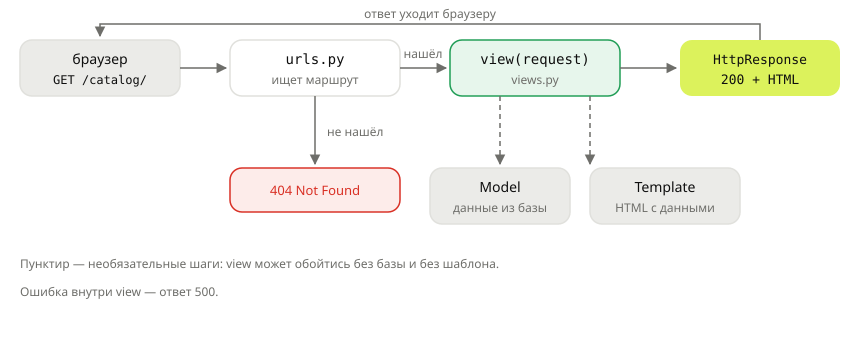

## Теория
Покупатель открывает `https://shop.example/catalog/`. Браузер отправляет на сервер HTTP-запрос `GET /catalog/`, а в ответ ждёт HTML-страницу. Собрать эту страницу — работа backend. **Django** — фреймворк на Python, который берёт на себя всё общее для любого сайта: разбор запроса, выбор кода по адресу, шаблоны, работу с базой, формы, пользователей, защиту. Разработчику остаётся написать то, что отличает магазин от блога.

Код Django-проекта делится по ролям — схема **MTV**:
- **Model** (модель) — данные и правила работы с ними: товар, заказ, покупатель. Модель описывает таблицу базы данных, а Django сам пишет для неё SQL (раздел «Модели»);
- **Template** (шаблон) — как выглядит страница: HTML с местами для данных (раздел «Шаблоны»);
- **View** (представление) — функция, которая получает запрос и возвращает ответ: берёт данные, передаёт их в шаблон, решает, что ответить.

Кроме них есть **URLconf** — файл `urls.py` со списком маршрутов «адрес → view». Путь запроса всегда один:
1. Django получает запрос и превращает его в объект `request` (метод, адрес, параметры, cookies);
2. ищет в `urls.py` первый маршрут, который подходит к адресу. Не подошёл ни один — ответ **404**;
3. вызывает view этого маршрута и передаёт ей `request`;
4. view при необходимости берёт данные из моделей и собирает HTML из шаблона;
5. view возвращает объект ответа (`HttpResponse`), Django отправляет его браузеру.

Если view упала с ошибкой — ответ **500**. Пока проект в разработке (`DEBUG = True`), Django показывает на этих страницах подробности: список маршрутов, traceback. Покупатель на настоящем сайте видит короткую страницу без деталей.

В тренажёре Django работает прямо в браузере: файлы приложения — на вкладках, адрес — в строке запроса, а в ответе видно статус, шаблон, HTML страницы и SQL-запросы к базе.

## Наглядно
**Рисунок 1.** Путь запроса в Django: от адреса до готового ответа.



**Таблица 1.** Кто за что отвечает.

| Часть | Файл | Отвечает на вопрос |
|---|---|---|
| URLconf | `urls.py` | какая view обработает этот адрес? |
| View | `views.py` | что ответить на запрос? |
| Model | `models.py` | какие данные есть и как их получить? |
| Template | `templates/…/*.html` | как страница выглядит? |

## На практике
Задача: сделать страницу каталога `/catalog/` и посмотреть, что Django делает с запросами к ней и к адресу, которого нет. Данные пока — список в коде, модели появятся позже.

### Шаг 1. Маршрут
В `urls.py` — список `urlpatterns`. Маршрут связывает адрес `catalog/` (без начального `/`) с функцией `catalog` из `views.py`:

Файл `urls.py`:
```python
from django.urls import path

from . import views

urlpatterns = [
    path("catalog/", views.catalog),
]
```

### Шаг 2. View
View получает `request` и возвращает ответ. `render` собирает HTML из шаблона и словаря с данными — **контекста**:

Файл `views.py`:
```python
from django.shortcuts import render

PRODUCTS = [
    {"name": "Беспроводная мышь", "price": 1499},
    {"name": "Коврик для мыши", "price": 490},
]


def catalog(request):
    context = {"products": PRODUCTS}
    return render(request, "shop/catalog.html", context)
```

### Шаг 3. Шаблон
HTML с местами для данных: `{{ … }}` выводит значение, `` повторяет кусок для каждого товара (подробно — в разделе «Шаблоны»):

Файл `templates/shop/catalog.html`:
```html
<h1>Каталог</h1>
<ul>
  
    <li>{{ product.name }} — {{ product.price }} ₽</li>
  
</ul>
```

### Шаг 4. Запрос
Отправляем `GET /catalog/` из строки запроса тренажёра.

Результат:
```
GET /catalog/ → 200 OK
Content-Type: text/html; charset=utf-8
Шаблон: shop/catalog.html
SQL-запросов: 0

<h1>Каталог</h1>
<ul>

    <li>Беспроводная мышь — 1499 ₽</li>

    <li>Коврик для мыши — 490 ₽</li>

</ul>
```
Пустые строки остались на месте тегов `` и `` — браузер их не показывает. SQL-запросов нет: данные взяты из списка в коде, а не из базы.

### Шаг 5. Адрес, которого нет
Отправляем `GET /about/` — такого маршрута нет.

Результат (текст страницы, сокращён):
```
GET /about/ → 404 Not Found

Page not found (404)
Using the URLconf defined in shop.urls,
Django tried these URL patterns, in this order:
    catalog/
The current path, about/, didn't match any of these.
```
Django перебрал маршруты по порядку и не нашёл подходящего — view не вызывалась вовсе. Список маршрутов показывается только при `DEBUG = True`.

### Шаг 6. Адрес без слеша
Отправляем `GET /catalog` — без `/` в конце.

Результат:
```
GET /catalog → 301 Moved Permanently
Location: /catalog/
```
Маршрута `catalog` без слеша нет, но есть `catalog/`, и Django перенаправляет браузер туда (настройка `APPEND_SLASH`, включена по умолчанию). Браузер сам откроет `/catalog/`.

## Частые ошибки
- **Слеш в начале маршрута.** `path("/catalog/", …)` не совпадёт ни с одним запросом: Django сравнивает адрес без начального `/`. Пишут `path("catalog/", …)`.
- **Функция view вызвана в маршруте.** `path("catalog/", views.catalog())` вызывает view при загрузке `urls.py`, без запроса, — Django упадёт. В маршрут передают саму функцию: `views.catalog`.
- **«Страница не открывается» — а маршрут не добавлен.** View написана, но в `urlpatterns` её нет: Django о ней не знает и отвечает 404.
- **Код в шаблоне.** Расчёты, запросы к базе и решения — во view; шаблон только показывает готовые данные.
- **Подробные страницы ошибок на настоящем сайте.** `DEBUG = True` показывает всем маршруты и куски кода — на сервере всегда `DEBUG = False` (раздел «Настройки и безопасность»).

## Итог
**MTV**
- Model — данные, Template — вид страницы, View — что ответить на запрос.
- `urls.py` связывает адреса с view.

**Путь запроса**
- Запрос → первый подходящий маршрут в `urls.py` → view(`request`) → данные и шаблон → `HttpResponse` → браузер.
- Маршрут не найден — 404; ошибка во view — 500.

**Тренажёр**
- Файлы приложения — вкладками, адрес — в строке запроса; в ответе — статус, шаблон, HTML и SQL.

## Вопросы на собеседовании
<details><summary>Что такое MTV в Django и чем отличается от MVC?</summary>

Model — данные, Template — представление страницы, View — логика обработки запроса. Это та же идея, что MVC, с другими названиями: «контроллер» MVC в Django — view и URLconf, а «представление» MVC — шаблон. Часть работы контроллера (разбор запроса, выбор кода по адресу) делает сам фреймворк.
</details>

<details><summary>Что происходит, когда Django получает запрос?</summary>

Запрос проходит middleware, затем Django ищет в URLconf первый подходящий маршрут и вызывает его view с объектом `request`. View возвращает `HttpResponse` (обычно собранный из шаблона), ответ проходит middleware в обратном порядке и уходит клиенту. Нет маршрута — 404, исключение во view — 500.
</details>

<details><summary>Что такое view?</summary>

Вызываемый объект — функция или класс, — который принимает `HttpRequest` и возвращает `HttpResponse`. Внутри — логика страницы: получить данные, проверить права, обработать форму, выбрать шаблон или вернуть JSON, редирект, ошибку.
</details>

## Глубже
Маршруты с параметрами и `include` — раздел «URL и представления». Что такое middleware и в каком порядке оно работает — раздел «Цикл запроса изнутри».
