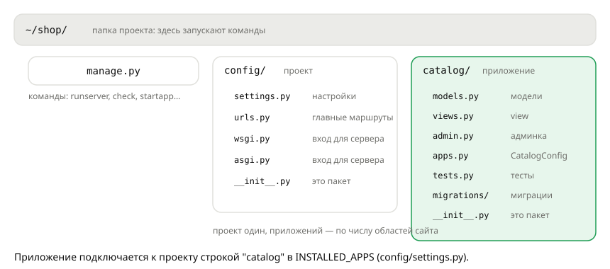

## Теория
Django-сайт состоит из двух уровней. **Проект** — сайт целиком: настройки, главный список маршрутов, точка запуска. **Приложение** — отдельная часть сайта со своими моделями, view и шаблонами: `catalog` (каталог), `orders` (заказы), `accounts` (покупатели). Проект один, приложений — сколько угодно; хорошее приложение отвечает за одну область и его можно понять отдельно от остальных. Готовые приложения Django — админка, пользователи, сессии — подключаются так же, как ваши.

Проект создаёт команда `django-admin startproject`, приложение — `python manage.py startapp`. Ставят Django в виртуальное окружение (`pip install django`, курс «Терминал и Git»). После создания проекта рядом лежит `manage.py` — программа для всех команд проекта: `runserver` запускает сервер разработки, `check` проверяет проект, `startapp` создаёт приложение; позже появятся `migrate`, `createsuperuser`, `shell`.

Главный файл проекта — **`settings.py`**, обычный модуль Python с настройками:
- `INSTALLED_APPS` — подключённые приложения. Новое приложение **нужно добавить сюда**, иначе Django не увидит его модели, шаблоны и админку;
- `DATABASES` — какая база: по умолчанию SQLite-файл `db.sqlite3`, в магазине — PostgreSQL;
- `SECRET_KEY` — ключ для подписи cookies и токенов; `DEBUG` — режим разработки с подробными ошибками; `ALLOWED_HOSTS` — домены, на которые сайт отвечает (на сервере обязательно);
- `ROOT_URLCONF` — главный `urls.py`; `TEMPLATES`, `STATIC_URL`, `LANGUAGE_CODE`, `TIME_ZONE` — шаблоны, статика, язык и часовой пояс.

`runserver` — только для разработки: он перезапускается при каждом изменении кода, но медленный и небезопасный. На сервере Django работает под Gunicorn (раздел «Настройки и безопасность»).

В тренажёре сайта проект уже собран: одно приложение `shop`, настройки задаёт тренажёр, команд `manage.py` нет. Ниже — как это выглядит на вашем компьютере.

## Наглядно
**Рисунок 1.** Структура проекта после `startproject config .` и `startapp catalog`.



**Таблица 1.** Файлы проекта и приложения.

| Файл | Что в нём |
|---|---|
| `manage.py` | запуск команд проекта |
| `config/settings.py` | настройки |
| `config/urls.py` | главный список маршрутов |
| `config/wsgi.py`, `asgi.py` | точка входа для сервера в продакшене |
| `catalog/models.py` | модели приложения |
| `catalog/views.py` | view приложения |
| `catalog/admin.py` | настройка админки |
| `catalog/apps.py` | описание приложения (`CatalogConfig`) |
| `catalog/migrations/` | миграции — изменения структуры базы |
| `catalog/tests.py` | тесты приложения |

## На практике
Задача: создать проект магазина с приложением `catalog`, запустить его и подключить приложение.

### Шаг 1. Проект
В папке проекта с активированным окружением:
```bash
pip install django
django-admin startproject config .
```
Точка в конце — создать проект в текущей папке, а не во вложенной. Пакет настроек назван `config`: так сразу видно, что в нём, — в отличие от второй папки с именем проекта.

### Шаг 2. Приложение
Команды:
```bash
python manage.py startapp catalog
python manage.py check
```
Результат:
```
System check identified no issues (0 silenced).
```
`check` проверяет настройки, модели и маршруты, не запуская сервер. Получилась структура с рисунка 1.

### Шаг 3. Сервер разработки
Команды:
```bash
python manage.py runserver
```
Результат:
```
Watching for file changes with StatReloader
Performing system checks...

System check identified no issues (0 silenced).

You have 18 unapplied migration(s). Your project may not work properly until you apply the migrations for app(s): admin, auth, contenttypes, sessions.
Run 'python manage.py migrate' to apply them.
November 18, 2026 - 18:11:35
Django version 5.2.18, using settings 'config.settings'
Starting development server at http://127.0.0.1:8000/
Quit the server with CONTROL-C.

WARNING: This is a development server. Do not use it in a production setting. Use a production WSGI or ASGI server instead.
For more information on production servers see: https://docs.djangoproject.com/en/5.2/howto/deployment/
```
Дата и время в выводе будут вашими. Сайт открывается по `http://127.0.0.1:8000/` — пока это страница-приветствие Django. Сервер следит за файлами и перезапускается при изменениях; остановить — `Ctrl+C`. Предупреждение о миграциях — встроенным приложениям нужны таблицы в базе (раздел «Миграции и админка»).

### Шаг 4. Подключить приложение
Добавляем `catalog` в `INSTALLED_APPS` и ставим русский язык и московское время:

Файл `config/settings.py` (фрагмент):
```python
INSTALLED_APPS = [
    "django.contrib.admin",
    "django.contrib.auth",
    "django.contrib.contenttypes",
    "django.contrib.sessions",
    "django.contrib.messages",
    "django.contrib.staticfiles",
    "catalog",
]

LANGUAGE_CODE = "ru"
TIME_ZONE = "Europe/Moscow"
```
`"catalog"` — имя пакета приложения; можно писать и полный путь к его описанию `"catalog.apps.CatalogConfig"`.

### Шаг 5. Опечатка в имени
Если ошибиться в имени (`"catalgo"`), проект не запустится вовсе:
```bash
python manage.py check
```
Результат (конец вывода):
```
ModuleNotFoundError: No module named 'catalgo'
```
`INSTALLED_APPS` — это имена модулей Python: Django импортирует каждый при старте.

## Частые ошибки
- **Приложение не добавлено в `INSTALLED_APPS`.** Модели не попадают в миграции, шаблоны приложения не находятся (`TemplateDoesNotExist`), админка его не видит.
- **Весь сайт в одном приложении.** Через полгода `views.py` на тысячу строк. Приложение — на одну область: каталог, заказы, покупатели.
- **`startproject shop` без точки.** Получается `shop/shop/settings.py` — две папки с одинаковым именем, легко запутаться в импортах.
- **`SECRET_KEY` и пароль базы прямо в `settings.py`.** Файл попадает в git; секреты берут из переменных окружения.
- **`runserver` на сервере.** Сервер разработки не рассчитан на нагрузку и безопасность — в продакшене Gunicorn или uvicorn.

## Итог
**Проект и приложения**
- Проект — сайт целиком: настройки и главный `urls.py`; приложение — одна область со своими моделями, view и шаблонами.
- `django-admin startproject config .`, `python manage.py startapp catalog`.

**settings.py**
- `INSTALLED_APPS` — новое приложение добавляем обязательно.
- `DATABASES`, `SECRET_KEY`, `DEBUG`, `ALLOWED_HOSTS`, `LANGUAGE_CODE`, `TIME_ZONE`.

**manage.py**
- `runserver` — сервер разработки, `check` — проверка проекта, `startapp` — новое приложение.

## Вопросы на собеседовании
<details><summary>Чем проект Django отличается от приложения?</summary>

Проект — конфигурация сайта целиком: настройки, корневой URLconf, точки входа WSGI/ASGI. Приложение — пакет Python с моделями, view, шаблонами и миграциями для одной области; его подключают в `INSTALLED_APPS` и при желании переносят в другой проект. Один проект — много приложений, включая встроенные (`admin`, `auth`).
</details>

<details><summary>Зачем нужен `INSTALLED_APPS`?</summary>

Это реестр приложений: Django импортирует их при старте, ищет в них модели (для миграций и ORM), шаблоны и статику (`APP_DIRS`), команды `manage.py`, регистрацию в админке. Приложение без записи в `INSTALLED_APPS` для Django не существует.
</details>

<details><summary>Почему `runserver` нельзя использовать в продакшене?</summary>

Это однопроцессный сервер для разработки: без оптимизаций, без защиты, с автоперезапуском и отдачей статики. Его не проверяли на безопасность и нагрузку — об этом прямо пишет сам Django при запуске. В продакшене приложение запускают через WSGI/ASGI-сервер (Gunicorn, uvicorn) за Nginx.
</details>

## Глубже
Настройки для разработки и продакшена, переменные окружения и `check --deploy` — раздел «Настройки и безопасность». Как устроен WSGI — тема «Django в продакшене».
