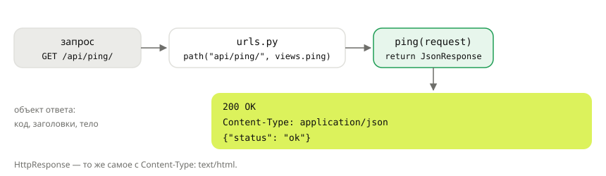

## Теория
Страница в Django — это **маршрут** плюс **view**. Маршрут создаёт функция `path(адрес, view)` в списке `urlpatterns` файла `urls.py`. View — обычная функция Python: первый параметр — объект запроса `request`, а вернуть она обязана **объект ответа**. Строка, словарь или `None` ответом не считаются.

Ответы бывают разные:
- **`HttpResponse(текст)`** — ответ с текстом, по умолчанию HTML: заголовок `Content-Type: text/html; charset=utf-8`, код 200. Подходит для самой простой страницы; настоящие страницы собирают из шаблонов через `render` (раздел «Шаблоны»), и он тоже возвращает `HttpResponse`;
- **`JsonResponse(словарь)`** — ответ в формате JSON для программ: мобильного приложения, JavaScript на странице, другого сервиса. Сам превращает словарь в JSON и ставит `Content-Type: application/json`. Список вместо словаря он примет, только если передать `safe=False`: так Django защищает от старой уязвимости браузеров с JSON-массивами. Русские буквы по умолчанию записываются кодами `\u…` — это правильный JSON, а читаемый вид даёт `json_dumps_params={"ensure_ascii": False}`;
- **код ответа** задаёт параметр `status`: `JsonResponse({...}, status=404)`, `HttpResponse("Создано", status=201)`.

Заголовок `Content-Type` важен: по нему браузер и программы понимают, что пришло. Строка с JSON внутри `HttpResponse` для них — всё ещё HTML.

## Наглядно
**Рисунок 1.** Маршрут связывает адрес с view, view возвращает объект ответа с кодом, заголовками и телом.



**Таблица 1.** Что может вернуть view.

| Вернули | Что получит клиент |
|---|---|
| `HttpResponse("<h1>…</h1>")` | 200, `text/html`, HTML |
| `HttpResponse("…", status=201)` | 201 с тем же HTML |
| `JsonResponse({"status": "ok"})` | 200, `application/json`, `{"status": "ok"}` |
| `JsonResponse([...])` | ошибка `TypeError` — нужен `safe=False` |
| `JsonResponse({...}, status=404)` | 404 с JSON-телом |
| словарь, строку, `None` | ошибка 500: это не объект ответа |

## На практике
Задача: сделать страницу «О магазине» и служебный адрес `/api/ping/`, по которому мониторинг проверяет, что сайт жив.

### Шаг 1. Две view и два маршрута
Файл `views.py`:
```python
from django.http import HttpResponse, JsonResponse


def about(request):
    return HttpResponse("<h1>О магазине</h1><p>Работаем с 2025 года.</p>")


def ping(request):
    return JsonResponse({"status": "ok"})
```

Файл `urls.py`:
```python
from django.urls import path

from . import views

urlpatterns = [
    path("about/", views.about),
    path("api/ping/", views.ping),
]
```

### Шаг 2. Запросы
Отправляем `GET /about/` и `GET /api/ping/`.

Результат:
```
GET /about/ → 200 OK
Content-Type: text/html; charset=utf-8

<h1>О магазине</h1><p>Работаем с 2025 года.</p>

GET /api/ping/ → 200 OK
Content-Type: application/json

{"status": "ok"}
```
Тело одно и то же по сути — текст, но `Content-Type` разный: мониторинг по нему понимает, что пришёл JSON.

### Шаг 3. JSON строкой
Частая попытка: `return HttpResponse('{"status": "ok"}')`.

Результат:
```
GET /api/ping/ → 200 OK
Content-Type: text/html; charset=utf-8

{"status": "ok"}
```
Текст похож на JSON, но заголовок говорит «HTML». Программа, которая ждёт `application/json`, такой ответ не примет.

### Шаг 4. View вернула словарь
Ещё одна попытка — вернуть словарь прямо: `return {"status": "ok"}`.

Результат в тренажёре:
```
GET /api/ping/ → 500 Internal Server Error

AttributeError: 'dict' object has no attribute 'status_code'
```
Django и middleware работают с ответом как с объектом `HttpResponse`: читают `status_code`, заголовки. У словаря их нет — ошибка 500. В вашем проекте имя атрибута в сообщении может быть другим (`'headers'`): его называет первый, кто обратился к ответу. Если view не вернула ничего (`None`), сообщение прямое: `ValueError: The view shop.views.ping didn't return an HttpResponse object. It returned None instead.`

### Шаг 5. Список категорий
Мобильному приложению нужен список категорий. Отдаём словарь со списком внутри и читаемыми русскими буквами:

Файл `views.py`:
```python
from django.http import JsonResponse

CATEGORIES = ["Ноутбуки", "Смартфоны", "Аксессуары"]


def categories(request):
    return JsonResponse(
        {"categories": CATEGORIES},
        json_dumps_params={"ensure_ascii": False},
    )
```
Результат (`GET /api/categories/`):
```
GET /api/categories/ → 200 OK
Content-Type: application/json

{"categories": ["Ноутбуки", "Смартфоны", "Аксессуары"]}
```
Без `json_dumps_params` тело было бы `{"categories": ["Но…"]}` — тот же JSON, но нечитаемый глазами. `JsonResponse(CATEGORIES)` со списком напрямую упадёт: `TypeError: In order to allow non-dict objects to be serialized set the safe parameter to False.`

## Частые ошибки
- **View ничего не возвращает или возвращает не ответ.** Забытый `return` даёт `None`, словарь — `AttributeError`; оба случая — 500. Каждая ветка view заканчивается `return HttpResponse(…)` / `JsonResponse(…)` / `render(…)`.
- **JSON строкой в `HttpResponse`.** Заголовок — `text/html`, клиенты не распознают JSON. Для JSON — `JsonResponse`.
- **Список в `JsonResponse`.** Без `safe=False` — `TypeError`. Обычно список заворачивают в словарь: `{"categories": [...]}` — так в ответ легко добавить поля.
- **Код 200 для ошибки.** `JsonResponse({"error": "не найден"})` без `status=404` говорит клиенту, что всё хорошо. Код ответа — часть смысла.
- **У view нет параметра `request`.** `def ping():` — Django всегда передаёт запрос и упадёт с `TypeError`.

## Итог
**Страница**
- `path("адрес/", view)` в `urlpatterns` + функция `view(request)`, которая возвращает объект ответа.

**Ответы**
- `HttpResponse(текст, status=…)` — HTML; `JsonResponse(словарь, status=…)` — JSON с `application/json`.
- Список в `JsonResponse` — `safe=False` или словарь вокруг; читаемая кириллица — `json_dumps_params={"ensure_ascii": False}`.

**Ошибки**
- Вернули не ответ — 500; нужный код ответа ставим параметром `status`.

## Вопросы на собеседовании
<details><summary>Что обязана вернуть view в Django?</summary>

Объект `HttpResponse` или его наследника: `JsonResponse`, `HttpResponseRedirect`, результат `render`. Django дальше работает с кодом, заголовками и телом этого объекта (middleware, отправка клиенту). Если view вернула что-то другое или `None`, запрос заканчивается ошибкой 500.
</details>

<details><summary>Чем `JsonResponse` отличается от `HttpResponse`?</summary>

`JsonResponse` — наследник `HttpResponse`: сериализует переданные данные в JSON (через `DjangoJSONEncoder`, который понимает `Decimal` и даты) и ставит заголовок `Content-Type: application/json`. По умолчанию принимает только словарь; для других типов нужен `safe=False`.
</details>

<details><summary>Зачем JsonResponse по умолчанию принимает только словарь?</summary>

В старых браузерах JSON-массив верхнего уровня можно было «прочитать» с чужого сайта, подключив адрес как скрипт, — так утекали данные. Объект верхнего уровня так не выполняется. Современные браузеры уязвимость закрыли, но Django сохраняет безопасное поведение по умолчанию; `safe=False` снимает ограничение явно.
</details>

## Глубже
Маршруты с параметрами (`/products/<slug>/`), `include` и имена маршрутов — раздел «URL и представления». Что лежит в `request` и как отвечать редиректом — тема «Запрос и ответ». Полноценный API — курс DRF.
