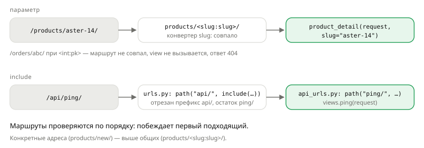

## Теория
В магазине сотни товаров, и писать маршрут на каждый никто не будет. Маршрут может содержать **параметр** — часть адреса, которая меняется: `path("products/<slug:slug>/", views.product_detail)`. Django вырезает эту часть из адреса и передаёт её во view **именованным аргументом**: запрос `/products/aster-14/` вызывает `product_detail(request, slug="aster-14")`. Имя параметра в маршруте и имя аргумента функции должны совпадать.

Перед именем стоит **конвертер** — какие значения подходят и в каком виде они попадут во view:
- `int` — целое число ≥ 0, во view приходит `int`: `orders/<int:pk>/`;
- `slug` — латинские буквы, цифры, `-` и `_`: `aster-14`. Так называют адреса товаров и статей — понятно человеку и поисковику;
- `str` (по умолчанию, если конвертер не указан) — любые символы, кроме `/`; `path` — любые, включая `/`; `uuid` — UUID.

Если значение не подходит конвертеру (`/orders/abc/` при `<int:pk>`), маршрут просто **не совпадает**, и Django ищет дальше — в итоге 404. Ошибку в view обрабатывать не нужно: туда попадает только правильное значение.

Маршруты проверяются **по порядку**, побеждает первый подходящий. Поэтому конкретные адреса ставят раньше общих: `products/new/` — до `products/<slug:slug>/`, иначе `new` станет slug товара.

Когда маршрутов много, их группируют: **`include`** подключает список маршрутов из другого модуля под общим префиксом. `path("api/", include("shop.api_urls"))` + `path("ping/", …)` внутри `api_urls.py` дают адрес `/api/ping/`. Так каждое приложение держит свои маршруты у себя, а главный `urls.py` проекта только собирает их. Для особых случаев есть **`re_path`** — маршрут регулярным выражением; нужен редко, обычно хватает конвертеров.

В тренажёре главный список маршрутов — `urls.py` приложения `shop`; свой модуль для `include` — любой файл `.py` рядом, например `api_urls.py`.

## Наглядно
**Рисунок 1.** Как маршрут с параметром разбирает адрес и как `include` склеивает префикс.



**Таблица 1.** Конвертеры маршрутов.

| Конвертер | Подходит | Не подходит | Во view |
|---|---|---|---|
| `int` | `12`, `0` | `abc`, `-1`, `1.5` | `int` |
| `slug` | `aster-14`, `wireless_mouse` | `ноутбук`, `aster 14` | `str` |
| `str` | всё без `/` | `a/b` | `str` |
| `path` | всё, включая `/` | — | `str` |
| `uuid` | `075194d3-6885-417e-a8a8-6c931e272f00` | `123` | `UUID` |

## На практике
Задача: страница товара по адресу с slug, страница заказа по номеру и отдельный список маршрутов для API. Данные пока — словари в коде.

### Шаг 1. View с параметрами
Каждая view получает параметр маршрута отдельным аргументом:

Файл `views.py`:
```python
from django.http import HttpResponse, JsonResponse

PRODUCTS = {
    "aster-14": {"name": "Ноутбук Aster 14", "price": 64990},
    "wireless-mouse": {"name": "Беспроводная мышь", "price": 1499},
}
ORDERS = {12: "оплачен", 13: "доставляется"}


def product_detail(request, slug):
    product = PRODUCTS.get(slug)
    if product is None:
        return HttpResponse("Товар не найден", status=404)
    return HttpResponse(f"<h1>{product['name']}</h1>")


def order_detail(request, pk):
    return HttpResponse(f"Заказ №{pk}: {ORDERS.get(pk, 'не найден')}")


def ping(request):
    return JsonResponse({"status": "ok"})


def api_products(request):
    return JsonResponse({"count": len(PRODUCTS)})
```
`ORDERS.get(pk)` работает, потому что `<int:pk>` передаёт число: со строкой `"12"` ключ `12` не нашёлся бы.

### Шаг 2. Маршруты и include
Маршруты API — в своём модуле, главный `urls.py` подключает его под префиксом `api/`:

Файл `api_urls.py`:
```python
from django.urls import path

from . import views

urlpatterns = [
    path("ping/", views.ping),
    path("products/", views.api_products),
]
```

Файл `urls.py`:
```python
from django.urls import include, path

from . import views

urlpatterns = [
    path("products/<slug:slug>/", views.product_detail),
    path("orders/<int:pk>/", views.order_detail),
    path("api/", include("shop.api_urls")),
]
```

### Шаг 3. Запросы
Результат:
```
GET /products/aster-14/ → 200 OK
<h1>Ноутбук Aster 14</h1>

GET /products/unknown/ → 404 Not Found
Товар не найден

GET /orders/12/ → 200 OK
Заказ №12: оплачен

GET /api/ping/ → 200 OK
{"status": "ok"}

GET /api/products/ → 200 OK
{"count": 2}
```
`unknown` — правильный slug, маршрут совпал, а 404 вернула сама view: такого товара нет в словаре.

### Шаг 4. Значение не по конвертеру
Отправляем `GET /orders/abc/`.

Результат (текст страницы, сокращён):
```
GET /orders/abc/ → 404 Not Found

Django tried these URL patterns, in this order:
    products/<slug:slug>/
    orders/<int:pk>/
    api/
The current path, orders/abc/, didn't match any of these.
```
`abc` — не число, маршрут `orders/<int:pk>/` не совпал, и view даже не вызывалась. То же будет с `/products/ноутбук/`: кириллица не подходит конвертеру `slug`.

### Шаг 5. Порядок маршрутов
Добавляем страницу нового товара **после** маршрута со slug:

Файл `urls.py` (фрагмент):
```python
urlpatterns = [
    path("products/<slug:slug>/", views.product_detail),
    path("products/new/", views.product_new),
]
```
Результат (`GET /products/new/`):
```
GET /products/new/ → 404 Not Found
Товар не найден
```
`new` — правильный slug, поэтому сработал первый маршрут и view искала товар `new`. Маршрут `products/new/` нужно поставить выше.

## Частые ошибки
- **Имя параметра не совпадает с аргументом.** `<slug:slug>` и `def product_detail(request, product_slug)` — `TypeError: got an unexpected keyword argument 'slug'`.
- **Число без `int`.** `<pk>` передаёт строку `"12"`, и `ORDERS[pk]` не находит ключ `12`. Номера — через `<int:pk>`.
- **Общий маршрут выше конкретного.** `products/<slug:slug>/` перехватывает `products/new/`. Конкретные адреса — раньше.
- **Префикс дважды.** `path("api/", include(...))` и внутри снова `path("api/ping/", …)` дают `/api/api/ping/`. Внутри включённого модуля — адреса без префикса.
- **Кириллица в slug.** Конвертер `slug` её не принимает; адреса товаров делают латиницей (`aster-14`), русское название — в самой странице.

## Итог
**Параметры**
- `path("products/<slug:slug>/", view)` → `view(request, slug="aster-14")`; имена совпадают.
- Конвертеры: `int`, `slug`, `str` (по умолчанию), `path`, `uuid`; неподходящее значение — маршрут не совпал.

**Порядок**
- Первый подходящий маршрут побеждает: конкретные — выше общих.

**Группировка**
- `include("модуль.urls")` под префиксом; внутри — адреса без префикса.
- `re_path` — регулярное выражение для редких случаев.

## Вопросы на собеседовании
<details><summary>Как передать параметр из URL во view?</summary>

Указать его в маршруте с конвертером: `path("orders/<int:pk>/", views.order_detail)`. Django выделит часть адреса, преобразует её конвертером и передаст во view именованным аргументом `pk`. Если значение не подходит конвертеру, маршрут не совпадает.
</details>

<details><summary>Что делает `include` и зачем он нужен?</summary>

Подключает список маршрутов из другого модуля под общим префиксом: `path("api/", include("shop.api_urls"))`. Так у каждого приложения свои маршруты, главный URLconf остаётся коротким, а префикс меняется в одном месте. Django отрезает совпавший префикс и ищет остаток адреса во включённом списке.
</details>

<details><summary>Чем `path` отличается от `re_path`?</summary>

`path` описывает адрес простым шаблоном с конвертерами (`<int:pk>`), `re_path` — регулярным выражением с именованными группами (`(?P<year>[0-9]{4})`). `path` читается проще и покрывает почти все случаи; `re_path` нужен для особых форматов. Можно также написать свой конвертер для `path`.
</details>

## Глубже
Как ссылаться на маршруты, не повторяя адреса в коде, — тема «Имена маршрутов». Что ещё лежит в `request` и как вернуть 404 исключением — тема «Запрос и ответ».
