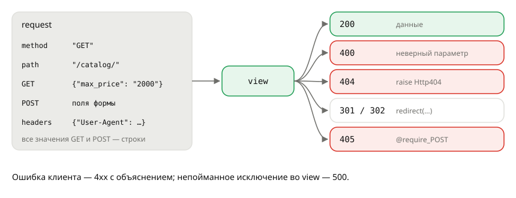

## Теория
Первый аргумент каждой view — объект **`request`** (`HttpRequest`). В нём всё, что прислал браузер:
- `request.method` — метод: `"GET"`, `"POST"`…;
- `request.path` — путь без параметров: `"/catalog/"`;
- `request.GET` — **query-параметры** из адреса (`?max_price=2000&sort=price`), `request.POST` — поля формы из тела POST-запроса;
- `request.headers` — заголовки: `request.headers["User-Agent"]`, `request.headers.get("Accept-Language")`;
- `request.COOKIES`, `request.user`, `request.session` — cookies, пользователь, сессия (позже в курсе).

`request.GET` и `request.POST` — объекты **`QueryDict`**, похожие на словарь, но с особенностями. Все значения в них — **строки**: `?max_price=2000` даёт `"2000"`, и прежде чем сравнивать с ценой, строку переводят в число. Параметра может не быть вовсе — поэтому берут `request.GET.get("max_price")` (вернёт `None`) или с значением по умолчанию, а не `request.GET["max_price"]`: тот при отсутствии параметра падает с `MultiValueDictKeyError`, и покупатель видит 500. Один параметр может прийти несколько раз (`?tag=хит&tag=новинка`): `get` вернёт **последнее** значение, `getlist("tag")` — список всех.

Данные из запроса присылает пользователь, и они могут быть любыми. Неправильное значение (`?max_price=abc`) — ошибка клиента, на неё отвечают **400 Bad Request** с объяснением, а не падают с 500.

Ответы, которые нужны почти в каждом проекте:
- **`raise Http404("…")`** — «такого нет». Исключение можно выбросить в любом месте view, Django сам превратит его в ответ 404. Удобнее, чем собирать ответ вручную;
- **`redirect(…)`** — перенаправление: ответ с заголовком `Location`, браузер сам откроет новый адрес. Принимает имя маршрута с параметрами (`redirect("product_detail", slug=slug)`), адрес или объект. По умолчанию код **302** (временно), с `permanent=True` — **301** (навсегда, так переносят старые адреса — поисковики запомнят новый);
- **`@require_POST`** и `@require_http_methods(["GET", "POST"])` из `django.views.decorators.http` — разрешить view только нужные методы; на остальные Django ответит **405 Method Not Allowed**. Действие, которое меняет данные (очистить корзину, отменить заказ), нельзя делать по GET: такой адрес откроет и поисковый робот, и чужая страница.

## Наглядно
**Рисунок 1.** Что приходит во view и что она может вернуть.



**Таблица 1.** Коды ответа и как их получить в Django.

| Код | Когда | В Django |
|---|---|---|
| 200 OK | всё хорошо | `HttpResponse`, `JsonResponse`, `render` |
| 301 Moved Permanently | адрес переехал навсегда | `redirect(…, permanent=True)` |
| 302 Found | перейти на другую страницу (после формы) | `redirect(…)` |
| 400 Bad Request | неверные данные от клиента | `JsonResponse({...}, status=400)` |
| 404 Not Found | такого нет | `raise Http404("…")` |
| 405 Method Not Allowed | метод не разрешён | `@require_POST`, `@require_http_methods` |
| 500 Internal Server Error | ошибка в коде | непойманное исключение во view |

## На практике
Задача: фильтр каталога по цене из адреса, 404 для несуществующего товара, перенос старых адресов и очистка корзины только POST-запросом. Данные — список в коде, ответы — JSON, чтобы было видно данные.

### Шаг 1. View
Файл `views.py`:
```python
from django.http import Http404, JsonResponse
from django.shortcuts import redirect
from django.views.decorators.http import require_POST

PRODUCTS = [
    {"slug": "aster-14", "name": "Ноутбук Aster 14", "price": 64990},
    {"slug": "wireless-mouse", "name": "Беспроводная мышь", "price": 1499},
    {"slug": "mouse-pad", "name": "Коврик для мыши", "price": 490},
]
UTF8 = {"ensure_ascii": False}


def catalog(request):
    products = PRODUCTS
    max_price = request.GET.get("max_price")
    if max_price is not None:
        try:
            max_price = int(max_price)
        except ValueError:
            return JsonResponse(
                {"error": "max_price — целое число"},
                status=400, json_dumps_params=UTF8,
            )
        products = [p for p in products if p["price"] <= max_price]
    names = [p["name"] for p in products]
    return JsonResponse({"products": names}, json_dumps_params=UTF8)


def product_detail(request, slug):
    for product in PRODUCTS:
        if product["slug"] == slug:
            return JsonResponse(product, json_dumps_params=UTF8)
    raise Http404("Товар не найден")


def old_product(request, slug):
    return redirect("product_detail", slug=slug, permanent=True)


@require_POST
def cart_clear(request):
    return redirect("catalog")
```

Файл `urls.py`:
```python
from django.urls import path

from . import views

urlpatterns = [
    path("catalog/", views.catalog, name="catalog"),
    path("products/<slug:slug>/", views.product_detail, name="product_detail"),
    path("item/<slug:slug>/", views.old_product),
    path("cart/clear/", views.cart_clear, name="cart_clear"),
]
```

### Шаг 2. Параметры из адреса
Результат:
```
GET /catalog/?max_price=2000 → 200 OK
{"products": ["Беспроводная мышь", "Коврик для мыши"]}

GET /catalog/ → 200 OK
{"products": ["Ноутбук Aster 14", "Беспроводная мышь", "Коврик для мыши"]}

GET /catalog/?max_price=abc → 400 Bad Request
{"error": "max_price — целое число"}

GET /catalog/?max_price=2000&max_price=500 → 200 OK
{"products": ["Коврик для мыши"]}
```
Без параметра фильтр не применяется. Неверное значение — 400 с объяснением, а не 500. Если параметр пришёл дважды, `get` взял последнее значение — `500`.

### Шаг 3. Товара нет
Отправляем `GET /products/unknown/`.

Результат (текст страницы, сокращён):
```
GET /products/unknown/ → 404 Not Found

Page not found (404)
Товар не найден
Raised by: shop.views.product_detail
The current path, products/unknown/, matched the last one.
```
Маршрут совпал, view выбросила `Http404` — Django показывает текст исключения и какая view его выбросила. При `DEBUG = False` покупатель увидит обычную страницу 404 без деталей.

### Шаг 4. Редиректы и методы
Результат:
```
GET /item/aster-14/ → 301 Moved Permanently
Location: /products/aster-14/

GET /cart/clear/ → 405 Method Not Allowed
Allow: POST

POST /cart/clear/ → 302 Found
Location: /catalog/
```
Старый адрес переехал навсегда — 301. Очистить корзину GET-запросом нельзя: 405 и заголовок `Allow` со списком разрешённых методов. После POST — редирект 302 обратно в каталог. В тренажёре по редиректу можно перейти кнопкой «Перейти».

## Частые ошибки
- **`request.GET["…"]` для необязательного параметра.** Нет параметра — `MultiValueDictKeyError` и 500. Берите `.get("…")` или `.get("…", значение_по_умолчанию)`.
- **Сравнивать строку с числом.** `p["price"] <= request.GET.get("max_price")` — `TypeError: '<=' not supported between instances of 'int' and 'str'`. Значения из запроса — строки, их переводят (`int`, `Decimal`) и ловят `ValueError`.
- **500 на неверные данные.** `int("abc")` без `try` — ошибка сервера, хотя ошиблась сторона клиента. Ответ — 400 с понятным текстом.
- **Изменение данных по GET.** Ссылка `/cart/clear/` очистит корзину, если её откроет кто угодно — превью в мессенджере, робот, чужая страница. Такие view — `@require_POST`.
- **`get` вместо `getlist` для повторяющихся параметров.** Из `?tag=хит&tag=новинка` `get` вернёт только последнее значение.

## Итог
**request**
- `method`, `path`, `GET`, `POST`, `headers`, `COOKIES`.
- `QueryDict`: значения — строки; `.get()` — без ошибки при отсутствии, последнее значение; `.getlist()` — все.

**Неверные данные**
- Ошибка клиента — 400 с объяснением, а не 500.

**Ответы**
- `raise Http404("…")` — 404 из любого места view.
- `redirect(имя, **параметры)` — 302; `permanent=True` — 301.
- `@require_POST` / `@require_http_methods` — 405 на другие методы; изменения данных — только POST.

## Вопросы на собеседовании
<details><summary>Чем `request.GET` отличается от `request.POST`?</summary>

`request.GET` — параметры из строки запроса адреса (`?a=1`), они есть у запроса любого метода. `request.POST` — поля формы из тела POST-запроса (`application/x-www-form-urlencoded` или `multipart/form-data`). Оба — `QueryDict` со строковыми значениями. JSON из тела в `request.POST` не попадает — его читают из `request.body`.
</details>

<details><summary>Чем 301 отличается от 302 и когда что использовать?</summary>

301 — постоянное перемещение: браузеры и поисковики запоминают новый адрес (перенос страниц, смена домена). 302 — временное: следующий раз клиент снова придёт на старый адрес (редирект после отправки формы, на страницу входа). В Django: `redirect(…)` — 302, `redirect(…, permanent=True)` — 301.
</details>

<details><summary>Зачем действия, меняющие данные, разрешают только POST?</summary>

GET по смыслу безопасный: его повторяют, кэшируют, предзагружают браузеры и превью мессенджеров, открывают роботы. Если удаление или оплата работают по GET, их запустит любая ссылка, в том числе на чужом сайте. POST-формы к тому же защищены CSRF-токеном. Ограничить методы — `@require_POST` или `@require_http_methods`.
</details>

<details><summary>Что такое `QueryDict` и почему он не обычный словарь?</summary>

Словареподобный объект Django для параметров запроса. Один ключ может иметь несколько значений (`?tag=a&tag=b`): `get` и `[]` возвращают последнее, `getlist` — все. Объекты `request.GET` и `request.POST` неизменяемы; для изменения делают `copy()`.
</details>

## Глубже
Формы и обработка POST с проверкой данных — раздел «Изменение данных и формы». Как Django защищает POST-формы токеном — тема «Формы» и курс «HTML, CSS и основы веба», «Форма и CSRF».
