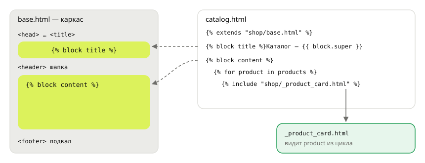

## Теория
У каждой страницы магазина одинаковые `<head>`, шапка и подвал — меняется только середина. Копировать их в каждый шаблон нельзя: при первой же правке шапки копии разойдутся (курс «HTML, CSS и основы веба», «Общие части страниц»). В Django для этого два инструмента.

**Наследование.** Общий каркас — шаблон **`base.html`** с «дырками» **`…`**. Страница начинается с **``** и заполняет только нужные блоки:
- то, что написано внутри `` в `base.html`, — содержимое **по умолчанию**: если страница блок не переопределила, останется оно;
- **`{{ block.super }}`** внутри блока страницы вставляет содержимое родительского блока — например, дописать к заголовку вкладки «— Магазин»;
- `` должен быть **первым тегом** шаблона, а всё, что в шаблоне-наследнике написано **вне блоков**, игнорируется: страница лишь заполняет блоки родителя;
- наследование может быть многоуровневым: `base.html` → `catalog_base.html` (с боковой панелью фильтров) → страницы каталога.

**Включение.** Повторяющийся кусок внутри страниц — карточку товара, форму поиска — выносят в отдельный шаблон и подключают **``**. Включённый шаблон видит весь текущий контекст (в цикле — и переменную цикла); передать дополнительные значения — ``, а с `only` — **только** их. Имена таких кусков часто начинают с `_`, чтобы отличать их от целых страниц.

Разница простая: `extends` — «эта страница построена на каркасе», `include` — «вставь сюда этот кусок». Браузер в обоих случаях получает обычный готовый HTML: шаблоны собирает сервер.

## Наглядно
**Рисунок 1.** Страница каталога наследует каркас и включает карточку товара для каждого товара.



**Таблица 1.** Теги наследования и включения.

| Тег | Где | Что делает |
|---|---|---|
| `…` | в базовом и в наследнике | место для подстановки / его заполнение |
| `` | первым тегом наследника | взять каркас родителя |
| `{{ block.super }}` | в блоке наследника | вставить содержимое блока родителя |
| `` | где угодно | вставить другой шаблон с текущим контекстом |
| `` | где угодно | передать значения; `only` — только их |

## На практике
Задача: общий каркас страниц магазина и каталог с карточкой товара как отдельным компонентом.

### Шаг 1. Каркас
Файл `templates/shop/base.html`:
```html
<!doctype html>
<html lang="ru">
<head>
  <meta charset="utf-8">
  <title>Магазин</title>
</head>
<body>
  <header><a href="/catalog/">Магазин</a></header>
  <main></main>
  <footer>© Магазин, 2026</footer>
</body>
</html>
```
Два блока: `title` со значением по умолчанию «Магазин» и пустой `content`.

### Шаг 2. Карточка — отдельный кусок
Файл `templates/shop/_product_card.html`:
```html
<article class="card">
  <h2>{{ product.name }}</h2>
  <p>{{ product.price }} ₽</p>
</article>
```
`product` придёт из контекста страницы — из цикла.

### Шаг 3. Страница каталога
Файл `templates/shop/catalog.html`:
```html


Каталог — {{ block.super }}


  <h1>Каталог</h1>
  
    
  

```
View та же, что раньше: `render(request, "shop/catalog.html", {"products": PRODUCTS})` со списком из двух товаров.

### Шаг 4. Запрос
Результат (пустые строки убраны):
```
GET /catalog/ → 200 OK
Шаблоны: shop/catalog.html, shop/base.html,
         shop/_product_card.html, shop/_product_card.html

<!doctype html>
<html lang="ru">
<head>
  <meta charset="utf-8">
  <title>Каталог — Магазин</title>
</head>
<body>
  <header><a href="/catalog/">Магазин</a></header>
  <main>
  <h1>Каталог</h1>
    <article class="card">
  <h2>Ноутбук Aster 14</h2>
  <p>64990 ₽</p>
</article>
    <article class="card">
  <h2>Беспроводная мышь</h2>
  <p>1499 ₽</p>
</article>
</main>
  <footer>© Магазин, 2026</footer>
</body>
</html>
```
`{{ block.super }}` подставил «Магазин» из родителя. Тренажёр показывает все шаблоны, из которых собран ответ: страница, каркас и карточка — по разу на товар.

### Шаг 5. Опечатка в имени блока
В `catalog.html` написали `` вместо `content`.

Результат (фрагмент):
```
GET /catalog/ → 200 OK

  <main></main>
```
Ошибки нет: блока `contents` в каркасе нет, его содержимое некуда вставить, а `content` остался пустым. Каталог исчез без следа — в списке шаблонов ответа нет `_product_card.html`.

### Шаг 6. Тег перед extends
Если в начало `catalog.html` поставить `…`, страница падает.

Результат:
```
GET /catalog/ → 500 Internal Server Error

TemplateSyntaxError:  must be the first tag in 'shop/catalog.html'.
```
А обычный текст между блоками наследника (`<p>Лучшие цены</p>` после `extends`) Django молча отбрасывает — на странице его нет.

## Частые ошибки
- **Опечатка в имени блока.** `` при `content` в каркасе — содержимое пропадает без ошибки. Сверяйте имена с `base.html`.
- **Текст вне блоков в наследнике.** Всё, что не в ``, игнорируется. Нужен новый кусок страницы — заведите блок в каркасе.
- **`extends` не первым тегом.** `TemplateSyntaxError … must be the first tag`. Перед ним допустимы только текст и комментарии; даже `` пишут после `extends`.
- **Копия карточки на каждой странице.** Изменили карточку в каталоге — в корзине старая. Повторяющийся кусок — в отдельный шаблон и `include`.
- **Включаемый кусок зависит от «случайного» контекста.** Карточка рассчитывает на переменную `product`, а на другой странице она называется `item`. Передайте явно: ``.

## Итог
**Наследование**
- `base.html` с ``; страница — `` первым тегом и свои блоки.
- Содержимое блока в каркасе — по умолчанию; `{{ block.super }}` — добавить к нему.
- Текст вне блоков в наследнике игнорируется; опечатка в имени блока — тихая пустота.

**Включение**
- `` — с текущим контекстом; `with x=… only` — явные значения.

**Когда что**
- `extends` — каркас страницы; `include` — повторяющийся кусок внутри.

## Вопросы на собеседовании
<details><summary>Как работает наследование шаблонов в Django?</summary>

Базовый шаблон объявляет блоки ``, дочерний начинается с `` и переопределяет нужные блоки. При рендеринге Django берёт базовый шаблон и подставляет в него блоки наследника; непереопределённые остаются как в базовом. `{{ block.super }}` вставляет содержимое родительского блока. Цепочка может быть многоуровневой.
</details>

<details><summary>Чем `` отличается от ``?</summary>

`extends` задаёт каркас: дочерний шаблон только заполняет блоки родителя, и тег обязан быть первым. `include` вставляет другой шаблон в текущее место и передаёт ему текущий контекст (или явный с `with … only`). Обычно страница наследует `base.html`, а повторяющиеся куски подключает через `include`.
</details>

<details><summary>Что делает `{{ block.super }}`?</summary>

Выводит содержимое того же блока в родительском шаблоне. Используется, чтобы дополнить, а не заменить: дописать заголовок вкладки, добавить свой CSS к общим стилям в блоке `head`, расширить меню.
</details>

## Глубже
Своя логика при включении — inclusion-теги: тема «Фильтры и свои теги». Общие данные для каркаса на каждой странице (число товаров в корзине в шапке) — контекст-процессоры, раздел «Цикл запроса изнутри».
