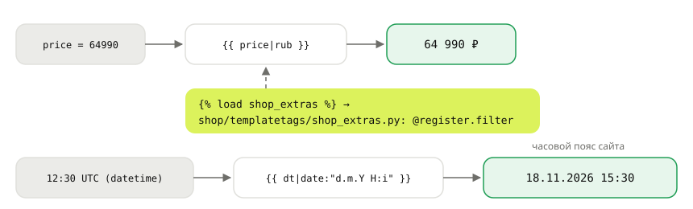

## Теория
Данные в контексте — «сырые»: цена `64990`, дата в UTC, описание пустой строкой. Показывать их покупателю в таком виде нельзя, а форматировать каждое значение во view — значит смешивать вывод с логикой. Для оформления значений в шаблоне есть **фильтры**: `{{ значение|фильтр }}` или с аргументом `{{ значение|фильтр:"аргумент" }}`. Фильтры выстраиваются в цепочку: `{{ name|lower|capfirst }}`.

Самые нужные встроенные фильтры:
- **`default:"…"`** — замена для «пустого» значения (`""`, `None`, `0`, `[]`); `default_if_none` — только для `None`;
- **`date:"d.m.Y H:i"`** — формат даты и времени. Важная деталь: при `USE_TZ = True` время хранится в UTC, а фильтр сам переводит его в часовой пояс сайта (`TIME_ZONE`). Если отформатировать дату во view через `strftime`, перевода не будет, и покупатель увидит время на 3 часа раньше московского;
- **`truncatechars:N`**, `truncatewords:N` — обрезать длинный текст (многоточие входит в длину);
- **`floatformat:1`** — округлить число; с `LANGUAGE_CODE = "ru"` дробная часть — через запятую: `4,7`;
- `length`, `join:", "`, `upper`, `lower`, `capfirst`, `linebreaksbr` (переносы строк → `<br>`, текст при этом экранируется), `yesno:"да,нет"`;
- `pluralize` — окончания только по правилам английского (`review` → `reviews`); для «1 отзыв / 3 отзыва / 5 отзывов» пишут свой фильтр.

**Свой фильтр** — обычная функция Python, зарегистрированная в библиотеке тегов. Библиотеки лежат в пакете **`templatetags`** внутри приложения: `shop/templatetags/__init__.py` (пустой) и `shop/templatetags/shop_extras.py`:
- в модуле — `register = template.Library()` и функция с декоратором `@register.filter`;
- в шаблоне библиотеку подключают тегом **``** — в каждом шаблоне, где она нужна (подключение не наследуется через `extends`);
- без `` — `TemplateSyntaxError: Invalid filter: 'rub'`.

Кроме фильтров, в библиотеке можно объявить свои теги: `@register.simple_tag` — тег, который возвращает значение (``), `@register.inclusion_tag("shop/_menu.html")` — тег, который рендерит кусок шаблона со своим контекстом. Сервер разработки нужно перезапустить после создания папки `templatetags` — новые библиотеки он находит только при старте.

## Наглядно
**Рисунок 1.** Значение проходит цепочку фильтров; свой фильтр — функция из библиотеки, подключённой ``.



**Таблица 1.** Встроенные фильтры, которые нужны чаще всего.

| Запись | Было | Стало |
|---|---|---|
| `{{ d|default:"Описания пока нет" }}` | `""` | `Описания пока нет` |
| `{{ dt|date:"d.m.Y H:i" }}` | `2026-11-18 12:30 UTC` | `18.11.2026 15:30` |
| `{{ s|truncatechars:20 }}` | `Ноутбук Aster 14 с экраном…` (длинный) | `Ноутбук Aster 14 с …` |
| `{{ r|floatformat:1 }}` | `4.666` | `4,7` |
| `{{ tags|join:", " }}` | `["хит", "новинка"]` | `хит, новинка` |
| `{{ text|linebreaksbr }}` | `"Лёгкий.\nБатареи…"` | `Лёгкий.<br>Батареи…` |
| `{{ name|capfirst }}` | `ноутбук aster 14` | `Ноутбук aster 14` |

## На практике
Задача: карточка товара — заголовок с заглавной буквы, замена пустого описания, дата в московском времени, короткое название, а цена — в формате «64 990 ₽» своим фильтром.

### Шаг 1. Встроенные фильтры
View передаёт значения как есть, дата — в UTC:

Файл `views.py`:
```python
from datetime import datetime, timezone

from django.shortcuts import render


def product(request):
    context = {
        "name": "ноутбук aster 14",
        "description": "",
        "rating": 4.666,
        "tags": ["хит", "новинка"],
        "price": 64990,
        "text": "Лёгкий.\nБатареи хватает на день.",
        "created_at": datetime(2026, 11, 18, 12, 30, tzinfo=timezone.utc),
        "long": "Ноутбук Aster 14 с экраном 14 дюймов и подсветкой клавиатуры",
    }
    return render(request, "shop/product.html", context)
```

Файл `templates/shop/product.html`:
```html
<h1>{{ name|capfirst }}</h1>
<p>{{ description|default:"Описания пока нет" }}</p>
<p>Оценка: {{ rating|floatformat:1 }}</p>
<p>Метки: {{ tags|join:", " }} ({{ tags|length }})</p>
<p>Добавлен: {{ created_at|date:"d.m.Y H:i" }}</p>
<p>{{ long|truncatechars:20 }}</p>
<p>{{ text|linebreaksbr }}</p>
```
Результат:
```
GET /product/ → 200 OK

<h1>Ноутбук aster 14</h1>
<p>Описания пока нет</p>
<p>Оценка: 4,7</p>
<p>Метки: хит, новинка (2)</p>
<p>Добавлен: 18.11.2026 15:30</p>
<p>Ноутбук Aster 14 с …</p>
<p>Лёгкий.<br>Батареи хватает на день.</p>
```
12:30 UTC превратились в 15:30 по Москве. В обрезанном названии ровно 20 символов вместе с «…».

### Шаг 2. Дата через strftime
Если во view отформатировать дату заранее — `created_at.strftime("%d.%m.%Y %H:%M")` — и вывести строку `{{ created_at }}`, результат будет `18.11.2026 12:30`. Строку шаблон уже не переводит в часовой пояс сайта: покупатель видит время UTC. Даты передают в шаблон объектами `datetime`, а форматируют фильтром `date`.

### Шаг 3. Свой фильтр цены
Пакет `templatetags` с пустым `__init__.py` и библиотекой:

Файл `templatetags/shop_extras.py`:
```python
from django import template

register = template.Library()


@register.filter
def rub(value):
    return f"{value:,} ₽".replace(",", "\u00a0")
```
Запятые-разделители тысяч заменяются неразрывным пробелом `\u00a0` — число не разорвётся на две строки.

Файл `templates/shop/product.html`:
```html

<p>{{ price|rub }}</p>
```
Результат:
```
GET /product/ → 200 OK

<p>64 990 ₽</p>
```

### Шаг 4. Забыли load
Без строки `` шаблон не знает фильтра.

Результат:
```
GET /product/ → 500 Internal Server Error

TemplateSyntaxError: Invalid filter: 'rub'
```

## Частые ошибки
- **`default_if_none` для пустой строки.** Пустое описание `""` — не `None`, замена не сработает. Для «любого пустого» — `default`.
- **Дата строкой из view.** `strftime` во view — время UTC без перевода в часовой пояс сайта. Передавайте `datetime`, форматируйте фильтром `date`.
- **Забытый ``.** `Invalid filter` или `Invalid block tag`. Библиотеку подключают в каждом шаблоне, где она используется, — `extends` её не передаёт.
- **Пробел вокруг двоеточия.** `{{ s|truncatechars: 20 }}` — `TemplateSyntaxError`. Аргумент пишут вплотную: `truncatechars:20`.
- **`pluralize` для русского.** Получится «3 отзывs». Русские окончания — свой фильтр.

## Итог
**Фильтры**
- `{{ x|фильтр }}`, `{{ x|фильтр:"арг" }}`, цепочки `{{ x|lower|capfirst }}`.
- `default`, `date`, `truncatechars`, `floatformat`, `join`, `length`, `linebreaksbr`.
- `date` переводит время в часовой пояс сайта; строки из `strftime` — нет.

**Свой фильтр**
- `templatetags/__init__.py` + модуль с `register = template.Library()` и `@register.filter`.
- `` в каждом шаблоне; без него — `Invalid filter`.
- Свои теги: `@register.simple_tag`, `@register.inclusion_tag`.

## Вопросы на собеседовании
<details><summary>Как написать свой фильтр шаблона?</summary>

В приложении создать пакет `templatetags` (с `__init__.py`) и модуль, например `shop_extras.py`; в нём `register = template.Library()` и функцию с `@register.filter`, которая получает значение (и, если нужно, один аргумент) и возвращает результат. В шаблоне — `` и `{{ value|имя_фильтра }}`. Приложение должно быть в `INSTALLED_APPS`.
</details>

<details><summary>Чем фильтр отличается от тега?</summary>

Фильтр преобразует одно значение (`{{ price|rub }}`) и принимает не больше одного аргумента. Тег — `` — может принимать много аргументов, управлять выводом (`for`, `if`), работать с контекстом; свои теги — `simple_tag` (возвращает значение) и `inclusion_tag` (рендерит шаблон).
</details>

<details><summary>Почему время в шаблоне отличается от времени в базе?</summary>

При `USE_TZ = True` Django хранит время в UTC, а при выводе в шаблоне переводит его в текущий часовой пояс (`TIME_ZONE` или активированный для пользователя). Если отформатировать время в Python без `timezone.localtime`, перевода не будет — выведется UTC.
</details>

## Глубже
Часовые пояса и `timezone.now()` в моделях — раздел «Модели». Как данные попадают во все шаблоны сразу (число товаров в корзине в шапке) — контекст-процессоры, раздел «Цикл запроса изнутри».
