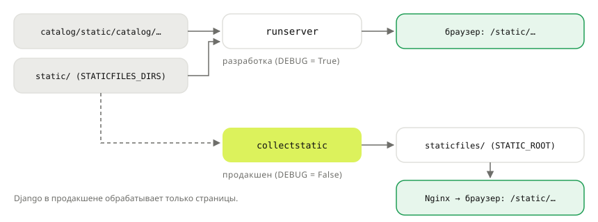

## Теория
**Статические файлы** — CSS, JavaScript, картинки интерфейса, шрифты: файлы, которые сайт отдаёт как есть, одинаковыми для всех. Загрузки пользователей (фото товаров, аватары) сюда не относятся — это **медиафайлы**, у них своя настройка (раздел «Изменение данных и формы»).

Где Django берёт статику:
- в папке `static/` каждого приложения из `INSTALLED_APPS` — как с шаблонами, внутри кладут подпапку с именем приложения: `catalog/static/catalog/css/shop.css`;
- в общих папках проекта из **`STATICFILES_DIRS`** — например, `static/` в корне для логотипа и общих стилей.

Адрес статики начинается со **`STATIC_URL`** (`/static/`). В шаблоне его не пишут руками, а строят тегом **``** после **``** — так же, как ссылки строят ``. Если на сервере статику перенесут на отдельный домен или CDN, поменяется одна настройка, а шаблоны — нет. Тег также подставляет «отпечатанные» имена файлов (`shop.3f2a9c.css`), если они включены, — чтобы браузер не держал в кэше старую версию стилей.

**Кто отдаёт файлы.** При `DEBUG = True` `runserver` отдаёт статику сам — удобно в разработке. В продакшене Django этим не занимается: команда **`collectstatic`** собирает файлы из всех `static/` и `STATICFILES_DIRS` в одну папку **`STATIC_ROOT`**, а отдаёт их Nginx — быстро и без участия Python (курс «Nginx и деплой»). Без `STATIC_ROOT` `collectstatic` не запустится.

В тренажёре сайта статических файлов нет: `` строит правильные адреса, но сами файлы по ним не отдаются (404).

## Наглядно
**Рисунок 1.** В разработке статику отдаёт runserver из папок `static/`, в продакшене `collectstatic` собирает её в `STATIC_ROOT`, а отдаёт Nginx.



**Таблица 1.** Настройки и команды статики.

| Настройка / команда | Что задаёт / делает |
|---|---|
| `STATIC_URL = "static/"` | начало адресов статики |
| `<приложение>/static/<приложение>/…` | статика приложения (ищется автоматически) |
| `STATICFILES_DIRS = [BASE_DIR / "static"]` | дополнительные папки проекта |
| `STATIC_ROOT = BASE_DIR / "staticfiles"` | куда `collectstatic` собирает всё для продакшена |
| `` + `` | адрес файла в шаблоне |
| `python manage.py collectstatic` | скопировать статику в `STATIC_ROOT` |
| `python manage.py findstatic путь` | где лежит файл-источник |

## На практике
Задача: подключить стили каталога и логотип в шаблоне и подготовить статику для сервера.

### Шаг 1. Файлы
В проекте из темы «Проект и приложение»: стили — в приложении, логотип — в общей папке проекта:
```bash
mkdir -p catalog/static/catalog/css static/img
python manage.py findstatic catalog/css/shop.css
```
Результат (путь у вас свой):
```
Found 'catalog/css/shop.css' here:
  /home/shop/shop/catalog/static/catalog/css/shop.css
```
Общую папку `static/` Django найдёт только после настройки:

Файл `config/settings.py` (фрагмент):
```python
STATIC_URL = "static/"
STATICFILES_DIRS = [BASE_DIR / "static"]
```

### Шаг 2. Шаблон
Подключаем библиотеку `static` и строим адреса тегом. Так выглядит главная в тренажёре:

Файл `templates/shop/home.html`:
```html

<link rel="stylesheet" href="">

```
Результат:
```
GET / → 200 OK

<link rel="stylesheet" href="/static/shop/css/shop.css">

```
Если убрать ``, страница падает: `TemplateSyntaxError: Invalid block tag on line 1: 'static'. Did you forget to register or load this tag?`

### Шаг 3. Сбор для сервера
Команды:
```bash
python manage.py collectstatic --noinput
```
Результат:
```
django.core.exceptions.ImproperlyConfigured: You're using the staticfiles app without having set the STATIC_ROOT setting to a filesystem path.
```
Без `STATIC_ROOT` собирать некуда. Добавляем настройку:

Файл `config/settings.py` (фрагмент):
```python
STATIC_ROOT = BASE_DIR / "staticfiles"
```
Повторяем `collectstatic --noinput`.

Результат (путь у вас свой):
```
129 static files copied to '/home/shop/shop/staticfiles'.
```
129 файлов — наши два плюс статика админки Django. В `staticfiles/` теперь папки `admin/`, `catalog/` и `img/`; её отдаёт Nginx, а в git она не попадает (`.gitignore`) — её собирают заново при каждом деплое.

## Частые ошибки
- **Адрес статики руками.** `href="/static/catalog/css/shop.css"` сломается при переносе статики на CDN и не получит «отпечатанное» имя. Только ``.
- **Забытый ``.** `Invalid block tag … 'static'`. Подключают в каждом шаблоне, где есть тег, — `extends` его не передаёт.
- **Статика без подпапки приложения.** `catalog/static/css/shop.css` и `orders/static/css/shop.css` перекроют друг друга: после `collectstatic` останется один файл.
- **`STATIC_ROOT` совпадает с папкой из `STATICFILES_DIRS`.** проверка проекта остановит запуск ошибкой `staticfiles.E002 The STATICFILES_DIRS setting should not contain the STATIC_ROOT setting.`: источник и место сборки должны быть разными.
- **Загрузки пользователей в `static/`.** Фото товаров — медиафайлы (`MEDIA_ROOT`), их не собирают `collectstatic` и не хранят в git.

## Итог
**Где лежит**
- `<приложение>/static/<приложение>/…` и папки `STATICFILES_DIRS`.

**В шаблоне**
- `` + `` → `/static/путь`.

**На сервере**
- `STATIC_ROOT` + `collectstatic` → одна папка; отдаёт Nginx.
- При `DEBUG = True` файлы отдаёт `runserver`.

## Вопросы на собеседовании
<details><summary>Как Django работает со статическими файлами в разработке и в продакшене?</summary>

В разработке приложение `staticfiles` при `DEBUG = True` отдаёт файлы через `runserver` прямо из папок `static/` приложений и `STATICFILES_DIRS`. В продакшене `collectstatic` копирует все файлы в `STATIC_ROOT`, а отдаёт их веб-сервер (Nginx) или CDN по адресу `STATIC_URL`; Django в этом не участвует.
</details>

<details><summary>Чем статические файлы отличаются от медиафайлов?</summary>

Статика — часть кода сайта (CSS, JS, иконки): лежит в репозитории, собирается `collectstatic`, настройки `STATIC_URL`/`STATIC_ROOT`. Медиа — файлы, загруженные пользователями во время работы (аватары, фото товаров): хранятся отдельно, настройки `MEDIA_URL`/`MEDIA_ROOT`, в git не попадают и требуют проверки при загрузке.
</details>

<details><summary>Зачем тег ``, если можно написать `/static/…`?</summary>

Тег строит адрес из настроек: при смене `STATIC_URL` (например, на CDN) шаблоны не меняются. С хранилищем `ManifestStaticFilesStorage` тег подставляет имя файла с хешем содержимого (`shop.3f2a9c.css`) — браузеры могут кэшировать статику надолго и всё равно получат новую версию после изменения.
</details>

## Глубже
Как Nginx отдаёт статику и почему это быстрее Django — курс «Nginx и деплой». Загрузка файлов пользователями — тема «Загрузка файлов» в разделе «Изменение данных и формы».
