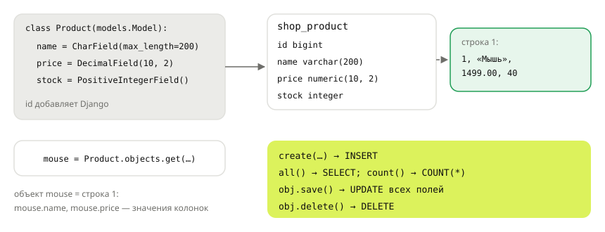

## Теория
До сих пор данные магазина жили в списках прямо в коде. Настоящие данные хранятся в базе, и в курсе SQL вы писали к ней запросы руками. В Django для этого есть **ORM** (object-relational mapping): таблицы описывают классами Python, а запросы пишут методами — SQL Django составит сам.

**Модель** — класс в `models.py`, наследник `models.Model`:
- модель = **таблица**: `Product` в приложении `shop` → таблица `shop_product` (имя приложения + имя модели строчными);
- атрибут-**поле** = **колонка**: `name = models.CharField(max_length=200)` → `"name" varchar(200) NOT NULL`;
- первичный ключ `id` Django добавляет сам (тип задаёт настройка `DEFAULT_AUTO_FIELD`, обычно `BigAutoField` → `bigint`);
- **объект** модели = **строка** таблицы: `mouse.name`, `mouse.price` — значения её колонок.

Работают с таблицей через **менеджер** `Product.objects`:
- `Product.objects.create(name=…, price=…)` — `INSERT`, возвращает созданный объект с `id`;
- `Product.objects.all()` — `SELECT` всех строк; `Product.objects.count()` — `SELECT COUNT(*)`;
- изменить объект и вызвать `obj.save()` — `UPDATE`; `obj.delete()` — `DELETE`.

Чтобы объект в консоли и в админке выглядел понятно, модели пишут метод `__str__`: без него — `Product object (1)`.

Таблицу в базе по модели создают **миграции** (`makemigrations` и `migrate`, раздел «Миграции и админка»). В тренажёре миграций нет: таблицы создаются по моделям заново при каждом запуске, а данные для задач кладёт `setup`. Для проб есть вкладка `orm.py` — строки как в `python manage.py shell`, с SQL каждого запроса.

## Наглядно
**Рисунок 1.** Модель описывает таблицу, объект — строку, менеджер `objects` превращает вызовы в SQL.



**Таблица 1.** ORM и SQL рядом.

| ORM | SQL |
|---|---|
| `class Product(models.Model)` | `CREATE TABLE "shop_product" (…)` |
| `Product.objects.create(name="Мышь", price="1499.00")` | `INSERT INTO "shop_product" … RETURNING "id"` |
| `Product.objects.all()` | `SELECT … FROM "shop_product"` |
| `Product.objects.count()` | `SELECT COUNT(*) FROM "shop_product"` |
| `mouse.stock = 39; mouse.save()` | `UPDATE "shop_product" SET … WHERE "id" = 1` |
| `mouse.delete()` | `DELETE FROM "shop_product" WHERE "id" IN (1)` |

## На практике
Задача: описать товар моделью, посмотреть, какую таблицу и какие SQL-запросы получает база, и вывести товары из базы на странице каталога.

### Шаг 1. Модель
Файл `models.py`:
```python
from django.db import models


class Product(models.Model):
    name = models.CharField(max_length=200)
    price = models.DecimalField(max_digits=10, decimal_places=2)
    stock = models.PositiveIntegerField(default=0)

    def __str__(self):
        return self.name
```
Для PostgreSQL Django создаст такую таблицу (это покажет `sqlmigrate` из раздела 5).

Результат:
```
CREATE TABLE "shop_product" ("id" bigint NOT NULL PRIMARY KEY GENERATED BY DEFAULT AS IDENTITY, "name" varchar(200) NOT NULL, "price" numeric(10, 2) NOT NULL, "stock" integer NOT NULL CHECK ("stock" >= 0));
```
Те же типы, что вы выбирали в курсе SQL: `varchar(200)`, `numeric(10, 2)` для денег, `CHECK` для неотрицательного остатка. В тренажёре база — SQLite, и типы там проще, но модель та же.

### Шаг 2. Записать и прочитать
Файл `orm.py`:
```python
mouse = Product.objects.create(name="Беспроводная мышь", price="1499.00", stock=40)
Product.objects.create(name="Коврик для мыши", price="490.00")
print(mouse.id, mouse.name, mouse.price)
print(Product.objects.count())
Product.objects.all()
```
Результат:
```
1 Беспроводная мышь 1499.00
2
<QuerySet [<Product: Беспроводная мышь>, <Product: Коврик для мыши>]>
```
SQL, которые ушли в базу:
```
INSERT INTO "shop_product" ("name", "price", "stock") VALUES ('Беспроводная мышь', '1499.00', 40) RETURNING "shop_product"."id"
INSERT INTO "shop_product" ("name", "price", "stock") VALUES ('Коврик для мыши', '490.00', 0) RETURNING "shop_product"."id"
SELECT COUNT(*) AS "__count" FROM "shop_product"
SELECT "shop_product"."id", "shop_product"."name", "shop_product"."price", "shop_product"."stock" FROM "shop_product" LIMIT 21
```
`create` сразу вернул `id` из базы. Коврику достался остаток `0` — значение по умолчанию. `LIMIT 21` — консоль показывает не больше 20 объектов. Без `__str__` в последней строке было бы `<Product: Product object (1)>`.

### Шаг 3. Изменить и удалить
Файл `orm.py` (продолжение):
```python
mouse.stock = 39
mouse.save()
mouse.delete()
```
SQL:
```
UPDATE "shop_product" SET "name" = 'Беспроводная мышь', "price" = '1499.00', "stock" = 39 WHERE "shop_product"."id" = 1
DELETE FROM "shop_product" WHERE "shop_product"."id" IN (1)
```
`save()` записывает **все** поля объекта, а не только изменённое.

### Шаг 4. Страница из базы
View берёт товары из базы вместо списка в коде:

Файл `views.py`:
```python
from django.shortcuts import render

from .models import Product


def catalog(request):
    products = Product.objects.all()
    return render(request, "shop/catalog.html", {"products": products})
```
Шаблон выводит `{{ product.name }} — {{ product.price }} ₽, на складе {{ product.stock }}` в цикле, а `setup` создаёт два товара.

Результат:
```
GET /catalog/ → 200 OK
SQL-запросов: 1

<h1>Каталог</h1>
<ul>
    <li>Беспроводная мышь — 1499,00 ₽, на складе 40</li>
    <li>Коврик для мыши — 490,00 ₽, на складе 100</li>
</ul>
```
Один `SELECT` на всю страницу. Цена в шаблоне — `1499,00`: при русском языке Django выводит дробные числа с запятой.

## Частые ошибки
- **Нет `__str__`.** В консоли, админке и выпадающих списках — `Product object (1)` вместо названия.
- **Ждать, что `save()` обновит одно поле.** Он пишет все поля объекта. Если другой запрос успел изменить строку, его изменения перезапишутся старыми значениями — точечные обновления делают `update()` и `F` (раздел «ORM: чтение данных»).
- **Модель есть, таблицы нет.** На своём проекте после изменения моделей нужны `makemigrations` и `migrate`, иначе запрос упадёт с `no such table` / `relation does not exist`.
- **Свой `id` без причины.** Django добавляет первичный ключ сам; объявлять его нужно, только если ключ особенный.
- **Имя таблицы руками в SQL.** Таблица называется `shop_product`, а не `product`; в ORM об этом думать не нужно.

## Итог
**Модель**
- Класс-наследник `models.Model` = таблица `приложение_модель`; поле = колонка; `id` добавляется сам.
- Объект = строка; `__str__` — понятное представление.

**Менеджер objects**
- `create` — INSERT, `all` — SELECT, `count` — COUNT, `save` — UPDATE всех полей, `delete` — DELETE.

**Таблицы**
- Создаются миграциями; в тренажёре — автоматически при каждом запуске.

## Вопросы на собеседовании
<details><summary>Что такое ORM и зачем он нужен?</summary>

Object-relational mapping — слой, который связывает классы языка с таблицами базы: модель — таблица, объект — строка, атрибут — колонка. Запросы пишутся методами (`filter`, `create`), а SQL составляет ORM: он экранирует значения (защита от SQL-инъекций), учитывает особенности конкретной СУБД и позволяет работать со связями как с атрибутами.
</details>

<details><summary>Как Django называет таблицу модели и первичный ключ?</summary>

Таблица — `<app_label>_<имя модели строчными>`: `shop_product`; поменять можно `Meta.db_table`. Первичный ключ, если не объявлен, — поле `id` типа из `DEFAULT_AUTO_FIELD` (обычно `BigAutoField`); обращаться к нему можно и через `pk`.
</details>

<details><summary>Что делает `save()` для нового и существующего объекта?</summary>

Для объекта без `pk` (нового) — `INSERT` и получение `id`. Для существующего — `UPDATE` всех полей по первичному ключу. Обновить только часть полей — `save(update_fields=["stock"])` или `Product.objects.filter(pk=…).update(stock=…)`.
</details>

## Глубже
Типы полей и их параметры — следующие темы. Запросы с условиями и сортировкой — раздел «ORM: чтение данных».
