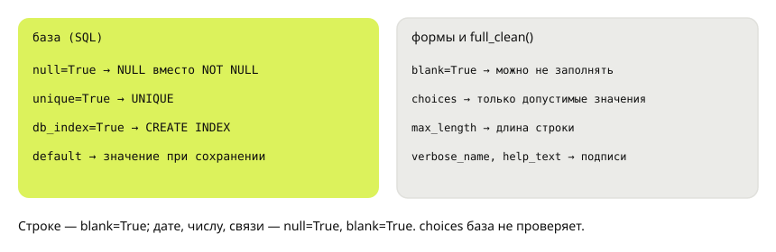

## Теория
Кроме типа, у поля есть параметры. Одни меняют таблицу в базе, другие — только проверку в формах, и их путают чаще всего.

**`null` и `blank`** — про пустые значения, но на разных уровнях:
- **`null=True`** — база: колонка может хранить `NULL` (`… NULL` вместо `NOT NULL`);
- **`blank=True`** — проверка: форма и `full_clean()` разрешают оставить поле пустым.

Для строк (`CharField`, `TextField`) пустое значение — пустая строка `""`, поэтому им дают только `blank=True`, без `null=True`. Иначе у «пустого» два вида — `NULL` и `""`, и запросы «без комментария» придётся писать дважды. Для дат, чисел и связей пустого значения, кроме `NULL`, нет: необязательное поле — `null=True, blank=True`.

Остальные параметры:
- **`default`** — значение, если его не передали. Можно передать **функцию** — она вызывается для каждого нового объекта: `default=timezone.now`. Со скобками `timezone.now()` время вычислится один раз при запуске сервера, и все объекты получат одно и то же время;
- **`unique=True`** — значение не повторяется: ограничение `UNIQUE` в базе, нарушение — `IntegrityError`;
- **`db_index=True`** — индекс на колонку для частых поисков по ней (курс SQL, «Индексы»);
- **`choices`** — допустимые значения. Удобнее всего — класс `TextChoices`: `NEW = "new", "Новый"` — в базе хранится `"new"`, людям показывается «Новый» (`order.get_status_display()`). Важно: `choices` проверяют формы и `full_clean()`, но **не база** — в колонке нет ограничения, и `save()` без проверки запишет что угодно;
- `verbose_name`, `help_text` — подпись и подсказка поля в формах и админке.

## Наглядно
**Рисунок 1.** Где работает каждый параметр: в базе или в проверке форм.



**Таблица 1.** Пустые значения по типам полей.

| Поле | Необязательное | Пустое значение |
|---|---|---|
| `CharField`, `TextField` | `blank=True` | `""` |
| `DateTimeField`, `DateField` | `null=True, blank=True` | `None` |
| `IntegerField`, `DecimalField` | `null=True, blank=True` (или `default=0`) | `None` |
| `ForeignKey` | `null=True, blank=True` | `None` |
| `BooleanField` | `default=False` | — |

## На практике
Задача: модель заказа — уникальный номер, статус из списка, необязательные комментарий, промокод и время оплаты.

### Шаг 1. Модель
Файл `models.py`:
```python
from django.db import models


class Order(models.Model):
    class Status(models.TextChoices):
        NEW = "new", "Новый"
        PAID = "paid", "Оплачен"
        SHIPPED = "shipped", "Отправлен"
        CANCELLED = "cancelled", "Отменён"

    number = models.CharField(max_length=20, unique=True)
    status = models.CharField(
        max_length=20, choices=Status, default=Status.NEW
    )
    comment = models.TextField(blank=True)
    promo_code = models.CharField(max_length=20, blank=True, db_index=True)
    paid_at = models.DateTimeField(null=True, blank=True)
```
Таблица в PostgreSQL:
```
CREATE TABLE "shop_order" ("id" bigint NOT NULL PRIMARY KEY GENERATED BY DEFAULT AS IDENTITY, "number" varchar(20) NOT NULL UNIQUE, "status" varchar(20) NOT NULL, "comment" text NOT NULL, "promo_code" varchar(20) NOT NULL, "paid_at" timestamp with time zone NULL);
CREATE INDEX "shop_order_number_d6408b6d_like" ON "shop_order" ("number" varchar_pattern_ops);
CREATE INDEX "shop_order_promo_code_0fa4f4ec" ON "shop_order" ("promo_code");
CREATE INDEX "shop_order_promo_code_0fa4f4ec_like" ON "shop_order" ("promo_code" varchar_pattern_ops);
```
`NULL` есть только у `paid_at`. У `status` нет никакого ограничения на значения — `choices` в таблицу не попали. `blank` в SQL не виден вовсе. `unique` дал `UNIQUE`, `db_index` — индексы.

### Шаг 2. Значения по умолчанию и статусы
Файл `orm.py`:
```python
o = Order.objects.create(number="A-12")
print(o.status, o.get_status_display(), o.comment == "", o.paid_at)
print(Order.Status.PAID, Order.Status.PAID.label, Order.Status.choices)
```
Результат:
```
new Новый True None
paid Оплачен [('new', 'Новый'), ('paid', 'Оплачен'), ('shipped', 'Отправлен'), ('cancelled', 'Отменён')]
```
Статус получил значение по умолчанию; в базе — `"new"`, для людей — «Новый». Пустой комментарий — `""`, неоплаченный заказ — `None`.

### Шаг 3. Что проверяет база, а что — full_clean
`Order.objects.create(number="A-13", status="lost")` сохраняется без ошибки: база не знает про `choices`. Проверка формы (`full_clean()`) такой статус не пропустит — `ValidationError: {'status': ["Значения 'lost' нет среди допустимых вариантов."]}`. То же с пустым номером:

Файл `orm.py`:
```python
o2 = Order(number="")
o2.full_clean()
```
Результат:
```
django.core.exceptions.ValidationError: {'number': ['Это поле не может быть пустым.']}
```
Без `blank=True` поле обязательно для форм. А вот повтор номера ловит уже база: второй `create(number="A-12")` — `IntegrityError: UNIQUE constraint failed: shop_order.number`.

### Шаг 4. default со скобками
Модель посещений с двумя полями: `at_wrong = models.DateTimeField(default=timezone.now())` и `at = models.DateTimeField(default=timezone.now)`. Создаём два объекта с паузой и сравниваем:

Результат:
```
True False
```
`timezone.now()` вычислился один раз, когда загрузился `models.py`, — у всех объектов одинаковое время. Функция без скобок вызывается заново для каждого объекта. Django предупреждает об этом проверкой `fields.W161`, но предупреждение не останавливает проект.

## Частые ошибки
- **`null=True` у строки.** Два вида пустоты: `NULL` и `""`. Строкам — только `blank=True`.
- **Необязательная дата без `null=True`.** `blank=True` пропустит пустое поле в форме, а база откажет: `NOT NULL constraint failed`.
- **Надеяться на `choices` в базе.** Ограничения в таблице нет; `save()` в обход форм запишет любой статус. Нужна защита в базе — `CheckConstraint` (тема «Meta и ограничения»).
- **`default=timezone.now()` и `default=[]`.** Значение со скобками считается один раз; изменяемый объект общий для всех. Передают функцию: `default=timezone.now`, `default=list`.
- **Строки статусов в коде.** `if order.status == "piad"` — опечатка молча даёт `False`. Сравнивают с `Order.Status.PAID`.

## Итог
**null и blank**
- `null` — база (`NULL`), `blank` — формы и `full_clean()`.
- Строки — `blank=True`; даты, числа, связи — `null=True, blank=True`.

**Другие параметры**
- `default` — значение или функция без скобок; `unique` — `UNIQUE` и `IntegrityError`; `db_index` — индекс.
- `choices=TextChoices` — значение в базе + подпись (`get_FOO_display()`); база ограничение не создаёт.

**Где ловится ошибка**
- Типы, `NULL`, `UNIQUE`, `CHECK` — база (`IntegrityError`); `blank`, `choices`, длина — `full_clean()` и формы (`ValidationError`).

## Вопросы на собеседовании
<details><summary>Чем `null=True` отличается от `blank=True`?</summary>

`null=True` разрешает `NULL` в колонке базы. `blank=True` разрешает пустое значение при валидации (формы, `full_clean`). Для строковых полей обычно ставят только `blank=True` — пустое значение хранится как `""`, без второго варианта `NULL`. Для дат, чисел и внешних ключей необязательность — `null=True, blank=True`.
</details>

<details><summary>Проверяет ли база значения из `choices`?</summary>

Нет. `choices` используются валидацией модели и форм, админкой и `get_FOO_display()`, но в таблице ограничения не создаётся. `Model.save()` и `QuerySet.update()` запишут любое значение. Защита на уровне базы — `CheckConstraint` в `Meta.constraints`.
</details>

<details><summary>Почему `default=timezone.now`, а не `timezone.now()`?</summary>

`default` может быть значением или вызываемым объектом. `timezone.now()` вычисляется один раз при импорте модуля, и все записи получат одно время. Функция без скобок вызывается Django для каждого нового объекта. Так же для изменяемых значений: `default=list`, а не `default=[]`.
</details>

## Глубже
Связи между моделями — следующая тема. Ограничения на несколько полей и проверки значений в базе — тема «Meta и ограничения». Проверка данных в формах — раздел «Изменение данных и формы».
