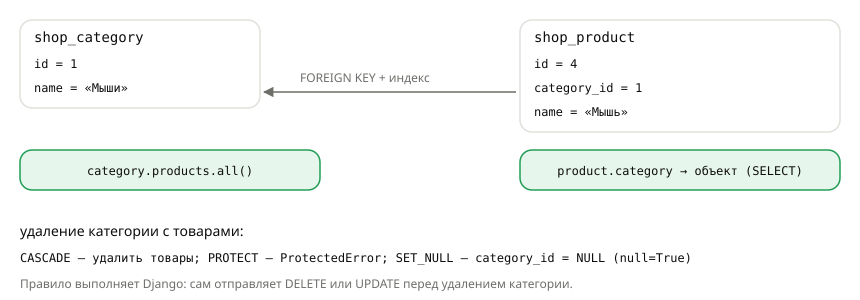

## Теория
Товар принадлежит категории, заказ — покупателю, позиция — заказу. Это связь **«многие к одному»** (1:N): у категории много товаров, у товара одна категория. В SQL её делали колонкой `category_id` с внешним ключом; в Django — полем **`ForeignKey`** на стороне «многих».

Файл `models.py` (фрагмент):
```python
category = models.ForeignKey(Category, on_delete=models.PROTECT, related_name="products")
```
В базе это колонка **`category_id`** (имя поля + `_id`), ограничение `FOREIGN KEY` и индекс по колонке — Django создаёт его сам, в отличие от «голого» SQL.

Доступ в коде — в обе стороны:
- **`product.category`** — объект категории. Если он ещё не загружен, Django сделает отдельный `SELECT`; **`product.category_id`** — просто число из строки товара, без запроса;
- **`category.products.all()`** — все товары категории (обратная связь). Имя задаёт **`related_name`**; без него — `category.product_set`.

Создать товар можно с объектом (`category=mice`) или с числом (`category_id=1`).

**`on_delete`** — обязательный параметр: что делать с товарами, если удаляют их категорию.
- **`CASCADE`** — удалить и товары. Подходит для «частей» объекта: позиции заказа удаляются вместе с заказом;
- **`PROTECT`** — запретить удаление, пока есть товары (`ProtectedError`). Для справочников: категорию с товарами случайно не удалят;
- **`SET_NULL`** — обнулить ссылку; поле должно быть `null=True`, иначе проверка `fields.E320`;
- **`RESTRICT`** — как `PROTECT`, но разрешает удаление, если связанные объекты удаляются в этом же каскаде;
- `SET_DEFAULT`, `DO_NOTHING` — значение по умолчанию; ничего не делать (база может отказать).

Важная деталь: правило `on_delete` выполняет **сам Django** — он находит связанные строки и сам отправляет `DELETE` или `UPDATE`. В таблице PostgreSQL внешний ключ создаётся без `ON DELETE` (курс SQL, «Внешние ключи»), поэтому удаление обычным SQL в обход Django правило не применит.

## Наглядно
**Рисунок 1.** `ForeignKey` — колонка `category_id` в таблице товаров; доступ в обе стороны.



**Таблица 1.** Варианты `on_delete` при удалении категории с товарами.

| `on_delete` | Что происходит | SQL от Django |
|---|---|---|
| `CASCADE` | товары удаляются | `DELETE FROM "shop_product" WHERE "category_id" IN (1)` |
| `PROTECT` | `ProtectedError`, ничего не удалено | только `SELECT` связанных товаров |
| `RESTRICT` | `RestrictedError` (кроме удаления каскадом) | только `SELECT` |
| `SET_NULL` | у товаров `category_id = NULL` | `UPDATE … SET "category_id" = NULL` |
| `SET_DEFAULT` | ссылка = значение `default` | `UPDATE … SET "category_id" = …` |

## На практике
Задача: связать товары с категориями, пройти по связи в обе стороны и выбрать правило удаления категории.

### Шаг 1. Модели
Файл `models.py`:
```python
from django.db import models


class Category(models.Model):
    name = models.CharField(max_length=100)

    def __str__(self):
        return self.name


class Product(models.Model):
    category = models.ForeignKey(
        Category, on_delete=models.PROTECT, related_name="products"
    )
    name = models.CharField(max_length=200)

    def __str__(self):
        return self.name
```
В PostgreSQL:
```
CREATE TABLE "shop_product" ("id" bigint NOT NULL PRIMARY KEY GENERATED BY DEFAULT AS IDENTITY, "category_id" bigint NOT NULL, "name" varchar(200) NOT NULL);
ALTER TABLE "shop_product" ADD CONSTRAINT "shop_product_category_id_14d7eea8_fk_shop_category_id" FOREIGN KEY ("category_id") REFERENCES "shop_category" ("id") DEFERRABLE INITIALLY DEFERRED;
CREATE INDEX "shop_product_category_id_14d7eea8" ON "shop_product" ("category_id");
```
Колонка `category_id`, внешний ключ без `ON DELETE` и индекс.

### Шаг 2. По связи в обе стороны
Файл `orm.py`:
```python
mice = Category.objects.create(name="Мыши")
Product.objects.create(category=mice, name="Беспроводная мышь")
Product.objects.create(category_id=mice.id, name="Проводная мышь")
p = Product.objects.get(name="Беспроводная мышь")
print(p.category_id)
print(p.category.name)
print(mice.products.all())
```
Результат:
```
1
Мыши
<QuerySet [<Product: Беспроводная мышь>, <Product: Проводная мышь>]>
```
SQL трёх последних строк:
```
SELECT "shop_product"."id", "shop_product"."category_id", "shop_product"."name" FROM "shop_product" WHERE "shop_product"."name" = 'Беспроводная мышь' LIMIT 21
SELECT "shop_category"."id", "shop_category"."name" FROM "shop_category" WHERE "shop_category"."id" = 1 LIMIT 21
SELECT "shop_product"."id", "shop_product"."category_id", "shop_product"."name" FROM "shop_product" WHERE "shop_product"."category_id" = 1 LIMIT 21
```
`category_id` уже был в строке товара — запроса нет. `p.category` — отдельный `SELECT` категории. В цикле по сотне товаров это сотня таких запросов — проблема N+1 (раздел «ORM: связи и N+1»).

### Шаг 3. Удалить категорию
Создаём категорию с товаром и вызываем `mice.delete()`.

Результат с `PROTECT`:
```
django.db.models.deletion.ProtectedError: ("Cannot delete some instances of model 'Category' because they are referenced through protected foreign keys: 'Product.category'.", {<Product: Беспроводная мышь>})
```
С `CASCADE` удаление проходит, а Django отправляет два запроса — сначала товары, потом категорию:
```
DELETE FROM "shop_product" WHERE "shop_product"."category_id" IN (1)
DELETE FROM "shop_category" WHERE "shop_category"."id" IN (1)
```
С `SET_NULL` (и `null=True` у поля) товары остаются без категории:
```
UPDATE "shop_product" SET "category_id" = NULL WHERE "shop_product"."category_id" IN (1)
DELETE FROM "shop_category" WHERE "shop_category"."id" IN (1)
```
Для категорий магазина подходит `PROTECT`: удалить категорию с товарами — почти всегда ошибка менеджера, а не намерение.

## Частые ошибки
- **`CASCADE` по привычке.** Удалили категорию — пропали все её товары, а с ними (по цепочке) позиции заказов. Для справочников — `PROTECT`.
- **`SET_NULL` без `null=True`.** `fields.E320 Field specifies on_delete=SET_NULL, but cannot be null.` — проект не запустится.
- **`ForeignKey` без `on_delete`.** `TypeError: ForeignKey.__init__() missing 1 required positional argument: 'on_delete'`.
- **`product.category.id` вместо `product.category_id`.** Первое загружает категорию лишним запросом ради числа, которое уже есть в строке товара.
- **Внешний ключ «не с той стороны».** Поле `ForeignKey` ставят у «многих» (у товара), а не у «одного» (не список товаров в категории).

## Итог
**ForeignKey**
- Поле на стороне «многих» → колонка `<поле>_id`, внешний ключ и индекс.
- `product.category` — объект (запрос, если не загружен), `product.category_id` — число без запроса.
- Обратно: `category.products.all()` (`related_name`), по умолчанию `product_set`.

**on_delete**
- `CASCADE` — части объекта; `PROTECT` / `RESTRICT` — справочники; `SET_NULL` — с `null=True`.
- Правило выполняет Django, а не база.

## Вопросы на собеседовании
<details><summary>Какие бывают варианты `on_delete` и когда что выбирать?</summary>

`CASCADE` — удалить связанные объекты (позиции заказа вместе с заказом). `PROTECT` — запретить удаление, пока есть ссылки (категории, справочники). `RESTRICT` — как `PROTECT`, но допускает удаление в рамках каскада от другого объекта. `SET_NULL` — обнулить ссылку (нужен `null=True`), `SET_DEFAULT` — значение по умолчанию, `SET(...)` — своё значение, `DO_NOTHING` — оставить проверку базе.
</details>

<details><summary>Чем `product.category_id` отличается от `product.category`?</summary>

`category_id` — значение колонки внешнего ключа, оно загружается вместе с товаром. `category` — объект связанной модели: при первом обращении Django делает отдельный запрос и кэширует результат. Если нужно только число, берут `category_id`; если нужны данные категории для многих товаров — загружают их заранее (`select_related`).
</details>

<details><summary>Что такое `related_name`?</summary>

Имя обратной связи у связанной модели: с `related_name="products"` товары категории — `category.products.all()`, без него — `category.product_set.all()`. Ещё его используют в фильтрах через связь (`Category.objects.filter(products__price__lt=1000)`). Если две связи ведут в одну модель, `related_name` обязателен — иначе имена обратных связей конфликтуют.
</details>

## Глубже
Связь «многие ко многим» — следующая тема. Как загружать связанные объекты без лишних запросов — раздел «ORM: связи и N+1».
