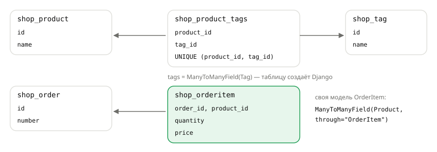

## Теория
У товара несколько меток («хит», «новинка»), и у каждой метки много товаров. Это связь **«многие ко многим»** (N:M). Одной колонкой её не выразить — в курсе SQL для неё заводили **таблицу-связку** `product_tags (product_id, tag_id)`. В Django связку описывает поле **`ManyToManyField`**, а таблицу Django создаёт сам.

**Простая связь** — когда о паре нечего хранить, кроме самого факта.

Файл `models.py` (фрагмент модели `Product`):
```python
tags = models.ManyToManyField(Tag, blank=True, related_name="products")
```
Поле объявляют в одной из моделей (где удобнее думать о связи: «у товара есть метки»). В базе — отдельная таблица `shop_product_tags` с `product_id`, `tag_id` и уникальностью пары; колонки в `shop_product` не появляется. Работа с ней — через менеджер связи:
- `product.tags.add(hit, new)`, `remove(…)`, `clear()`, `set([…])` — изменить пары;
- `product.tags.all()` — метки товара, `hit.products.all()` — товары метки (`related_name`);
- повторный `add` той же пары ничего не сломает — Django вставляет пары «с пропуском существующих».

**Связь с данными** — когда у пары есть свои поля. Позиция заказа — это пара «заказ — товар» плюс количество и цена на момент покупки. Такую связку описывают **моделью** и указывают её в `through`.

Файл `models.py` (фрагмент модели `Order`):
```python
products = models.ManyToManyField(Product, through="OrderItem")
```
`OrderItem` — обычная модель с двумя `ForeignKey` и своими полями. Создают позиции через неё: `OrderItem.objects.create(order=…, product=…, quantity=2, price=…)`; `order.products.all()` по-прежнему даёт товары заказа. `add()` для такой связи работает, только если передать значения дополнительных полей: `through_defaults={"quantity": 1, "price": …}`.

## Наглядно
**Рисунок 1.** Простая связь — таблица-связка, которую создаёт Django; связь с данными — своя модель `OrderItem`.



**Таблица 1.** Простая связь и связь через `through`.

| | Простая `ManyToManyField` | С `through="OrderItem"` |
|---|---|---|
| Таблица-связка | создаёт Django (`shop_product_tags`) | ваша модель (`shop_orderitem`) |
| Свои поля у пары | нет | есть: `quantity`, `price`… |
| Добавить пару | `product.tags.add(tag)` | `OrderItem.objects.create(…)` или `add(…, through_defaults={…})` |
| Прочитать | `product.tags.all()` | `order.products.all()`, `order.items.all()` |
| Повтор пары | не создаётся (уникальность) | как задано в модели |

## На практике
Задача: метки товаров и заказ с позициями.

### Шаг 1. Модели
Файл `models.py`:
```python
from django.db import models


class Tag(models.Model):
    name = models.CharField(max_length=50, unique=True)

    def __str__(self):
        return self.name


class Product(models.Model):
    name = models.CharField(max_length=200)
    price = models.DecimalField(max_digits=10, decimal_places=2)
    tags = models.ManyToManyField(Tag, blank=True, related_name="products")

    def __str__(self):
        return self.name


class Order(models.Model):
    number = models.CharField(max_length=20, unique=True)
    products = models.ManyToManyField(Product, through="OrderItem")

    def __str__(self):
        return self.number


class OrderItem(models.Model):
    order = models.ForeignKey(Order, on_delete=models.CASCADE, related_name="items")
    product = models.ForeignKey(Product, on_delete=models.PROTECT)
    quantity = models.PositiveIntegerField()
    price = models.DecimalField(max_digits=10, decimal_places=2)
```
Таблица-связка меток в PostgreSQL:
```
CREATE TABLE "shop_product_tags" ("id" bigint NOT NULL PRIMARY KEY GENERATED BY DEFAULT AS IDENTITY, "product_id" bigint NOT NULL, "tag_id" bigint NOT NULL);
ALTER TABLE "shop_product_tags" ADD CONSTRAINT "shop_product_tags_product_id_tag_id_a244154e_uniq" UNIQUE ("product_id", "tag_id");
```
Плюс два внешних ключа и два индекса. Таблица позиций — обычная `shop_orderitem` из модели `OrderItem`.

### Шаг 2. Метки
Файл `orm.py`:
```python
mouse = Product.objects.create(name="Беспроводная мышь", price="1499.00")
hit = Tag.objects.create(name="хит")
new = Tag.objects.create(name="новинка")
mouse.tags.add(hit, new)
print(mouse.tags.all())
print(hit.products.all())
mouse.tags.remove(new)
print(mouse.tags.count())
```
Результат:
```
<QuerySet [<Tag: хит>, <Tag: новинка>]>
<QuerySet [<Product: Беспроводная мышь>]>
1
```
SQL добавления и чтения меток:
```
INSERT OR IGNORE INTO "shop_product_tags" ("product_id", "tag_id") VALUES (1, 1), (1, 2)
SELECT "shop_tag"."id", "shop_tag"."name" FROM "shop_tag" INNER JOIN "shop_product_tags" ON ("shop_tag"."id" = "shop_product_tags"."tag_id") WHERE "shop_product_tags"."product_id" = 1 LIMIT 21
```
Две пары — одним `INSERT` («с пропуском повторов»: в SQLite — `OR IGNORE`, в PostgreSQL — `ON CONFLICT DO NOTHING`). Чтение — тот самый `JOIN` через связку из курса SQL.

### Шаг 3. Позиции заказа
Файл `orm.py`:
```python
mouse = Product.objects.create(name="Беспроводная мышь", price="1499.00")
order = Order.objects.create(number="A-12")
OrderItem.objects.create(order=order, product=mouse, quantity=2, price=mouse.price)
print(order.products.all())
for item in order.items.all():
    print(item.product.name, item.quantity, item.price)
```
Результат:
```
<QuerySet [<Product: Беспроводная мышь>]>
Беспроводная мышь 2 1499.00
```
Цену копируем в позицию: если завтра цена товара изменится, в заказе останется та, по которой купили.

### Шаг 4. add для связи через through
`order.products.add(mouse)` без значений для `quantity` и `price` падает:
```
django.db.utils.IntegrityError: NOT NULL constraint failed: shop_orderitem.quantity
```
С `order.products.add(mouse, through_defaults={"quantity": 1, "price": mouse.price})` позиция создаётся.

## Частые ошибки
- **Количество в простой связке.** У `ManyToManyField` без `through` негде хранить `quantity` и цену. Если у пары есть данные — модель-связка.
- **`add` без `through_defaults`.** Для связки с обязательными полями — `IntegrityError`. Создавайте позиции через модель или передавайте `through_defaults`.
- **Цена позиции из товара «по ссылке».** `item.product.price` показывает текущую цену, а не цену покупки. Копируйте цену в позицию при оформлении.
- **`ManyToManyField` с обеих сторон.** Поле объявляют в одной модели; у другой появляется обратная связь (`related_name`).
- **`null=True` у `ManyToManyField`.** Не имеет смысла — колонки нет; Django предупредит `fields.W340`. Необязательность — `blank=True`.

## Итог
**Простая связь**
- `ManyToManyField(Tag)` → таблица `shop_product_tags` с уникальной парой; `add`, `remove`, `set`, `clear`, `all`.

**Связь с данными**
- Модель-связка с двумя `ForeignKey` и своими полями + `ManyToManyField(…, through="OrderItem")`.
- Пары создают через модель; `add` — только с `through_defaults`.

**Обратная сторона**
- `related_name` у `ManyToManyField` — имя связи у другой модели.

## Вопросы на собеседовании
<details><summary>Как в Django устроена связь многие-ко-многим?</summary>

`ManyToManyField` создаёт промежуточную таблицу с двумя внешними ключами и уникальностью пары. Колонки в таблицах моделей не появляется. Работают через менеджер связи (`add`, `remove`, `set`, `clear`, `all`), фильтры через `__` идут `JOIN` через промежуточную таблицу.
</details>

<details><summary>Зачем нужен параметр `through`?</summary>

Чтобы использовать свою модель как промежуточную таблицу и хранить данные о связи: количество и цену позиции заказа, дату вступления участника в группу, роль. Связь остаётся доступной через `ManyToManyField`, а сами пары создаются и изменяются через модель-связку.
</details>

<details><summary>Почему цену товара копируют в позицию заказа?</summary>

Цена товара меняется со временем, а заказ должен показывать сумму, которую заплатили. Позиция хранит цену на момент покупки, и история заказов не «пересчитывается» при изменении каталога. Это осознанная денормализация (курс SQL, «Проектирование»).
</details>

## Глубже
Связь «один к одному» — следующая тема. Фильтры через связи (`Product.objects.filter(tags__name="хит")`) и загрузка меток без N+1 (`prefetch_related`) — раздел «ORM: связи и N+1».
