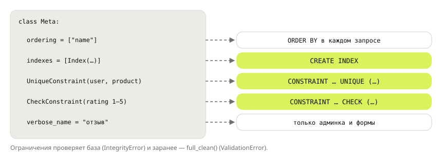

## Теория
Поля описывают колонки, а настройки модели целиком — порядок по умолчанию, индексы на несколько колонок, ограничения таблицы, подписи — живут во вложенном классе **`Meta`**:
- **`ordering = ["name"]`** — порядок по умолчанию: Django добавит `ORDER BY` в каждый запрос модели без своей сортировки (`"-created_at"` — по убыванию). Удобно, но это сортировка в каждом запросе — даже там, где она не нужна;
- **`indexes = [models.Index(fields=["-created_at"], name="…")]`** — индексы, в том числе на несколько колонок (курс SQL, «Виды индексов»);
- **`constraints = [...]`** — ограничения таблицы в базе:
  - **`UniqueConstraint(fields=["user", "product"], name="…")`** — уникальность сочетания полей: один отзыв от покупателя на товар. Можно с условием `condition=Q(…)` — частичная уникальность;
  - **`CheckConstraint(condition=Q(price__gte=0), name="…")`** — проверка значения: цена не меньше нуля, оценка от 1 до 5. Условие — объект `Q` с теми же фильтрами, что в запросах (подробно — раздел «ORM: чтение данных»; `price__gte=0` — «price ≥ 0»). В Django 5.1 параметр переименовали из `check` в `condition`;
- **`verbose_name`**, **`verbose_name_plural`** — названия модели в админке и формах («товар», «товары»); **`db_table`** — своё имя таблицы.

Ограничения в `Meta` — это **база**, а не проверка формы: их соблюдают все — формы, админка, `update()`, скрипты импорта, другой сервис, работающий с той же базой. Нарушение — `IntegrityError`. Кроме того, `full_clean()` (а значит, и формы) проверяет эти ограничения заранее и показывает понятную ошибку вместо падения. Так закрывают дыру из темы «Параметры полей»: `choices` в базе не проверяются, а `CheckConstraint` — проверяется.

У каждого ограничения и индекса обязательное **имя** — уникальное в базе. По нему ошибка понятна сразу: `CHECK constraint failed: product_price_gte_0`.

## Наглядно
**Рисунок 1.** Что в `Meta` превращается в SQL, а что остаётся только в Python.



**Таблица 1.** Параметры `Meta`.

| Параметр | Что делает | Где работает |
|---|---|---|
| `ordering = ["-created_at"]` | `ORDER BY` по умолчанию | каждый запрос модели |
| `indexes = [Index(fields=[…], name=…)]` | индекс | база |
| `UniqueConstraint(fields=[…], name=…)` | уникальность сочетания | база + `full_clean` |
| `CheckConstraint(condition=Q(…), name=…)` | проверка значений | база + `full_clean` |
| `verbose_name`, `verbose_name_plural` | подписи модели | админка, формы |
| `db_table = "…"` | имя таблицы | база |

## На практике
Задача: в каталоге цены не бывают отрицательными, товары по умолчанию идут по алфавиту, новинки ищутся быстро; отзыв — один от покупателя на товар и с оценкой от 1 до 5.

### Шаг 1. Модели
Файл `models.py`:
```python
from django.contrib.auth.models import User
from django.db import models
from django.db.models import Q


class Product(models.Model):
    name = models.CharField(max_length=200)
    price = models.DecimalField(max_digits=10, decimal_places=2)
    created_at = models.DateTimeField(auto_now_add=True)

    class Meta:
        ordering = ["name"]
        verbose_name = "товар"
        verbose_name_plural = "товары"
        indexes = [models.Index(fields=["-created_at"], name="product_new_idx")]
        constraints = [
            models.CheckConstraint(
                condition=Q(price__gte=0), name="product_price_gte_0"
            ),
        ]

    def __str__(self):
        return self.name


class Review(models.Model):
    user = models.ForeignKey(User, on_delete=models.CASCADE)
    product = models.ForeignKey(Product, on_delete=models.CASCADE)
    rating = models.PositiveSmallIntegerField()

    class Meta:
        constraints = [
            models.UniqueConstraint(
                fields=["user", "product"], name="one_review_per_product"
            ),
            models.CheckConstraint(
                condition=Q(rating__gte=1, rating__lte=5),
                name="review_rating_1_5",
            ),
        ]
```
В PostgreSQL (внешние ключи и их индексы не показаны):
```
CREATE TABLE "shop_product" ("id" bigint NOT NULL PRIMARY KEY GENERATED BY DEFAULT AS IDENTITY, "name" varchar(200) NOT NULL, "price" numeric(10, 2) NOT NULL, "created_at" timestamp with time zone NOT NULL, CONSTRAINT "product_price_gte_0" CHECK ("price" >= 0));
CREATE TABLE "shop_review" ("id" bigint NOT NULL PRIMARY KEY GENERATED BY DEFAULT AS IDENTITY, "user_id" integer NOT NULL, "product_id" bigint NOT NULL, "rating" smallint NOT NULL CHECK ("rating" >= 0), CONSTRAINT "one_review_per_product" UNIQUE ("user_id", "product_id"), CONSTRAINT "review_rating_1_5" CHECK (("rating" >= 1 AND "rating" <= 5)));
CREATE INDEX "product_new_idx" ON "shop_product" ("created_at" DESC);
```
Всё из курса SQL: именованные `CHECK` и `UNIQUE` на пару колонок, индекс по убыванию даты. `ordering` и `verbose_name` в SQL нет.

### Шаг 2. Порядок по умолчанию
`Product.objects.all()` после создания «Мыши» и «Коврика» возвращает `<QuerySet [<Product: Коврик>, <Product: Мышь>]>`, а в SQL появился порядок, который никто не просил:
```
SELECT "shop_product"."id", "shop_product"."name", "shop_product"."price", "shop_product"."created_at" FROM "shop_product" ORDER BY "shop_product"."name" ASC LIMIT 21
```

### Шаг 3. База не пропускает
`Product.objects.create(name="Мышь", price="-1.00")`:
```
django.db.utils.IntegrityError: CHECK constraint failed: product_price_gte_0
```
Второй отзыв Анны на ту же мышь:
```
django.db.utils.IntegrityError: UNIQUE constraint failed: shop_review.user_id, shop_review.product_id
```

### Шаг 4. full_clean видит ограничения
Анна уже оставила отзыв на мышь. Проверяем второй, ещё и с оценкой 9:

Файл `orm.py`:
```python
r = Review(user=anna, product=mouse, rating=9)
r.full_clean()
```
Результат:
```
django.core.exceptions.ValidationError: {'__all__': ['Review с такими значениями полей User и Product уже существует.', 'Нарушено ограничение "review_rating_1_5".']}
```
Форма покажет эти сообщения покупателю, а не упадёт с ошибкой 500. Для проверки `full_clean` сделал запросы к базе — в том числе `SELECT 1 … WHERE ("shop_review"."product_id" = 1 AND "shop_review"."user_id" = 1)`.

## Частые ошибки
- **Проверка только в форме или в view.** Импорт, `update()`, админка, параллельный запрос обходят код — правило должно жить в базе: `CheckConstraint`, `UniqueConstraint`.
- **`unique=True` на каждом поле вместо уникальности пары.** `unique` у `user` разрешит покупателю один отзыв на весь магазин. Сочетание — `UniqueConstraint(fields=["user", "product"])`.
- **`ordering` у всех моделей «на всякий случай».** Каждый запрос получает `ORDER BY`, в том числе там, где порядок не важен (подсчёты, большие выгрузки). Сортируйте там, где она нужна: `order_by()` в запросе.
- **Ограничение без имени или с повторным именем.** `name` обязателен и должен быть уникален в базе; понятное имя превращает `IntegrityError` в подсказку.
- **`CheckConstraint(check=…)` из старых примеров.** С Django 5.1 параметр называется `condition`; `check` устарел.

## Итог
**Meta**
- `ordering` — `ORDER BY` по умолчанию; `indexes` — индексы; `verbose_name` — подписи; `db_table` — имя таблицы.

**Ограничения**
- `UniqueConstraint(fields=[…], name=…)` — уникальная пара; `CheckConstraint(condition=Q(…), name=…)` — проверка значения.
- Работают в базе для всех путей записи (`IntegrityError`) и проверяются `full_clean()` (`ValidationError`).

## Вопросы на собеседовании
<details><summary>Зачем ограничения в базе, если есть валидация форм?</summary>

Форма — только один путь записи. Данные меняют админка, `update()`, скрипты, миграции данных, параллельные запросы — их форма не видит. Ограничение в базе выполняется всегда и атомарно: два одновременных запроса не создадут два отзыва, даже если оба прошли проверку формы.
</details>

<details><summary>Чем `UniqueConstraint` отличается от `unique=True` и `unique_together`?</summary>

`unique=True` — уникальность одного поля. `UniqueConstraint` — уникальность набора полей, с именем, а также с условием (`condition`) или по выражению. `unique_together` — старый способ уникальности набора полей; документация рекомендует `UniqueConstraint`.
</details>

<details><summary>Чем опасен `Meta.ordering`?</summary>

Он добавляет `ORDER BY` во все запросы модели без явной сортировки — лишняя работа базы там, где порядок не нужен. Сортировка по неиндексированному полю на большой таблице заметно замедляет запросы. Явный `order_by()` в нужных местах прозрачнее.
</details>

## Глубже
Абстрактные модели и наследование — следующая тема. Индексы под конкретные запросы и `explain()` — раздел «Продвинутый ORM», тема «Производительность ORM».
