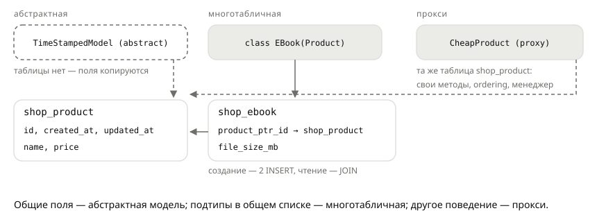

## Теория
У товара, заказа, отзыва и категории одинаковые поля «создано» и «изменено». Копировать их в каждую модель — то же, что копировать шапку в каждый шаблон. Модели — классы Python, и общее выносят наследованием. Но таблицы в базе не наследуются, поэтому у Django **три вида** наследования — и они по-разному ложатся на таблицы.

**Абстрактная модель** — `class Meta: abstract = True`. Своей таблицы у неё нет; её поля **копируются в таблицу каждого наследника**. Это самый частый вид: общие поля (`created_at`, `updated_at`), общие методы. Запросов к абстрактной модели не бывает — у неё нет менеджера `objects`.

**Многотабличное наследование** — обычный класс-наследник обычной модели: `class EBook(Product)`. У родителя и у наследника **по своей таблице**; таблица наследника хранит только свои поля и ссылку на строку родителя (`product_ptr_id` — это одновременно первичный ключ и внешний ключ, по сути `OneToOneField`). Создание электронной книги — два `INSERT`, чтение — `JOIN`. Электронные книги видны и среди обычных товаров (`Product.objects.all()`), а от товара к книге — `product.ebook`. Удобно, но каждый запрос к наследнику дороже; если различий немного, часто проще одно поле «тип» или связь 1:1.

**Прокси-модель** — `class Meta: proxy = True`. Таблица **та же самая**, полей добавить нельзя, но можно добавить методы, свой порядок `ordering`, свой менеджер, отдельную регистрацию в админке. Пример — «товары для распродажи» с сортировкой по цене и методом `is_bargain()` поверх тех же строк `shop_product`.

## Наглядно
**Рисунок 1.** Три вида наследования и их таблицы.



**Таблица 1.** Виды наследования моделей.

| Вид | Как объявить | Таблицы | Когда |
|---|---|---|---|
| Абстрактная | `Meta: abstract = True` | у родителя нет; поля копируются в наследников | общие поля и методы |
| Многотабличная | `class EBook(Product)` | у каждого своя + `product_ptr_id` | подтипы с разными полями, нужен общий список |
| Прокси | `Meta: proxy = True` | одна общая | другое поведение тех же данных |

## На практике
Задача: общие поля времени для всех моделей, электронные книги как особый вид товара и «дешёвые товары» с другой сортировкой.

### Шаг 1. Модели
Файл `models.py`:
```python
from django.db import models


class TimeStampedModel(models.Model):
    created_at = models.DateTimeField(auto_now_add=True)
    updated_at = models.DateTimeField(auto_now=True)

    class Meta:
        abstract = True


class Product(TimeStampedModel):
    name = models.CharField(max_length=200)
    price = models.DecimalField(max_digits=10, decimal_places=2)

    def __str__(self):
        return self.name


class EBook(Product):
    file_size_mb = models.PositiveIntegerField()


class CheapProduct(Product):
    class Meta:
        proxy = True
        ordering = ["price"]

    def is_bargain(self):
        return self.price < 500
```
Таблицы в PostgreSQL:
```
CREATE TABLE "shop_product" ("id" bigint NOT NULL PRIMARY KEY GENERATED BY DEFAULT AS IDENTITY, "created_at" timestamp with time zone NOT NULL, "updated_at" timestamp with time zone NOT NULL, "name" varchar(200) NOT NULL, "price" numeric(10, 2) NOT NULL);
CREATE TABLE "shop_ebook" ("product_ptr_id" bigint NOT NULL PRIMARY KEY, "file_size_mb" integer NOT NULL CHECK ("file_size_mb" >= 0));
ALTER TABLE "shop_ebook" ADD CONSTRAINT "shop_ebook_product_ptr_id_9dc11430_fk_shop_product_id" FOREIGN KEY ("product_ptr_id") REFERENCES "shop_product" ("id") DEFERRABLE INITIALLY DEFERRED;
```
Таблицы `shop_timestampedmodel` нет — её поля оказались в `shop_product`. У `shop_ebook` только своё поле и ссылка на товар. Для `CheapProduct` таблицы нет — он читает `shop_product`.

### Шаг 2. Как это работает в запросах
Файл `orm.py`:
```python
book = EBook.objects.create(name="Книга «SQL на практике»", price="1590.00", file_size_mb=12)
Product.objects.create(name="Коврик", price="490.00")
print(Product.objects.count(), EBook.objects.count())
print(EBook.objects.get().name)
p = Product.objects.get(name__startswith="Книга")
print(p.ebook.file_size_mb)
print([(x.name, x.is_bargain()) for x in CheapProduct.objects.all()])
```
Результат:
```
2 1
Книга «SQL на практике»
12
[('Коврик', True), ('Книга «SQL на практике»', False)]
```
Книга — тоже товар: товаров два, книг одна. SQL создания книги и чтения книг:
```
INSERT INTO "shop_product" ("created_at", "updated_at", "name", "price") VALUES ('2026-11-19 05:36:34.271088', '2026-11-19 05:36:34.271109', 'Книга «SQL на практике»', '1590.00') RETURNING "shop_product"."id"
INSERT INTO "shop_ebook" ("product_ptr_id", "file_size_mb") VALUES (1, 12)
SELECT "shop_product"."id", "shop_product"."created_at", "shop_product"."updated_at", "shop_product"."name", "shop_product"."price", "shop_ebook"."product_ptr_id", "shop_ebook"."file_size_mb" FROM "shop_ebook" INNER JOIN "shop_product" ON ("shop_ebook"."product_ptr_id" = "shop_product"."id") LIMIT 21
```
Два `INSERT` на один объект и `JOIN` на каждое чтение — цена многотабличного наследования. Прокси сделал обычный запрос к `shop_product`, только с `ORDER BY "shop_product"."price" ASC`.

## Частые ошибки
- **Забыли `abstract = True`.** Получается многотабличное наследование: лишняя таблица `shop_timestampedmodel` и `JOIN` в каждом запросе всех моделей.
- **Многотабличное наследование ради пары полей.** Каждое чтение наследника — `JOIN`, каждое создание — два `INSERT`. Если различия малы, хватает поля-типа или `OneToOneField`.
- **Поля в прокси-модели.** Прокси не может добавить поле — проверки остановят проект: `models.E017 Proxy model 'CheapProduct' contains model fields.` Новые поля — в основной модели или наследнике.
- **`Meta` абстрактной модели «не дошла».** Наследник получает `Meta` родителя только если не объявляет свою; иначе пишут `class Meta(TimeStampedModel.Meta):`.
- **`Product.objects.get()` вместо `EBook`.** Объект товара — не книга: у него нет `file_size_mb`, к нему нужно обратиться через `product.ebook`.

## Итог
**Абстрактная**
- `abstract = True`: таблицы нет, поля копируются в наследников — общие поля и методы.

**Многотабличная**
- Обычный наследник: у каждого своя таблица, связь `<родитель>_ptr_id`; создание — два `INSERT`, чтение — `JOIN`.

**Прокси**
- `proxy = True`: та же таблица, новые методы, порядок, менеджер, админка — без новых полей.

## Вопросы на собеседовании
<details><summary>Какие виды наследования моделей есть в Django?</summary>

Абстрактные модели (`abstract = True`) — без своей таблицы, их поля копируются в наследников. Многотабличное наследование — у родителя и наследника свои таблицы, связанные неявным `OneToOneField` (`<parent>_ptr`), чтение — через `JOIN`. Прокси-модели (`proxy = True`) — та же таблица, меняется только поведение: методы, менеджер, сортировка, регистрация в админке.
</details>

<details><summary>Чем плохо многотабличное наследование?</summary>

Каждый запрос к наследнику — `JOIN` с таблицей родителя, создание — два `INSERT`. Получить из списка родителей «настоящие» объекты наследников без лишних запросов сложно. Часто его заменяют абстрактной моделью (если общий список не нужен), полем-типом или явной связью `OneToOneField`.
</details>

<details><summary>Зачем нужны прокси-модели?</summary>

Чтобы по-другому работать с теми же данными, не трогая таблицу: свой менеджер (только активные товары), свой порядок, дополнительные методы, отдельный раздел в админке с другими колонками и фильтрами. Новые поля в прокси добавлять нельзя.
</details>

## Глубже
Как модели превращаются в таблицы на настоящем проекте — раздел «Миграции и админка». Свои менеджеры и методы QuerySet — раздел «Продвинутый ORM».
