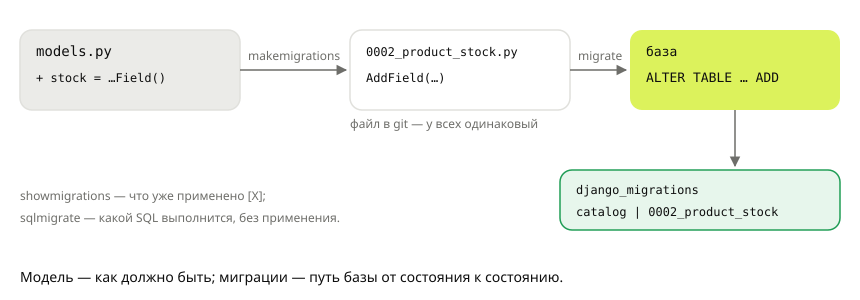

## Теория
Модель описывает, какой таблица **должна** быть. Но база живёт своей жизнью: в ней уже есть таблицы и данные, на сервере — одна версия, у коллеги — другая. **Миграция** — файл Python с шагами, которые переводят структуру базы из одного состояния в другое: «создать таблицу», «добавить колонку», «изменить тип». Миграции лежат в папке `migrations/` приложения, пронумерованы и хранятся в git вместе с кодом.

Работа идёт в два шага — как с коммитом:
1. **`python manage.py makemigrations`** — Django сравнивает модели с состоянием, записанным в существующих миграциях, и пишет **новый файл** с разницей. База при этом не трогается;
2. **`python manage.py migrate`** — применяет к базе миграции, которые к ней ещё не применены. Какие уже применены, Django хранит в служебной таблице **`django_migrations`**.

Вспомогательные команды:
- **`showmigrations`** — список миграций с отметкой `[X]` (применена) или `[ ]`;
- **`sqlmigrate catalog 0002`** — какой SQL выполнит миграция, без применения. Полезно перед выкладкой: сколько займёт, не заблокирует ли таблицу.

Каждая миграция знает свои **зависимости** (`dependencies`) — предыдущие миграции, — и Django применяет их по порядку. Новое обязательное поле в таблице, где уже есть строки, — частая ситуация: базе нужно чем-то заполнить колонку для существующих строк. Django спросит значение (или вы задаёте `default` в модели).

В тренажёре миграций нет: таблицы создаются по моделям заново при каждом запуске. Всё ниже — на вашем компьютере, в проекте из темы «Проект и приложение».

## Наглядно
**Рисунок 1.** Модель → файл миграции → таблица в базе.



**Таблица 1.** Команды миграций.

| Команда | Что делает | Трогает базу |
|---|---|---|
| `makemigrations` | пишет файл миграции по изменениям моделей | нет |
| `migrate` | применяет неприменённые миграции | да |
| `migrate catalog 0003` | откатывает приложение до миграции `0003` | да |
| `showmigrations` | список миграций, `[X]` — применена | только чтение |
| `sqlmigrate catalog 0002` | SQL миграции без выполнения | нет |

## На практике
Задача: создать таблицу товаров миграцией, а потом добавить обязательный остаток, когда в таблице уже есть товары.

### Шаг 1. Первая миграция
В `catalog/models.py` — модель `Product` с `name` и `price`:
```bash
python manage.py makemigrations
```
Результат:
```
Migrations for 'catalog':
  catalog/migrations/0001_initial.py
    + Create model Product
```
Файл — обычный Python:

Файл `catalog/migrations/0001_initial.py`:
```python
# Generated by Django 5.2.18 on 2026-11-19 05:49

from django.db import migrations, models


class Migration(migrations.Migration):

    initial = True

    dependencies = [
    ]

    operations = [
        migrations.CreateModel(
            name='Product',
            fields=[
                ('id', models.BigAutoField(auto_created=True, primary_key=True, serialize=False, verbose_name='ID')),
                ('name', models.CharField(max_length=200)),
                ('price', models.DecimalField(decimal_places=2, max_digits=10)),
            ],
        ),
    ]
```
Операция `CreateModel` и все поля — снимок модели на этот момент.

### Шаг 2. SQL и применение
Команды:
```bash
python manage.py sqlmigrate catalog 0001
```
Результат для PostgreSQL:
```
BEGIN;
--
-- Create model Product
--
CREATE TABLE "catalog_product" ("id" bigint NOT NULL PRIMARY KEY GENERATED BY DEFAULT AS IDENTITY, "name" varchar(200) NOT NULL, "price" numeric(10, 2) NOT NULL);
COMMIT;
```
Миграция выполняется в транзакции: упадёт на середине — откатится целиком. Применяем:
```bash
python manage.py showmigrations catalog
python manage.py migrate
python manage.py showmigrations catalog
```
Результат (сокращён: встроенные приложения применяют ещё 17 миграций):
```
catalog
 [ ] 0001_initial
Operations to perform:
  Apply all migrations: admin, auth, catalog, contenttypes, sessions
Running migrations:
  Applying contenttypes.0001_initial... OK
  Applying auth.0001_initial... OK
  ...
  Applying catalog.0001_initial... OK
  Applying sessions.0001_initial... OK
catalog
 [X] 0001_initial
```

### Шаг 3. Обязательное поле в таблице с данными
Добавляем в модель `stock = models.PositiveIntegerField()` — без значения по умолчанию — и запускаем `makemigrations`.

Результат:
```
It is impossible to add a non-nullable field 'stock' to product without specifying a default. This is because the database needs something to populate existing rows.
Please select a fix:
 1) Provide a one-off default now (will be set on all existing rows with a null value for this column)
 2) Quit and manually define a default value in models.py.
Select an option: 1
Please enter the default value as valid Python.
The datetime and django.utils.timezone modules are available, so it is possible to provide e.g. timezone.now as a value.
Type 'exit' to exit this prompt
>>> 0
Migrations for 'catalog':
  catalog/migrations/0002_product_stock.py
    + Add field stock to product
```
Выбрали «одноразовое» значение `0` для существующих строк. В файле миграции оно записано с `preserve_default=False` — в модели значения по умолчанию так и не появится:

Файл `catalog/migrations/0002_product_stock.py` (фрагмент):
```python
    operations = [
        migrations.AddField(
            model_name='product',
            name='stock',
            field=models.PositiveIntegerField(default=0),
            preserve_default=False,
        ),
    ]
```
В CI или скрипте деплоя, где отвечать некому (`makemigrations --noinput`), Django откажется: `Field 'stock' on model 'product' not migrated: it is impossible to add a non-nullable field without specifying a default.`

### Шаг 4. Что выполнит база
`sqlmigrate catalog 0002` для PostgreSQL:
```
BEGIN;
--
-- Add field stock to product
--
ALTER TABLE "catalog_product" ADD COLUMN "stock" integer DEFAULT 0 NOT NULL CHECK ("stock" >= 0);
ALTER TABLE "catalog_product" ALTER COLUMN "stock" DROP DEFAULT;
COMMIT;
```
Колонка добавляется с `DEFAULT 0` — так существующие строки получают значение, — и сразу после этого значение по умолчанию снимается. SQLite так не умеет: для того же изменения Django создаёт новую таблицу `new__catalog_product`, копирует в неё строки и переименовывает. Поэтому SQL миграции зависит от базы, и смотреть его нужно для той, что на сервере.

## Частые ошибки
- **Изменили модель, забыли `makemigrations`.** `migrate` пишет `No migrations to apply`, а запросы падают: `column catalog_product.stock does not exist`. После любого изменения модели — `makemigrations`.
- **Миграции не в git.** У коллег и на сервере другая история, и `migrate` не знает, как дойти до вашей структуры. Файлы миграций коммитят вместе с моделью.
- **Правка уже применённой миграции.** Django считает её выполненной и не выполнит повторно — у вас и на сервере базы разойдутся. Изменение — новой миграцией.
- **Обязательное поле без `default` в большой таблице.** На PostgreSQL добавление колонки с `DEFAULT` быстрое, но подумать о значении для старых строк нужно заранее — а в CI ответить на вопрос Django некому.
- **Удаление файлов миграций, «чтобы начать заново», в проекте с данными.** История в `django_migrations` перестанет совпадать с файлами. Сбросить миграции можно только на пустой базе разработки.

## Итог
**Два шага**
- `makemigrations` — файл с разницей моделей; `migrate` — применение к базе.
- Применённые — в таблице `django_migrations`; файлы миграций — в git.

**Проверка**
- `showmigrations` — что применено; `sqlmigrate` — какой SQL выполнится (разный для PostgreSQL и SQLite).

**Новое обязательное поле**
- Существующим строкам нужно значение: одноразовое при `makemigrations` или `default` в модели.

## Вопросы на собеседовании
<details><summary>Чем `makemigrations` отличается от `migrate`?</summary>

`makemigrations` сравнивает модели с состоянием, восстановленным из файлов миграций, и создаёт новый файл миграции; база не меняется. `migrate` применяет к базе миграции, которых ещё нет в таблице `django_migrations`, в порядке зависимостей.
</details>

<details><summary>Как Django знает, какие миграции уже применены?</summary>

По таблице `django_migrations` в самой базе: в ней строка на каждую применённую миграцию (приложение, имя, время). `migrate` сравнивает её с файлами миграций и выполняет недостающие в порядке зависимостей.
</details>

<details><summary>Как посмотреть SQL миграции перед выкладкой?</summary>

`python manage.py sqlmigrate <приложение> <номер>` выводит SQL для текущей базы, не выполняя его. Так проверяют, не будет ли тяжёлой операции на большой таблице (перестройка, долгая блокировка), и какой индекс создастся.
</details>

<details><summary>Что будет, если изменить уже применённую миграцию?</summary>

Django её не перевыполнит: она отмечена как применённая в `django_migrations`. На новых базах (у коллег, в CI) применится изменённая версия, на старых — нет, и структуры разойдутся. Изменения вносят новой миграцией.
</details>

## Глубже
Миграции с изменением данных, откат, конфликты веток и `--fake` — следующая тема. Миграции на сервере как шаг деплоя — курс «Docker» и «Nginx и деплой».
