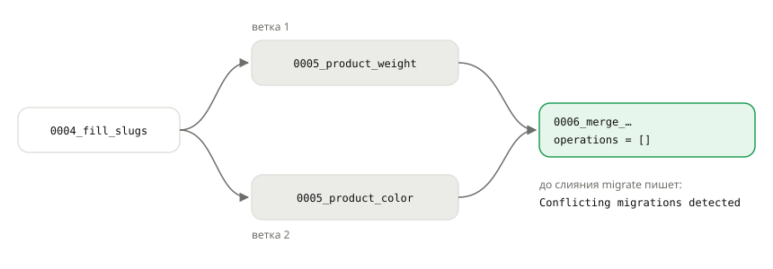

## Теория
Миграции меняют не только структуру. Добавили товарам поле `slug` — у сотни существующих товаров оно пустое, и страницы `/products/<slug>/` для них не откроются. Заполнить его нужно **миграцией данных**: тогда заполнение выполнится один раз на каждой базе — у вас, у коллег, на сервере — ровно в нужный момент между структурными миграциями.

Миграцию данных создают пустой — **`makemigrations catalog --empty --name fill_slugs`** — и пишут в неё операцию **`RunPython(функция, обратная_функция)`**. Правила:
- модель берут **`apps.get_model("catalog", "Product")`**, а не импортом из `models.py`. Миграция должна работать с моделью такой, какой та была **в этот момент истории**. Импорт даст текущую модель — через год, когда у неё появятся новые поля, старая миграция упадёт на новой базе;
- вторая функция — **откат**. Если отменять нечего, передают `migrations.RunPython.noop`. Без неё миграцию нельзя откатить: `IrreversibleError`.

**Конфликты.** Два разработчика в разных ветках сделали по миграции `0005_…` от одной `0004`. После слияния веток у приложения две «последних» миграции, и `migrate` откажется работать. Решение — **`makemigrations --merge`**: Django создаст пустую миграцию, которая зависит от обеих, и история снова станет линейной. Если две ветки меняют одно поле по-разному, слить автоматически нельзя — нужно разобраться руками.

**`--fake`** — отметить миграцию применённой (или откатанной) в `django_migrations`, **не выполняя** её. Нужно редко: база уже приведена в нужное состояние вручную или восстановлена из резервной копии, и история в таблице не совпадает с реальной структурой. Ошибка с `--fake` — база и история расходятся, и следующие миграции падают.

## Наглядно
**Рисунок 1.** Две ветки создали по миграции от одной; `--merge` сводит их миграцией без операций.



**Таблица 1.** Инструменты для данных и истории.

| Задача | Инструмент |
|---|---|
| Пустая миграция для своих операций | `makemigrations app --empty --name имя` |
| Изменить данные | `RunPython(вперёд, назад)`, модель — `apps.get_model` |
| Откат без действий | `migrations.RunPython.noop` |
| Две последние миграции после слияния веток | `makemigrations --merge` |
| Отметить применённой без выполнения | `migrate app номер --fake` |
| Откатить приложение до миграции | `migrate app номер` |

## На практике
Задача: заполнить `slug` у существующих товаров, проверить откат, свести миграции из двух веток и посмотреть, чем опасен `--fake`. В проекте уже применены `0001`–`0003` (последняя добавила пустое поле `slug`), в таблице — «Ноутбук Aster 14» и «Wireless Mouse».

### Шаг 1. Миграция данных
Команды:
```bash
python manage.py makemigrations catalog --empty --name fill_slugs
```
Результат:
```
Migrations for 'catalog':
  catalog/migrations/0004_fill_slugs.py
```
Пишем операцию:

Файл `catalog/migrations/0004_fill_slugs.py`:
```python
from django.db import migrations
from django.utils.text import slugify


def fill_slugs(apps, schema_editor):
    Product = apps.get_model("catalog", "Product")
    for product in Product.objects.filter(slug=""):
        product.slug = f"{slugify(product.name) or 'product'}-{product.pk}"
        product.save(update_fields=["slug"])


class Migration(migrations.Migration):

    dependencies = [
        ("catalog", "0003_product_slug"),
    ]

    operations = [
        migrations.RunPython(fill_slugs),
    ]
```
После `migrate` в базе:
```
[('Ноутбук Aster 14', 'aster-14-1'), ('Wireless Mouse', 'wireless-mouse-2')]
```
`slugify` выбросил кириллицу: от «Ноутбук Aster 14» осталось `aster-14`. Номер товара в конце гарантирует уникальность, даже если от названия не останется ничего.

### Шаг 2. Откат
Команды:
```bash
python manage.py migrate catalog 0003
```
Результат (конец):
```
django.db.migrations.exceptions.IrreversibleError: Operation <RunPython <function fill_slugs at 0x745b5a54b600>> in catalog.0004_fill_slugs is not reversible
```
Без функции отката Django не знает, как вернуть данные. Отменять заполнение не нужно — поле всё равно удалит предыдущая миграция при дальнейшем откате, — поэтому ставим «пустой» откат: `migrations.RunPython(fill_slugs, migrations.RunPython.noop)`. Теперь откат проходит:
```
  Unapplying catalog.0004_fill_slugs... OK
```

### Шаг 3. Конфликт веток
В одной ветке добавили вес (`0005_product_weight`), в другой — цвет (`0005_product_color`), обе — от `0004`. После слияния:
```bash
python manage.py migrate
```
Результат:
```
CommandError: Conflicting migrations detected; multiple leaf nodes in the migration graph: (0005_product_color, 0005_product_weight in catalog).
To fix them run 'python manage.py makemigrations --merge'
```
Сводим:
```bash
python manage.py makemigrations --merge --noinput
```
Результат (путь у вас свой):
```
Merging catalog
  Branch 0005_product_color
    + Add field color to product
  Branch 0005_product_weight
    + Add field weight_g to product

Created new merge migration /home/shop/shop/catalog/migrations/0006_merge_0005_product_color_0005_product_weight.py
```
В новой миграции нет операций — только две зависимости:

Файл `catalog/migrations/0006_merge_0005_product_color_0005_product_weight.py` (фрагмент):
```python
    dependencies = [
        ('catalog', '0005_product_color'),
        ('catalog', '0005_product_weight'),
    ]

    operations = [
    ]
```
После `migrate` применяются обе ветки и слияние.

### Шаг 4. Чем опасен --fake
Отмечаем три последние миграции откатанными, **не трогая** базу, и пробуем применить их снова:
```bash
python manage.py migrate catalog 0004 --fake
python manage.py migrate catalog
```
Результат (сокращён):
```
  Unapplying catalog.0006_merge_0005_product_color_0005_product_weight... FAKED
  Unapplying catalog.0005_product_color... FAKED
  Unapplying catalog.0005_product_weight... FAKED
django.db.utils.OperationalError: duplicate column name: weight_g
```
По истории колонки ещё нет, а в базе она есть — миграция падает. Чинится тем же `--fake` вперёд (`migrate catalog --fake`), но смысл ясен: `--fake` меняет только историю, и использовать его можно, только точно зная, что база уже в нужном состоянии.

## Частые ошибки
- **Импорт модели в миграции.** `from catalog.models import Product` — миграция работает с моделью «из будущего» и ломается, когда модель изменится. Только `apps.get_model`.
- **`RunPython` без отката.** Миграцию не откатить, а значит, нельзя откатить и всё, что после неё. Нечего отменять — `RunPython.noop`.
- **Тяжёлая миграция данных одним проходом.** Миллион строк через `save()` в одной транзакции — долгая блокировка таблицы при деплое. Большие объёмы обновляют пачками или `update()`.
- **Переименовать номер чужой миграции вместо `--merge`.** Если миграция уже применена у коллег или на сервере, история разойдётся. Слияние — отдельной миграцией.
- **`--fake`, «чтобы прошло».** Таблица в базе не совпадает с историей — следующая миграция падает или, хуже, молча не создаёт нужное.

## Итог
**Миграции данных**
- `makemigrations app --empty --name …` + `RunPython(вперёд, назад)`.
- Модель — `apps.get_model("app", "Model")`; откат — функция или `RunPython.noop`, иначе `IrreversibleError`.

**Конфликты**
- Две последние миграции после слияния веток — `Conflicting migrations detected`; решение — `makemigrations --merge`.

**--fake**
- Меняет только `django_migrations`, базу не трогает; только когда структура уже приведена вручную.

## Вопросы на собеседовании
<details><summary>Как заполнить данные при изменении модели?</summary>

Миграцией данных: пустая миграция с `RunPython(forwards, backwards)`. В функции модель берут `apps.get_model()` — историческую версию на момент миграции. Так заполнение выполнится один раз на каждой базе в правильном месте истории. Для отката передают обратную функцию или `RunPython.noop`.
</details>

<details><summary>Почему в миграции нельзя импортировать модель напрямую?</summary>

Импорт даёт текущий код модели, а миграция описывает момент в прошлом. Когда модель изменится (новые поля, переименования), старая миграция на новой базе будет ссылаться на то, чего в таблице ещё нет. `apps.get_model` возвращает модель, собранную из состояния миграций на этот момент.
</details>

<details><summary>Что делать при конфликте миграций после слияния веток?</summary>

`python manage.py makemigrations --merge` создаёт миграцию без операций, зависящую от обеих «последних», — граф снова сходится в одну точку. Если ветки меняют одно и то же поле, сначала разбираются вручную. Переименовывать уже применённые где-то миграции нельзя.
</details>

<details><summary>Когда используют `migrate --fake`?</summary>

Когда структура базы уже соответствует миграции, а история в `django_migrations` — нет: базу восстановили из копии, таблицы созданы вручную или при переходе на миграции в существующем проекте (`--fake-initial`). `--fake` только записывает или удаляет отметки, SQL не выполняется; ошибка в его применении приводит к расхождению базы и истории.
</details>

## Глубже
Массовые обновления и `bulk_update` для больших миграций данных — раздел «Изменение данных и формы». Транзакции и блокировки — раздел «Продвинутый ORM».
