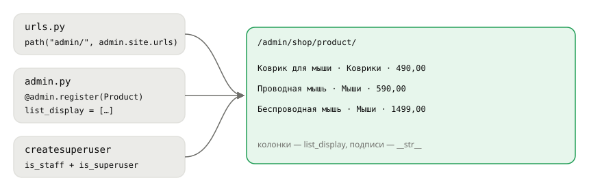

## Теория
Менеджерам магазина нужно добавлять товары, менять цены, смотреть заказы — с первого дня, а не когда разработчики напишут для этого отдельные страницы. В Django для этого есть **админка** — готовое приложение `django.contrib.admin`: по моделям оно само строит страницы списка, поиска, создания, изменения и удаления. Админка — инструмент сотрудников, а не страница для покупателей.

Что нужно, чтобы модель появилась в админке:
1. в `urls.py` проекта подключена админка: `path("admin/", admin.site.urls)` (в новом проекте уже есть);
2. в `admin.py` приложения модель **зарегистрирована**: `admin.site.register(Product)` или декоратор `@admin.register(Product)` над классом настроек `ModelAdmin`;
3. есть пользователь с доступом: **`python manage.py createsuperuser`** создаёт суперпользователя (флаги `is_staff` и `is_superuser`). Войти в админку может только пользователь с `is_staff=True`; что ему там можно делать — решают права (раздел «Пользователи и доступ»).

Без настроек список товаров показывает одну колонку — `str(объект)`. Поэтому у каждой модели нужен `__str__`, иначе в списке будет «Product object (1)». Колонки списка задаёт **`ModelAdmin.list_display`** — имена полей, а также методы модели или самого `ModelAdmin`.

Названия в админке берутся из `verbose_name` полей и моделей. Без них Django показывает имя модели по-английски: раздел «Products», действие «Удалить выбранные orders».

В тренажёре админка включена всегда: подключите `admin/` в `urls.py`, зарегистрируйте модель в `admin.py`, а для входа тест или песочница создают суперпользователя через ORM. Страницы админки в тренажёре — без CSS.

## Наглядно
**Рисунок 1.** Что нужно, чтобы модель появилась в админке.



**Таблица 1.** Адреса админки для модели `Product` приложения `shop`.

| Адрес | Страница |
|---|---|
| `/admin/` | главная: приложения и модели |
| `/admin/shop/product/` | список товаров |
| `/admin/shop/product/add/` | новый товар |
| `/admin/shop/product/4/change/` | изменение товара 4 |
| `/admin/shop/product/4/delete/` | удаление с подтверждением |
| `/admin/shop/product/?q=мышь` | поиск (если задан `search_fields`) |

## На практике
Задача: дать менеджерам список товаров с категорией и ценой.

### Шаг 1. Суперпользователь
На своём компьютере, после `migrate`:
```bash
python manage.py createsuperuser
```
Команда спросит логин, почту и пароль (дважды). В скриптах её запускают без вопросов: `DJANGO_SUPERUSER_PASSWORD=… python manage.py createsuperuser --noinput --username admin --email admin@shop.example`.

Результат:
```
Superuser created successfully.
```

### Шаг 2. Регистрация без настроек
Модели `Category` и `Product` (с `ForeignKey` на категорию, ценой и флагом `is_active`) уже есть, у обеих — `__str__`:

Файл `admin.py`:
```python
from django.contrib import admin

from .models import Product

admin.site.register(Product)
```
Список `/admin/shop/product/` — одна колонка, `str(товар)`:
```
Коврик для мыши
Проводная мышь
Беспроводная мышь
```
Новые товары сверху: по умолчанию админка сортирует по убыванию первичного ключа.

### Шаг 3. Колонки списка
Файл `admin.py`:
```python
from django.contrib import admin

from .models import Category, Product


@admin.register(Product)
class ProductAdmin(admin.ModelAdmin):
    list_display = ["name", "category", "price", "is_active"]


admin.site.register(Category)
```
Список (текст строк таблицы; `is_active` админка рисует значком):
```
Коврик для мыши | Коврики | 490,00
Проводная мышь | Мыши | 590,00
Беспроводная мышь | Мыши | 1499,00
```
Категория показана через её `__str__`. Цена — в русском формате с запятой.

## Частые ошибки
- **Модель не зарегистрирована.** В админке её просто нет — ни ошибки, ни подсказки. Проверьте `admin.py` приложения.
- **Нет `__str__`.** Списки, выпадающие меню и история изменений показывают «Product object (1)».
- **Пользователь без `is_staff`.** Обычный покупатель не войдёт в админку даже с правильным паролем — форма ответит так же, как на неверный пароль: «Пожалуйста, введите корректные имя пользователя и пароль учётной записи. Оба поля могут быть чувствительны к регистру.»
- **Админка на `/admin/` на боевом сервере без защиты.** Адрес знают все боты; сложный пароль обязателен, адрес часто меняют на свой, а доступ закрывают по IP или двухфакторной авторизацией.
- **Админка вместо интерфейса для покупателей.** Она для сотрудников: дизайн и логика страниц магазина — во view и шаблонах.

## Итог
**Подключение**
- `path("admin/", admin.site.urls)` + регистрация модели в `admin.py` (`admin.site.register` или `@admin.register`).
- Вход — пользователь с `is_staff`; первый — `createsuperuser`.

**Вид списка**
- По умолчанию — `str(объект)`; колонки — `ModelAdmin.list_display`.
- Названия — из `verbose_name`, иначе английские имена моделей.

## Вопросы на собеседовании
<details><summary>Как добавить модель в админку Django?</summary>

Зарегистрировать её в `admin.py` приложения: `admin.site.register(Model)` или класс-наследник `admin.ModelAdmin` с декоратором `@admin.register(Model)` для настроек. В корневом `urls.py` должен быть подключён `admin.site.urls`, а у пользователя — флаг `is_staff`.
</details>

<details><summary>Чем `is_staff` отличается от `is_superuser`?</summary>

`is_staff` разрешает входить в админку; что пользователь в ней видит и может делать, определяют его права (`permissions`) и группы. `is_superuser` даёт все права сразу, без явного назначения.
</details>

<details><summary>Для кого админка Django?</summary>

Для сотрудников: менеджеров, поддержки, контент-редакторов — быстрый CRUD по моделям без отдельной разработки. Покупательский интерфейс делают своими view и шаблонами: у него другая логика, дизайн и требования к безопасности.
</details>

## Глубже
Фильтры, поиск, связанные объекты на одной странице и массовые действия — следующая тема «Настройка админки». Права и группы сотрудников — раздел «Пользователи и доступ».
