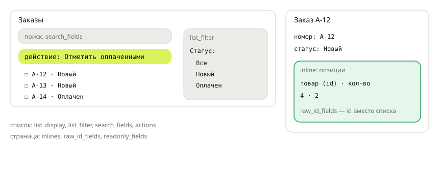

## Теория
Список «все товары подряд» перестаёт помогать уже на сотне товаров. Менеджеру нужно найти заказ по номеру, отфильтровать неоплаченные, увидеть позиции заказа на его странице и отметить десяток заказов оплаченными за один раз. Всё это — атрибуты класса **`ModelAdmin`**:
- **`list_display`** — колонки списка; **`list_filter`** — панель фильтров справа (по полям, связям, датам; `BooleanField` и `choices` — с готовыми вариантами);
- **`search_fields`** — поле поиска: Django ищет `icontains` по перечисленным полям, в том числе через связь (`"category__name"`). Поиск по `"=number"` — точное совпадение;
- **`ordering`**, **`list_per_page`** — сортировка и число строк на странице; **`readonly_fields`** — поля только для чтения (время создания);
- **`raw_id_fields`** или **`autocomplete_fields`** — для `ForeignKey` на большую таблицу. По умолчанию поле связи — выпадающий список **всех** объектов: на 100 000 товаров страница заказа загружает их все;
- **`inlines`** — связанные объекты на странице родителя: позиции на странице заказа. Inline — класс `admin.TabularInline` (таблицей) или `StackedInline` (блоками) с `model = OrderItem`;
- **`actions`** — массовые действия над выбранными строками: метод с декоратором `@admin.action(description="…")`, который получает `queryset` выбранных объектов. Сообщение менеджеру — `self.message_user(request, "…")`. Встроенное действие одно — «Удалить выбранные».

Всё это — настройки отображения, а не логика магазина: изменения, которые делает админка, проходят через те же модели и ограничения базы.

## Наглядно
**Рисунок 1.** Список и страница заказа в настроенной админке.



**Таблица 1.** Настройки `ModelAdmin`.

| Атрибут | Что даёт | Пример |
|---|---|---|
| `list_display` | колонки списка | `["number", "status"]` |
| `list_filter` | фильтры справа | `["status", "created_at"]` |
| `search_fields` | поиск | `["number", "user__email"]` |
| `ordering` | сортировка списка | `["-created_at"]` |
| `readonly_fields` | только чтение | `["created_at"]` |
| `raw_id_fields` | поле id вместо огромного списка | `["product"]` |
| `inlines` | связанные объекты на странице | `[OrderItemInline]` |
| `actions` | массовые действия | `["mark_paid"]` |

## На практике
Задача: в каталоге — поиск и фильтры; заказы — с позициями на одной странице и действием «Отметить оплаченными».

### Шаг 1. Поиск и фильтры товаров
Файл `admin.py` (фрагмент):
```python
@admin.register(Product)
class ProductAdmin(admin.ModelAdmin):
    list_display = ["name", "category", "price", "is_active"]
    list_filter = ["is_active", "category"]
    search_fields = ["name"]
```
Результат (`/admin/shop/product/?q=мышь`):
```
Проводная мышь | Мыши | 590,00
Беспроводная мышь | Мыши | 1499,00
```
Коврик отфильтрован поиском. Фильтр «Активен: Нет» — это `/admin/shop/product/?is_active__exact=0`: выбор фильтров хранится в адресе, его можно сохранить в закладки.

### Шаг 2. Позиции на странице заказа и действие
Модели `Product`, `Order` (номер и статус из `TextChoices`) и `OrderItem` (заказ, товар, количество):

Файл `admin.py`:
```python
from django.contrib import admin

from .models import Order, OrderItem, Product


class OrderItemInline(admin.TabularInline):
    model = OrderItem
    extra = 0
    raw_id_fields = ["product"]


@admin.register(Order)
class OrderAdmin(admin.ModelAdmin):
    list_display = ["number", "status"]
    list_filter = ["status"]
    inlines = [OrderItemInline]
    actions = ["mark_paid"]

    @admin.action(description="Отметить оплаченными")
    def mark_paid(self, request, queryset):
        updated = queryset.update(status=Order.Status.PAID)
        self.message_user(request, f"Оплачено заказов: {updated}")


admin.site.register(Product)
```
`extra = 0` — без пустых строк для новых позиций; `raw_id_fields` — номер товара вместо списка всех товаров.

### Шаг 3. Что получилось
На странице заказа A-12 в форме появились поля набора позиций:
```
['items-TOTAL_FORMS', 'items-INITIAL_FORMS', 'items-MIN_NUM_FORMS', 'items-MAX_NUM_FORMS', 'items-0-id', 'items-0-order', 'items-0-product', 'items-0-quantity']
```
Это набор форм (formset) — позиции редактируются вместе с заказом и сохраняются одной кнопкой. Подробно про наборы форм — раздел «Изменение данных и формы».

В списке действий над заказами:
```
[('delete_selected', 'Удалить выбранные orders'), ('mark_paid', 'Отметить оплаченными')]
```
«orders» — потому что у модели нет `verbose_name_plural`. Выбираем оба заказа и запускаем своё действие:
```
200 [('A-12', 'paid'), ('A-13', 'paid')]
['Оплачено заказов: 2']
```
Действие обновило оба заказа одним `UPDATE` и показало сообщение над списком.

## Частые ошибки
- **`ForeignKey` на большую таблицу без `raw_id_fields`.** Страница заказа строит выпадающий список из всех товаров и пользователей — секунды на загрузку. `raw_id_fields` или `autocomplete_fields`.
- **`search_fields` по полю без индекса на большой таблице.** Поиск — `ILIKE '%…%'` по каждому полю, на миллионах строк он медленный. Точное совпадение — `"=number"`, поиск по связям — с осторожностью.
- **Колонка-метод с запросом на каждую строку.** `list_display` с методом, который ходит в связанную модель, — N+1 на странице списка. Помогает `list_select_related` (раздел «ORM: связи и N+1»).
- **Действие через `save()` в цикле без нужды.** `queryset.update(…)` — один запрос; но учтите, что `update()` не вызывает `save()` и сигналы. Если при оплате должно уходить письмо, это нужно сделать явно.
- **Логика магазина в админке.** Правило «оплаченный заказ нельзя изменить» должно жить в модели или в базе: заказ меняют и сайт, и скрипты, а не только админка.

## Итог
**Список**
- `list_display`, `list_filter`, `search_fields`, `ordering`, `list_per_page`.

**Страница объекта**
- `readonly_fields`, `raw_id_fields` / `autocomplete_fields` для больших связей.
- `inlines = [TabularInline]` — связанные объекты с родителем.

**Действия**
- `actions` + метод с `@admin.action(description=…)`, получает `queryset`; `message_user` — сообщение.

## Вопросы на собеседовании
<details><summary>Как показать связанные объекты на странице объекта в админке?</summary>

Через inline: класс-наследник `admin.TabularInline` или `admin.StackedInline` с `model = СвязаннаяМодель` и список `inlines` в `ModelAdmin` родителя. Связанная модель должна ссылаться на родителя `ForeignKey`. Объекты редактируются набором форм и сохраняются вместе с родителем.
</details>

<details><summary>Как сделать массовое действие в админке?</summary>

Метод `ModelAdmin` (или функция) с сигнатурой `(self, request, queryset)` и декоратором `@admin.action(description="…")`, добавленный в `actions`. В `queryset` — выбранные объекты; результат сообщают `self.message_user`. Для простых изменений удобен `queryset.update()` — один запрос.
</details>

<details><summary>Зачем `raw_id_fields` и `autocomplete_fields`?</summary>

Поле `ForeignKey` в форме по умолчанию — выпадающий список со всеми объектами связанной модели. На больших таблицах страница загружается долго и весит мегабайты. `raw_id_fields` заменяет список полем с id и окном поиска, `autocomplete_fields` — поиском с подсказками (у связанной модели нужен `search_fields`).
</details>

## Глубже
Наборы форм вне админки — раздел «Изменение данных и формы». Права сотрудников на модели и действия — раздел «Пользователи и доступ».
