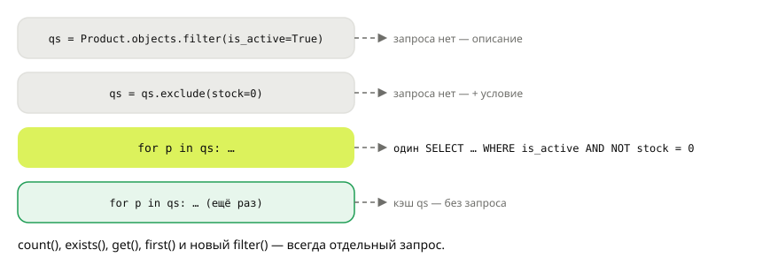

## Теория
`Product.objects.filter(is_active=True)` возвращает не список товаров, а **QuerySet** — описание запроса: какая таблица, какие условия, какой порядок. Сам запрос в базу при этом **не уходит**. QuerySet **ленивый**: SQL выполняется, только когда данные действительно нужны:
- перебор в цикле `for p in qs` или в шаблоне ``;
- `list(qs)`, `len(qs)`, `bool(qs)`, `if qs:`;
- индекс `qs[0]` или срез с шагом `qs[::2]`; `repr(qs)` в консоли (тогда — с `LIMIT 21`). Обычный срез `qs[:5]` ещё ленивый — он лишь добавляет `LIMIT`.

Поэтому QuerySet можно строить по шагам: `qs = qs.filter(…)`, `qs = qs.exclude(…)`, `qs = qs.order_by(…)`. Каждый метод возвращает **новый** QuerySet с добавленным условием, и в базу в итоге уходит один запрос со всеми условиями. Это главное удобство ORM для страниц каталога: фильтры из адреса добавляются по очереди, а запрос остаётся один.

У выполненного QuerySet есть **кэш**: повторный перебор того же объекта `qs` берёт строки из памяти, без нового запроса. Но кэш принадлежит объекту: `Product.objects.filter(…)` в двух местах — два разных QuerySet и два запроса. Часть методов в кэш не смотрит и всегда идёт в базу: `count()`, `exists()`, `get()`, `first()`, а также любой новый `filter()` над старым QuerySet.

Какой SQL получится, можно увидеть без выполнения: `print(qs.query)`. В тренажёре видно все запросы, которые ушли в базу во время запуска.

## Наглядно
**Рисунок 1.** QuerySet копит условия и идёт в базу один раз — когда нужны данные.



**Таблица 1.** Что выполняет запрос.

| Действие | Запрос в базу |
|---|---|
| `qs = Product.objects.filter(…)`, `qs.exclude(…)`, `qs.order_by(…)` | нет |
| `for p in qs`, `list(qs)`, `len(qs)`, `if qs:` | да — один раз, дальше кэш |
| `qs[:5]` (срез без шага) | нет — новый QuerySet с `LIMIT 5`, запрос при переборе |
| `qs[0]` | да, сразу: `LIMIT 1` |
| `qs.count()`, `qs.exists()`, `qs.get(…)`, `qs.first()` | да, каждый раз |
| `print(qs.query)` | нет — только текст SQL |

## На практике
Задача: понять, сколько запросов сделает страница каталога, если строить выборку по шагам и перебирать её дважды. В базе 6 товаров (модели `Category` и `Product`: название, slug, цена, остаток, «активен», дата создания).

### Шаг 1. Условия по шагам
Файл `orm.py`:
```python
qs = Product.objects.filter(is_active=True)
qs = qs.exclude(stock=0)
print("запросов пока нет")
print(qs.query)
names = [p.name for p in qs]
again = [p.name for p in qs]
print(names)
```
Результат:
```
запросов пока нет
SELECT "shop_product"."id", "shop_product"."category_id", "shop_product"."name", "shop_product"."slug", "shop_product"."description", "shop_product"."price", "shop_product"."stock", "shop_product"."is_active", "shop_product"."created_at" FROM "shop_product" WHERE ("shop_product"."is_active" AND NOT ("shop_product"."stock" = 0))
['Ноутбук Aster 14', 'Беспроводная мышь', 'Игровая мышь', 'Коврик для мыши']
```
В журнале запросов тренажёра — ровно один `SELECT` с обоими условиями: два метода сложились в один `WHERE`, а второй перебор взял строки из кэша `qs`.

### Шаг 2. Два одинаковых QuerySet
Файл `orm.py`:
```python
for p in Product.objects.filter(is_active=True): pass
for p in Product.objects.filter(is_active=True): pass
Product.objects.all()[:2]
```
SQL (здесь и дальше список колонок товара сокращён до `…`):
```
SELECT … FROM "shop_product" WHERE "shop_product"."is_active"
SELECT … FROM "shop_product" WHERE "shop_product"."is_active"
SELECT … FROM "shop_product" LIMIT 2
```
Одинаковый текст — но два объекта, и у каждого свой кэш. Срез стал `LIMIT 2`, а не «загрузить всё и отрезать».

### Шаг 3. count() и len()
`print(Product.objects.count(), len(Product.objects.all()))` выводит `6 6`, но запросы разные:
```
SELECT COUNT(*) AS "__count" FROM "shop_product"
SELECT … FROM "shop_product"
```
`count()` считает в базе, `len()` загружает все строки в Python и считает их там. Если строки потом всё равно понадобятся — `len()` уже готового QuerySet не сделает лишнего запроса; если нужно только число — `count()`.

## Частые ошибки
- **Новый QuerySet в цикле.** `for c in categories: Product.objects.filter(category=c)` — запрос на каждую категорию. Тема N+1 — раздел «ORM: связи и N+1».
- **`len(qs)` ради числа.** Загружает все строки. Для подсчёта — `count()`, для «есть ли хоть одна» — `exists()`.
- **Ждать, что `qs.filter()` возьмёт данные из кэша.** Любой новый метод — новый QuerySet и новый запрос.
- **QuerySet в атрибуте класса или модуля.** `CHEAP = Product.objects.filter(price__lt=1000)` вычисляется лениво, но кэш остаётся после первого использования — можно получить устаревшие данные. Строят внутри функции.
- **`print(qs)` в отладке «бесплатно».** Это настоящий запрос с `LIMIT 21`.

## Итог
**Ленивость**
- `filter`, `exclude`, `order_by` только строят запрос; SQL уходит при переборе, `list`, `len`, `bool`, индексе.
- Цепочка методов — один SQL со всеми условиями.

**Кэш**
- Повторный перебор того же QuerySet — без запроса; `count`, `exists`, `get`, `first` и новый `filter` — всегда в базу.

**Проверка**
- `print(qs.query)` — текст SQL; в тренажёре — журнал всех запросов.

## Вопросы на собеседовании
<details><summary>Что значит «QuerySet ленивый»?</summary>

Создание и изменение QuerySet (`filter`, `exclude`, `order_by`) не обращается к базе — строится описание запроса. SQL выполняется при первом требовании данных: итерации, `len`, `list`, `bool`, индексе, `repr`. Это позволяет собирать запрос по частям и отправлять один запрос со всеми условиями.
</details>

<details><summary>Когда QuerySet использует кэш?</summary>

После первого полного вычисления результат хранится в объекте QuerySet: повторная итерация, `len()` и `bool()` берут его из памяти. Методы, возвращающие новый QuerySet (`filter`, `order_by`), и методы с отдельным запросом (`count`, `exists`, `get`, `first`, `aggregate`) идут в базу. Индекс и срез невычисленного QuerySet тоже делают свой запрос.
</details>

<details><summary>Чем `count()` отличается от `len()`?</summary>

`count()` выполняет `SELECT COUNT(*)` и не загружает строки. `len()` вычисляет QuerySet — загружает все объекты — и считает их в Python. Если объекты всё равно нужны, `len()` уже вычисленного QuerySet ничего не стоит; если нужно только число — `count()`.
</details>

## Глубже
Методы `filter`, `exclude`, `get` и что они делают с пустым результатом — следующая тема. Почему цикл со связями порождает сотни запросов — раздел «ORM: связи и N+1».
