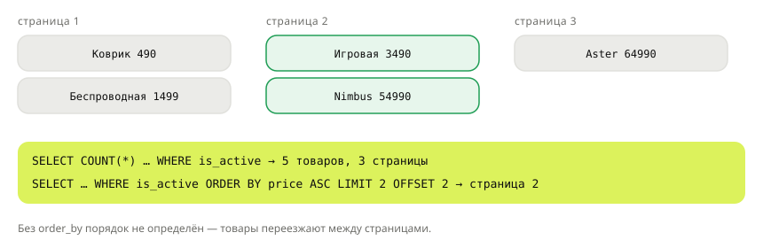

## Теория
Без явной сортировки база отдаёт строки в любом удобном ей порядке, и он может меняться от запроса к запросу (курс SQL, «Сортировка»). Порядок задаёт **`order_by("поле")`**; по убыванию — минус: `order_by("-price")`; несколько полей — `order_by("price", "name")`: при равной цене — по названию. `order_by()` без аргументов отменяет сортировку, в том числе `Meta.ordering`.

**Срезы** QuerySet — это `LIMIT` и `OFFSET`: `qs[:3]` — первые три, `qs[20:40]` — третья страница по 20. Срез без шага остаётся ленивым QuerySet, отрицательные индексы (`qs[-1]`) не поддерживаются. Первый и последний объект — **`first()`** и **`last()`**: они сами добавят сортировку по `pk`, если её нет.

**Пагинация** — постраничный вывод. Ручные срезы неудобны: нужно считать номер страницы, число страниц, проверять границы. **`Paginator(qs, 20)`** из `django.core.paginator` делает это сам:
- `paginator.get_page(номер)` — страница: неверный номер (`abc`) даёт первую, слишком большой — последнюю. Строже — `paginator.page(номер)`: он выбросит `EmptyPage` / `PageNotAnInteger`;
- у страницы — `page.object_list` (или просто цикл ``), `page.number`, `page.has_next`, `page.next_page_number`, `page.paginator.num_pages`;
- запросов два: `COUNT(*)` — сколько всего, и `LIMIT … OFFSET …` — строки текущей страницы.

Пагинировать можно только **упорядоченный** QuerySet: без `order_by` одни и те же товары окажутся на разных страницах, а Django предупредит `UnorderedObjectListWarning`.

## Наглядно
**Рисунок 1.** Paginator делит упорядоченный список на страницы: один запрос считает строки, второй берёт одну страницу.



**Таблица 1.** Сортировка и срезы.

| ORM | SQL |
|---|---|
| `order_by("-price")[:3]` | `ORDER BY price DESC LIMIT 3` |
| `order_by("price", "name")[2:4]` | `ORDER BY price ASC, name ASC LIMIT 2 OFFSET 2` |
| `order_by("price").first()` | `ORDER BY price ASC LIMIT 1` |
| `order_by("price").last()` | `ORDER BY price DESC LIMIT 1` |
| `Paginator(qs, 2).get_page(2)` | `COUNT(*)` + `… LIMIT 2 OFFSET 2` |

## На практике
Задача: три самых дорогих товара и каталог по две карточки на странице со ссылкой «Дальше».

### Шаг 1. Сортировка и срезы
Файл `orm.py`:
```python
print(Product.objects.order_by("-price")[:3])
print(Product.objects.order_by("price", "name")[2:4])
print(Product.objects.order_by("price").first(), Product.objects.order_by("price").last())
```
Результат:
```
<QuerySet [<Product: Ноутбук Aster 14>, <Product: Ноутбук Nimbus Air>, <Product: Игровая мышь>]>
<QuerySet [<Product: Беспроводная мышь>, <Product: Игровая мышь>]>
Коврик для мыши Ноутбук Aster 14
```
SQL (колонки сокращены):
```
SELECT … FROM "shop_product" ORDER BY "shop_product"."price" DESC LIMIT 3
SELECT … FROM "shop_product" ORDER BY "shop_product"."price" ASC, "shop_product"."name" ASC LIMIT 2 OFFSET 2
SELECT … FROM "shop_product" ORDER BY "shop_product"."price" ASC LIMIT 1
SELECT … FROM "shop_product" ORDER BY "shop_product"."price" DESC LIMIT 1
```
`last()` не загружает все строки: Django разворачивает сортировку и берёт одну.

### Шаг 2. Каталог с пагинацией
Файл `views.py`:
```python
from django.core.paginator import Paginator
from django.shortcuts import render

from .models import Product


def catalog(request):
    products = Product.objects.filter(is_active=True).order_by("price")
    paginator = Paginator(products, 2)
    page = paginator.get_page(request.GET.get("page"))
    return render(request, "shop/catalog.html", {"page": page})
```

Файл `templates/shop/catalog.html`:
```html
<ul>
  <li>{{ product.name }} — {{ product.price }}</li>
</ul>
<p>Страница {{ page.number }} из {{ page.paginator.num_pages }}</p>
<a href="?page={{ page.next_page_number }}">Дальше</a>
```

### Шаг 3. Запросы
Результат:
```
GET /catalog/ → 200 OK, SQL-запросов: 2
<li>Коврик для мыши — 490,00</li><li>Беспроводная мышь — 1499,00</li>
<p>Страница 1 из 3</p>
<a href="?page=2">Дальше</a>

GET /catalog/?page=3 → 200 OK
<li>Ноутбук Aster 14 — 64990,00</li>
<p>Страница 3 из 3</p>

GET /catalog/?page=99 → 200 OK
<p>Страница 3 из 3</p>

GET /catalog/?page=abc → 200 OK
<p>Страница 1 из 3</p>
```
`get_page` не падает на чужих номерах: слишком большой — последняя страница, не число — первая. SQL второй страницы:
```
SELECT COUNT(*) AS "__count" FROM "shop_product" WHERE "shop_product"."is_active"
SELECT … FROM "shop_product" WHERE "shop_product"."is_active" ORDER BY "shop_product"."price" ASC LIMIT 2 OFFSET 2
```

## Частые ошибки
- **Пагинация без `order_by`.** Порядок не гарантирован — товар может оказаться на двух страницах или ни на одной. Перед `Paginator` — всегда сортировка (с уникальным полем в конце: `order_by("price", "id")`).
- **`page(номер)` без обработки ошибок.** `?page=abc` даёт `PageNotAnInteger` и 500. Для страниц каталога — `get_page`.
- **`qs[-1]`.** `ValueError: Negative indexing is not supported.` — последний объект берут `last()` или сортировкой по убыванию.
- **Сортировка в Python.** `sorted(Product.objects.all(), key=…)` загружает всю таблицу; сортирует база — `order_by`.
- **Ссылки страниц без фильтров.** `?page=2` теряет `?q=мышь` — на второй странице уже весь каталог. Параметры поиска переносят в ссылки страниц (курс «HTML, CSS и основы веба», «Каталог»).

## Итог
**Сортировка**
- `order_by("поле", "-поле")`; без неё порядок не определён; `order_by()` — отменить.

**Срезы**
- `qs[:n]` — `LIMIT`, `qs[a:b]` — `LIMIT … OFFSET`; отрицательных индексов нет; `first()`/`last()`.

**Пагинация**
- `Paginator(упорядоченный_qs, n).get_page(номер)`: два запроса, неверный номер не роняет страницу.
- В шаблоне — `page.number`, `page.has_next`, `page.next_page_number`, `page.paginator.num_pages`.

## Вопросы на собеседовании
<details><summary>Как сделать постраничный вывод в Django?</summary>

`Paginator(queryset, per_page)` и `paginator.get_page(request.GET.get("page"))`. Страница — итерируемый объект с методами `has_next`, `next_page_number`, `number` и ссылкой на пагинатор. Django выполняет `COUNT(*)` и запрос с `LIMIT/OFFSET`. Queryset должен быть упорядочен.
</details>

<details><summary>Чем `Paginator.page()` отличается от `get_page()`?</summary>

`page(n)` строгий: при нечисловом номере — `PageNotAnInteger`, за пределами — `EmptyPage`. `get_page(n)` прощающий: нечисловой номер — первая страница, слишком большой — последняя. Для пользовательских ссылок обычно берут `get_page`.
</details>

<details><summary>Почему большой `OFFSET` медленный и что с этим делают?</summary>

Чтобы пропустить 100 000 строк, базе всё равно нужно их пройти и отбросить. Для глубоких страниц и бесконечной ленты используют курсорную пагинацию (keyset): «следующие 20 после товара с ценой X и id Y» — `WHERE (price, id) > (X, Y) ORDER BY price, id LIMIT 20`. Такой запрос работает по индексу с любой глубины.
</details>

## Глубже
Выбор только нужных колонок — следующая тема. Пагинация в class-based views (`ListView`, `paginate_by`) — раздел «Class-based views».
