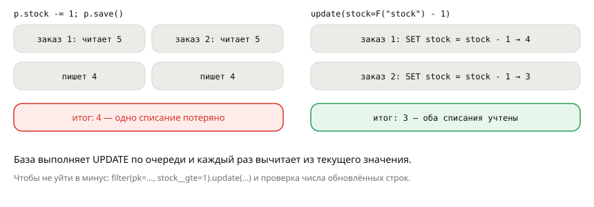

## Теория
В условиях до сих пор справа стояло значение из Python: `price__lt=1000`. А как найти товары, у которых цена со скидкой выше обычной, — то есть сравнить **две колонки одной строки**? Или уменьшить остаток на 1 **в базе**, не читая его в Python? Для этого есть **`F("поле")`** из `django.db.models` — ссылка на колонку, которую база подставит сама:
- в условиях: `filter(sale_price__gt=F("price"))` — `WHERE sale_price > price`; с арифметикой: `filter(stock__lt=F("reserved") + 5)`;
- в обновлениях: `filter(pk=…).update(stock=F("stock") - 1)` — `SET stock = stock - 1`. Значение меняет база, одним запросом.

Зачем второе. Обычный способ «прочитать — уменьшить — сохранить» ломается, когда два покупателя оформляют заказ одновременно: оба прочитали остаток 5, оба записали 4 — продано два, а списан один. Это **гонка** (race condition). `F("stock") - 1` считает от значения, которое в базе **в момент обновления**: два запроса дадут 3. (Блокировки и `select_for_update` — раздел «Продвинутый ORM».)

`F` можно присвоить и полю объекта: `product.stock = F("stock") - 1; product.save()`. Но после этого в атрибуте лежит не число, а выражение — `F(stock) - Value(1)`. Настоящее значение нужно перечитать: **`product.refresh_from_db()`**. И `save()` при этом всё равно записывает все остальные поля — как всегда.

## Наглядно
**Рисунок 1.** «Прочитать — изменить — сохранить» теряет списание при одновременных заказах; `F` считает в базе.



**Таблица 1.** F в запросах.

| ORM | SQL |
|---|---|
| `filter(sale_price__gt=F("price"))` | `WHERE sale_price > price` |
| `filter(stock__lt=F("price") / 1000)` | `WHERE stock < (price / 1000)` |
| `update(stock=F("stock") - 1)` | `SET stock = (stock - 1)` |
| `update(price=F("price") * 0.9)` | `SET price = (price * 0.9)` |
| `obj.stock = F("stock") - 1; obj.save()` | `UPDATE … SET …, stock = (stock - 1), … WHERE id = …` |

## На практике
Задача: списать товар со склада при заказе без гонки и найти «подозрительно дешёвые» товары, у которых остаток меньше тысячной доли цены.

### Шаг 1. Списание одним запросом
Файл `orm.py`:
```python
from django.db.models import F
Product.objects.filter(slug="aster-14").update(stock=F("stock") - 1)
p = Product.objects.get(slug="aster-14")
print(p.stock)
```
Результат:
```
4
```
SQL:
```
UPDATE "shop_product" SET "stock" = ("shop_product"."stock" - 1) WHERE "shop_product"."slug" = 'aster-14'
```
База сама вычла 1 из текущего значения. Если два таких запроса придут одновременно, база выполнит их по очереди, и остаток уменьшится на 2.

### Шаг 2. Сравнение колонок
`Product.objects.filter(stock__lt=F("price") / 1000)` — «остаток меньше цены, делённой на 1000».

Результат:
```
<QuerySet [<Product: Ноутбук Aster 14>, <Product: Ноутбук Nimbus Air>]>
```
SQL (колонки сокращены):
```
SELECT … FROM "shop_product" WHERE "shop_product"."stock" < (CAST(("shop_product"."price" / 1000) AS NUMERIC)) LIMIT 21
```
Оба значения берутся из одной строки; Django сам привёл тип результата деления.

### Шаг 3. F в объекте
Файл `orm.py`:
```python
from django.db.models import F
p = Product.objects.get(slug="aster-14")
p.stock = F("stock") - 1
p.save()
print(p.stock)
p.refresh_from_db()
print(p.stock)
```
Результат:
```
F(stock) - Value(1)
4
```
SQL сохранения:
```
UPDATE "shop_product" SET "category_id" = 1, "name" = 'Ноутбук Aster 14', "slug" = 'aster-14', "description" = '', "price" = '64990.00', "stock" = ("shop_product"."stock" - 1), "is_active" = 1, "created_at" = '2026-03-01 12:00:00' WHERE "shop_product"."id" = 1
```
Остаток посчитала база, но `save()` переписал и остальные поля значениями из объекта — изменения других полей, сделанные параллельно, потеряются. Для одного поля чище `filter(pk=p.pk).update(…)`.

## Частые ошибки
- **«Прочитать — изменить — сохранить» для счётчиков.** `p.stock -= 1; p.save()` при одновременных заказах теряет списания. Остатки, счётчики просмотров, балансы — `update(поле=F("поле") ± …)`.
- **Использовать атрибут после `F`.** `p.stock` после `p.stock = F(...)` и `save()` — выражение, а не число; в шаблоне выведется `F(stock) - Value(1)`. Нужен `refresh_from_db()`.
- **Повторный `save()` того же объекта.** Выражение в атрибуте осталось — второй `save()` спишет ещё одну единицу.
- **`F` не уберёт отрицательный остаток.** `stock = 0` минус 1 — нарушение `CHECK`, `IntegrityError`. Условие «если хватает» добавляют в фильтр: `filter(pk=…, stock__gte=1).update(...)` и проверяют, сколько строк обновилось.
- **Сравнение двух полей через Python.** `[p for p in qs if p.sale_price > p.price]` загружает всю таблицу; сравнивает база — `F`.

## Итог
**F**
- `F("поле")` — значение колонки той же строки; арифметика `+ - * /`.
- Условия: `filter(a__gt=F("b"))`; обновления: `update(a=F("a") - 1)`.

**Гонки**
- Обновление через `F` считается в базе и не теряет одновременные изменения.
- Безопасное списание: `filter(pk=…, stock__gte=n).update(stock=F("stock") - n)` и проверка результата.

**В объекте**
- После `obj.поле = F(...)` и `save()` — `refresh_from_db()`; `save()` по-прежнему пишет все поля.

## Вопросы на собеседовании
<details><summary>Что такое `F`-выражение и зачем оно?</summary>

Ссылка на значение колонки в самой базе. Позволяет сравнивать поля одной строки (`filter(sale_price__gt=F("price"))`) и обновлять значение относительно текущего (`update(stock=F("stock") - 1)`) без чтения в Python. Вычисление происходит в SQL, поэтому одновременные обновления не теряются.
</details>

<details><summary>Как избежать гонки при уменьшении остатка?</summary>

Атомарным `UPDATE`: `Product.objects.filter(pk=pk, stock__gte=qty).update(stock=F("stock") - qty)` и проверить, что обновилась одна строка (`update` возвращает число строк). Если нужно прочитать и принять решение, — транзакция и `select_for_update()`, который блокирует строку до конца транзакции.
</details>

<details><summary>Что будет с атрибутом объекта после `obj.field = F(...)` и `save()`?</summary>

В атрибуте останется выражение (`CombinedExpression`), а не значение: Django не перечитывает строку после `UPDATE`. Нужно вызвать `obj.refresh_from_db()` (или `refresh_from_db(fields=[...])`). Повторный `save()` без перечитывания применит выражение ещё раз.
</details>

## Глубже
Транзакции и блокировки строк — раздел «Продвинутый ORM». `F` в вычисляемых полях (`annotate`) — раздел «ORM: агрегация».
