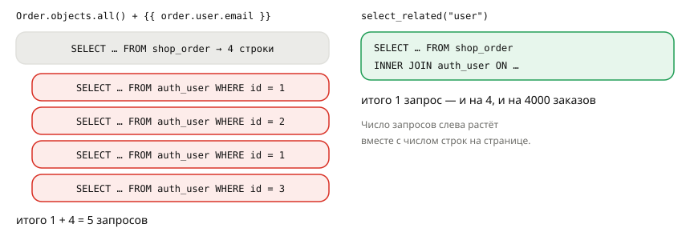

## Теория
Страница списка заказов показывает номер и почту покупателя. View делает `Order.objects.all()` — один запрос. Шаблон в цикле выводит `order.user.email` — и для **каждого** заказа Django загружает покупателя отдельным запросом: связанный объект не был загружен заранее. Итого **1 + N** запросов, где N — число заказов. Это самая частая проблема производительности в Django-проектах: на 10 заказах страница работает, на 1000 — открывается секунды, потому что каждый запрос — это поездка к базе, даже если сам он быстрый.

N+1 возникает везде, где в цикле обращаются к связи:
- `obj.fk.поле` — `ForeignKey` или `OneToOne` вперёд (`order.user.email`, `product.category.name`);
- `obj.related.all()` / `.count()` — обратная связь и M2M (`product.tags.all`, `order.items.count`);
- метод модели или колонка `list_display` в админке, которые внутри ходят по связи.

Его не видно в коде: и view, и шаблон выглядят безобидно. Видно в **журнале SQL**: много одинаковых запросов, отличающихся только числом в `WHERE id = …`. В тренажёре такие повторы помечены плашкой N+1; в проекте журнал показывает django-debug-toolbar, а в тестах число запросов фиксируют `assertNumQueries` (раздел «Тесты в Django»; в задачах тренажёра — `max_queries`).

Лечится загрузкой связанных данных **заранее**, одним-двумя запросами на всю страницу: `select_related` для связей «к одному» и `prefetch_related` для связей «ко многим» — две следующие темы.

## Наглядно
**Рисунок 1.** Список из N заказов: один запрос за заказами и ещё по запросу на покупателя каждого.



**Таблица 1.** Где прячется N+1.

| Код в цикле | Лишний запрос на каждый объект | Лечение |
|---|---|---|
| `{{ order.user.email }}` | `SELECT … FROM auth_user WHERE id = …` | `select_related("user")` |
| `{{ product.category.name }}` | `SELECT … FROM shop_category WHERE id = …` | `select_related("category")` |
| `` | `SELECT … FROM shop_tag JOIN … WHERE product_id = …` | `prefetch_related("tags")` |
| `{{ order.items.count }}` | `SELECT COUNT(*) … WHERE order_id = …` | `annotate(Count("items"))` |
| `list_display = ["user_email"]` (метод) | как у FK | `list_select_related = ["user"]` |

## На практике
Задача: найти и посчитать лишние запросы на страницах «Заказы» и «Каталог».

### Шаг 1. Список заказов
Файл `views.py` (фрагмент):
```python
def orders(request):
    orders = Order.objects.order_by("number")
    return render(request, "shop/orders.html", {"orders": orders})
```
Шаблон выводит `{{ order.number }} — {{ order.user.email }}`.

Результат:
```
GET /orders/ → 200 OK, SQL-запросов: 5

<li>A-12 — anna@shop.example</li><li>A-13 — boris@shop.example</li><li>A-14 — anna@shop.example</li><li>A-15 — vera@shop.example</li>
```
SQL (колонки пользователя сокращены):
```
SELECT "shop_order"."id", "shop_order"."user_id", "shop_order"."number" FROM "shop_order" ORDER BY "shop_order"."number" ASC
SELECT … FROM "auth_user" WHERE "auth_user"."id" = 1 LIMIT 21
SELECT … FROM "auth_user" WHERE "auth_user"."id" = 2 LIMIT 21
SELECT … FROM "auth_user" WHERE "auth_user"."id" = 1 LIMIT 21
SELECT … FROM "auth_user" WHERE "auth_user"."id" = 3 LIMIT 21
```
1 + 4. Анна загружена дважды: у каждого заказа свой объект пользователя, кэша между ними нет.

### Шаг 2. Каталог с категорией и метками
Шаблон выводит `{{ p.name }} ({{ p.category.name }})` и метки товара циклом ``.

Результат:
```
GET /catalog/ → 200 OK, SQL-запросов: 9
```
Запрос товаров, а затем для каждого из 4 товаров — категория и метки: 1 + 4 × 2. Две связи в цикле — два «N».

### Шаг 3. Как заметить
Признаки в журнале: число запросов растёт вместе с числом строк на странице, и запросы повторяются с разными `id`. Быстрая проверка — добавить в базу ещё объектов и посмотреть, изменилось ли число запросов. Правильная страница делает одно и то же число запросов на 4 и на 400 заказов.

## Частые ошибки
- **Проверять на трёх объектах.** N+1 незаметен на учебных данных и «вдруг» появляется на боевых. Смотрите на число запросов, а не на время.
- **Лечить кэшированием.** Кэш прячет проблему до первой очистки; правильнее — загрузить связи заранее.
- **Считать, что `user` загружен вместе с заказом.** `order.user_id` есть в строке заказа, а `order.user` — отдельный запрос, если не было `select_related`.
- **N+1 в методе модели.** `def total(self): return sum(i.product.price * i.quantity for i in self.items.all())` в цикле по заказам — N × M запросов. Метод выглядит безобидно, а вызывают его на странице списка.
- **Админка.** Колонка `list_display` с полем связанной модели — N+1 на странице списка; `list_select_related` или своё `get_queryset`.

## Итог
**N+1**
- Один запрос за списком + по запросу на связь каждого объекта.
- Появляется при обращении к FK, обратным связям и M2M в цикле — в шаблоне, методе, админке.

**Как увидеть**
- Журнал SQL: повторяющиеся запросы с разными `id`; число запросов растёт вместе с данными.
- В тестах — фиксировать число запросов (`assertNumQueries`, в тренажёре — `max_queries`).

**Лечение**
- `select_related` — связи «к одному», `prefetch_related` — «ко многим».

## Вопросы на собеседовании
<details><summary>Что такое проблема N+1?</summary>

Один запрос загружает N объектов, а затем при обращении к связи каждого объекта выполняется ещё по запросу — всего N+1. Обычно возникает в цикле в шаблоне или сериализаторе. Решается заранее загруженными связями: `select_related` (JOIN) и `prefetch_related` (отдельный запрос с `IN`).
</details>

<details><summary>Как обнаружить N+1 в Django-проекте?</summary>

По журналу запросов: django-debug-toolbar на странице, логирование `django.db.backends`, `connection.queries` при `DEBUG = True`. В тестах — `assertNumQueries(n)` или `CaptureQueriesContext`: тест падает, если число запросов выросло. Признак — одинаковые запросы с разными значениями в `WHERE`.
</details>

<details><summary>Почему N+1 опасен, если каждый запрос быстрый?</summary>

Каждый запрос — круг до базы (сеть, разбор, планирование), и на 1000 объектов это 1000 кругов. Время растёт линейно с данными, нагрузка на базу умножается на число пользователей. Один запрос с JOIN или два с IN делают ту же работу за постоянное число обращений.
</details>

## Глубже
Связи «к одному» одним запросом — следующая тема `select_related`. Подсчёты без N+1 (`annotate(Count(…))`) — раздел «ORM: агрегация».
