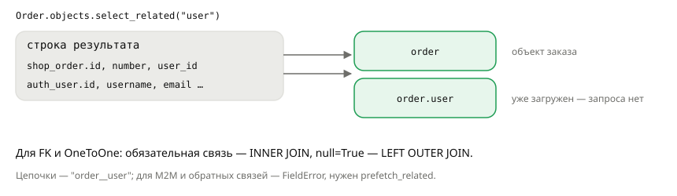

## Теория
**`select_related("связь")`** загружает связанный объект **в том же запросе**: Django добавляет `JOIN` и колонки связанной таблицы в `SELECT`, а из каждой строки собирает и заказ, и его покупателя. Обращение `order.user` после этого запроса не делает — объект уже есть.

Подходит для связей, где у объекта **один** связанный объект:
- `ForeignKey` вперёд: `Order.objects.select_related("user")`, `Product.objects.select_related("category")`;
- `OneToOneField` в обе стороны: `User.objects.select_related("profile")`.

Цепочки — через двойное подчёркивание: `OrderItem.objects.select_related("order__user", "product")` — позиция, её заказ, покупатель заказа и товар — один запрос с тремя `JOIN`. Несколько связей перечисляют через запятую.

Для **«ко многим»** — обратных связей и `ManyToManyField` — `select_related` не работает: одним `JOIN` их не загрузить без размножения строк. Django сразу скажет: `FieldError: Invalid field name(s) given in select_related: 'tags'. Choices are: category`. Для них — `prefetch_related` (следующая тема).

Обратите внимание на тип `JOIN`: для обязательного `ForeignKey` — `INNER JOIN`, а для связи с `null=True` Django использует `LEFT OUTER JOIN`, чтобы не потерять строки без связи. `select_related()` без аргументов загрузит **все** обязательные связи — удобно в консоли, но в коде лучше перечислять явно: запрос не разрастётся случайно.

## Наглядно
**Рисунок 1.** `select_related("user")` превращает 1 + N запросов в один с `JOIN`.



**Таблица 1.** Что загружает select_related.

| Запрос | JOIN | Для каких связей |
|---|---|---|
| `Order.objects.select_related("user")` | `INNER JOIN auth_user` | FK вперёд |
| `Product.objects.select_related("category__parent")` | два `JOIN`, родитель — `LEFT OUTER` (`null=True`) | цепочка FK |
| `OrderItem.objects.select_related("order__user", "product")` | три `JOIN` | несколько цепочек |
| `User.objects.select_related("profile")` | `LEFT OUTER JOIN shop_profile` | OneToOne обратно |
| `Product.objects.select_related("tags")` | — `FieldError` | M2M — только `prefetch_related` |

## На практике
Задача: убрать N+1 со страницы заказов и вывести позиции всех заказов с покупателем и товаром одним запросом.

### Шаг 1. Заказы с покупателем
Файл `views.py` (фрагмент):
```python
def orders(request):
    orders = Order.objects.select_related("user").order_by("number")
    return render(request, "shop/orders.html", {"orders": orders})
```
Результат:
```
GET /orders/ → 200 OK, SQL-запросов: 1
```
SQL:
```
SELECT "shop_order"."id", "shop_order"."user_id", "shop_order"."number", "auth_user"."id", "auth_user"."password", "auth_user"."last_login", "auth_user"."is_superuser", "auth_user"."username", "auth_user"."first_name", "auth_user"."last_name", "auth_user"."email", "auth_user"."is_staff", "auth_user"."is_active", "auth_user"."date_joined" FROM "shop_order" INNER JOIN "auth_user" ON ("shop_order"."user_id" = "auth_user"."id") ORDER BY "shop_order"."number" ASC
```
Было 5 запросов — стал один; и при сотне заказов останется один.

### Шаг 2. Цепочка связей
Файл `orm.py`:
```python
items = OrderItem.objects.select_related("order__user", "product").order_by("id")
for i in items:
    print(i.order.number, i.order.user.username, i.product.name, i.quantity)
```
Результат:
```
A-12 anna Ноутбук Aster 14 1
A-12 anna Беспроводная мышь 1
A-13 boris Коврик для мыши 2
A-14 anna Игровая мышь 1
A-15 vera Беспроводная мышь 2
A-15 vera Коврик для мыши 1
```
SQL — один запрос (колонки сокращены):
```
SELECT … FROM "shop_orderitem" INNER JOIN "shop_order" ON ("shop_orderitem"."order_id" = "shop_order"."id") INNER JOIN "auth_user" ON ("shop_order"."user_id" = "auth_user"."id") INNER JOIN "shop_product" ON ("shop_orderitem"."product_id" = "shop_product"."id") ORDER BY "shop_orderitem"."id" ASC
```
Без `select_related` здесь было бы 1 + 6 × 3 = 19 запросов.

### Шаг 3. M2M — не сюда
`Product.objects.select_related("tags")`:
```
django.core.exceptions.FieldError: Invalid field name(s) given in select_related: 'tags'. Choices are: category
```
Django перечисляет связи, которые можно загрузить так, — только `category`.

## Частые ошибки
- **`select_related` на обратную связь или M2M.** `FieldError … Choices are: …`. Для «ко многим» — `prefetch_related`.
- **Забыть звено цепочки.** `select_related("order")` и в шаблоне `item.order.user.email` — покупатель всё равно загружается по запросу на позицию. Нужно `"order__user"`.
- **`select_related()` без аргументов в коде.** Загрузит все обязательные FK — с их широкими колонками; запрос разрастается, когда в модель добавят связь. Перечисляйте нужные.
- **`select_related` ради одного объекта.** Для `get_object_or_404(Product, slug=…)` с выводом категории это экономит один запрос — полезно, но главная выгода — в списках.
- **JOIN по десятку связей.** Очень широкие строки тоже медленные. Если связей много, часть удобнее загрузить `prefetch_related`.

## Итог
**select_related**
- `JOIN` и загрузка связанного объекта в том же запросе.
- Для FK вперёд и OneToOne; цепочки — `"order__user"`, несколько — через запятую.
- Обязательная связь — `INNER JOIN`, с `null=True` — `LEFT OUTER JOIN`.

**Не для**
- Обратных FK и M2M — `FieldError`; для них `prefetch_related`.

## Вопросы на собеседовании
<details><summary>Как работает `select_related`?</summary>

Добавляет к запросу `JOIN` на связанные таблицы и выбирает их колонки, а при разборе строк создаёт и основной, и связанные объекты. Работает для `ForeignKey` и `OneToOneField` (одиночных связей), поддерживает цепочки через `__`.
</details>

<details><summary>Почему `select_related` нельзя использовать для ManyToMany?</summary>

У объекта много связанных строк: `JOIN` размножил бы основную строку на каждую связанную, и Django пришлось бы склеивать дубли и терять LIMIT/пагинацию. Поэтому для M2M и обратных FK используется `prefetch_related` — отдельный запрос с `IN`, а склейка — в Python.
</details>

<details><summary>Какой JOIN делает `select_related` для nullable FK?</summary>

`LEFT OUTER JOIN`: объекты без связанной строки не должны пропасть из результата. Для обязательного (`null=False`) FK — `INNER JOIN`.
</details>

## Глубже
Связи «ко многим» без N+1 — следующая тема `prefetch_related`. Как закрепить число запросов тестом — раздел «Тесты в Django».
