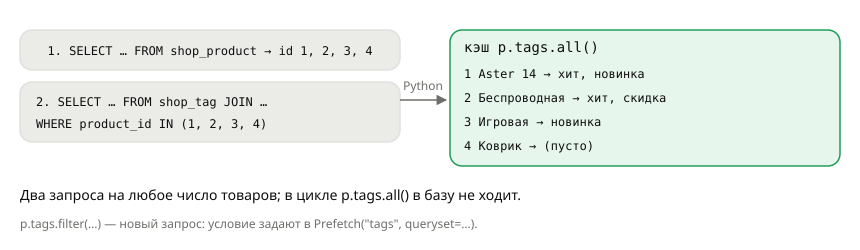

## Теория
Для связей «ко многим» — меток товара, позиций заказа, товаров категории — **`prefetch_related("связь")`**. Он работает иначе, чем `select_related`: сначала выполняется основной запрос, а потом **один** дополнительный запрос за связанными строками всех объектов сразу — `WHERE product_id IN (1, 2, 3, 4)`. Склеивает результаты Django в Python и кладёт каждому объекту его список. Итого — 2 запроса на любое число товаров вместо 1 + N.

Подходит для:
- `ManyToManyField`: `Product.objects.prefetch_related("tags")`;
- обратных `ForeignKey`: `Category.objects.prefetch_related("products")`, `Order.objects.prefetch_related("items")`;
- цепочек: `prefetch_related("items__product")` — позиции и их товары (по запросу на уровень).

`select_related` и `prefetch_related` сочетаются: `Product.objects.select_related("category").prefetch_related("tags")` — категория через `JOIN`, метки — вторым запросом.

**Главная ловушка.** Предзагрузка заполняет кэш для `obj.related.all()` (по нему же работают `len`, `.count()` и `.exists()`). Методы, которые строят новый запрос, — `.filter()`, `.exclude()`, `.order_by()` и даже `.first()` (он сортирует по ключу), — снова идут в базу, и предзагруженные данные не используются. `p.reviews.filter(is_published=True)` в цикле — снова N+1, хотя `prefetch_related("reviews")` написан.

Нужен отбор или порядок — его задают в самой предзагрузке объектом **`Prefetch`**:
```
Prefetch("reviews", queryset=Review.objects.filter(is_published=True), to_attr="published_reviews")
```
`queryset` — какие строки и в каком порядке подгрузить, `to_attr` — в какой атрибут положить готовый **список** (без `to_attr` отфильтрованный результат заменит обычный `obj.reviews.all()`, что путает).

## Наглядно
**Рисунок 1.** `prefetch_related` — второй запрос с `IN` по всем объектам и склейка в Python.



**Таблица 1.** `select_related` и `prefetch_related`.

| | `select_related` | `prefetch_related` |
|---|---|---|
| Связи | FK вперёд, OneToOne | M2M, обратные FK (и любые) |
| Запросов | один, с `JOIN` | основной + по одному на каждую связь |
| Склейка | в базе | в Python |
| Фильтр связанных | — | `Prefetch("rel", queryset=…)` |
| Ловушка | `FieldError` для «ко многим» | `.filter()` после предзагрузки — новые запросы |

## На практике
Задача: каталог с категорией и метками без N+1, категории с их товарами и опубликованные отзывы каждого товара.

### Шаг 1. Каталог
Файл `views.py` (фрагмент):
```python
def catalog(request):
    products = (
        Product.objects.select_related("category")
        .prefetch_related("tags")
        .order_by("id")
    )
    return render(request, "shop/catalog.html", {"products": products})
```
Тот же шаблон, что в теме «Проблема N+1»: категория и метки каждого товара.

Результат:
```
GET /catalog/ → 200 OK, SQL-запросов: 2

<li>Ноутбук Aster 14 (Ноутбуки): хит новинка </li>
<li>Беспроводная мышь (Мыши): хит скидка </li>
<li>Игровая мышь (Мыши): новинка </li>
<li>Коврик для мыши (Коврики): </li>
```
SQL (колонки сокращены):
```
SELECT … FROM "shop_product" INNER JOIN "shop_category" ON ("shop_product"."category_id" = "shop_category"."id") ORDER BY "shop_product"."id" ASC
SELECT ("shop_product_tags"."product_id") AS "_prefetch_related_val_product_id", "shop_tag"."id", "shop_tag"."name" FROM "shop_tag" INNER JOIN "shop_product_tags" ON ("shop_tag"."id" = "shop_product_tags"."tag_id") WHERE "shop_product_tags"."product_id" IN (1, 2, 3, 4)
```
Было 9 — стало 2.

### Шаг 2. Обратная связь
Файл `orm.py`:
```python
qs = Category.objects.prefetch_related("products").filter(parent__isnull=False)
for c in qs.order_by("id"):
    print(c.name, [p.name for p in c.products.all()])
```
Результат:
```
Ноутбуки ['Ноутбук Aster 14']
Мыши ['Беспроводная мышь', 'Игровая мышь']
```
Второй запрос — `… FROM "shop_product" WHERE "shop_product"."category_id" IN (2, 3)`.

### Шаг 3. Ловушка с filter
Предзагрузили отзывы, а в цикле отобрали опубликованные:

Файл `orm.py`:
```python
for p in Product.objects.prefetch_related("reviews").order_by("id"):
    print(p.name, [r.rating for r in p.reviews.filter(is_published=True)])
```
Результат:
```
Ноутбук Aster 14 [5]
Беспроводная мышь [5, 4]
Игровая мышь []
Коврик для мыши []
```
Ответ верный, но запросов шесть: товары, предзагрузка отзывов — и ещё по запросу на товар, `… WHERE ("shop_review"."product_id" = 1 AND "shop_review"."is_published")`. Предзагрузка не пригодилась.

### Шаг 4. Prefetch с условием
Файл `orm.py`:
```python
from django.db.models import Prefetch
published = Review.objects.filter(is_published=True).order_by("-rating")
qs = Product.objects.prefetch_related(
    Prefetch("reviews", queryset=published, to_attr="published_reviews")
).order_by("id")
for p in qs:
    print(p.name, [r.rating for r in p.published_reviews])
```
Результат тот же, запросов — два:
```
SELECT … FROM "shop_product" ORDER BY "shop_product"."id" ASC
SELECT … FROM "shop_review" WHERE ("shop_review"."is_published" AND "shop_review"."product_id" IN (1, 2, 3, 4)) ORDER BY "shop_review"."rating" DESC
```
Отбор и сортировка — в запросе предзагрузки; `published_reviews` — обычный список, у него нет `.all()`.

## Частые ошибки
- **`.filter()` / `.order_by()` по предзагруженной связи.** Новый запрос на каждый объект. Условие — в `Prefetch(queryset=…)`.
- **`to_attr` и `.all()`.** `p.published_reviews` — список; `p.published_reviews.all()` — `AttributeError: 'list' object has no attribute 'all'`.
- **`prefetch_related` вместо `select_related` для FK.** Работает, но два запроса вместо одного `JOIN`. Для «к одному» — `select_related`.
- **Предзагрузка огромной связи.** `prefetch_related("orders")` у тысячи покупателей с сотнями заказов — сотни тысяч строк в память ради последнего заказа. Ограничьте `Prefetch(queryset=…)` или посчитайте нужное в базе (раздел «ORM: агрегация»).
- **Цепочка без промежуточного звена.** `prefetch_related("items")` и в цикле `item.product.name` — N+1 по товарам. Нужно `"items__product"` (или `Prefetch("items", queryset=OrderItem.objects.select_related("product"))`).

## Итог
**prefetch_related**
- Основной запрос + один запрос с `IN` на каждую связь; склейка в Python.
- Для M2M и обратных FK; сочетается с `select_related`; цепочки — `"items__product"`.

**Prefetch**
- `Prefetch("связь", queryset=…, to_attr="имя")` — отбор, порядок, свой атрибут-список.
- `.filter()` по предзагруженной связи — новые запросы.

## Вопросы на собеседовании
<details><summary>Чем `prefetch_related` отличается от `select_related`?</summary>

`select_related` делает `JOIN` и загружает связанные объекты в том же запросе — только для FK вперёд и OneToOne. `prefetch_related` выполняет отдельный запрос с `IN` по ключам загруженных объектов и раскладывает результат в Python — работает для M2M и обратных FK. Первый — один запрос, второй — по запросу на каждую связь.
</details>

<details><summary>Почему после `prefetch_related` в цикле снова N+1?</summary>

Кэш предзагрузки используется для `obj.related.all()`, `count()` и `exists()`, а `filter`, `exclude`, `order_by` и `first` создают новый QuerySet и идут в базу. Нужное условие задают в `Prefetch("related", queryset=...)`.
</details>

<details><summary>Зачем объект `Prefetch` и `to_attr`?</summary>

`Prefetch` позволяет задать queryset предзагрузки: отбор, сортировку, `select_related` вложенных объектов. `to_attr` сохраняет результат в отдельный атрибут-список, не подменяя обычный менеджер связи, — так в коде видно, что это отфильтрованные данные.
</details>

## Глубже
Подсчёты по связям одним запросом — раздел «ORM: агрегация». Как закрепить число запросов страницы тестом — раздел «Тесты в Django».
