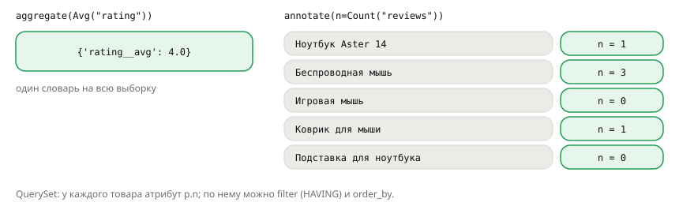

## Теория
В карточке каждого товара — число отзывов и средняя оценка. **`annotate()`** считает значение **для каждого объекта** и кладёт его атрибутом: `Product.objects.annotate(n=Count("reviews"))` — у каждого товара появляется `p.n`. Агрегат идёт через связь (`reviews`, `reviews__rating`), а в SQL это `LEFT OUTER JOIN` + `GROUP BY` по колонкам товара: товары без отзывов не пропадают, у них `0` (для `Count`) или `None` (для `Avg`, `Sum`).

Результат — обычный QuerySet, поэтому по аннотации можно:
- фильтровать — `.filter(n__gte=1)` превращается в `HAVING`;
- сортировать — `.order_by("-n")`;
- выводить в шаблоне — `{{ p.n }}`.

**Порядок `filter` и `annotate` важен**, когда условие идёт через ту же связь, что агрегат:
- `filter(orders__status="paid").annotate(n=Count("orders"))` — сначала оставили оплаченные заказы, потом посчитали: `n` — число **оплаченных**;
- `annotate(n=Count("orders")).filter(orders__status="paid")` — сначала посчитали все, потом отобрали покупателей: `n` — число **всех** заказов (фильтр добавляет свой `JOIN`).

Посчитать несколько величин по одной связи с разными условиями — аргумент **`filter=Q(…)`** у агрегата: `Count("orders", filter=Q(orders__status="paid"))` (в SQL — `COUNT(…) FILTER (WHERE …)`). Остальные строки при этом не теряются.

## Наглядно
**Рисунок 1.** `aggregate` сворачивает выборку в одно число, `annotate` добавляет число к каждому объекту.



**Таблица 1.** `aggregate` и `annotate`.

| | `aggregate` | `annotate` |
|---|---|---|
| Результат | словарь | QuerySet объектов |
| Значений | одно на выборку | по одному на объект |
| SQL | `SELECT SUM(…) FROM …` | `… GROUP BY` колонки объекта |
| Дальше | ничего | `filter` (→ `HAVING`), `order_by`, шаблон |
| Пример | выручка магазина | отзывов у каждого товара |

## На практике
Задача: число отзывов и средняя оценка в карточках, «популярные товары» и счётчики заказов покупателей. Модели и данные — как в теме `aggregate`.

### Шаг 1. Значение на каждый товар
Файл `orm.py`:
```python
from django.db.models import Avg, Count
qs = Product.objects.annotate(
    n=Count("reviews"), avg=Avg("reviews__rating")
).order_by("id")
for p in qs:
    print(p.name, p.n, p.avg)
```
Результат:
```
Ноутбук Aster 14 1 5.0
Беспроводная мышь 3 3.6666666666666665
Игровая мышь 0 None
Коврик для мыши 1 4.0
Подставка для ноутбука 0 None
```
SQL:
```
SELECT "shop_product"."id", "shop_product"."category_id", "shop_product"."name", "shop_product"."price", "shop_product"."stock", COUNT("shop_review"."id") AS "n", AVG("shop_review"."rating") AS "avg" FROM "shop_product" LEFT OUTER JOIN "shop_review" ON ("shop_product"."id" = "shop_review"."product_id") GROUP BY "shop_product"."id", "shop_product"."category_id", "shop_product"."name", "shop_product"."price", "shop_product"."stock" ORDER BY "shop_product"."id" ASC
```
Один запрос на все карточки. Без отзывов: `n` — `0`, `avg` — `None`. Округлить в шаблоне — `{{ p.avg|floatformat:1 }}`.

### Шаг 2. Фильтр и сортировка по аннотации
Файл `orm.py`:
```python
from django.db.models import Count
qs = (
    Product.objects.annotate(n=Count("reviews"))
    .filter(n__gte=1)
    .order_by("-n", "id")
)
print([(p.name, p.n) for p in qs])
```
Результат:
```
[('Беспроводная мышь', 3), ('Ноутбук Aster 14', 1), ('Коврик для мыши', 1)]
```
Условие на агрегат в SQL — `HAVING COUNT("shop_review"."id") >= 1`: оно проверяется после группировки.

### Шаг 3. Порядок filter и annotate
Покупатели, у которых есть оплаченный заказ, и число заказов:

Файл `orm.py`:
```python
from django.db.models import Count
a = (
    User.objects.annotate(n=Count("orders"))
    .filter(orders__status="paid").order_by("username")
)
b = (
    User.objects.filter(orders__status="paid")
    .annotate(n=Count("orders")).order_by("username")
)
print([(u.username, u.n) for u in a])
print([(u.username, u.n) for u in b])
```
Результат:
```
[('anna', 2), ('vera', 2)]
[('anna', 1), ('vera', 1)]
```
В `a` посчитаны все заказы (у Анны A-10 и A-13), а фильтр присоединил таблицу заказов второй раз (`INNER JOIN "shop_order" T3`). В `b` условие ограничило заказы до подсчёта — осталось по одному оплаченному.

### Шаг 4. Несколько счётчиков по одной связи
Файл `orm.py`:
```python
from django.db.models import Count, Q
paid = Q(orders__status__in=["paid", "shipped"])
qs = User.objects.annotate(
    total=Count("orders"),
    paid=Count("orders", filter=paid),
).order_by("username")
print([(u.username, u.total, u.paid) for u in qs])
```
Результат:
```
[('anna', 2, 2), ('boris', 2, 1), ('gleb', 0, 0), ('vera', 2, 1)]
```
SQL счётчика:
```
COUNT("shop_order"."id") FILTER (WHERE "shop_order"."status" IN ('paid', 'shipped')) AS "paid"
```
Глеб без заказов — в списке, с нулями: условие внутри агрегата не отбрасывает строки.

## Частые ошибки
- **`aggregate` вместо `annotate`.** «Отзывов у каждого товара» — `annotate`; `aggregate(Count("reviews"))` — одно число на весь каталог.
- **Счётчик в цикле.** `{{ p.reviews.count }}` в шаблоне — запрос на каждый товар (N+1). `annotate(n=Count("reviews"))` — один запрос.
- **Не тот порядок `filter`/`annotate`.** Фильтр по той же связи до `annotate` ограничивает, что считается; после — только какие объекты показать. Перепутали — счётчики не те.
- **`filter` вместо `filter=Q(…)`.** `filter(orders__status="paid")` убирает покупателей без оплаченных заказов целиком; `Count(…, filter=Q(…))` оставляет всех и считает только подходящие.
- **`None` у среднего.** У товара без отзывов `avg` — `None`; `{{ p.avg|floatformat:1 }}` выведет пустую строку. Ноль — `Coalesce` (тема «Условные выражения»).
- **Имя аннотации совпало с полем.** `annotate(price=…)` — `ValueError: The annotation 'price' conflicts with a field on the model.`

## Итог
**annotate**
- Значение на каждый объект: `LEFT OUTER JOIN` + `GROUP BY`; результат — QuerySet.
- По аннотации — `filter` (`HAVING`), `order_by`, вывод в шаблоне.

**Порядок и условия**
- `filter` по связи до `annotate` — что считать; после — кого показать.
- Разные условия по одной связи — `Count(…, filter=Q(…))`.

## Вопросы на собеседовании
<details><summary>Чем `annotate` отличается от `aggregate`?</summary>

`aggregate` возвращает словарь с итогом по всей выборке. `annotate` возвращает QuerySet, где у каждого объекта есть вычисленный атрибут; в SQL — `GROUP BY` по объекту. По аннотации можно фильтровать (`HAVING`) и сортировать.
</details>

<details><summary>Важен ли порядок `filter()` и `annotate()`?</summary>

Да, если фильтр идёт через ту же многозначную связь. `filter` до `annotate` ограничивает строки, которые попадут в агрегат. `filter` после `annotate` добавляет отдельный `JOIN` и отбирает объекты, не меняя посчитанное. Фильтр по самой аннотации (`n__gte=1`) всегда становится `HAVING`.
</details>

<details><summary>Как посчитать для каждого покупателя все заказы и оплаченные одним запросом?</summary>

Двумя агрегатами по одной связи: `annotate(total=Count("orders"), paid=Count("orders", filter=Q(orders__status="paid")))`. В PostgreSQL это `COUNT(...) FILTER (WHERE ...)`; на базах без `FILTER` Django строит `CASE WHEN`.
</details>

## Глубже
Агрегаты по группам (заказы по статусам) — следующая тема. Почему две аннотации через разные связи дают завышенные числа — там же, «ловушка двойного JOIN».
