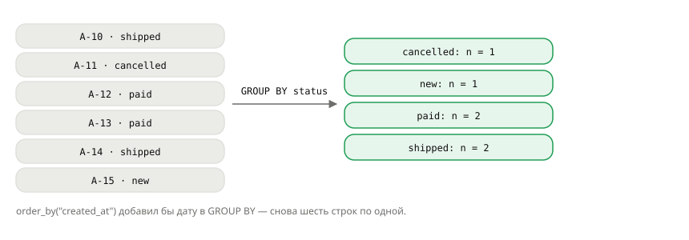
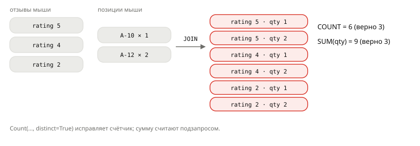

## Теория
«Сколько заказов в каждом статусе», «выручка по покупателям» — это `GROUP BY` по колонке. В ORM его пишут так: **`values("поле")` перед `annotate()`**. `values` задаёт, по чему группировать, `annotate` — что посчитать в каждой группе. Результат — словари: `{'status': 'paid', 'n': 2}`.

Порядок вызовов решает всё:
- `values("status").annotate(n=Count("id"))` — группы по статусу;
- `annotate(n=Count("items")).values("status", "n")` — сначала `annotate` посчитал **каждый заказ** (группа = заказ), потом `values` только выбрал колонки: строк столько же, сколько заказов.

Вторая ловушка — **`order_by` по другому полю**. Колонка сортировки попадает в `GROUP BY`, и группы дробятся: `values("status").annotate(…).order_by("created_at")` — по строке на заказ. Сортируют по полю группировки или по агрегату: `.order_by("status")`, `.order_by("-n")`. Порядок из `Meta.ordering` модели Django в таких запросах не применяет.

Третья — **двойной JOIN**. Две аннотации через разные связи «ко многим» — `Count("reviews")` и `Sum("order_items__quantity")` — присоединяют обе таблицы сразу, и строки перемножаются: у мыши 3 отзыва и 2 позиции заказов — 6 строк на товар. Отзывов насчитается 6, проданных штук — втрое больше. `Count(…, distinct=True)` спасает счётчик, а сумму — нет: её считают подзапросом (тема «Подзапросы») или отдельным запросом.

## Наглядно
**Рисунок 1.** `values("status").annotate(n=Count("id"))`: строки заказов собираются в группы по статусу.



**Рисунок 2.** Двойной JOIN: каждая строка отзывов соединяется с каждой позицией заказа.



**Таблица 1.** Группировка в ORM.

| ORM | SQL |
|---|---|
| `values("status").annotate(n=Count("id"))` | `SELECT status, COUNT(id) … GROUP BY status` |
| `.order_by("status")` или `.order_by("-n")` | группировка та же |
| `.order_by("created_at")` | `GROUP BY status, created_at` — группы дробятся |
| `annotate(…).values("status")` | группа — каждый объект |
| `values("order__user__username").annotate(…)` | группировка по колонке связанной таблицы |

## На практике
Задача: заказы по статусам и сумма покупок каждого покупателя для отчёта менеджера; разобраться, откуда в карточках завышенные числа.

### Шаг 1. Заказы по статусам
Файл `orm.py`:
```python
from django.db.models import Count
by_status = Order.objects.values("status").annotate(n=Count("id"))
print(by_status.order_by("status"))
```
Результат:
```
<QuerySet [{'status': 'cancelled', 'n': 1}, {'status': 'new', 'n': 1}, {'status': 'paid', 'n': 2}, {'status': 'shipped', 'n': 2}]>
```
SQL:
```
SELECT "shop_order"."status" AS "status", COUNT("shop_order"."id") AS "n" FROM "shop_order" GROUP BY 1 ORDER BY 1 ASC LIMIT 21
```
`GROUP BY 1` — «по первой колонке выборки», то есть по `status`.

### Шаг 2. Сортировка сломала группы
Тот же запрос, но новые статусы хотели видеть по дате:

Файл `orm.py`:
```python
from django.db.models import Count
by_status = Order.objects.values("status").annotate(n=Count("id"))
print(by_status.order_by("created_at"))
```
Результат:
```
<QuerySet [{'status': 'shipped', 'n': 1}, {'status': 'cancelled', 'n': 1}, {'status': 'paid', 'n': 1}, {'status': 'paid', 'n': 1}, {'status': 'shipped', 'n': 1}, {'status': 'new', 'n': 1}]>
```
SQL — дата попала в группировку:
```
SELECT "shop_order"."status" AS "status", COUNT("shop_order"."id") AS "n" FROM "shop_order" GROUP BY 1, "shop_order"."created_at" ORDER BY "shop_order"."created_at" ASC LIMIT 21
```

### Шаг 3. annotate до values
Файл `orm.py`:
```python
from django.db.models import Count
qs = Order.objects.annotate(n=Count("items"))
print(qs.values("status", "n").order_by("number"))
```
Результат:
```
<QuerySet [{'status': 'shipped', 'n': 2}, {'status': 'cancelled', 'n': 1}, {'status': 'paid', 'n': 2}, {'status': 'paid', 'n': 1}, {'status': 'shipped', 'n': 2}, {'status': 'new', 'n': 1}]>
```
Шесть строк — по заказу, `n` — позиций в заказе. `values` после `annotate` группы не задаёт.

### Шаг 4. Сумма покупок по покупателям
Группировать можно и по полю через связь:

Файл `orm.py`:
```python
from django.db.models import F, Sum
qs = (
    OrderItem.objects.filter(order__status__in=["paid", "shipped"])
    .values("order__user__username")
    .annotate(spent=Sum(F("price") * F("quantity")))
    .order_by("-spent")
)
print(list(qs))
```
Результат:
```
[{'order__user__username': 'anna', 'spent': Decimal('66979')}, {'order__user__username': 'boris', 'spent': Decimal('3980')}, {'order__user__username': 'vera', 'spent': Decimal('3978')}]
```
`filter` перед `values` — `WHERE` (какие позиции считать), сортировка — по агрегату.

### Шаг 5. Двойной JOIN
Карточки товаров: число отзывов и сколько штук продано.

Файл `orm.py`:
```python
from django.db.models import Count, Sum
qs = Product.objects.annotate(
    reviews_n=Count("reviews"),
    sold=Sum("order_items__quantity"),
).order_by("id")
for p in qs:
    print(p.name, p.reviews_n, p.sold)
```
Результат:
```
Ноутбук Aster 14 2 2
Беспроводная мышь 6 9
Игровая мышь 0 2
Коврик для мыши 3 4
Подставка для ноутбука 0 None
```
На самом деле у мыши 3 отзыва и 3 проданных штуки (1 в A-10 и 2 в A-12). В SQL два `LEFT OUTER JOIN` подряд — `shop_review` и `shop_orderitem`, — и 3 отзыва × 2 позиции дали 6 строк. С `Count("reviews", distinct=True)` счётчик станет верным (`1`, `3`, `0`, `1`, `0`), а `sold` у мыши останется `9`: `Sum(…, distinct=True)` сложил бы разные **значения** количества, а не позиции: у коврика (позиции по 2, 1 и 1 штуке) — `3` вместо `4`. Правильная сумма — подзапросом, тема «Подзапросы».

## Частые ошибки
- **`annotate` до `values`.** Группа — каждый объект, строк столько же. Для `GROUP BY поле` — `values("поле").annotate(…)`.
- **`order_by` по полю вне группировки.** Поле попадает в `GROUP BY`, группы дробятся. Сортируйте по полю группировки или агрегату.
- **Две аннотации через разные «многие».** Числа перемножаются. Счётчик — `Count(…, distinct=True)`, сумму — подзапросом.
- **`Sum(…, distinct=True)` как лекарство.** Складывает различные значения: две позиции по 1 штуке дадут 1. Для суммы не подходит.
- **Ключи словарей через связь.** `values("order__user__username")` даёт ключ `order__user__username`; короче — `values(username=F("order__user__username"))`.

## Итог
**GROUP BY в ORM**
- `values("поле").annotate(агрегат)` — группы по полю, результат — словари.
- `annotate(…).values(…)` — группа = объект.
- `order_by` — только по полю группировки или агрегату.

**Двойной JOIN**
- Две связи «ко многим» в одном `annotate` перемножают строки.
- Счётчик — `distinct=True`, сумма — подзапрос.

## Вопросы на собеседовании
<details><summary>Как сделать GROUP BY в Django ORM?</summary>

`Model.objects.values("поле").annotate(n=Count("id"))`: `values` перед `annotate` задаёт колонки группировки, агрегаты считаются в каждой группе. Фильтр до `values` — `WHERE`, фильтр по агрегату после `annotate` — `HAVING`.
</details>

<details><summary>Почему `order_by` ломает группировку?</summary>

SQL требует, чтобы колонки `ORDER BY` были в `GROUP BY` (или были агрегатами), поэтому Django добавляет поле сортировки в группировку — группы дробятся. Сортировать нужно по полю группировки или агрегату. `Meta.ordering` модели в таких запросах не применяется (с Django 3.1).
</details>

<details><summary>Почему `annotate(Count("a"), Count("b"))` даёт неверные числа?</summary>

Каждая связь «ко многим» — свой `JOIN`, и строки перемножаются: 3 × 2 = 6. `Count(..., distinct=True)` считает уникальные id и даёт верное число; для `Sum` и `Avg` это не работает — их считают подзапросами (`Subquery`) или отдельными запросами.
</details>

## Глубже
Подсчёт по условию внутри группы — `Count(…, filter=Q(…))` (тема `annotate`) и `Case` (следующая тема). Подзапрос вместо двойного JOIN — тема «Подзапросы».
