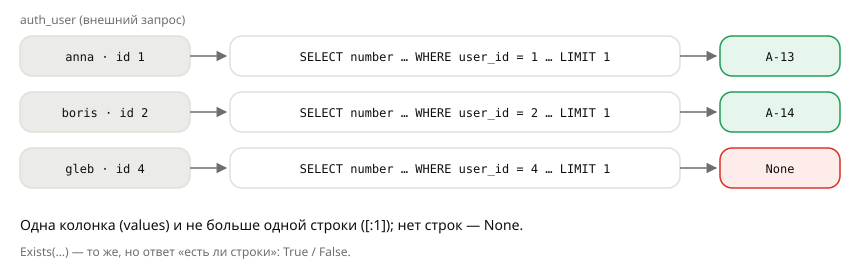

## Теория
В списке покупателей нужен номер последнего заказа каждого. `Max("orders__created_at")` даст дату, но не номер: агрегат возвращает одно значение по группе, а не «строку с максимумом». Здесь нужен **подзапрос** — запрос внутри запроса, который выполняется для каждой строки внешнего.

**`OuterRef("поле")`** — ссылка на поле строки **внешнего** запроса. Сам по себе такой QuerySet выполнить нельзя: «покупатель» в нём появится, только когда он станет частью внешнего запроса.

**`Subquery(qs)`** — значение из подзапроса как колонка: `annotate(last_number=Subquery(…))`. Подзапрос должен вернуть **одну колонку** (`.values("number")`) и **не больше одной строки** (`[:1]` → `LIMIT 1`):
```
last = Order.objects.filter(user=OuterRef("pk")).order_by("-created_at")
User.objects.annotate(last_number=Subquery(last.values("number")[:1]))
```
Если строк нет — `None`.

**`Exists(qs)`** — есть ли хоть одна строка (`EXISTS (…)`); результат — `True`/`False`. Работает в `filter()` («покупатели с оплаченным заказом») и в `annotate()`; `~Exists(…)` — «нет ни одной». Это быстрее и точнее, чем `filter(orders__…).distinct()`: дублей не бывает, база останавливается на первой найденной строке.

Подзапрос с агрегатом решает ловушку двойного JOIN из темы «Группировка»: сумма проданных штук считается в подзапросе по `shop_orderitem` и не перемножается с отзывами.

## Наглядно
**Рисунок 1.** Подзапрос выполняется для каждой строки внешнего запроса; `OuterRef("pk")` подставляет её `id`.



**Таблица 1.** Подзапросы в ORM.

| Задача | ORM | SQL |
|---|---|---|
| поле последней строки | `Subquery(qs.values("number")[:1])` | `(SELECT number … LIMIT 1)` |
| есть ли строки | `filter(Exists(qs))` | `WHERE EXISTS (…)` |
| нет ни одной | `filter(~Exists(qs))` | `WHERE NOT EXISTS (…)` |
| флаг у объекта | `annotate(x=Exists(qs))` | `EXISTS (…) AS x` |
| агрегат без двойного JOIN | `Subquery(qs.values("fk").annotate(t=Sum(…)).values("t"))` | `(SELECT SUM(…) … GROUP BY fk)` |

## На практике
Задача: последний заказ каждого покупателя, покупатели с оплаченными заказами и без заказов, верное число проданных штук в карточках.

### Шаг 1. Последний заказ
Файл `orm.py`:
```python
from django.db.models import OuterRef, Subquery
last = (
    Order.objects.filter(user=OuterRef("pk"))
    .order_by("-created_at")
)
qs = User.objects.annotate(
    last_order=Subquery(last.values("created_at")[:1]),
    last_number=Subquery(last.values("number")[:1]),
).order_by("username")
for u in qs:
    print(u.username, u.last_number, u.last_order)
```
Результат:
```
anna A-13 2026-11-02 08:00:00+00:00
boris A-14 2026-11-05 13:00:00+00:00
gleb None None
vera A-15 2026-11-09 17:00:00+00:00
```
SQL подзапроса номера:
```
(SELECT U0."number" AS "number" FROM "shop_order" U0 WHERE U0."user_id" = ("auth_user"."id") ORDER BY U0."created_at" DESC LIMIT 1) AS "last_number"
```
Время — в UTC, как его хранит база (11:00 по Москве — это 08:00 UTC); шаблон покажет его в часовом поясе проекта. У Глеба заказов нет — `None`.

### Шаг 2. Только дата — проще агрегат
Если нужна одна дата, подзапрос не нужен:

Файл `orm.py`:
```python
from django.db.models import Max
qs = User.objects.annotate(
    last_order=Max("orders__created_at")
).order_by("username")
for u in qs:
    print(u.username, u.last_order)
```
Результат:
```
anna 2026-11-02 08:00:00+00:00
boris 2026-11-05 13:00:00+00:00
gleb None
vera 2026-11-09 17:00:00+00:00
```
`Subquery` нужен, когда из «последней» строки берут другое поле (номер, сумму) — `Max` вернёт только максимум самого поля.

### Шаг 3. Есть ли оплаченный заказ
Файл `orm.py`:
```python
from django.db.models import Exists, OuterRef
paid = Order.objects.filter(
    user=OuterRef("pk"), status__in=["paid", "shipped"]
)
qs = User.objects.filter(Exists(paid)).order_by("username")
print(list(qs.values_list("username", flat=True)))
qs2 = User.objects.annotate(has_paid=Exists(paid))
print([(u.username, u.has_paid) for u in qs2.order_by("username")])
```
Результат:
```
['anna', 'boris', 'vera']
[('anna', True), ('boris', True), ('gleb', False), ('vera', True)]
```
SQL условия:
```
WHERE EXISTS(SELECT 1 AS "a" FROM "shop_order" U0 WHERE (U0."status" IN ('paid', 'shipped') AND U0."user_id" = ("auth_user"."id")) LIMIT 1)
```
Покупатели без единого заказа — `~Exists`:

Файл `orm.py`:
```python
from django.db.models import Exists, OuterRef
orders = Order.objects.filter(user=OuterRef("pk"))
qs = User.objects.filter(~Exists(orders))
print(list(qs.values_list("username", flat=True)))
```
Результат:
```
['gleb']
```

### Шаг 4. Сумма без двойного JOIN
Карточки из темы «Группировка»: отзывы через `Count`, проданные штуки — подзапросом.

Файл `orm.py`:
```python
from django.db.models import Count, OuterRef, Subquery, Sum
from django.db.models.functions import Coalesce
sold = (
    OrderItem.objects.filter(product=OuterRef("pk"))
    .values("product")
    .annotate(total=Sum("quantity"))
    .values("total")
)
qs = Product.objects.annotate(
    reviews_n=Count("reviews"), sold=Coalesce(Subquery(sold), 0)
).order_by("id")
for p in qs:
    print(p.name, p.reviews_n, p.sold)
```
Результат:
```
Ноутбук Aster 14 1 2
Беспроводная мышь 3 3
Игровая мышь 0 2
Коврик для мыши 1 4
Подставка для ноутбука 0 0
```
Числа верные: у мыши 3 отзыва и 3 штуки. `values("product").annotate(…)` — группировка внутри подзапроса по товару, `.values("total")` — одна колонка. SQL:
```
COALESCE((SELECT SUM(U0."quantity") AS "total" FROM "shop_orderitem" U0 WHERE U0."product_id" = ("shop_product"."id") GROUP BY U0."product_id"), 0) AS "sold"
```

## Частые ошибки
- **Подзапрос без `[:1]`.** В тренажёре (SQLite) молча вернётся первая строка, а PostgreSQL упадёт: `more than one row returned by a subquery used as an expression`. Всегда `order_by(…)` + `[:1]`.
- **Две колонки в подзапросе.** `Subquery(last.values("number", "created_at")[:1])` — `OutputFieldIsNoneError: Cannot resolve expression type, unknown output_field`. Каждое поле — свой `Subquery`.
- **QuerySet с `OuterRef` сам по себе.** `list(Order.objects.filter(user=OuterRef("pk")))` — `ValueError: This queryset contains a reference to an outer query and may only be used in a subquery.`
- **`filter(orders__…).distinct()` вместо `Exists`.** Работает, но с `JOIN` и дублями; для «есть ли» `Exists` проще и обычно быстрее.
- **Подзапрос там, где хватит агрегата.** Дата последнего заказа — `Max`, число заказов — `Count`. Подзапрос нужен для поля «той самой» строки и для агрегатов без двойного JOIN.

## Итог
**Subquery и OuterRef**
- `OuterRef("pk")` — поле строки внешнего запроса.
- `Subquery(qs.values("поле")[:1])` — одна колонка, одна строка; нет строк — `None`.

**Exists**
- `filter(Exists(qs))` / `~Exists(qs)` — есть / нет строк; `annotate(x=Exists(qs))` — флаг.

**Двойной JOIN**
- Агрегат по второй связи — подзапрос с `values("fk").annotate(…).values("…")`.

## Вопросы на собеседовании
<details><summary>Как получить для каждого покупателя номер его последнего заказа?</summary>

Коррелированным подзапросом: `last = Order.objects.filter(user=OuterRef("pk")).order_by("-created_at")`, затем `User.objects.annotate(last_number=Subquery(last.values("number")[:1]))`. `Max("orders__created_at")` дал бы только дату, но не номер.
</details>

<details><summary>Чем `Exists` лучше `filter(related__...).distinct()`?</summary>

`Exists` строит `WHERE EXISTS (подзапрос)`: строки основной таблицы не размножаются, `distinct` не нужен, база прекращает поиск на первой подходящей строке. Через `JOIN` строки дублируются, и `DISTINCT` сортирует или хеширует всю выборку.
</details>

<details><summary>Что такое `OuterRef`?</summary>

Ссылка на поле внешнего запроса внутри подзапроса — аналог обращения к колонке внешней таблицы в коррелированном подзапросе SQL. QuerySet с `OuterRef` нельзя выполнить отдельно, только внутри `Subquery` или `Exists`.
</details>

## Глубже
Изменение данных — `create`, `update`, `delete` и транзакции — следующий раздел «Изменение данных и формы».
