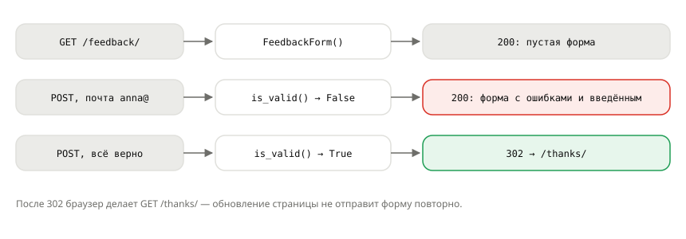

## Теория
Форма обратной связи принимает данные от пользователя — а им нельзя доверять: поле может быть пустым, почта — без домена, вместо числа — текст. Класс **`forms.Form`** описывает поля и делает три вещи: рисует HTML-поля, проверяет присланные данные и превращает их в значения Python. Поля описывают как атрибуты класса:
```
class FeedbackForm(forms.Form):
    name = forms.CharField(label="Имя", max_length=100)
    email = forms.EmailField(label="Почта")
```

View формы обрабатывает два запроса по одному адресу:
1. **GET** — пустая форма: `FeedbackForm()`.
2. **POST** — форма с данными: `FeedbackForm(request.POST)`, затем **`form.is_valid()`**:
   - `True` — чистые значения в **`form.cleaned_data`** (словарь: строки обрезаны от пробелов, числа — `int`, даты — `date`); делаем дело и **перенаправляем** (`redirect`) — паттерн Post/Redirect/Get: обновление страницы не отправит форму повторно;
   - `False` — снова рисуем ту же форму: в ней уже введённые значения и ошибки у полей.

В шаблоне — `<form method="post">`, **``** и поля: `{{ form.as_p }}` или по одному — `{{ form.email.label_tag }} {{ form.email }} {{ form.email.errors }}`. CSRF-токен — скрытое поле со случайным значением: `CsrfViewMiddleware` отклоняет POST без него с ответом **403**, и чужой сайт не сможет отправить форму от имени вашего пользователя (подробно — раздел «Настройки и безопасность»).

Проверка в браузере (`required`, `type="email"`) — только удобство: её легко обойти. Настоящая проверка — `is_valid()` на сервере.

## Наглядно
**Рисунок 1.** Один view обрабатывает форму: GET — пустая форма, POST с ошибками — та же форма с ошибками, верный POST — действие и redirect.



**Таблица 1.** Частые поля форм.

| Поле | HTML | `cleaned_data` | Проверка |
|---|---|---|---|
| `CharField(max_length=100)` | `<input type="text">` | `str` без пробелов по краям | длина |
| `EmailField()` | `<input type="email">` | `str` | формат почты |
| `IntegerField(min_value=1)` | `<input type="number">` | `int` | число, границы |
| `DecimalField()` | `<input type="number">` | `Decimal` | число |
| `BooleanField(required=False)` | `<input type="checkbox">` | `True`/`False` | — |
| `ChoiceField(choices=…)` | `<select>` | `str` | значение из списка |
| `CharField(widget=forms.Textarea)` | `<textarea>` | `str` | длина |

## На практике
Задача: форма обратной связи — имя, почта, сообщение; после отправки — страница «Спасибо».

### Шаг 1. Форма, view, шаблон
Файл `forms.py`:
```python
from django import forms


class FeedbackForm(forms.Form):
    name = forms.CharField(label="Имя", max_length=100)
    email = forms.EmailField(label="Почта")
    message = forms.CharField(label="Сообщение", widget=forms.Textarea)
```
Файл `views.py`:
```python
from django.shortcuts import redirect, render

from .forms import FeedbackForm


def feedback(request):
    if request.method == "POST":
        form = FeedbackForm(request.POST)
        if form.is_valid():
            print(form.cleaned_data)
            return redirect("thanks")
    else:
        form = FeedbackForm()
    return render(request, "shop/feedback.html", {"form": form})
```
Файл `templates/shop/feedback.html`:
```html
<h1>Обратная связь</h1>
<form method="post">
  
  {{ form.as_p }}
  <button>Отправить</button>
</form>
```
`print` — вместо настоящего действия (письмо менеджеру, запись в базу). Маршруты `feedback` и `thanks` — в `urls.py`.

### Шаг 2. GET — пустая форма
`GET /feedback/` → `200 OK`. Начало формы:
```html
<form method="post">
  <input type="hidden" name="csrfmiddlewaretoken" value="iDx6DjGBGNkmwh10NAvmAZUqvznS29iNdI1MBJqC2bwpw1ow2SvucyhFyeYMTvs2">
  <p>
    <label for="id_name">Имя:</label>
    <input type="text" name="name" maxlength="100" required id="id_name">
```
Django сам построил `label`, `id`, `maxlength` и `required` по описанию поля. Значение токена новое на каждой странице.

### Шаг 3. POST с ошибками
Пустое имя и почта `anna@` → `200 OK`, та же страница:
```html
  <ul class="errorlist" id="id_name_error"><li>Обязательное поле.</li></ul>
  <p>
    <label for="id_name">Имя:</label>
    <input type="text" name="name" maxlength="100" required aria-invalid="true" aria-describedby="id_name_error" id="id_name">
```
У почты — своё сообщение и введённое значение:
```html
  <ul class="errorlist" id="id_email_error"><li>Введите правильный адрес электронной почты.</li></ul>
  <p>
    <label for="id_email">Почта:</label>
    <input type="email" name="email" value="anna@" maxlength="320" required aria-invalid="true" aria-describedby="id_email_error" id="id_email">
```
Введённые значения остались в полях (`value="anna@"`, текст сообщения — в `textarea`), пользователю не нужно набирать всё заново.

### Шаг 4. Верный POST
Имя «Анна», почта `anna@shop.example`, сообщение «Где мой заказ?»:
```
POST /feedback/ → 302 Found, Location: /thanks/
GET /thanks/ → 200 OK
<p>Спасибо! Мы ответим на почту.</p>
```
В выводе сервера — `cleaned_data`:
```
{'name': 'Анна', 'email': 'anna@shop.example', 'message': 'Где мой заказ?'}
```

### Шаг 5. Форма в консоли
Файл `orm.py`:
```python
from shop.forms import FeedbackForm
f = FeedbackForm({"name": "  Анна ", "email": "ANNA@Shop.Example", "message": "Привет"})
print(f.is_valid(), f.cleaned_data)
f = FeedbackForm({"name": "", "email": "anna@"})
print(f.is_valid())
print(f.errors.as_data())
```
Результат:
```
True {'name': 'Анна', 'email': 'ANNA@Shop.Example', 'message': 'Привет'}
False
{'name': [ValidationError(['Обязательное поле.'])], 'email': [ValidationError(['Введите правильный адрес электронной почты.'])], 'message': [ValidationError(['Обязательное поле.'])]}
```
`CharField` обрезал пробелы, `EmailField` регистр не меняет. `form.errors` — словарь «поле → список ошибок».

### Шаг 6. Без CSRF-токена
Тот же POST от клиента, который проверяет CSRF, но без токена в данных → `403 Forbidden`, в журнале сервера:
```
Forbidden (CSRF cookie not set.): /feedback/
```
На странице 403 при `DEBUG = True` — «Ошибка проверки CSRF. Запрос отклонён.» и подсказки, что проверить.

## Частые ошибки
- **Нет ``.** POST отклоняется с 403 «Ошибка проверки CSRF». Токен — внутри каждой `<form method="post">`.
- **`render` после успешного POST.** Обновление страницы отправит форму ещё раз (браузер переспросит «отправить данные повторно?») — второе письмо, второй заказ. После успеха — `redirect`.
- **Новая пустая форма при ошибках.** `form = FeedbackForm()` в ветке POST — ошибки и введённое пропадают. Рисуют ту же форму, что проверяли.
- **`cleaned_data` до `is_valid()`.** `AttributeError: 'FeedbackForm' object has no attribute 'cleaned_data'. Did you mean: 'changed_data'?` — словарь появляется только после проверки.
- **Брать `request.POST["email"]` напрямую.** Строка без проверки, а поля может не быть (`MultiValueDictKeyError`). Значения — из `cleaned_data`.
- **`method="get"` для формы, которая меняет данные.** Данные уходят в адресную строку и историю браузера, CSRF не проверяется. GET — для поиска и фильтров.

## Итог
**Форма**
- `forms.Form` с полями: HTML, проверка, значения Python.
- `is_valid()` → `cleaned_data` или `errors`.

**View**
- GET — `Form()`, POST — `Form(request.POST)`; успех — `redirect`, ошибки — та же форма.

**Шаблон**
- `<form method="post">`, ``, `{{ form.as_p }}` или поля по одному с `.errors`.

## Вопросы на собеседовании
<details><summary>Что такое Post/Redirect/Get и зачем он нужен?</summary>

После успешной обработки POST сервер отвечает редиректом (302), и браузер делает GET на новую страницу. Если пользователь обновит страницу, повторится безопасный GET, а не отправка формы — нет дублей заказов и писем.
</details>

<details><summary>Как работает защита от CSRF в Django?</summary>

`CsrfViewMiddleware` выдаёт браузеру cookie с секретом, а `` добавляет в форму скрытое поле с маской того же секрета. На POST/PUT/DELETE middleware сравнивает их; нет или не совпали — 403. Чужой сайт может заставить браузер отправить запрос с cookie, но не может прочитать и подставить токен.
</details>

<details><summary>Что делает `form.is_valid()`?</summary>

Для каждого поля приводит строку к типу (`to_python`), запускает проверки поля и валидаторы, затем методы `clean_<поле>()` и общий `clean()`. Заполняет `cleaned_data` и `errors`, возвращает `True`, если ошибок нет. Вызывается на связанной форме (с данными); у несвязанной `is_valid()` — `False`.
</details>

## Глубже
Форма, которая сама знает поля модели и сохраняет объект, — следующая тема `ModelForm`. Свои правила проверки — тема «Валидация».
