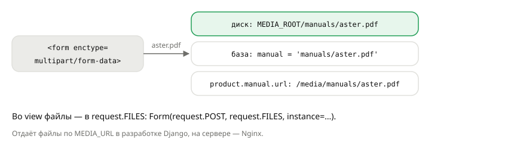

## Теория
Инструкция к ноутбуку в PDF, фото товара — файлы. Сам файл в базу не кладут: он сохраняется на диск (или в облачное хранилище), а в колонке модели — только **путь** к нему, строкой.

**Поле модели:**
- `FileField(upload_to="manuals/")` — любой файл; `upload_to` — папка внутри `MEDIA_ROOT` (можно с датой: `"manuals/%Y/%m/"`);
- `ImageField` — то же, но проверяет, что это картинка, и знает её размеры. Нужна библиотека **Pillow**; без неё проект не пройдёт системную проверку (`fields.E210`).

**Настройки:**
- `MEDIA_ROOT` — папка на диске для загруженных файлов (`BASE_DIR / "media"`);
- `MEDIA_URL` — адрес, по которому они открываются (`"/media/"`). В шаблоне — `{{ product.manual.url }}`. В разработке файлы отдаёт Django (`static(settings.MEDIA_URL, document_root=settings.MEDIA_ROOT)` в `urls.py`), на сервере — Nginx (курс «Nginx и деплой»).

**Форма** отправляет файл, только если у неё **`enctype="multipart/form-data"`**; без него браузер пришлёт имя файла, а не содержимое. Во view файлы лежат отдельно от остальных данных — в **`request.FILES`**: `ManualForm(request.POST, request.FILES, instance=product)`. Забыть `request.FILES` — форма скажет «Обязательное поле.», будто файла нет.

Если файл с таким именем уже есть, Django не перезапишет его, а добавит к имени случайный суффикс: `aster_P7Dcn5B.pdf`. При замене или удалении объекта старый файл с диска **не удаляется** — это делают отдельно.

Загруженный файл — чужие данные. Ограничивайте тип (`FileExtensionValidator(["pdf"])`) и размер, не отдавайте пользовательские HTML и SVG с вашего домена: браузер выполнит в них скрипты.

## Наглядно
**Рисунок 1.** Файл — на диске в `MEDIA_ROOT`, в базе — путь, в браузере — адрес из `MEDIA_URL`.



**Таблица 1.** Атрибуты поля файла у объекта.

| Выражение | Значение (`MEDIA_ROOT = /srv/media`, `MEDIA_URL = /media/`) |
|---|---|
| `p.manual.name` | `'manuals/aster.pdf'` — то, что в базе |
| `p.manual.url` | `'/media/manuals/aster.pdf'` |
| `p.manual.path` | `'/srv/media/manuals/aster.pdf'` |
| `p.manual.size` | размер в байтах |
| `bool(p.manual)` | `False`, если файла нет — `` |

## На практике
Задача: загрузить инструкцию в PDF к товару и показать ссылку на странице. В тренажёре `MEDIA_ROOT` — временная папка `/tmp/shop-media`, `MEDIA_URL` — `/media/`; сами файлы тренажёр по ссылке не отдаёт.

### Шаг 1. Поле, форма, view
Файл `models.py` (фрагмент):
```python
class Product(models.Model):
    # … прежние поля
    manual = models.FileField(upload_to="manuals/", blank=True)
```
Файл `forms.py`:
```python
from django import forms

from .models import Product


class ManualForm(forms.ModelForm):
    class Meta:
        model = Product
        fields = ["manual"]
```
Файл `views.py`:
```python
from django.shortcuts import get_object_or_404, redirect, render

from .forms import ManualForm
from .models import Product


def manual(request, slug):
    product = get_object_or_404(Product, slug=slug)
    if request.method == "POST":
        form = ManualForm(request.POST, request.FILES, instance=product)
        if form.is_valid():
            form.save()
            return redirect("manual", slug=slug)
    else:
        form = ManualForm(instance=product)
    return render(request, "shop/manual.html", {"form": form, "product": product})
```
Файл `templates/shop/manual.html`:
```html
<h1>{{ product.name }}</h1>
<p><a href="{{ product.manual.url }}">Инструкция</a></p>
<form method="post" enctype="multipart/form-data">
  
  {{ form.as_p }}
  <button>Загрузить</button>
</form>
```

### Шаг 2. Загрузка
Отправим файл тем же способом, что и браузер, — тестовым клиентом:

Файл `orm.py`:
```python
from django.core.files.uploadedfile import SimpleUploadedFile
from django.test import Client
c = Client()
f = SimpleUploadedFile("aster.pdf", b"%PDF-1.4 ...")
r = c.post("/products/aster-14/manual/", {"manual": f})
print(r.status_code, r["Location"])
p = Product.objects.get(slug="aster-14")
print(repr(p.manual.name), p.manual.url, p.manual.size)
print(p.manual.path)
```
Результат:
```
302 /products/aster-14/manual/
'manuals/aster.pdf' /media/manuals/aster.pdf 12
/tmp/shop-media/manuals/aster.pdf
```
На странице после загрузки — ссылка и поле с текущим файлом:
```html
<p><a href="/media/manuals/aster.pdf">Инструкция</a></p>
```
Поле формы показывает текущий файл:
```html
На данный момент: <a href="/media/manuals/aster.pdf">manuals/aster.pdf</a>
<input type="checkbox" name="manual-clear" id="manual-clear_id">
<label for="manual-clear_id">Очистить</label><br>
```
Флажок «Очистить» есть, потому что поле `blank=True`. Вторая загрузка файла с тем же именем сохранилась как `'manuals/aster_P7Dcn5B.pdf'` — первый файл остался на диске.

### Шаг 3. Форма без enctype
Уберём `enctype` и сделаем поле обязательным (без `blank=True`). Браузер отправит только имя файла — `{"manual": "aster.pdf"}` в обычных данных:
```
200
['<ul class="errorlist" id="id_manual_error"><li>Обязательное поле.</li></ul>']
```
Файл в `request.FILES` не пришёл — для формы его нет.

### Шаг 4. ImageField без Pillow
Поле `photo = models.ImageField(upload_to="products/", blank=True)` в тренажёре, где Pillow нет:
```
SystemCheckError: Django нашёл ошибки:
Product.photo: (fields.E210) Cannot use ImageField because Pillow is not installed.
	ПОДСКАЗКА: Get Pillow at https://pypi.org/project/Pillow/ or run command "python -m pip install Pillow".
```
В проекте — `pip install Pillow`; в тренажёре фото товара разбираем на `FileField`.

## Частые ошибки
- **Нет `enctype="multipart/form-data"`.** Файл не уходит на сервер, форма говорит «Обязательное поле.» или молча сохраняет без файла.
- **Нет `request.FILES` во view.** `ManualForm(request.POST, instance=product)` — тот же эффект: файла для формы нет.
- **Файлы в базе.** Колонка — путь (`varchar`); содержимое на диске или в хранилище. Хранить байты в базе — раздувать её и бэкапы.
- **Ждать удаления старого файла.** Замена и `delete()` объекта файл с диска не удаляют; чистят отдельно (`p.manual.delete(save=False)` или задачей по расписанию).
- **`ImageField` без Pillow.** `fields.E210` — проект не запускается.
- **Доверять расширению и размеру.** Ограничивайте тип (`FileExtensionValidator`) и размер (`DATA_UPLOAD_MAX_MEMORY_SIZE` и своя проверка в `clean_<поле>`), не отдавайте загруженные HTML/SVG со своего домена.

## Итог
**Модель и настройки**
- `FileField` / `ImageField(upload_to=…)`; в базе — путь, файл — в `MEDIA_ROOT`, адрес — `MEDIA_URL` + `name` (`.url`).
- `ImageField` требует Pillow.

**Форма и view**
- `<form method="post" enctype="multipart/form-data">`.
- `Form(request.POST, request.FILES, …)`.

## Вопросы на собеседовании
<details><summary>Где хранится загруженный через FileField файл и что лежит в базе?</summary>

Файл сохраняет хранилище (по умолчанию `FileSystemStorage` в `MEDIA_ROOT`, в продакшене часто S3-совместимое), в колонке — относительный путь строкой (`manuals/aster.pdf`). `.url` строится как `MEDIA_URL` + путь, `.path` — путь на диске.
</details>

<details><summary>Почему файл из формы не приходит на сервер?</summary>

Чаще всего у `<form>` нет `enctype="multipart/form-data"` — браузер отправляет только имя файла. Вторая причина — view не передаёт `request.FILES` в форму: загруженные файлы лежат там, а не в `request.POST`.
</details>

<details><summary>Чем отличаются MEDIA и STATIC?</summary>

`STATIC_*` — файлы проекта (CSS, JS, картинки интерфейса): собираются `collectstatic` при деплое и не меняются пользователями. `MEDIA_*` — файлы, загруженные пользователями во время работы сайта; их не хранят в git, их бэкапят вместе с базой.
</details>

## Глубже
Несколько однотипных форм на одной странице — следующая тема «Набор форм». Отдача медиа-файлов Nginx — курс «Nginx и деплой».
