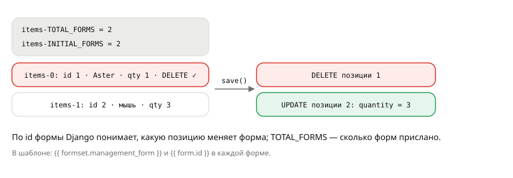

## Теория
В корзине несколько позиций, и у каждой — поле «Количество». Одна форма на позицию и одна кнопка «Сохранить» для всех — это **набор форм** (formset).

- `formset_factory(Form, extra=2)` — набор обычных форм;
- `modelformset_factory(Model, fields=[…])` — набор ModelForm по QuerySet;
- **`inlineformset_factory(Order, OrderItem, fields=["quantity"])`** — формы для объектов, связанных с одним родителем: позиции конкретного заказа. Создают с `instance=order`, сохраняют `formset.save()`.

Параметры: `extra` — сколько пустых форм для новых объектов (для корзины — `0`), `can_delete=True` — флажок «удалить» у каждой формы.

Чтобы на сервере понять, сколько форм пришло, набору нужна **management form** — четыре скрытых поля: `TOTAL_FORMS` (всего форм), `INITIAL_FORMS` (сколько из них — существующие объекты), `MIN_NUM_FORMS`, `MAX_NUM_FORMS`. В шаблоне — `{{ formset.management_form }}`; без неё POST не пройдёт проверку. Имена полей получают префикс: `items-0-quantity`, `items-1-quantity` (`items` — `related_name` связи).

В шаблоне у каждой формы ModelFormSet нужно вывести скрытое поле `{{ form.id }}` — по нему Django понимает, какую позицию меняет форма. View — тот же шаблон, что у одной формы: GET — набор с `instance`, POST — с `request.POST`, `is_valid()` проверяет все формы, `save()` пишет изменения и удаляет отмеченные.

## Наглядно
**Рисунок 1.** Набор форм позиций: management form и формы с префиксами.



**Таблица 1.** Фабрики наборов форм.

| Фабрика | Для чего | Создание |
|---|---|---|
| `formset_factory(QtyForm, extra=2)` | обычные формы | `QtyFormSet()` / `QtyFormSet(request.POST)` |
| `modelformset_factory(Product, fields=["price"])` | объекты по QuerySet | `queryset=Product.objects.filter(…)` |
| `inlineformset_factory(Order, OrderItem, fields=["quantity"])` | объекты одного родителя | `instance=order` |

## На практике
Задача: корзина-заказ A-12 — изменить количество обеих позиций одной формой и удалить позицию флажком.

### Шаг 1. Набор, view, шаблон
Файл `forms.py`:
```python
from django.forms import inlineformset_factory

from .models import Order, OrderItem

ItemFormSet = inlineformset_factory(
    Order, OrderItem, fields=["quantity"], extra=0, can_delete=True
)
```
Файл `views.py`:
```python
from django.shortcuts import get_object_or_404, redirect, render

from .forms import ItemFormSet
from .models import Order


def cart(request, number):
    order = get_object_or_404(Order, number=number)
    if request.method == "POST":
        formset = ItemFormSet(request.POST, instance=order)
        if formset.is_valid():
            formset.save()
            return redirect("cart", number=number)
    else:
        formset = ItemFormSet(instance=order)
    return render(request, "shop/cart.html", {"order": order, "formset": formset})
```
Файл `templates/shop/cart.html`:
```html
<form method="post">
  
  {{ formset.management_form }}
  
    <p>{{ form.instance.product.name }}: {{ form.id }} {{ form.quantity }} {{ form.DELETE }} {{ form.quantity.errors }}</p>
  
  <button>Сохранить</button>
</form>
```

### Шаг 2. Что получил браузер
`GET /cart/A-12/` — management form и две формы (строки разбиты для чтения):
```html
<input type="hidden" name="items-TOTAL_FORMS" value="2" id="id_items-TOTAL_FORMS">
<input type="hidden" name="items-INITIAL_FORMS" value="2" id="id_items-INITIAL_FORMS">
<input type="hidden" name="items-MIN_NUM_FORMS" value="0" id="id_items-MIN_NUM_FORMS">
<input type="hidden" name="items-MAX_NUM_FORMS" value="1000" id="id_items-MAX_NUM_FORMS">
```
Формы позиций — с префиксами `items-0`, `items-1` и скрытым `id`:
```html
<p>Ноутбук Aster 14: <input type="hidden" name="items-0-id" value="1" id="id_items-0-id"> <input type="number" name="items-0-quantity" value="1" min="0" id="id_items-0-quantity"> <input type="checkbox" name="items-0-DELETE" id="id_items-0-DELETE"> </p>
<p>Беспроводная мышь: <input type="hidden" name="items-1-id" value="2" id="id_items-1-id"> <input type="number" name="items-1-quantity" value="2" min="0" id="id_items-1-quantity"> <input type="checkbox" name="items-1-DELETE" id="id_items-1-DELETE"> </p>
```

### Шаг 3. Сохранение и удаление
Файл `orm.py`:
```python
from django.test import Client
c = Client()
data = {
    "items-TOTAL_FORMS": "2", "items-INITIAL_FORMS": "2",
    "items-0-id": "1", "items-0-quantity": "1",
    "items-1-id": "2", "items-1-quantity": "3",
}
print(c.post("/cart/A-12/", data).status_code)
items = OrderItem.objects.order_by("id")
print(list(items.values_list("product__name", "quantity")))
data["items-0-DELETE"] = "on"
c.post("/cart/A-12/", data)
print(list(items.values_list("product__name", "quantity")))
```
Результат:
```
302
[('Ноутбук Aster 14', 1), ('Беспроводная мышь', 3)]
[('Беспроводная мышь', 3)]
```
Одна отправка — обе позиции обработаны; отмеченная `DELETE` удалена. `MIN_NUM_FORMS` и `MAX_NUM_FORMS` можно не присылать.

### Шаг 4. Без management form
POST только с `items-0-id` и `items-0-quantity` → `200 OK`, набор не прошёл проверку:
```html
<ul class="errorlist nonfield"><li>(Скрытое поле TOTAL_FORMS) Обязательное поле.</li><li>(Скрытое поле INITIAL_FORMS) Обязательное поле.</li></ul>
```
Количество `-1` → ошибка у поля этой формы: «Убедитесь, что это значение больше либо равно 0.» — граница от `PositiveIntegerField`.

## Частые ошибки
- **Нет `{{ formset.management_form }}`.** Ошибка «(Скрытое поле TOTAL_FORMS) Обязательное поле.», ничего не сохраняется.
- **Нет `{{ form.id }}` в цикле.** Django не знает, какую позицию меняет форма: у каждой формы ошибка `{'id': ['Обязательное поле.']}`, ничего не сохраняется. Ошибка у скрытого поля, и если шаблон выводит только `form.quantity.errors`, страница просто «не сохраняет» без объяснений.
- **Новый набор без `request.POST` при ошибках.** Как и с одной формой: ошибки и введённое пропадут.
- **`extra` по умолчанию.** У `inlineformset_factory` `extra=3` — в корзине появятся три пустые строки. Для правки существующих — `extra=0`.
- **Количество 0.** `PositiveIntegerField` разрешает 0; если «0» в корзине не нужен — своя форма с `IntegerField(min_value=1)` (`form=` у фабрики) или удаление позиции при 0.
- **Набор для сотен объектов.** Каждая форма — поля в HTML и проверка на сервере; большой список правят по частям или через API.

## Итог
**Наборы форм**
- `formset_factory`, `modelformset_factory`, `inlineformset_factory(Родитель, Дочерняя, fields=[…])`.
- `extra` — пустые формы, `can_delete` — флажок удаления.

**Шаблон и view**
- `{{ formset.management_form }}` и `{{ form.id }}` в каждой форме.
- `Formset(request.POST, instance=…)` → `is_valid()` → `save()`.

## Вопросы на собеседовании
<details><summary>Что такое management form и зачем она?</summary>

Скрытые поля `TOTAL_FORMS`, `INITIAL_FORMS`, `MIN_NUM_FORMS`, `MAX_NUM_FORMS` с префиксом набора. По ним сервер узнаёт, сколько форм пришло и какие из них — существующие объекты. Без них набор невалиден; JS, добавляющий формы на странице, должен увеличивать `TOTAL_FORMS`.
</details>

<details><summary>Когда `inlineformset_factory`, а когда `modelformset_factory`?</summary>

`inlineformset_factory` — для объектов, связанных `ForeignKey` с одним родителем (позиции заказа): набор создают с `instance=родитель`, новые объекты автоматически получают ссылку на него. `modelformset_factory` — для произвольного QuerySet объектов одной модели.
</details>

<details><summary>Как удалить объект через набор форм?</summary>

Создать набор с `can_delete=True` — у каждой формы появится поле `DELETE`. Отмеченные формы при `formset.save()` удаляются (у ModelFormSet), их объекты доступны в `formset.deleted_objects`.
</details>

## Глубже
Страницы создания и редактирования на готовых классах — раздел «Class-based views». Корзина, которая обновляется без перезагрузки страницы, — API (курс «Веб и API»).
