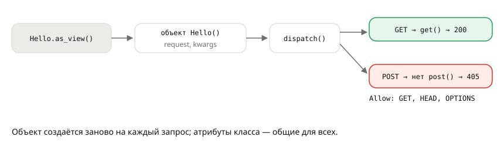

## Теория
До сих пор view были функциями (FBV, function-based views): `def catalog(request): …`. Django позволяет писать их и **классами** (CBV, class-based views). Базовый класс — `django.views.View`:
```
class Hello(View):
    def get(self, request):
        return HttpResponse("GET: каталог")
```
Ветки `if request.method == "POST"` заменяют **методы с именами HTTP-методов**: `get`, `post`, `put`, `delete`. Как это работает:
1. В `urls.py` передают не класс, а **`Hello.as_view()`** — это функция-view, которую строит Django.
2. На каждый запрос `as_view()` создаёт **новый объект** класса, кладёт в него `self.request`, `self.args`, `self.kwargs` (параметры из адреса) и вызывает **`dispatch()`**.
3. `dispatch()` ищет метод с именем HTTP-метода в нижнем регистре и вызывает его. Метода нет — ответ **405 Method Not Allowed** с заголовком `Allow` (какие методы есть).

Параметры маршрута приходят в метод аргументами, как в функцию: `def get(self, request, slug)`, — и лежат в `self.kwargs`.

Сам по себе `View` почти не экономит код. Сила CBV — в **готовых классах** (`ListView`, `DetailView`, `CreateView` — следующие темы) и в **наследовании**: общее поведение выносится в базовый класс или миксин и переопределяется по частям.

**Когда что.** Функция — когда логика своя и нестандартная: её проще прочитать сверху вниз. Готовый класс — когда страница типовая (список, карточка, форма создания), и остаётся указать модель и шаблон. В одном проекте нормально сочетать оба способа.

## Наглядно
**Рисунок 1.** Путь запроса к CBV: `as_view()` → новый объект → `dispatch()` → метод по имени HTTP-метода.



**Таблица 1.** Функция и класс.

| | FBV | CBV |
|---|---|---|
| В `urls.py` | `views.catalog` | `views.Catalog.as_view()` |
| Разные методы | `if request.method == "POST"` | методы `get`, `post` |
| Неподдержанный метод | как напишете | 405 автоматически |
| Параметры адреса | аргументы функции | аргументы метода и `self.kwargs` |
| Повторное использование | вызов других функций, декораторы | наследование, миксины |
| Типовые страницы | пишется вручную | `ListView`, `DetailView`, `CreateView` |

## На практике
Задача: переписать простую страницу на класс и увидеть, как класс обрабатывает методы и параметры.

### Шаг 1. Класс с методом get
Файл `views.py`:
```python
from django.http import HttpResponse
from django.views import View


class Hello(View):
    def get(self, request):
        return HttpResponse("GET: каталог")
```
Файл `urls.py`:
```python
from django.urls import path

from . import views

urlpatterns = [
    path("hello/", views.Hello.as_view(), name="hello"),
]
```
Запросы:
```
GET /hello/ → 200 OK
GET: каталог
POST /hello/ → 405 Method Not Allowed
DELETE /hello/ → 405 Method Not Allowed
```
Заголовок ответа на POST — `Allow: GET, HEAD, OPTIONS`: `head` Django берёт из `get`, `options` есть у каждого `View`.

### Шаг 2. Класс без as_view()
`path("hello/", views.Hello, name="hello")` — проект не пройдёт системную проверку:
```
SystemCheckError: Django нашёл ошибки:
None: (urls.E009) Your URL pattern 'hello/' [name='hello'] has an invalid view, pass Hello.as_view() instead of Hello.
```

### Шаг 3. Параметры и dispatch
Файл `views.py`:
```python
from django.http import HttpResponse
from django.views import View


class Catalog(View):
    http_method_names = ["get"]

    def dispatch(self, request, *args, **kwargs):
        print("dispatch:", request.method, kwargs)
        return super().dispatch(request, *args, **kwargs)

    def get(self, request, slug):
        return HttpResponse(f"товар {slug}")
```
Маршрут — `path("p/<slug:slug>/", views.Catalog.as_view(), name="p")`. Запросы и вывод сервера:
```
GET /p/aster-14/ → 200 OK
товар aster-14
POST /p/aster-14/ → 405 Method Not Allowed
```
Вывод сервера:
```
dispatch: GET {'slug': 'aster-14'}
dispatch: POST {'slug': 'aster-14'}
```
`dispatch` вызывается на любой метод — здесь удобно сделать общее для всех: проверить доступ, записать в журнал. `http_method_names` ограничивает список разрешённых методов.

### Шаг 4. Атрибут класса — общий для всех запросов
Объект свой на каждый запрос, но **атрибут класса** — один на все:

Файл `views.py`:
```python
from django.http import HttpResponse
from django.views import View


class Counter(View):
    seen = []

    def get(self, request):
        self.seen.append(1)
        return HttpResponse(str(len(self.seen)))
```
Три запроса `GET /c/` вернули `1`, `2`, `3`: список `seen` живёт в классе и копит данные всех пользователей. Данные одного запроса хранят в `self.…`, присвоенном внутри метода, а не в изменяемых атрибутах класса.

## Частые ошибки
- **Класс вместо `as_view()` в `urls.py`.** `urls.E009 … pass Hello.as_view() instead of Hello.`
- **Метод с большой буквы или другим именем.** `def GET(self, request)` или `def show(…)` — Django ищет `get`, ответ 405.
- **Забыть `return super().dispatch(…)`.** Переопределённый `dispatch` без вызова родителя не дойдёт до `get`/`post`; без `return` view вернёт `None` — ошибка 500.
- **Изменяемый атрибут класса как хранилище.** Список или словарь в классе общий для всех запросов и пользователей.
- **CBV ради CBV.** Нестандартную логику в класс с пятью переопределёнными методами читать труднее, чем функцию на десять строк.

## Итог
**CBV**
- Класс от `View`; в `urls.py` — `Класс.as_view()`.
- На запрос — новый объект, `dispatch()` вызывает метод по имени HTTP-метода; нет метода — 405 с `Allow`.
- Параметры адреса — аргументы метода и `self.kwargs`.

**Выбор**
- Типовые страницы — готовые классы; своя логика — функция.

## Вопросы на собеседовании
<details><summary>Что делает `as_view()`?</summary>

Возвращает функцию-view. При каждом запросе она создаёт новый экземпляр класса с аргументами `as_view(**initkwargs)`, вызывает `setup()` (сохраняет `request`, `args`, `kwargs`) и `dispatch()`, который выбирает метод-обработчик по `request.method`.
</details>

<details><summary>Как CBV обрабатывает неподдерживаемый HTTP-метод?</summary>

`dispatch()` ищет атрибут с именем метода в нижнем регистре, если метод есть в `http_method_names`. Не нашёл — вызывает `http_method_not_allowed()`, ответ `HttpResponseNotAllowed` (405) с заголовком `Allow`, перечисляющим реализованные методы.
</details>

<details><summary>Когда лучше FBV, а когда CBV?</summary>

FBV — для нестандартной логики: явный поток сверху вниз, легко читать и отлаживать. CBV — для типовых страниц (generic views), где хватает настройки атрибутов, и когда поведение переиспользуется наследованием и миксинами. Минус CBV — логика размазана по методам родителей, нужно знать порядок их вызова.
</details>

## Глубже
Готовые классы для списка и карточки — следующая тема «Просмотр».
