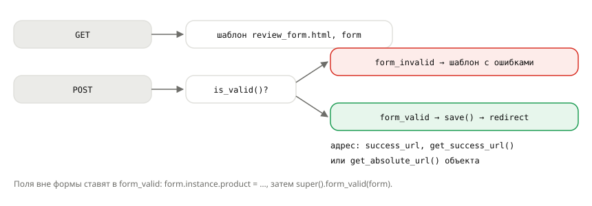

## Теория
Страницы с формами из раздела «Изменение данных и формы» — GET рисует форму, POST проверяет, при успехе redirect — тоже типовые. Готовые классы:
- **`CreateView`** — форма создания объекта;
- **`UpdateView`** — форма правки (объект ищется по `pk`/`slug`, как в `DetailView`);
- **`DeleteView`** — GET показывает страницу подтверждения, POST удаляет;
- **`FormView`** — обычная форма без модели (обратная связь).

У `CreateView` и `UpdateView` форму строит класс по модели — как ModelForm — и тоже **требует `fields`** (или свой `form_class`). Шаблон один на оба — **`<модель>_form.html`**, в контексте `form` (и `object` при правке). У `DeleteView` шаблон — `<модель>_confirm_delete.html`.

Куда перенаправить после успеха:
- **`success_url`** — фиксированный адрес; в атрибуте класса — только **`reverse_lazy("имя")`**: обычный `reverse()` выполнится при импорте `views.py`, когда маршруты ещё не загружены;
- **`get_success_url()`** — адрес, зависящий от объекта (`self.object` — созданный или изменённый);
- ни того, ни другого — `CreateView`/`UpdateView` берут `get_absolute_url()` модели, а если его нет — `ImproperlyConfigured: No URL to redirect to.`

Своё действие при успешной форме — **`form_valid(form)`**: здесь заполняют поля, которых нет в форме (`form.instance.product = …`), отправляют письмо, пишут сообщение. В конце — `return super().form_valid(form)`: он сохраняет объект и делает redirect. Неудачная форма идёт в `form_invalid()` — тот же шаблон с ошибками.

## Наглядно
**Рисунок 1.** Как CreateView обрабатывает GET и POST.



**Таблица 1.** Классы редактирования.

| Класс | GET | POST | Шаблон по умолчанию |
|---|---|---|---|
| `CreateView` | пустая форма | создать → redirect | `<модель>_form.html` |
| `UpdateView` | форма с объектом | сохранить → redirect | `<модель>_form.html` |
| `DeleteView` | страница подтверждения | удалить → redirect | `<модель>_confirm_delete.html` |
| `FormView` | пустая форма | `form_valid` → redirect | `template_name` обязателен |

## На практике
Задача: отзывы о товаре на классах — добавить со страницы товара, изменить, удалить; форма обратной связи.

### Шаг 1. Создание, правка, удаление
У модели `Product` есть `get_absolute_url()` — адрес карточки `reverse("product", kwargs={"slug": self.slug})`.

Файл `views.py`:
```python
from django.shortcuts import get_object_or_404
from django.urls import reverse_lazy
from django.views.generic import CreateView, DeleteView, UpdateView

from .models import Product, Review


class ReviewCreate(CreateView):
    model = Review
    fields = ["author", "rating", "text"]

    def form_valid(self, form):
        form.instance.product = get_object_or_404(Product, slug=self.kwargs["slug"])
        return super().form_valid(form)

    def get_success_url(self):
        return self.object.product.get_absolute_url()


class ReviewUpdate(UpdateView):
    model = Review
    fields = ["rating", "text"]
    success_url = reverse_lazy("catalog")


class ReviewDelete(DeleteView):
    model = Review
    success_url = reverse_lazy("catalog")
```
Маршруты: `products/<slug:slug>/review/` → `ReviewCreate`, `reviews/<int:pk>/edit/` → `ReviewUpdate`, `reviews/<int:pk>/delete/` → `ReviewDelete`.

Файл `templates/shop/review_form.html`:
```html
<form method="post">{{ form.as_p }}<button>Сохранить</button></form>
```
Файл `templates/shop/review_confirm_delete.html`:
```html
<form method="post"><p>Удалить отзыв «{{ object }}»?</p><button>Удалить</button></form>
```

### Шаг 2. Что отвечают страницы
Запросы по порядку — создание, ошибка, правка, удаление:
```
POST /products/aster-14/review/ (Борис, 4) → 302 Found, Location: /products/aster-14/
POST /products/aster-14/review/ (Борис, 9) → 200 OK — форма с ошибкой
GET /reviews/1/edit/ → 200 OK — форма с оценкой 5 и текстом «Удобная»
POST /reviews/1/edit/ (3, «Шумная») → 302 Found, Location: /catalog/
GET /reviews/1/delete/ → 200 OK
POST /reviews/1/delete/ → 302 Found, Location: /catalog/
GET /reviews/1/edit/ → 404 Not Found
```
Ошибка при оценке 9 — из валидатора модели: «Убедитесь, что это значение меньше либо равно 5.». Страница подтверждения удаления:
```html
<p>Удалить отзыв «Анна: 3»?</p>
```
GET на `delete/` ничего не удаляет — только POST из формы подтверждения.

### Шаг 3. Без адреса перехода
У `Review` нет `get_absolute_url()`. Уберём `success_url` у `ReviewUpdate` — POST сохранит отзыв и упадёт:
```
django.core.exceptions.ImproperlyConfigured: No URL to redirect to.  Either provide a url or define a get_absolute_url method on the Model.
```
`success_url = reverse("catalog")` вместо `reverse_lazy` — проект не загрузится:
```
django.core.exceptions.ImproperlyConfigured: The included URLconf 'shop.urls' does not appear to have any patterns in it. If you see the 'urlpatterns' variable with valid patterns in the file then the issue is probably caused by a circular import.
```
`urls.py` импортирует `views.py`, а тот при импорте уже хочет разрешить имя маршрута — маршрутов ещё нет.

### Шаг 4. FormView
Файл `views.py`:
```python
from django import forms
from django.urls import reverse_lazy
from django.views.generic import FormView


class FeedbackForm(forms.Form):
    email = forms.EmailField()
    message = forms.CharField()


class Feedback(FormView):
    template_name = "shop/feedback.html"
    form_class = FeedbackForm
    success_url = reverse_lazy("thanks")

    def form_valid(self, form):
        print("письмо от", form.cleaned_data["email"])
        return super().form_valid(form)
```
Верный POST → `302 Found`, `Location: /thanks/`, в выводе сервера — `письмо от anna@shop.example`. С ошибками — `200` и форма с сообщениями. Вся схема GET/POST/redirect из функции поместилась в атрибуты и один метод.

## Частые ошибки
- **Нет `fields` у CreateView/UpdateView.** `ImproperlyConfigured: Using ModelFormMixin (base class of ReviewCreate) without the 'fields' attribute is prohibited.`
- **`reverse()` в атрибуте класса.** Циклический импорт: «The included URLconf 'shop.urls' does not appear to have any patterns in it». В атрибутах — `reverse_lazy`.
- **Нет `success_url` и `get_absolute_url()`.** Объект сохранён, но ответ — 500 «No URL to redirect to».
- **`form_valid` без `return super().form_valid(form)`.** Объект не сохранится (у `CreateView` сохраняет именно `super()`) или view вернёт `None`.
- **Удаление по ссылке.** `<a href="…/delete/">` только открывает подтверждение; удаляет POST из формы. Не делайте удаление на GET — его выполнит любой переход по ссылке или поисковый робот.
- **Чужие объекты.** `UpdateView` и `DeleteView` по `pk` откроют любой отзыв; «только свои» — `get_queryset()` с фильтром по пользователю (раздел «Пользователи и доступ»).

## Итог
**Классы**
- `CreateView`, `UpdateView` — `model` + `fields`, шаблон `<модель>_form.html`.
- `DeleteView` — подтверждение на GET, удаление на POST, шаблон `<модель>_confirm_delete.html`.
- `FormView` — `form_class`, `template_name`, `form_valid`.

**После успеха**
- `success_url = reverse_lazy(…)`, `get_success_url()` или `get_absolute_url()` модели.
- Свои действия — в `form_valid`, в конце `super().form_valid(form)`.

## Вопросы на собеседовании
<details><summary>Почему в `success_url` используют `reverse_lazy`, а не `reverse`?</summary>

Атрибуты класса вычисляются при импорте модуля `views.py`, а он импортируется из `urls.py` — до того, как `urlpatterns` определён. `reverse()` в этот момент не найдёт маршруты. `reverse_lazy` возвращает ленивый объект, который вычислится при первом использовании, когда URLconf уже загружен.
</details>

<details><summary>Что делает `form_valid` в CreateView?</summary>

Вызывается после успешной проверки формы. В `ModelFormMixin` он делает `self.object = form.save()` и возвращает `HttpResponseRedirect(self.get_success_url())`. Переопределяют, чтобы заполнить поля вне формы (`form.instance.user = self.request.user`), отправить уведомление или добавить сообщение, и вызывают `super()`.
</details>

<details><summary>Как DeleteView работает с GET и POST?</summary>

GET показывает страницу подтверждения (`<модель>_confirm_delete.html`), POST вызывает `form_valid` формы удаления: `self.object.delete()` и redirect на `success_url`. С Django 4.0 логика удаления в `form_valid`, а не в `delete()`, — переопределять для своих действий нужно его.
</details>

## Глубже
Общее поведение для нескольких классов — следующая тема «Миксины». Ограничение «только свои отзывы» — раздел «Пользователи и доступ».
