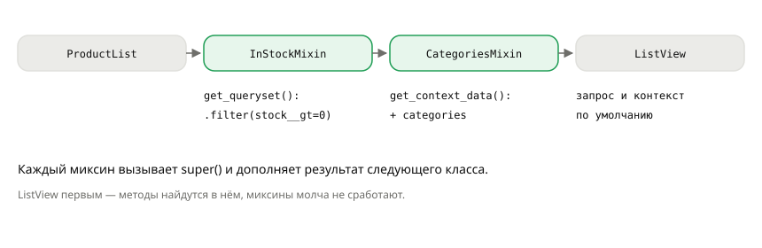

## Теория
Каталог, страница категории и карточка товара должны показывать только товары в наличии, а меню категорий нужно на всех страницах каталога. Копировать одинаковый `get_queryset` в каждый класс — значит потом исправлять его в пяти местах. Общий кусок поведения выносят в **миксин** — маленький класс без собственной роли, который подмешивают к view:
```
class InStockMixin:
    def get_queryset(self):
        return super().get_queryset().filter(stock__gt=0)


class ProductList(InStockMixin, ListView):
    model = Product
```
Всё держится на **MRO** (method resolution order) — порядке, в котором Python ищет метод среди родителей (подробно — курс «Python», раздел «ООП»). У `class ProductList(InStockMixin, ListView)` порядок такой: `ProductList` → `InStockMixin` → `ListView` → … Поэтому:
- `ProductList.get_queryset()` находится в `InStockMixin`;
- внутри него **`super().get_queryset()`** вызывает следующий по MRO класс — `ListView` (точнее, `MultipleObjectMixin`): тот строит `Product.objects.all()`, а миксин добавляет фильтр.

Отсюда два правила:
1. **Миксины пишут слева, базовый view — последним.** `class ProductList(ListView, InStockMixin)` — `get_queryset` найдётся в `ListView` раньше, и миксин молча не сработает.
2. **Метод миксина вызывает `super()`.** Тогда миксины складываются в цепочку: каждый добавляет своё и передаёт дальше. Без `super()` цепочка обрывается — например, `get_context_data` без `super()` выбросит контекст `ListView`, и пропадёт сам список.

Готовые миксины Django устроены так же: `LoginRequiredMixin` (только для вошедших — раздел «Пользователи и доступ») тоже пишут первым.

## Наглядно
**Рисунок 1.** MRO `ProductList(InStockMixin, CategoriesMixin, ListView)`: вызов `get_queryset()` и `get_context_data()` проходит миксины слева направо через `super()`.



**Таблица 1.** Порядок родителей.

| Объявление | `get_queryset()` | Результат |
|---|---|---|
| `class ProductList(InStockMixin, ListView)` | миксин → `super()` → ListView | только в наличии |
| `class ProductList(ListView, InStockMixin)` | сразу ListView | все товары, миксин не работает |
| миксин без `super()` | только миксин | свой запрос вместо базового (или пустой контекст) |

## На практике
Задача: миксин «только в наличии» для каталога и карточки и миксин «меню категорий» для каталога.

### Шаг 1. Два миксина
Файл `views.py`:
```python
from django.views.generic import DetailView, ListView

from .models import Category, Product


class InStockMixin:
    def get_queryset(self):
        return super().get_queryset().filter(stock__gt=0)


class CategoriesMixin:
    def get_context_data(self, **kwargs):
        context = super().get_context_data(**kwargs)
        context["categories"] = Category.objects.order_by("name")
        return context


class ProductList(InStockMixin, CategoriesMixin, ListView):
    model = Product
    ordering = ["name"]


class ProductDetail(InStockMixin, DetailView):
    model = Product
```
Файл `templates/shop/product_list.html`:
```html
<nav>{{ c.name }} </nav>
<ul><li>{{ p.name }}</li></ul>
```

### Шаг 2. Результат
Каталог и карточка товара без остатка:
```
GET /catalog/ → 200 OK, SQL-запросов: 2
<nav>Мыши Ноутбуки </nav>
<ul><li>Беспроводная мышь</li><li>Коврик для мыши</li><li>Ноутбук Aster 14</li><li>Подставка для ноутбука</li></ul>

GET /products/gaming-mouse/ → 404 Not Found
Не найден ни один product, соответствующий запросу
```
Игровой мыши (остаток 0) нет ни в каталоге, ни по прямой ссылке: `DetailView` ищет объект внутри `get_queryset()` миксина.

MRO класса:

Файл `orm.py`:
```python
from shop.views import ProductList
print([c.__name__ for c in ProductList.__mro__][:6])
```
Результат:
```
['ProductList', 'InStockMixin', 'CategoriesMixin', 'ListView', 'MultipleObjectTemplateResponseMixin', 'TemplateResponseMixin']
```

### Шаг 3. Не тот порядок
`class ProductList(ListView, InStockMixin, CategoriesMixin)`:
```
GET /catalog/ → 200 OK, SQL-запросов: 1
<nav></nav>
<ul><li>Беспроводная мышь</li><li>Игровая мышь</li><li>Коврик для мыши</li><li>Ноутбук Aster 14</li><li>Подставка для ноутбука</li></ul>
```
Ошибки нет, но не сработал ни один миксин: и `get_queryset`, и `get_context_data` нашлись в `ListView` раньше миксинов.

### Шаг 4. Миксин без super()
`CategoriesMixin`, который начинает с `context = {}` вместо `super().get_context_data(**kwargs)`:
```html
<nav>Мыши Ноутбуки </nav>
<ul></ul>
```
Меню есть, а товаров нет: контекст `ListView` с `product_list` выброшен.

## Частые ошибки
- **Базовый view первым.** `class X(ListView, Mixin)` — методы миксина не вызываются, ошибки нет. Миксины — слева.
- **Метод миксина без `super()`.** Цепочка обрывается: теряется базовый запрос или контекст и все миксины правее.
- **Миксин, который знает слишком много.** `InStockMixin` с `Product.objects…` внутри работает только для товаров; через `super().get_queryset()` — для любой модели с полем `stock`.
- **Атрибуты с одинаковыми именами в двух миксинах.** Победит левый — второй молча проигнорирован.
- **Глубокая иерархия.** Пять уровней миксинов — чтобы понять, какой `get_queryset` сработал, нужно читать MRO. Если миксин нужен один раз — проще написать метод в классе.

## Итог
**Миксин**
- Маленький класс с общим поведением; метод переопределяет метод view и вызывает `super()`.

**Порядок**
- `class View(Миксин1, Миксин2, БазовыйView)` — миксины слева, базовый последним.
- `super()` идёт по MRO: каждый миксин добавляет своё к результату следующего.

## Вопросы на собеседовании
<details><summary>Почему миксины указывают перед базовым классом view?</summary>

Python ищет атрибуты по MRO слева направо. Если базовый `ListView` стоит первым, его `get_queryset` найдётся раньше и метод миксина не вызовется. Миксин слева перехватывает вызов, делает своё и через `super()` передаёт управление дальше — к базовому классу.
</details>

<details><summary>Что такое MRO и как его посмотреть?</summary>

Method Resolution Order — линейный порядок классов, в котором ищутся атрибуты при множественном наследовании (алгоритм C3). Посмотреть — `Class.__mro__` или `Class.mro()`. `super()` вызывает метод следующего класса именно в этом порядке, а не «родителя» в смысле объявления.
</details>

<details><summary>Чем миксин отличается от обычного базового класса?</summary>

Миксин не самостоятелен: его не используют отдельно, он рассчитан на то, что «рядом» в MRO будет класс с нужными методами (`get_queryset`, `get_context_data`), и вызывает их через `super()`. Обычный базовый класс задаёт основное поведение и может работать сам.
</details>

## Глубже
Готовые миксины доступа (`LoginRequiredMixin`, `PermissionRequiredMixin`, `UserPassesTestMixin`) — следующий раздел «Пользователи и доступ». MRO и `super()` подробно — курс «Python», раздел «ООП».
