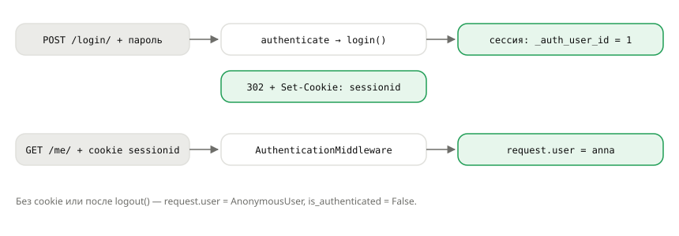

## Теория
HTTP не помнит, кто отправил прошлый запрос. Вход держится на **сессии**: после проверки пароля сервер записывает в таблицу сессий id пользователя и отдаёт браузеру cookie **`sessionid`** со случайным ключом. Браузер присылает cookie с каждым запросом, `AuthenticationMiddleware` находит по ней пользователя и кладёт его в **`request.user`**. Для гостя `request.user` — `AnonymousUser`, у него `is_authenticated` — `False`.

Три функции из `django.contrib.auth`:
- **`authenticate(request, username=…, password=…)`** — проверяет логин и пароль; вернёт пользователя или `None`. Сам по себе не входит;
- **`login(request, user)`** — записывает пользователя в сессию (и меняет ключ сессии — защита от подмены);
- **`logout(request)`** — очищает сессию.

Писать вход руками не обязательно: **`path("accounts/", include("django.contrib.auth.urls"))`** подключает готовые view — `login/`, `logout/`, смену и сброс пароля. Шаблоны — свои: `registration/login.html` с `{{ form }}` (имя и пароль). Куда вести после входа — `LOGIN_REDIRECT_URL` (по умолчанию `/accounts/profile/`) или скрытое поле **`next`** — адрес, с которого пользователя отправили на вход. Чужие адреса в `next` Django игнорирует — это защита от «открытого редиректа» на фишинговый сайт. После выхода — `LOGOUT_REDIRECT_URL`.

Выход — только **POST** (с Django 5.0 `LogoutView` на GET отвечает 405): иначе любая картинка `` на чужом сайте разлогинила бы пользователя. В шаблоне — форма с кнопкой «Выйти» и ``.

Регистрация — **`UserCreationForm`**: имя, пароль и повтор; проверяет уникальность имени, совпадение паролей и валидаторы из `AUTH_PASSWORD_VALIDATORS` (длина, «слишком простой»), сохраняет пароль хешем. После `form.save()` пользователя обычно сразу вводят в систему `login()`.

## Наглядно
**Рисунок 1.** Вход по сессии: пароль проверяется один раз, дальше пользователя узнают по cookie.



**Таблица 1.** Готовые адреса `django.contrib.auth.urls`.

| Адрес | View | Шаблон |
|---|---|---|
| `accounts/login/` | `LoginView` | `registration/login.html` |
| `accounts/logout/` | `LogoutView` (только POST) | — (`LOGOUT_REDIRECT_URL`) |
| `accounts/password_change/` | `PasswordChangeView` | `registration/password_change_form.html` |
| `accounts/password_reset/` | `PasswordResetView` | `registration/password_reset_form.html` + письмо |

## На практике
Задача: вход и выход своими view, затем на готовых, и регистрация покупателя. В учебных данных пользователи `anna`, `boris`, `olga`; пароль Анны — `anna-pass-1`.

### Шаг 1. Свой вход и выход
Файл `views.py` (фрагмент):
```python
from django.contrib.auth import authenticate, login, logout
from django.http import HttpResponse
from django.shortcuts import redirect, render


def sign_in(request):
    error = ""
    if request.method == "POST":
        user = authenticate(
            request,
            username=request.POST["username"],
            password=request.POST["password"],
        )
        if user is None:
            error = "Неверное имя или пароль."
        else:
            login(request, user)
            return redirect("me")
    return render(request, "shop/login.html", {"error": error})


def sign_out(request):
    if request.method == "POST":
        logout(request)
    return redirect("me")


def me(request):
    if request.user.is_authenticated:
        return HttpResponse(f"Вы вошли как {request.user.username}")
    return HttpResponse(f"Гость: {request.user}, {request.user.is_authenticated}")
```
Запросы одного браузера по порядку:
```
GET /me/ → Гость: AnonymousUser, False
POST /login/ (anna, wrong) → 200, «Неверное имя или пароль.»
POST /login/ (anna, anna-pass-1) → 302, Location: /me/, Set-Cookie: sessionid (HttpOnly)
GET /me/ → Вы вошли как anna
GET /logout/ → 302, по-прежнему «Вы вошли как anna»
POST /logout/ → 302, GET /me/ → Гость: AnonymousUser, False
```

### Шаг 2. Готовые view
Файл `urls.py` (фрагмент):
```python
path("accounts/", include("django.contrib.auth.urls")),
```
Файл `templates/registration/login.html`:
```html
<form method="post">{{ form.as_p }}<input type="hidden" name="next" value="{{ next }}"><button>Войти</button></form>
```
Ответы:
```
POST /accounts/login/ (anna, wrong) → 200
Пожалуйста, введите правильные имя пользователя и пароль. Оба поля могут быть чувствительны к регистру.
POST /accounts/login/ (anna, anna-pass-1) → 302, Location: /accounts/profile/
… с next=/me/ → 302, Location: /me/
… с next=https://evil.example/ → 302, Location: /accounts/profile/
GET /accounts/logout/ → 405 Method Not Allowed
POST /accounts/logout/ → 302, Location: /me/ (LOGOUT_REDIRECT_URL = "/me/")
```
Без `LOGOUT_REDIRECT_URL` `LogoutView` рисует шаблон `registration/logged_out.html`, а если его нет — шаблон админки; в тренажёре у админки нет маршрутов, поэтому — `NoReverseMatch: 'admin' is not a registered namespace`. Задавайте `LOGOUT_REDIRECT_URL`.

### Шаг 3. Регистрация
Файл `views.py` (фрагмент):
```python
from django.contrib.auth.forms import UserCreationForm


def signup(request):
    form = UserCreationForm(request.POST or None)
    if request.method == "POST" and form.is_valid():
        user = form.save()
        login(request, user)
        return redirect("me")
    return render(request, "shop/signup.html", {"form": form})
```
Имя `anna` и разные пароли — две ошибки:
```html
<ul class="errorlist" id="id_username_error"><li>Пользователь с таким именем уже существует.</li></ul>
<ul class="errorlist" id="id_password2_error"><li>Введенные пароли не совпадают.</li></ul>
```
Имя `vera` и одинаковые пароли — `302`, и сразу «Вы вошли как vera». Сессия Веры (она четвёртый пользователь, id 4) — только id и служебные поля, не пароль:
```
{'_auth_user_id': '4', '_auth_user_backend': 'django.contrib.auth.backends.ModelBackend', '_auth_user_hash': 'cc61d27551681e0884ca597baa333f797890cef0d9642d1fd1ba5aeb21a637e2'}
```
`_auth_user_hash` построен из хеша пароля: сменил пароль — старые сессии перестают действовать. Пароль в базе — хеш (`md5$…` в тренажёре — ради скорости; в проекте по умолчанию `pbkdf2_sha256$…`). В тренажёре не настроены `AUTH_PASSWORD_VALIDATORS`, поэтому короткий пароль проходит; в новом проекте `startproject` их включает.

## Частые ошибки
- **`authenticate` без `login`.** Пароль проверен, но в сессию никто не записан — на следующей странице снова гость.
- **Выход по ссылке.** `<a href="/accounts/logout/">` — 405; выход — форма `method="post"` с ``.
- **Свой `next` без проверки.** `redirect(request.GET["next"])` перенаправит на любой сайт. `LoginView` проверяет адрес сам; в своём view — `url_has_allowed_host_and_scheme`.
- **Пароль строкой в поле.** `User(password="…")` или `user.password = "…"` — без хеша. `create_user()`, `set_password()` или `UserCreationForm`.
- **Сообщение «нет такого пользователя».** Разные ошибки для неверного имени и пароля подсказывают, какие логины есть. Одно сообщение на оба случая.
- **Проверка `if request.user:`.** `AnonymousUser` — истинный объект; нужно `request.user.is_authenticated`.

## Итог
**Сессия**
- После `login()` в сессии — id пользователя, у браузера — cookie `sessionid`; `request.user` — пользователь или `AnonymousUser`.

**Функции и готовые view**
- `authenticate` → `login` → redirect; `logout` — только POST.
- `include("django.contrib.auth.urls")`, шаблон `registration/login.html`, `next`, `LOGIN_REDIRECT_URL`, `LOGOUT_REDIRECT_URL`.

**Регистрация**
- `UserCreationForm` → `save()` → `login()`.

## Вопросы на собеседовании
<details><summary>Как в Django устроена аутентификация по сессии?</summary>

`login()` сохраняет в сессии `_auth_user_id`, бэкенд и хеш от пароля, а `SessionMiddleware` отдаёт cookie `sessionid`. На каждом запросе `AuthenticationMiddleware` лениво загружает пользователя по сессии в `request.user`. Пароль проверяется только при входе; `logout()` очищает сессию.
</details>

<details><summary>Чем `authenticate()` отличается от `login()`?</summary>

`authenticate()` проходит по `AUTHENTICATION_BACKENDS` и возвращает пользователя, если учётные данные верны (и пользователь активен), иначе `None`. `login()` фиксирует уже проверенного пользователя в сессии и меняет ключ сессии (`cycle_key`), защищая от фиксации сессии.
</details>

<details><summary>Почему выход делают POST-запросом?</summary>

GET должен быть безопасным: его выполняют ссылки, картинки и предзагрузка. Выход по GET позволяет чужому сайту разлогинить пользователя (``) — это вид CSRF. С Django 5.0 `LogoutView` принимает только POST.
</details>

## Глубже
Кому что можно после входа — следующая тема «Права и группы». Настройки сессий и cookie (`SESSION_COOKIE_SECURE`, `CSRF_COOKIE_SECURE`) — раздел «Настройки и безопасность».
