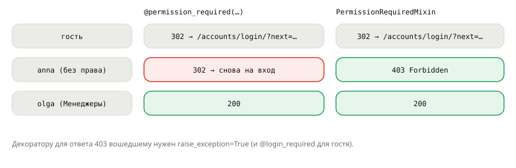

## Теория
Вход отвечает на вопрос «кто это», права — «что ему можно». В Django два уровня проверки.

**Только для вошедших:**
- функции — декоратор **`@login_required`**;
- классы — **`LoginRequiredMixin`** (первым среди родителей, см. «Миксины»).

Гость перенаправляется на `LOGIN_URL` (по умолчанию `/accounts/login/`) с `?next=<адрес>` — после входа он вернётся туда, куда шёл.

**Права (permissions).** Для каждой модели Django создаёт четыре права: `add_<модель>`, `change_<модель>`, `delete_<модель>`, `view_<модель>`. Полное имя — `"<приложение>.<codename>"`: `"shop.change_product"`. Права выдают пользователю (`user.user_permissions`) или, чаще, **группе** (`Group` — «Менеджеры», «Склад»), а пользователя включают в группу. Суперпользователь (`is_superuser`) имеет все права.

Проверка:
- в коде — **`user.has_perm("shop.change_product")`**;
- функции — **`@permission_required("shop.change_product", raise_exception=True)`**;
- классы — **`PermissionRequiredMixin`** с `permission_required = "shop.change_product"`;
- шаблон — **``** (и `{{ user }}` — текущий пользователь).

Чем отличаются ответы: гостя отправляют на вход (302), а вошедшему без права отвечают **403 Forbidden**. Так делает `PermissionRequiredMixin`. А вот `@permission_required` **без `raise_exception=True`** и вошедшего отправляет на страницу входа — человек уже вошёл, а его снова просят войти.

Права кэшируются в объекте пользователя: выдали право — `has_perm()` у того же объекта ответит по-старому, пока пользователя не загрузят заново. В запросах это не мешает: каждый запрос загружает пользователя заново.

## Наглядно
**Рисунок 1.** Кто что видит на странице изменения цены: гость, покупатель и менеджер.



**Таблица 1.** Инструменты проверки.

| Где | Только вошедшие | Право |
|---|---|---|
| функция | `@login_required` | `@permission_required("shop.change_product", raise_exception=True)` |
| класс | `LoginRequiredMixin` | `PermissionRequiredMixin` + `permission_required` |
| код | `request.user.is_authenticated` | `request.user.has_perm("shop.change_product")` |
| шаблон | `` | `` |

## На практике
Задача: «Мои заказы» — только для вошедших; изменение цены — только менеджерам; ссылка «Цены» в меню — только тем, кому можно. В учебных данных группа «Менеджеры» с правом `shop.change_product`, в ней Ольга; Анна и Борис — покупатели.

### Шаг 1. Только для вошедших
Файл `views.py` (фрагмент):
```python
from django.contrib.auth.decorators import login_required


@login_required
def orders(request):
    return render(request, "shop/orders.html", {"orders": request.user.orders.order_by("number")})
```
Гость и вошедшая Анна:
```
гость: GET /orders/ → 302, Location: /accounts/login/?next=/orders/
anna:  GET /orders/ → 200
```

### Шаг 2. Только с правом
Файл `views.py` (фрагмент):
```python
from django.contrib.auth.decorators import permission_required
from django.contrib.auth.mixins import PermissionRequiredMixin


@permission_required("shop.change_product")
def price_fbv(request, slug):
    return HttpResponse("форма цены")


class PriceUpdate(PermissionRequiredMixin, UpdateView):
    permission_required = "shop.change_product"
    model = Product
    fields = ["price"]
    template_name = "shop/price.html"
    success_url = "/"
```
Ответы функции (`/price-fbv/aster-14/`) и класса (`/products/aster-14/price/`):
```
гость: 302 на /accounts/login/?next=… | 302 на /accounts/login/?next=…
anna:  302 на /accounts/login/?next=… | 403
olga:  200                            | 200
```
Анна вошла, но декоратор без `raise_exception=True` снова отправил её на вход. Класс ответил честным 403.

### Шаг 3. Права в шаблоне
Файл `templates/shop/menu.html`:
```html
<p>{{ user.username }}</p><a href="/manage/">Цены</a><p>есть права в shop</p>
```
Что видят гость, Анна и Ольга:
```
гость: (пусто)
anna:  <p>anna</p>
olga:  <p>olga</p><a href="/manage/">Цены</a><p>есть права в shop</p>
```
Скрытая ссылка — удобство, не защита: проверка права обязательна и во view.

### Шаг 4. Права и группы в коде
Файл `orm.py`:
```python
from django.contrib.auth.models import Permission
anna = User.objects.get(username="anna")
olga = User.objects.get(username="olga")
print(anna.has_perm("shop.change_product"), olga.has_perm("shop.change_product"))
print(olga.get_all_permissions())
change = Permission.objects.get(codename="change_product")
anna.user_permissions.add(change)
print(anna.has_perm("shop.change_product"))
anna = User.objects.get(pk=anna.pk)
print(anna.has_perm("shop.change_product"))
print(olga.has_perm("change_product"))
```
Результат:
```
False True
{'shop.change_product'}
False
True
False
```
Ольга получила право через группу. Анне право выдали, но тот же объект ответил `False` — права закэшированы; после повторной загрузки — `True`. Без имени приложения (`"change_product"`) право не найдено.

## Частые ошибки
- **`@permission_required` без `raise_exception=True`.** Вошедший без права уходит на страницу входа по кругу. Для вошедших — 403.
- **Миксин не первым.** `class PriceUpdate(UpdateView, PermissionRequiredMixin)` — `dispatch` найдётся в `UpdateView`, проверки нет.
- **Право без приложения.** `has_perm("change_product")` — всегда `False`; нужно `"shop.change_product"`.
- **Проверка только в шаблоне.** Скрыли кнопку, а адрес открывается напрямую. Проверяйте во view.
- **`is_staff` вместо прав.** `is_staff` — только «пускать в админку»; что можно делать — права и группы.
- **Ждать нового права от того же объекта.** Права кэшируются; в тесте после выдачи права загрузите пользователя заново.

## Итог
**Вход обязателен**
- `@login_required`, `LoginRequiredMixin` — гостя на `LOGIN_URL` с `?next=`.

**Права**
- `<приложение>.<действие>_<модель>`; выдают группе, пользователя — в группу.
- `has_perm`, `@permission_required(…, raise_exception=True)`, `PermissionRequiredMixin`, `perms` в шаблоне.
- Гость — 302 на вход, вошедший без права — 403.

## Вопросы на собеседовании
<details><summary>Какие права Django создаёт автоматически?</summary>

Для каждой модели — `add_`, `change_`, `delete_`, `view_` + имя модели строчными; они создаются после `migrate` (сигнал `post_migrate`). Свои права — `Meta.permissions = [("publish_review", "Может публиковать отзывы")]`. Полное имя для проверки — `"app_label.codename"`.
</details>

<details><summary>Чем отличается поведение `PermissionRequiredMixin` и `@permission_required`?</summary>

Миксин: гость — редирект на вход, вошедший без права — 403 (`raise_exception` по умолчанию учитывает, вошёл ли пользователь). Декоратор по умолчанию всегда перенаправляет на вход, даже вошедшего; чтобы отвечать 403, нужен `raise_exception=True`.
</details>

<details><summary>Зачем нужны группы?</summary>

Чтобы выдавать набор прав роли, а не каждому пользователю: «Менеджеры» — менять цены и заказы, «Склад» — остатки. Новый сотрудник получает права добавлением в группу; изменили права группы — изменились у всех её участников.
</details>

## Глубже
Права на уровне конкретного объекта («свой заказ») — следующая тема «Доступ к своим объектам».
