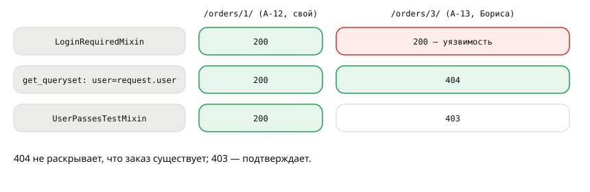

## Теория
Права из прошлой темы — на модель целиком: «может менять товары». Но покупатель может смотреть **заказы**, а не **все заказы**: только свои. Это проверка на уровне объекта, и её делают в коде view.

Главный способ — **искать объект сразу среди своих**:
- в функции — `get_object_or_404(Order, pk=pk, user=request.user)`;
- в классе — `get_queryset()` с `filter(user=self.request.user)`; `DetailView`, `UpdateView`, `DeleteView` ищут объект внутри него.

Чужой заказ при этом «не существует» — ответ **404**. Если искать по одному `pk` (`Order.objects.get(pk=pk)`), любой вошедший пользователь перебором адресов `/orders/1/`, `/orders/2/`… откроет чужие заказы — это уязвимость IDOR (Insecure Direct Object Reference), одна из самых частых в веб-приложениях.

Второй способ — **`UserPassesTestMixin`** с методом `test_func()`: вернул `False` — вошедшему **403**, гостю — редирект на вход. Подходит для правил, которые не выразить фильтром: «редактировать отзыв можно в течение суток».

**403 или 404?** 403 честно говорит «объект есть, но вам нельзя» — и тем самым подтверждает, что заказ с таким номером существует. 404 не раскрывает даже этого. Для чужих личных данных (заказы, адреса) обычно отвечают 404; 403 — когда существование объекта не секрет (товар есть, а менять цену нельзя).

Одной проверки «вошёл» недостаточно: `LoginRequiredMixin` пускает любого вошедшего к любому объекту.

## Наглядно
**Рисунок 1.** Анна открывает свой и чужой заказ при трёх вариантах view.



**Таблица 1.** Способы ограничить доступ к объекту.

| Способ | Чужой объект | Гость |
|---|---|---|
| только `LoginRequiredMixin` | 200 — **уязвимость** | 302 на вход |
| `get_queryset()` / `get_object_or_404(…, user=request.user)` | 404 | (нужен ещё `LoginRequiredMixin`) |
| `UserPassesTestMixin.test_func()` | 403 | 302 на вход |
| `request.user.orders.all()` в списке | не попадает в список | — |

## На практике
Задача: страница заказа `/orders/<pk>/` — покупатель видит только свои. У Анны заказы A-12 (pk 1) и A-14 (pk 2), у Бориса — A-13 (pk 3).

### Шаг 1. Только вход — уязвимость
Файл `views.py` (фрагмент):
```python
class OrderDetailAll(LoginRequiredMixin, DetailView):
    model = Order
```
Анна вошла:
```
GET /all/3/ → 200
```
Заказ Бориса открылся.

### Шаг 2. Поиск среди своих
Файл `views.py` (фрагмент):
```python
class OrderDetail(LoginRequiredMixin, DetailView):
    model = Order

    def get_queryset(self):
        return Order.objects.filter(user=self.request.user)
```
Анна открывает свой и чужой заказ:
```
GET /orders/1/ → 200
GET /orders/3/ → 404
```
В функции то же самое — `get_object_or_404(Order, pk=pk, user=request.user)`.

### Шаг 3. Проверка правилом
Файл `views.py` (фрагмент):
```python
class OrderDetailTest(UserPassesTestMixin, DetailView):
    model = Order

    def test_func(self):
        return self.get_object().user == self.request.user
```
Свой, чужой и запрос гостя:
```
anna:  GET /test/1/ → 200
anna:  GET /test/3/ → 403
гость: GET /test/1/ → 302, Location: /accounts/login/?next=/test/1/
```
Чужой заказ — 403: Анна узнала, что заказ 3 существует. `get_object()` здесь вызывается дважды — в `test_func` и при показе страницы, это лишний запрос.

## Частые ошибки
- **Только `@login_required`/`LoginRequiredMixin`.** Любой вошедший открывает любой объект по `pk`. Ограничьте запрос владельцем.
- **`Order.objects.get(pk=pk)` и проверка после.** Забыли проверку в одном view — дыра. Надёжнее искать сразу в `filter(user=request.user)`.
- **Скрыть ссылку и считать, что защищено.** Адрес `/orders/3/` набирают вручную.
- **403 для чужих личных объектов.** Подтверждает, что объект существует; для заказов и адресов — 404.
- **`UpdateView`/`DeleteView` без ограничения.** Защитили страницу просмотра, а изменить и удалить чужой отзыв можно. Ограничение — во всех view с объектом (удобно миксином `OwnerMixin` с `get_queryset`).
- **Владелец из формы.** `user` в полях формы позволяет подставить чужого владельца; ставьте `form.instance.user = request.user` во view.

## Итог
**Свои объекты**
- Ищите среди своих: `filter(user=request.user)` в `get_queryset()` или `get_object_or_404(…, user=request.user)` — чужое даёт 404.
- `UserPassesTestMixin.test_func()` — для правил, которые не фильтр; чужое — 403.

**Ответ**
- 404 — не раскрывает существование; 403 — «есть, но нельзя».

## Вопросы на собеседовании
<details><summary>Что такое IDOR и как защититься в Django?</summary>

Insecure Direct Object Reference — доступ к чужому объекту по его идентификатору из адреса (`/orders/3/`). Защита: искать объект с условием владельца (`get_object_or_404(Order, pk=pk, user=request.user)`, `get_queryset()` с фильтром) во всех view — просмотре, изменении, удалении — и не брать владельца из данных формы.
</details>

<details><summary>Когда отвечать 403, а когда 404?</summary>

404 — если само существование объекта — чужая информация (заказы, адреса, личные сообщения): пользователь не отличит «нет» от «чужое». 403 — когда объект и так виден, но действие запрещено (товар открыт всем, менять цену — только менеджеру). Django: `Http404` против `PermissionDenied`.
</details>

<details><summary>Зачем `UserPassesTestMixin`, если есть `get_queryset`?</summary>

Для правил, которые не сводятся к фильтру запроса: «редактировать отзыв в течение 24 часов», «отменить заказ, пока он не отправлен», «доступ по флагу пользователя». `test_func()` возвращает `True`/`False`; при `False` гостя отправляют на вход, вошедшему — 403.
</details>

## Глубже
Проверка в тестах, что чужой заказ отвечает 404, — раздел «Тесты в Django». Права на уровне объекта как подсистема — библиотека django-guardian.
