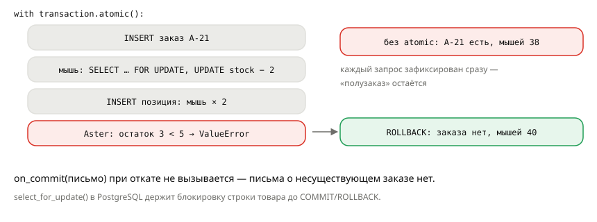

## Теория
Оформление заказа — несколько записей: создать заказ, списать остатки, создать позиции. Если на третьем товаре остатка не хватило, а первые два уже списаны и заказ создан — база в полуготовом состоянии. **Транзакция** объединяет запросы в одно целое: либо все применяются (`COMMIT`), либо ни один (`ROLLBACK`).

По умолчанию Django работает в режиме **autocommit**: каждый запрос — своя маленькая транзакция. Объединяют блоком **`transaction.atomic()`**:
```
with transaction.atomic():
    ...  # исключение внутри — откат всего блока
```
Можно и декоратором `@transaction.atomic` на функцию. Вложенный `atomic()` создаёт **точку сохранения (savepoint)**: его можно откатить, не трогая внешний блок. Если поймать ошибку базы (`IntegrityError`) внутри блока без вложенного `atomic`, транзакция уже «сломана» — следующий запрос упадёт с `TransactionManagementError`.

**Гонка остатков.** Два покупателя одновременно читают «осталось 1» и оба оформляют заказ. Защиты две:
- атомарное изменение `update(stock=F("stock") - qty)` с проверкой в условии (раздел «ORM: чтение данных»);
- **`select_for_update()`** — `SELECT … FOR UPDATE`: строка блокируется до конца транзакции, второй покупатель ждёт и прочитает уже уменьшенный остаток. Работает только внутри `atomic()` (иначе — `TransactionManagementError: select_for_update cannot be used outside of a transaction.`). В SQLite блокировки строк нет — Django просто не добавляет `FOR UPDATE`; проверяйте на PostgreSQL.

**`transaction.on_commit(функция)`** — выполнить действие **после** успешного коммита: письмо о заказе, задачу в очередь. Если блок откатится, функция не вызовется — покупатель не получит письмо о заказе, которого нет.

Внешние действия (оплата, письмо, HTTP-запрос) не откатываются вместе с базой — их не делают внутри транзакции «по пути», а запускают в `on_commit`.

## Наглядно
**Рисунок 1.** Оформление заказа в транзакции: ошибка на любом шаге откатывает всё.



**Таблица 1.** Инструменты транзакций.

| Инструмент | Что делает |
|---|---|
| `with transaction.atomic():` | блок «всё или ничего»; исключение — `ROLLBACK` |
| вложенный `atomic()` | savepoint: откат только внутреннего блока |
| `select_for_update()` | `SELECT … FOR UPDATE` — блокировка строк до конца транзакции |
| `select_for_update(skip_locked=True)` | пропустить заблокированные строки (очереди задач) |
| `transaction.on_commit(f)` | вызвать `f` после коммита; при откате — не вызывать |
| `ATOMIC_REQUESTS = True` | каждый запрос к view — в транзакции |

## На практике
Задача: функция оформления заказа, которая не оставляет «полузаказов» и отправляет письмо только об оформленном заказе. Остатки: Aster 14 — 3, беспроводная мышь — 40.

### Шаг 1. Оформление в atomic
Файл `orm.py`:
```python
from django.db import transaction
from django.db.models import F


def checkout(number, email, cart):
    with transaction.atomic():
        order = Order.objects.create(number=number, email=email)
        for slug, qty in cart:
            product = Product.objects.select_for_update().get(slug=slug)
            if product.stock < qty:
                raise ValueError(f"Нет столько: {product.name}")
            Product.objects.filter(pk=product.pk).update(stock=F("stock") - qty)
            OrderItem.objects.create(order=order, product=product, quantity=qty, price=product.price)
        transaction.on_commit(lambda: print("письмо о заказе", number))
    return order


checkout("A-20", "vera@shop.example", [("wireless-mouse", 2), ("aster-14", 1)])
print(Order.objects.count(), dict(Product.objects.values_list("slug", "stock")))
```
Результат:
```
письмо о заказе A-20
2 {'aster-14': 2, 'wireless-mouse': 38, 'gaming-mouse': 0, 'mouse-pad': 25}
```

### Шаг 2. Не хватило остатка
Тот же `checkout`, корзина `[("wireless-mouse", 2), ("aster-14", 5)]`, ошибка перехвачена снаружи:
```
ошибка: Нет столько: Ноутбук Aster 14
False {'aster-14': 3, 'wireless-mouse': 40, 'gaming-mouse': 0, 'mouse-pad': 25}
```
Заказа A-21 нет, мышь не списана, письма нет. Без `atomic()` (каждый запрос коммитится сразу):
```
ошибка: Нет столько: Ноутбук Aster 14
True {'aster-14': 3, 'wireless-mouse': 38, 'gaming-mouse': 0, 'mouse-pad': 25}
```
Заказ A-21 создан, две мыши списаны — за несуществующую покупку.

### Шаг 3. FOR UPDATE
В тренажёре (SQLite) `select_for_update()` даёт обычный `SELECT` без блокировки. Тот же запрос для PostgreSQL:
```
SELECT … FROM "shop_product" WHERE "shop_product"."slug" = %s FOR UPDATE
```
С `skip_locked=True` и срезом `[:1]` — `… LIMIT 1 FOR UPDATE SKIP LOCKED`.

### Шаг 4. Ошибка внутри блока
Поймали дубль номера заказа прямо в `atomic()` и пошли дальше:

Файл `orm.py`:
```python
from django.db import IntegrityError, transaction
with transaction.atomic():
    Order.objects.create(number="A-30", email="x@shop.example")
    try:
        Order.objects.create(number="A-12", email="dup@shop.example")
    except IntegrityError:
        print("дубль номера")
    Order.objects.create(number="A-31", email="y@shop.example")
```
Вывод — `дубль номера`, затем:
```
django.db.transaction.TransactionManagementError: An error occurred in the current transaction. You can't execute queries until the end of the 'atomic' block.
```
Опасную операцию оборачивают во вложенный `atomic()` — тогда откатится только она:

Файл `orm.py`:
```python
from django.db import IntegrityError, transaction
with transaction.atomic():
    Order.objects.create(number="A-30", email="x@shop.example")
    try:
        with transaction.atomic():
            Order.objects.create(number="A-12", email="dup@shop.example")
    except IntegrityError:
        print("дубль номера")
    Order.objects.create(number="A-31", email="y@shop.example")
print(sorted(Order.objects.values_list("number", flat=True)))
```
Результат:
```
дубль номера
['A-12', 'A-30', 'A-31']
```

### Шаг 5. on_commit и откат
Файл `orm.py`:
```python
from django.db import transaction
try:
    with transaction.atomic():
        transaction.on_commit(lambda: print("письмо"))
        raise ValueError("сбой")
except ValueError:
    print("откат")
with transaction.atomic():
    transaction.on_commit(lambda: print("письмо 2"))
    print("внутри")
print("после")
```
Результат:
```
откат
внутри
письмо 2
после
```
Первое письмо не ушло — блок откатился. Второе ушло после выхода из блока, в момент коммита.

## Частые ошибки
- **Несколько связанных записей без `atomic()`.** Ошибка посередине оставляет «полузаказ» и списанные остатки.
- **`try/except IntegrityError` внутри `atomic()` без вложенного блока.** Следующий запрос — `TransactionManagementError`.
- **`select_for_update()` вне транзакции.** `TransactionManagementError: select_for_update cannot be used outside of a transaction.` (в PostgreSQL); в SQLite ошибки нет — и блокировки тоже.
- **Письмо или оплата внутри транзакции.** Откат базы их не отменит. Письма — в `on_commit`; оплату — до заказа или с отдельной обработкой отказа.
- **Долгие транзакции.** Блокировки держатся до коммита: внешний HTTP-запрос внутри `atomic()` с `select_for_update` останавливает всех, кто ждёт эти строки.
- **Проверка остатка в Python без блокировки.** `if product.stock >= qty: product.stock -= qty; product.save()` — гонка. `select_for_update()` или `update()` с `F` и условием.

## Итог
**atomic**
- Блок «всё или ничего»; исключение — откат; вложенный — savepoint.
- Пойманная ошибка базы внутри — только во вложенном `atomic()`.

**Конкуренция**
- `select_for_update()` внутри `atomic()` — `FOR UPDATE` (в SQLite не действует); `update(F(…))` — атомарное изменение.

**После коммита**
- `transaction.on_commit()` — письма и задачи только для зафиксированных данных.

## Вопросы на собеседовании
<details><summary>Как работают транзакции в Django по умолчанию?</summary>

Режим autocommit: каждый запрос сразу фиксируется. `transaction.atomic()` открывает транзакцию (или savepoint, если вложенный); выход без исключения — `COMMIT`, с исключением — `ROLLBACK`. `ATOMIC_REQUESTS = True` оборачивает каждый view в транзакцию.
</details>

<details><summary>Зачем `select_for_update()`?</summary>

Для пессимистичной блокировки: `SELECT … FOR UPDATE` блокирует выбранные строки до конца транзакции, и конкурентные транзакции ждут, а не читают устаревшие значения (например, остаток). Работает только внутри `atomic()`; `nowait=True` — ошибка вместо ожидания, `skip_locked=True` — пропуск занятых строк.
</details>

<details><summary>Почему письмо об оформлении заказа отправляют через `on_commit`?</summary>

Внутри транзакции заказ ещё может откатиться — письмо уйдёт о заказе, которого нет. `on_commit` вызывает функцию только после успешного коммита и не вызывает при откате. Так же ставят задачи в очередь (Celery): задача не должна запуститься раньше, чем данные появятся в базе.
</details>

## Глубже
Уровни изоляции и блокировки PostgreSQL — курс SQL, раздел «Производительность и транзакции». Запросы мимо ORM — следующая тема «Сырой SQL и безопасность».
