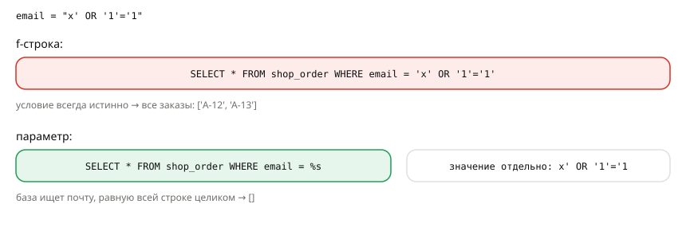

## Теория
ORM покрывает почти всё, но иногда нужен свой SQL: оконные функции в отчёте, особый синтаксис PostgreSQL, перенос старого запроса. Два способа:
- **`Model.objects.raw(sql, params)`** — SQL, который возвращает строки таблицы модели; результат — `RawQuerySet` с объектами модели. В выборке обязателен первичный ключ; поля, которых нет в `SELECT`, догружаются по запросу на объект (как у `only()`); лишние колонки становятся атрибутами;
- **`connection.cursor()`** — любой SQL, результат — кортежи: `cur.execute(sql, params)`, `cur.fetchall()`.

Главное правило — **значения передают параметрами, а не вклеивают в строку**:
```
Order.objects.raw("SELECT * FROM shop_order WHERE email = %s", [email])
```
`%s` — место для параметра (в Django для любой базы — именно `%s`, без кавычек вокруг). Драйвер базы передаёт значение отдельно от текста запроса, и оно никогда не станет частью SQL.

Если же собрать запрос f-строкой — `f"… WHERE email = '{email}'"`, — значение из формы становится кодом. Ввод `x' OR '1'='1` превращает условие в «всегда истина» — это **SQL-инъекция**: чужие заказы, обход входа, в худшем случае удаление данных. Обычные методы ORM (`filter`, `get`, `exclude`) параметризуют сами и от инъекций защищены — в зоне риска только `raw()`, `cursor()`, `extra()` и `RawSQL`.

Имена таблиц и колонок параметром не передать — параметры только для значений. Если имя колонки приходит от пользователя (сортировка по выбору), его сверяют со **списком разрешённых**.

## Наглядно
**Рисунок 1.** Строка из формы в f-строке становится частью SQL; параметром — остаётся значением.



**Таблица 1.** Как выполнять свой SQL.

| Способ | Результат | Значения |
|---|---|---|
| `Model.objects.raw(sql, [p])` | объекты модели (нужен `id`) | параметрами `%s` |
| `connection.cursor().execute(sql, [p])` | кортежи `fetchall()` | параметрами `%s` |
| `filter()`, `get()` и т. д. | QuerySet | параметризуются автоматически |
| f-строка / `%` / `.format()` со значением | — | **SQL-инъекция** |

## На практике
Задача: найти заказы покупателя по почте своим SQL — и увидеть, чем опасна f-строка. В базе заказы A-12 (anna@shop.example) и A-13 (boris@shop.example, 980 ₽).

### Шаг 1. Инъекция
Файл `orm.py`:
```python
def find_orders(email):
    sql = f"SELECT * FROM shop_order WHERE email = '{email}'"
    return [o.number for o in Order.objects.raw(sql)]


print(find_orders("anna@shop.example"))
print(find_orders("x' OR '1'='1"))
```
Результат:
```
['A-12']
['A-12', 'A-13']
```
Второй запрос, который ушёл в базу:
```
SELECT * FROM shop_order WHERE email = 'x' OR '1'='1'
```

### Шаг 2. Параметры
Файл `orm.py`:
```python
def find_orders(email):
    sql = "SELECT * FROM shop_order WHERE email = %s"
    return [o.number for o in Order.objects.raw(sql, [email])]


print(find_orders("anna@shop.example"))
print(find_orders("x' OR '1'='1"))
```
Результат:
```
['A-12']
[]
```
В журнале тренажёра значение показано с удвоенными кавычками — `WHERE email = 'x'' OR ''1''=''1'`: база искала почту, равную всей строке целиком. Так же экранирует значения `filter(email=…)`.

Кавычки вокруг `%s` — частая ошибка: `"… WHERE email = '%s'"` с параметром:
```
django.db.utils.ProgrammingError: Incorrect number of bindings supplied. The current statement uses 0, and there are 1 supplied.
```
`'%s'` — уже строковая константа, а не место для параметра.

### Шаг 3. Курсор и лишние колонки
Файл `orm.py`:
```python
from django.db import connection
with connection.cursor() as cur:
    cur.execute(
        "SELECT number, total FROM shop_order WHERE total > %s ORDER BY number",
        [500],
    )
    print(cur.fetchall())
```
Результат:
```
[('A-13', 980)]
```
Курсор возвращает сырые значения базы: здесь `980` — число SQLite, не `Decimal`.

`raw()` с вычисляемой колонкой и без `email` — `Order.objects.raw("SELECT id, number, total * 2 AS double FROM shop_order ORDER BY id")` и вывод `o.number, o.double, o.email`:
```
A-12 0 anna@shop.example
A-13 1960 boris@shop.example
```
Колонка `double` стала атрибутом, а `email` догружался отдельным запросом на каждый заказ — N+1. Без `id` в выборке:
```
django.core.exceptions.FieldDoesNotExist: Raw query must include the primary key
```

## Частые ошибки
- **Значение в f-строке, `%` или `.format()`.** SQL-инъекция. Только параметры `%s` + список значений.
- **Кавычки вокруг `%s`.** `'%s'` — строка, а не параметр: «Incorrect number of bindings supplied».
- **Имя колонки параметром.** Параметры — только значения; имена сверяют со списком разрешённых: `if sort not in {"price", "name"}: …`.
- **`raw()` без первичного ключа.** `FieldDoesNotExist: Raw query must include the primary key`.
- **Не все поля в `raw()`.** Недостающие догружаются по объекту — N+1.
- **Сырой SQL «для скорости» без замера.** Обычно ORM-запрос с `select_related`/`annotate` не медленнее; сначала `explain()` (следующая тема).

## Итог
**Свой SQL**
- `Model.objects.raw(sql, params)` — объекты модели, нужен `id`; `connection.cursor()` — кортежи.

**Безопасность**
- Значения — только параметрами `%s` (без кавычек) списком; ORM-методы параметризуют сами.
- f-строка со значением — SQL-инъекция; имена колонок — по белому списку.

## Вопросы на собеседовании
<details><summary>Как Django защищает от SQL-инъекций?</summary>

Методы ORM строят параметризованные запросы: значения передаются драйверу отдельно от текста SQL и не могут изменить его структуру. В `raw()`, `cursor.execute()`, `extra()` и `RawSQL` защита работает, только если значения переданы параметрами (`%s` + список), а не вставлены форматированием строки.
</details>

<details><summary>Чем `raw()` отличается от `connection.cursor()`?</summary>

`raw()` превращает строки результата в объекты модели (нужен первичный ключ, недостающие поля догружаются лениво, лишние колонки становятся атрибутами) и ленив, как QuerySet, но без `filter()` и других цепочек. `cursor()` выполняет любой SQL и возвращает кортежи; подходит для запросов, не привязанных к одной модели.
</details>

<details><summary>Почему нельзя передать имя колонки как параметр?</summary>

Параметры подставляются как значения (строка в кавычках), а не как идентификаторы: `ORDER BY %s` с `"price"` даст сортировку по константе `'price'`. Имена таблиц и колонок проверяют по белому списку и вставляют в текст запроса сами.
</details>

## Глубже
Как понять, что запрос медленный, — следующая тема «Производительность ORM». Инъекции и другие уязвимости — раздел «Настройки и безопасность».
