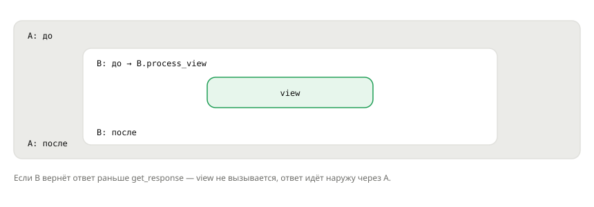

## Теория
Своё middleware нужно, когда что-то должно происходить **на каждом запросе**: замер времени ответа, журнал, заголовок, закрытие раздела сайта на время работ. Это класс из двух частей:
```
class TimingMiddleware:
    def __init__(self, get_response):
        self.get_response = get_response      # один раз при старте

    def __call__(self, request):               # на каждый запрос
        # код ДО view
        response = self.get_response(request)
        # код ПОСЛЕ view
        return response
```
- `__init__` вызывается **один раз** при запуске сервера; `get_response` — следующий слой цепочки (другое middleware или сам view);
- `__call__` — на каждый запрос: что до `self.get_response(request)` — по пути к view, что после — по пути обратно. Метод **обязан вернуть ответ**;
- вернуть свой ответ, не вызывая `get_response`, — значит остановить запрос: дальше ни middleware, ни view.

Подключение — путь к классу в `MIDDLEWARE`; место в списке определяет, что middleware уже видит (`request.user` — только после `AuthenticationMiddleware`).

Необязательные хуки — методы того же класса:
- **`process_view(request, view_func, view_args, view_kwargs)`** — вызывается перед view, когда уже известно, какой view сработает; вернул ответ — view не вызывается;
- **`process_exception(request, exception)`** — если view выбросил исключение; вернул ответ — он уйдёт пользователю вместо страницы 500;
- **`process_template_response`** — для ответов `TemplateResponse` (CBV) до отрисовки шаблона.

## Наглядно
**Рисунок 1.** Два middleware A и B: «матрёшка» вызовов.



**Таблица 1.** Части middleware.

| Часть | Когда | Вернуть ответ — значит |
|---|---|---|
| `__init__(get_response)` | один раз при запуске | — |
| код до `get_response` в `__call__` | каждый запрос, к view | не пустить запрос дальше |
| код после `get_response` | каждый запрос, обратно | заменить или дополнить ответ |
| `process_view` | перед view | не вызывать view |
| `process_exception` | исключение во view | ответ вместо 500 |

## На практике
Задача: заголовок `X-Response-Time-ms` со временем обработки каждой страницы; заодно посмотреть порядок вызовов и обработку ошибок. В тренажёре свои middleware подключаются ключом `MIDDLEWARE` в `settings` задачи — они встают в конец списка, после `MessageMiddleware`.

### Шаг 1. Время ответа
Файл `middleware.py`:
```python
import time


class TimingMiddleware:
    def __init__(self, get_response):
        self.get_response = get_response

    def __call__(self, request):
        start = time.perf_counter()
        response = self.get_response(request)
        ms = (time.perf_counter() - start) * 1000
        response["X-Response-Time-ms"] = f"{ms:.1f}"
        return response
```
Подключение — `"shop.middleware.TimingMiddleware"` в `MIDDLEWARE`. `Client().get("/p/aster-14/")`: статус `200`, заголовок `X-Response-Time-ms` есть (значение — миллисекунды, своё на каждый запрос).

### Шаг 2. Порядок вызовов
Два middleware, `A` и `B`, печатают «до» и «после»; у `B` ещё `process_view`. В `MIDDLEWARE` — `A`, затем `B`. View печатает `view`.

Файл `middleware.py` (фрагмент):
```python
class B(Trace):
    def process_view(self, request, view_func, view_args, view_kwargs):
        print("B process_view:", view_func.__name__, view_kwargs)
```
Вывод при `GET /p/aster-14/`:
```
A до
B до
B process_view: product {'slug': 'aster-14'}
view
B после
A после
```
`process_view` всех middleware вызываются уже после «до» каждого — когда маршрут разобран.

### Шаг 3. Ранний ответ и ошибки
Файл `middleware.py` (фрагмент):
```python
class Blocker:
    def __init__(self, get_response):
        self.get_response = get_response

    def __call__(self, request):
        if request.path.startswith("/admin-only/"):
            return HttpResponse("закрыто", status=403)
        return self.get_response(request)


class Errors:
    def __init__(self, get_response):
        self.get_response = get_response

    def __call__(self, request):
        return self.get_response(request)

    def process_exception(self, request, exception):
        print("ошибка:", type(exception).__name__, exception)
        return HttpResponse("Что-то пошло не так", status=500)
```
`Blocker` перед `A` на `/admin-only/` — ответ `403 закрыто`, и `A` не печатает ничего: дальше запрос не прошёл. View `/boom/` бросает `ValueError("нет такого заказа")`, с `Errors`:
```
ошибка: ValueError нет такого заказа
500 Что-то пошло не так
```

### Шаг 4. Забыли return
`__call__` без `return`: view отработал (`view` в выводе), а middleware выше получили `None` вместо ответа:
```
AttributeError: 'NoneType' object has no attribute 'status_code'
```

## Частые ошибки
- **Нет `return response`.** Верхние слои получают `None` — 500.
- **Работа в `__init__`, которая зависит от запроса.** `__init__` — один раз на весь процесс; всё про запрос — в `__call__`.
- **Состояние запроса в атрибутах `self`.** Объект middleware один на все запросы и потоки — `self.start = …` перепутает запросы. Храните в локальных переменных или в `request`.
- **Нужен `request.user`, а middleware выше `AuthenticationMiddleware`.** Пользователя ещё нет.
- **Middleware там, где хватит декоратора.** Если поведение нужно трём view, а не всем страницам, — декоратор или миксин.

## Итог
**Класс**
- `__init__(get_response)` — один раз; `__call__(request)` — до `get_response`, после, `return response`.
- Свой ответ без вызова `get_response` — запрос дальше не идёт.

**Хуки**
- `process_view` — перед view; `process_exception` — при исключении, ответ вместо 500.

## Вопросы на собеседовании
<details><summary>Как написать своё middleware?</summary>

Класс с `__init__(self, get_response)` (сохранить следующий слой) и `__call__(self, request)`: код до `self.get_response(request)` выполняется на пути к view, после — на пути обратно, метод возвращает ответ. Подключить путём к классу в `MIDDLEWARE` в нужном месте списка.
</details>

<details><summary>Когда вызывается `process_view` и что будет, если он вернёт ответ?</summary>

После разбора URL, перед вызовом view, у каждого middleware по порядку списка. Если он вернёт `HttpResponse`, остальные `process_view` и сам view не вызываются — ответ идёт обратно через `__call__` middleware.
</details>

<details><summary>Почему нельзя хранить данные запроса в `self` middleware?</summary>

Экземпляр создаётся один раз при старте и обслуживает все запросы, в том числе одновременные в разных потоках. Атрибут `self` общий — данные одного запроса перезапишут другой. Данные запроса держат в локальных переменных `__call__` или в атрибутах `request`.
</details>

## Глубже
Данные пользователя между запросами — следующая тема «Сессии и сообщения».
