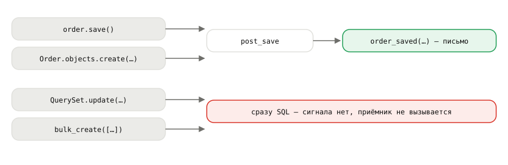

## Теория
**Сигнал** — уведомление «что-то произошло», на которое могут подписаться функции-**приёмники** в любом месте проекта. Модели посылают сигналы при сохранении и удалении:
- `pre_save` / `post_save` — до и после `save()`; у `post_save` есть аргумент `created` — объект создан или обновлён;
- `pre_delete` / `post_delete` — до и после удаления;
- `m2m_changed` — изменение связей «многие ко многим».

Приёмник подключают декоратором **`@receiver(сигнал, sender=Модель)`**:
```
@receiver(post_save, sender=Order)
def order_saved(sender, instance, created, **kwargs):
    ...
```
`sender` обязателен по смыслу: без него приёмник срабатывает при сохранении **любой** модели проекта, включая служебные. Код приёмников обычно кладут в `signals.py` приложения и импортируют в `AppConfig.ready()` — иначе модуль не загрузится, и приёмники не подключатся.

**Когда сигналы — плохая идея.** Сигнал прячет логику: читая `order.save()`, не видно, что где-то отправляется письмо. Отладка, тесты и порядок выполнения становятся неочевидными. Если код и модель — в одном приложении, проще и честнее явный вызов: метод `order.mark_paid()` или сервисная функция. Сигналы уместны, когда **другое** приложение должно реагировать на событие, а менять код модели нельзя или не нужно (сторонняя библиотека, кэш, журнал).

Ограничения, о которых часто забывают:
- `QuerySet.update()`, `bulk_create()`, `bulk_update()` сигналы **не посылают**;
- `post_save` приходит на **каждое** сохранение — «заказ оплачен» при повторном `save()` придёт снова;
- приёмник выполняется **внутри** транзакции: письмо уйдёт, даже если транзакция потом откатится. Внешние действия — через `transaction.on_commit()`.

## Наглядно
**Рисунок 1.** Кто вызывает приёмник `post_save`, а кто нет.



**Таблица 1.** Сигнал или явный вызов.

| Ситуация | Лучше |
|---|---|
| письмо при оплате, код магазина | явный метод `order.mark_paid()` / сервис |
| сбросить кэш каталога при изменении товара | сигнал (кэш — отдельная забота) |
| реакция на модель сторонней библиотеки (`User`) | сигнал `post_save, sender=User` |
| действие после коммита | `transaction.on_commit()` (в сигнале или сервисе) |
| массовые изменения `update()` | сигнал не придёт — явный вызов |

## На практике
Задача: письмо покупателю, когда заказ стал оплаченным, — сначала сигналом, затем разобрать, где сигнал подводит. Письма в тренажёре попадают в `mail.outbox`.

### Шаг 1. Приёмники
Файл `models.py` (фрагмент, после модели `Order`):
```python
from django.core.mail import send_mail
from django.db.models.signals import post_save, pre_delete
from django.dispatch import receiver


@receiver(post_save, sender=Order)
def order_saved(sender, instance, created, **kwargs):
    print("post_save:", instance.number, "created" if created else "updated", instance.status)
    if instance.status == Order.Status.PAID:
        send_mail(f"Заказ {instance.number} оплачен", "Спасибо!", "shop@shop.example", [instance.email])


@receiver(pre_delete, sender=Order)
def order_deleting(sender, instance, **kwargs):
    print("pre_delete:", instance.number)
```
В тренажёре код из `models.py` загружается всегда; в проекте приёмники кладут в `signals.py` и импортируют в `ready()` конфигурации приложения.

### Шаг 2. Что приходит
Файл `orm.py`:
```python
from django.core import mail
mail.outbox = []
o = Order.objects.create(number="A-20", email="vera@shop.example")
o.status = Order.Status.PAID
o.save()
o.save()
print(len(mail.outbox), [m.subject for m in mail.outbox])
Order.objects.filter(number="A-12").update(status="paid")
print(len(mail.outbox))
o.delete()
```
Результат:
```
post_save: A-20 created new
post_save: A-20 updated paid
post_save: A-20 updated paid
2 ['Заказ A-20 оплачен', 'Заказ A-20 оплачен']
2
pre_delete: A-20
(1, {'shop.Order': 1})
```
Последняя строка — результат `o.delete()`: последнее выражение тренажёр печатает, как консоль. Покупатель получил **два** письма — повторный `save()` оплаченного заказа снова прислал `post_save`. A-12 стал оплаченным через `update()` — сигнала нет, письма нет. `bulk_create` тоже не вызывает приёмник.

### Шаг 3. Откат транзакции
Файл `orm.py`:
```python
from django.core import mail
from django.db import transaction
mail.outbox = []
try:
    with transaction.atomic():
        Order.objects.create(number="A-21", email="vera@shop.example", status="paid")
        raise ValueError("оплата отклонена банком")
except ValueError:
    pass
print(Order.objects.filter(number="A-21").exists(), len(mail.outbox))
```
Результат:
```
post_save: A-21 created paid
False 1
```
Заказа нет, а письмо «оплачен» ушло: приёмник выполнился внутри транзакции до отката.

### Шаг 4. Приёмник без sender
`@receiver(post_save)` без `sender=Order` — приёмник срабатывает на все модели. Проект падает ещё при подготовке базы: `migrate` записывает в служебную таблицу примененные миграции, сигнал приходит и для них:
```
AttributeError: 'Migration' object has no attribute 'status'
```

### Шаг 5. Явный вызов вместо сигнала
Файл `models.py` (фрагмент):
```python
class Order(models.Model):
    # … поля

    def mark_paid(self):
        if self.status == self.Status.PAID:
            return
        self.status = self.Status.PAID
        self.save(update_fields=["status"])
        transaction.on_commit(lambda: send_mail(
            f"Заказ {self.number} оплачен", "Спасибо!",
            "shop@shop.example", [self.email],
        ))
```
Письмо — только при переходе в статус «оплачен», только после коммита, а читая код оплаты, видно, что оно отправляется.

## Частые ошибки
- **`@receiver` без `sender`.** Приёмник срабатывает на каждую модель, в том числе служебные, — `AttributeError` на неожиданных объектах.
- **Приёмники в модуле, который никто не импортирует.** `signals.py` без импорта в `AppConfig.ready()` — приёмники тихо не работают.
- **Ждать сигнал от `update()` / `bulk_create()`.** Их нет — логика пропускается.
- **Действие на каждый `post_save`.** Повторные письма. Проверяйте переход состояния (было → стало) или делайте явный метод.
- **Письмо внутри транзакции.** Откат не вернёт письмо; `transaction.on_commit()`.
- **Сигналы для логики своего приложения.** Неявные связи трудно найти и протестировать; явный вызов проще.

## Итог
**Сигналы**
- `post_save` (`created`), `pre_delete`, `m2m_changed`; `@receiver(сигнал, sender=Модель)`; подключение — в `AppConfig.ready()`.
- Не приходят от `update()`, `bulk_create()`, `bulk_update()`; `post_save` — на каждое сохранение; выполняются в транзакции.

**Когда**
- Реакция другого приложения или на чужую модель — сигнал; своя бизнес-логика — явный метод или сервис.

## Вопросы на собеседовании
<details><summary>Какие встроенные сигналы моделей есть в Django?</summary>

`pre_init`/`post_init`, `pre_save`/`post_save` (с `created`, `update_fields`, `raw`), `pre_delete`/`post_delete`, `m2m_changed`, а также `pre_migrate`/`post_migrate`. Есть сигналы запросов (`request_started`, `request_finished`) и `user_logged_in`/`user_logged_out` в `auth`.
</details>

<details><summary>Почему сигналы считают анти-паттерном для бизнес-логики?</summary>

Они создают неявные связи: при вызове `save()` не видно, что выполнится дальше; порядок приёмников и их ошибки трудно отслеживать; не срабатывают при `update()`/`bulk_*`; выполняются синхронно в той же транзакции. Явный вызов сервиса или метода модели читается и тестируется проще.
</details>

<details><summary>Где регистрировать приёмники сигналов?</summary>

В модуле `signals.py` приложения, который импортируется в `AppConfig.ready()` (`from . import signals`). Так приёмники подключаются один раз при запуске. `dispatch_uid` в `connect`/`@receiver` защищает от двойной регистрации, если модуль импортируется повторно.
</details>

## Глубже
Тестирование сигналов и `on_commit` — раздел «Тесты в Django». Фоновые задачи вместо отправки писем в запросе — курс «Celery» (этап 2).
