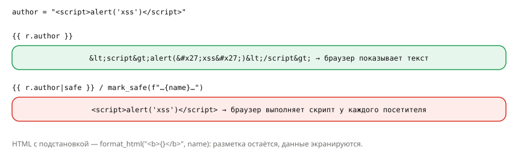

## Теория
Django защищает от основных атак по умолчанию — если эту защиту не выключить. Сводка того, что уже разбиралось и что осталось.

**XSS (межсайтовый скриптинг)** — пользователь присылает `<script>` в отзыв или имя, и он выполняется у других посетителей: крадёт сессию, меняет страницу. Шаблоны **экранируют** все переменные: `<` превращается в `&lt;`, и браузер показывает текст, а не выполняет код. Экранирование выключают:
- фильтр `|safe` и `` в шаблоне;
- `mark_safe(...)` в Python — «эта строка уже безопасна».

Применять их к данным пользователя нельзя. Собрать HTML с подстановкой — **`format_html("<b>{}</b>", name)`**: она экранирует аргументы. Разрешить пользователю форматирование — очищать HTML библиотекой с белым списком тегов (`nh3`, `bleach`).

**CSRF** — подделка запроса с чужого сайта: `` + `CsrfViewMiddleware` (раздел «Изменение данных и формы»). **SQL-инъекции** — параметры, а не f-строки в сыром SQL (раздел «Продвинутый ORM»).

**Clickjacking** — ваш сайт открывают в невидимом `<iframe>` на чужой странице и заставляют пользователя нажать кнопку «Оплатить». Защита — заголовок **`X-Frame-Options: DENY`**: `XFrameOptionsMiddleware` (есть в `startproject`).

**HTTPS и cookie** — на сервере:
- `SECURE_SSL_REDIRECT = True` — редирект с HTTP на HTTPS (за Nginx — ещё `SECURE_PROXY_SSL_HEADER`, чтобы Django знал, что запрос пришёл по HTTPS);
- `SESSION_COOKIE_SECURE`, `CSRF_COOKIE_SECURE = True` — cookie только по HTTPS;
- `SECURE_HSTS_SECONDS` — заголовок HSTS: браузер сам ходит только по HTTPS. Включают осторожно: неправильный HSTS не отменить у уже побывавших посетителей до истечения срока.

**Проверка перед выкаткой** — `python manage.py check --deploy`: список настроек, которые стоит включить в продакшене.

## Наглядно
**Рисунок 1.** Одно и то же имя из отзыва с автоэкранированием и с `|safe`.



**Таблица 1.** Атаки и защита.

| Атака | Защита в Django | Как сломать |
|---|---|---|
| XSS | автоэкранирование шаблонов, `format_html` | `|safe`, `mark_safe`, `autoescape off` для данных пользователя |
| CSRF | ``, `CsrfViewMiddleware` | удалить middleware, `@csrf_exempt` без проверки подписи |
| SQL-инъекция | параметры ORM и `raw(sql, params)` | f-строка со значением в SQL |
| Clickjacking | `XFrameOptionsMiddleware` (`DENY`) | убрать middleware |
| перехват трафика | `SECURE_SSL_REDIRECT`, `*_COOKIE_SECURE`, HSTS | работать по HTTP |
| подмена Host | `ALLOWED_HOSTS` | `["*"]` |

## На практике
Задача: аудит безопасности магазина — отзывы, «бейдж» с именем, заголовки и настройки. Отзыв от «Анны» содержит `<b>`, второй — `<script>` в имени и `` в тексте.

### Шаг 1. Автоэкранирование и |safe
Шаблон `{{ r.author }}: {{ r.text }}`:
```html
<ul><li>Анна: Отличный &lt;b&gt;экран&lt;/b&gt;</li><li>&lt;script&gt;alert(&#x27;xss&#x27;)&lt;/script&gt;: &lt;img src=x onerror=alert(1)&gt;</li></ul>
```
Тот же шаблон с `{{ r.text|safe }}` «чтобы работал жирный шрифт»:
```html
<ul><li>Анна: Отличный <b>экран</b></li><li>&lt;script&gt;alert(&#x27;xss&#x27;)&lt;/script&gt;: </li></ul>
```
Жирный появился — вместе с картинкой, чей `onerror` выполнит код в браузере каждого покупателя.

### Шаг 2. mark_safe и format_html
Файл `views.py` (фрагмент):
```python
def badge(request):
    name = request.GET.get("name", "")
    return HttpResponse(mark_safe(f"<b>{name}</b>"))


def badge_ok(request):
    name = request.GET.get("name", "")
    return HttpResponse(format_html("<b>{}</b>", name))
```
С `?name=<script>alert(1)</script>`:
```
/badge/    → <b><script>alert(1)</script></b>
/badge-ok/ → <b>&lt;script&gt;alert(1)&lt;/script&gt;</b>
```
`format_html` экранирует подставляемые значения, а разметка шаблона строки остаётся разметкой.

### Шаг 3. Заголовки и HTTPS
Настройки задачи в тренажёре и ответ на `GET /page/`:
```
XFrameOptionsMiddleware в MIDDLEWARE   → X-Frame-Options: DENY
ALLOWED_HOSTS = ["shop.example"]        → Host testserver: 400, Host shop.example: 200
SECURE_SSL_REDIRECT = True             → http: 301 на https://testserver/page/, https: 200
SECURE_HSTS_SECONDS = 2592000          → по https: Strict-Transport-Security: max-age=2592000; по http заголовка нет
```
При неразрешённом хосте Django пишет в журнал `Invalid HTTP_HOST header: 'testserver'. You may need to add 'testserver' to ALLOWED_HOSTS.`

### Шаг 4. check --deploy
Свежий проект после `startproject` (из настоящего проекта Django 5.2):
```
?: (security.W004) You have not set a value for the SECURE_HSTS_SECONDS setting. …
?: (security.W008) Your SECURE_SSL_REDIRECT setting is not set to True. …
?: (security.W009) Your SECRET_KEY has less than 50 characters, less than 5 unique characters, or it's prefixed with 'django-insecure-' indicating that it was generated automatically by Django. …
?: (security.W012) SESSION_COOKIE_SECURE is not set to True. …
?: (security.W016) You have 'django.middleware.csrf.CsrfViewMiddleware' in your MIDDLEWARE, but you have not set CSRF_COOKIE_SECURE to True. …
?: (security.W018) You should not have DEBUG set to True in deployment.
?: (security.W020) ALLOWED_HOSTS must not be empty in deployment.

System check identified 7 issues (0 silenced).
```
С настройками `prod.py` из прошлой темы остаётся одно предупреждение — `security.W021` про `SECURE_HSTS_PRELOAD`: его включают, только если сайт готов попасть в список HSTS браузеров навсегда.

## Частые ошибки
- **`|safe` / `mark_safe` для данных пользователя.** Прямой XSS. Для разметки — `format_html` или очистка HTML белым списком (`nh3`).
- **`mark_safe(f"…{value}…")`.** Строка помечена безопасной вместе с подставленным значением; `format_html` экранирует подстановки.
- **Убрать `XFrameOptionsMiddleware`, чтобы встроить свою страницу во фрейм.** Для своего сайта — `X_FRAME_OPTIONS = "SAMEORIGIN"` или `@xframe_options_sameorigin` на конкретный view.
- **`SECURE_SSL_REDIRECT` за Nginx без `SECURE_PROXY_SSL_HEADER`.** Django считает каждый запрос HTTP-шным — бесконечный редирект.
- **HSTS «на год» с первого дня.** Ошибка в HTTPS отрежет сайт у всех, кто уже заходил. Начинают с минут/дней.
- **Не запускать `check --deploy`.** Самая дешёвая проверка перед выкаткой; её добавляют в CI.

## Итог
**Не выключать встроенную защиту**
- Автоэкранирование (без `|safe`/`mark_safe` для чужих данных, `format_html`), CSRF, параметры SQL, `X-Frame-Options`.

**Продакшен**
- `SECURE_SSL_REDIRECT`, `SECURE_PROXY_SSL_HEADER`, `SESSION_COOKIE_SECURE`, `CSRF_COOKIE_SECURE`, HSTS, `ALLOWED_HOSTS`, `DEBUG = False`.
- `manage.py check --deploy` перед выкаткой.

## Вопросы на собеседовании
<details><summary>Как Django защищает от XSS и как эту защиту можно сломать?</summary>

Шаблонизатор экранирует все переменные (`<`, `>`, `&`, кавычки). Защиту ломают `|safe`, `mark_safe`, `` и сборка HTML f-строками с данными пользователя. Безопасно: `format_html`, очистка HTML белым списком, `|escapejs`/`json_script` для данных в JavaScript.
</details>

<details><summary>Что такое clickjacking и как от него защититься?</summary>

Атака, при которой сайт загружают в прозрачный iframe поверх чужой страницы и обманом заставляют нажать кнопку. Защита — заголовок `X-Frame-Options: DENY` (или `SAMEORIGIN`) и/или CSP `frame-ancestors`; в Django — `XFrameOptionsMiddleware`, декораторы `xframe_options_*`.
</details>

<details><summary>Что проверяет `manage.py check --deploy`?</summary>

Настройки, опасные в продакшене: `DEBUG`, слабый `SECRET_KEY`, пустой `ALLOWED_HOSTS`, отсутствие `SECURE_SSL_REDIRECT`, HSTS, secure-cookie сессии и CSRF, middleware безопасности. Это предупреждения `security.W0xx`; запускают с продакшен-настройками, обычно в CI.
</details>

## Глубже
Как сайт работает на сервере без `runserver` — следующая тема. Content Security Policy (CSP) — заголовок, ограничивающий источники скриптов: встроен в Django 6.0, раньше — пакет django-csp.
