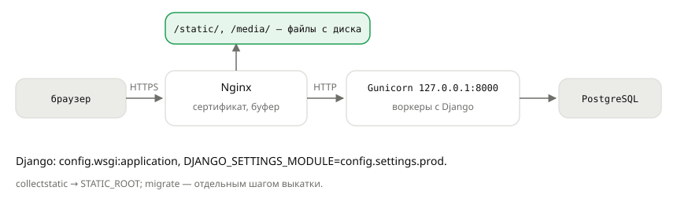

## Теория
`runserver` — сервер для разработки: перезапускается при изменении кода, отдаёт статику, обрабатывает запросы по одному на поток, не проверен на безопасность и нагрузку. Документация прямо пишет не использовать его в продакшене. На сервере цепочка другая:

**Nginx → сервер приложения (Gunicorn) → Django.**

- **Nginx** принимает HTTPS, отдаёт статику и медиа из папок на диске, остальное передаёт приложению (курс «Nginx и деплой»);
- **Gunicorn** — сервер приложения по протоколу **WSGI**: запускает несколько процессов-**воркеров** с Django и отдаёт им запросы;
- Django — тот же код, что в разработке, с настройками `prod`.

**WSGI и ASGI.** WSGI — стандарт «синхронный Python-объект `application(environ, start_response)`», его Django создаёт в `config/wsgi.py`. ASGI — асинхронный аналог (`config/asgi.py`) для WebSocket, долгих соединений и `async`-view; запускается Uvicorn или Daphne (или Gunicorn с воркерами Uvicorn). Обычному магазину хватает WSGI.

Запуск Gunicorn:
```
gunicorn config.wsgi:application --bind 127.0.0.1:8000 --workers 3
```
`config.wsgi:application` — модуль и переменная; `--workers` — число процессов (частая отправная точка — `2 × ядра + 1`). Каждый воркер обрабатывает один запрос за раз: медленный внешний запрос во view держит воркер.

**Статика.** При `DEBUG = False` Django статику не отдаёт. Перед запуском **`collectstatic`** собирает файлы всех приложений (и админки) в одну папку `STATIC_ROOT`; оттуда их отдаёт Nginx по `STATIC_URL`. Без Nginx — пакет **WhiteNoise** (middleware, отдающий статику из `STATIC_ROOT` с кэш-заголовками). **Медиа** (загрузки пользователей, `MEDIA_ROOT`) — тоже Nginx, их не собирают и не хранят в git; бэкапят вместе с базой.

**Миграции** — отдельным шагом выкатки (`python manage.py migrate`), до запуска новой версии кода, а не при каждом старте воркера.

## Наглядно
**Рисунок 1.** Запрос в продакшене.



**Таблица 1.** Разработка и продакшен.

| | Разработка | Продакшен |
|---|---|---|
| сервер | `runserver` | Gunicorn (WSGI) / Uvicorn (ASGI) за Nginx |
| HTTPS | нет | Nginx (Let's Encrypt) |
| статика | Django при `DEBUG` | `collectstatic` → `STATIC_ROOT` → Nginx или WhiteNoise |
| медиа | `static()` в `urls.py` | Nginx из `MEDIA_ROOT` |
| настройки | `settings.dev` | `settings.prod` + переменные окружения |
| миграции | вручную | шаг выкатки перед запуском |
| перезапуск при правке | да | нет — новая версия выкатывается |

## На практике
Задача: запустить магазин не через `runserver`: Gunicorn с настройками `prod`, проверка HTTPS и статики. Вывод — из настоящего проекта Django 5.2 и Gunicorn на локальной машине (в тренажёре сервера приложения нет).

### Шаг 1. Что запускает Gunicorn
Файл `config/wsgi.py` (создан `startproject`, без комментариев):
```python
import os
from django.core.wsgi import get_wsgi_application
os.environ.setdefault('DJANGO_SETTINGS_MODULE', 'config.settings')
application = get_wsgi_application()
```
`application` — WSGI-объект, который Gunicorn вызывает на каждый запрос. После перехода на пакет настроек `DJANGO_SETTINGS_MODULE` задают переменной окружения на сервере — `setdefault` её не перезапишет.

### Шаг 2. Запуск
Команда — с переменными `DJANGO_SETTINGS_MODULE=config.settings.prod`, `DJANGO_SECRET_KEY` и `DJANGO_ALLOWED_HOSTS`:
```bash
gunicorn config.wsgi:application --bind 127.0.0.1:8765 --workers 2
```
Журнал запуска (номера процессов у вас другие):
```
[INFO] Starting gunicorn 26.2.0
[INFO] Listening at: http://127.0.0.1:8765 (251390)
[INFO] Using worker: sync
[INFO] Booting worker with pid: 251392
[INFO] Booting worker with pid: 251393
```
Один главный процесс и два воркера. Gunicorn слушает только `127.0.0.1` — снаружи к нему ходит Nginx.

### Шаг 3. Что отвечает сайт
Запросы `curl` к `/admin/login/` и статике админки:
```
http, без прокси                       → 301 https://127.0.0.1:8765/admin/login/
с X-Forwarded-Proto: https (как Nginx) → 200
/static/admin/css/base.css            → 404
Host: evil.example                     → 400
```
`SECURE_SSL_REDIRECT` отправляет на HTTPS, пока не пришёл заголовок от прокси (`SECURE_PROXY_SSL_HEADER`). Статику при `DEBUG = False` Django не отдаёт — это работа Nginx.

### Шаг 4. Сбор статики
Команда при выкатке:
```bash
python manage.py collectstatic --noinput
```
Результат (путь сокращён):
```
127 static files copied to '…/staticfiles'.
```
127 файлов — CSS, JS и картинки админки; в проекте добавятся свои из `static/` приложений. Эту папку Nginx отдаёт по `/static/`.

## Частые ошибки
- **`runserver` на сервере.** Один процесс, нет защиты от медленных клиентов, отдаёт статику только при `DEBUG`. Нужен Gunicorn/Uvicorn за Nginx.
- **`DEBUG = True`, «чтобы статика работала».** Открывает страницы ошибок всем; статику отдаёт Nginx или WhiteNoise после `collectstatic`.
- **Gunicorn на `0.0.0.0` без Nginx.** Наружу смотрит сервер без HTTPS и буферизации медленных клиентов.
- **Забыть `collectstatic` при выкатке.** Админка и сайт без стилей (404 на `/static/`).
- **`migrate` при старте каждого воркера.** Несколько воркеров одновременно применяют миграции; миграции — отдельный шаг выкатки.
- **Медленные внешние запросы во view.** Синхронный воркер занят всё это время; при трёх воркерах четыре медленных запроса останавливают сайт. Долгую работу — в фоновые задачи (курс «Celery»).

## Итог
**Цепочка**
- Nginx (HTTPS, статика, медиа) → Gunicorn (`config.wsgi:application`, воркеры) → Django с `settings.prod`.
- ASGI (`config.asgi`, Uvicorn) — для WebSocket и async; магазину хватает WSGI.

**Выкатка**
- `collectstatic` → `STATIC_ROOT`; медиа — `MEDIA_ROOT` вне git; `migrate` — отдельным шагом.

## Вопросы на собеседовании
<details><summary>Чем WSGI отличается от ASGI?</summary>

WSGI — синхронный интерфейс между веб-сервером и Python-приложением: один вызов на запрос, ответ целиком. ASGI — асинхронный: поддерживает WebSocket, долгие соединения, `async def` view без блокировки потока. Django поддерживает оба (`wsgi.py`, `asgi.py`); серверы — Gunicorn для WSGI, Uvicorn/Daphne для ASGI.
</details>

<details><summary>Почему в продакшене нужен Nginx перед Gunicorn?</summary>

Nginx завершает HTTPS, быстро отдаёт статику и медиа, буферизует медленных клиентов (Gunicorn не держит воркер, пока клиент медленно передаёт данные), ограничивает размер запросов и частоту, балансирует несколько экземпляров приложения.
</details>

<details><summary>Что делает `collectstatic`?</summary>

Находит статические файлы всех приложений и `STATICFILES_DIRS` (через `STATICFILES_FINDERS`) и копирует их в одну папку `STATIC_ROOT`, которую отдаёт веб-сервер. С `ManifestStaticFilesStorage` добавляет хеши в имена для долгого кэша.
</details>

## Глубже
Настройка Nginx, HTTPS и выкатка — курс «Nginx и деплой». Контейнеры для приложения и базы — курс «Docker».
