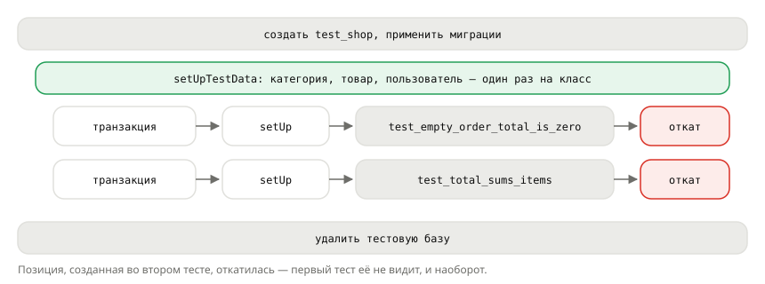

## Теория
Тесты Django — те же автотесты, что в курсе «Python» (раздел «Тесты и качество кода»), только у них есть база. Пишут их в `tests.py` приложения (или в пакете `tests/`) на классах **`django.test.TestCase`**, запускают командой **`python manage.py test`**.

Что делает Django при запуске:
1. Создаёт **отдельную тестовую базу** (`test_<имя базы>`) и применяет к ней миграции — рабочие данные не трогаются.
2. Находит тесты: методы с именем `test_…` в классах-наследниках `TestCase` в модулях `test*.py`.
3. Каждый тест выполняет **внутри транзакции**, которую после теста откатывает. Тесты не видят данных друг друга и не зависят от порядка.
4. После всех тестов удаляет тестовую базу.

Данные для тестов создают сами:
- **`setUpTestData(cls)`** (`@classmethod`) — один раз на класс; объекты кладут в `cls.…`. Быстро: при откате каждого теста эти данные остаются, а объекты в памяти Django восстанавливает для каждого теста;
- **`setUp(self)`** — перед **каждым** тестом; для того, что тест меняет и что нужно свежим.

Проверки — методы `self.assert…`: `assertEqual`, `assertTrue`, `assertIn`, `assertRaises` и специальные для Django (следующие темы). При падении `unittest` пишет, какой тест, в какой строке и что ожидалось.

Итог прогона: **`ok`** — тест прошёл, **`FAIL`** — не выполнилось условие `assert…`, **`ERROR`** — тест упал исключением (ошибка в коде или в самом тесте).

**pytest-django** — альтернатива: тесты-функции, фикстуры, `assert` вместо `self.assertEqual`, маркер `@pytest.mark.django_db` для доступа к базе. Многие проекты используют его; в тренажёре тесты запускаются через `unittest`, как `manage.py test`.

## Наглядно
**Рисунок 1.** Жизненный цикл тестов: тестовая база, данные класса и транзакция на каждый тест.



**Таблица 1.** Что где создавать.

| Где | Когда вызывается | Для чего |
|---|---|---|
| `setUpTestData(cls)` | один раз на класс | общие данные: категории, товары, пользователи |
| `setUp(self)` | перед каждым тестом | клиент с входом, свежие объекты для изменения |
| внутри теста | только в нём | то, что проверяет этот тест |
| `tearDown(self)` | после каждого теста | редко: транзакция и так откатывается |

## На практике
Задача: тесты метода `Order.total()` — сумма позиций заказа. Модели: категории, товары, заказы покупателей и позиции (`quantity`, `price`).

### Шаг 1. Тесты модели
Файл `tests.py`:
```python
from decimal import Decimal

from django.contrib.auth.models import User
from django.test import TestCase

from .models import Category, Order, OrderItem, Product


class OrderTotalTests(TestCase):
    @classmethod
    def setUpTestData(cls):
        cat = Category.objects.create(name="Мыши")
        cls.mouse = Product.objects.create(
            category=cat, name="Мышь", slug="mouse", price="1499.00"
        )
        user = User.objects.create_user("anna")
        cls.order = Order.objects.create(user=user, number="A-12")

    def test_empty_order_total_is_zero(self):
        self.assertEqual(self.order.total(), 0)

    def test_total_sums_items(self):
        OrderItem.objects.create(
            order=self.order, product=self.mouse, quantity=2, price="1499.00"
        )
        self.assertEqual(self.order.total(), Decimal("2998.00"))
```
Вывод `manage.py test -v 2` (в тренажёре — кнопка «Запустить тесты»):
```
test_empty_order_total_is_zero (shop.tests.OrderTotalTests.test_empty_order_total_is_zero) ... ok
test_total_sums_items (shop.tests.OrderTotalTests.test_total_sums_items) ... ok

----------------------------------------------------------------------
Ran 2 tests in 0.003s

OK
```
Тест пустого заказа проходит, хотя позицию создал соседний тест: она откатилась вместе с его транзакцией.

### Шаг 2. Упавший тест
Ожидание в тесте с ошибкой — `Decimal("3000.00")`:
```
test_total_sums_items (shop.tests.OrderTotalTests.test_total_sums_items) ... FAIL

======================================================================
FAIL: test_total_sums_items (shop.tests.OrderTotalTests.test_total_sums_items)
----------------------------------------------------------------------
Traceback (most recent call last):
  File "tests.py", line 26, in test_total_sums_items
    self.assertEqual(self.order.total(), Decimal("3000.00"))
AssertionError: Decimal('2998.00') != Decimal('3000.00')
----------------------------------------------------------------------
Ran 2 tests in 0.007s

FAILED (failures=1)
```
Слева — что получилось, справа — что ожидал тест. Тест сам может быть неправ: прежде чем «чинить» код, проверьте ожидание.

## Частые ошибки
- **Ждать данные из рабочей базы.** Тестовая база пустая, учебные данные и `setup` задачи туда не попадают; всё создают в `setUpTestData`/`setUp`.
- **Метод без префикса `test_`.** `def check_total(self)` не запустится — `unittest` его не найдёт; тест «зелёный», потому что его нет.
- **Тесты зависят друг от друга.** Порядок запуска не гарантирован, а данные откатываются после каждого теста.
- **Сравнение `Decimal` со строкой или `float`.** `self.assertEqual(total, "2998.00")` упадёт: `Decimal('2998.00') != '2998.00'`. Сравнивайте с `Decimal("2998.00")`.
- **Один огромный тест.** Упал — непонятно, что именно сломалось. Один тест — одно поведение, имя говорит, какое.
- **`unittest.TestCase` вместо `django.test.TestCase`.** Без транзакций и тестового клиента: данные одного теста остаются для следующих.

## Итог
**Запуск**
- `manage.py test`: тестовая база с миграциями, каждый тест в откатываемой транзакции, база удаляется в конце.

**TestCase**
- `setUpTestData` — общие данные один раз, `setUp` — перед каждым тестом, методы `test_…`.
- `ok` / `FAIL` (не выполнилась проверка) / `ERROR` (исключение).

## Вопросы на собеседовании
<details><summary>Как Django изолирует тесты друг от друга?</summary>

`django.test.TestCase` создаёт тестовую базу один раз на прогон, а каждый тест оборачивает в транзакцию с откатом после теста (и ещё одну на класс — для `setUpTestData`). Изменения одного теста не видны другим. `TransactionTestCase` вместо отката очищает таблицы — медленнее, нужен для проверки самих транзакций и `on_commit`.
</details>

<details><summary>Чем `setUpTestData` отличается от `setUp`?</summary>

`setUpTestData` — классовый метод, вызывается один раз для класса внутри внешней транзакции; объекты, созданные в нём, доступны всем тестам класса (в памяти Django копирует их для каждого теста). `setUp` вызывается перед каждым тестом. Общие данные — в `setUpTestData` (быстрее), изменяемое состояние — в `setUp`.
</details>

<details><summary>Чем pytest-django отличается от встроенных тестов?</summary>

Тесты — обычные функции с `assert`, данные и клиенты — фикстуры (`client`, `admin_client`, `django_user_model`), доступ к базе — маркер `@pytest.mark.django_db`. Запуск — `pytest`, настройки — `DJANGO_SETTINGS_MODULE` в `pytest.ini`. Тестовая база и откат транзакций — те же механизмы Django.
</details>

## Глубже
Тесты страниц, прав и форм — следующая тема. Основы автотестов, `assert` и pytest — курс «Python», раздел «Тесты и качество кода».
