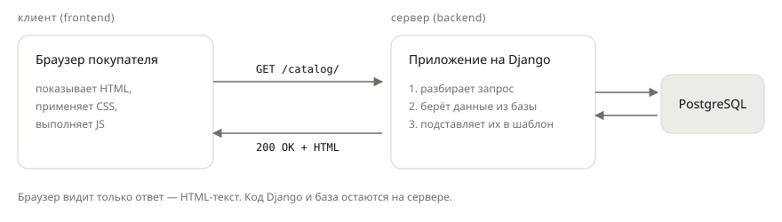

## Теория
Сайт магазина — это две программы на разных компьютерах. **Клиент** — браузер покупателя: он просит страницу и показывает её. **Сервер** — программа магазина в дата-центре: она принимает просьбу, готовит ответ и отправляет его обратно. Такой обмен называется **запрос — ответ**. Запрос всегда начинает клиент, а сервер только отвечает: сам он браузеру ничего не присылает.

Отсюда деление работы. **Frontend** — то, что выполняется в браузере: HTML (содержимое страницы), CSS (оформление) и JavaScript (поведение кнопок). **Backend** — то, что выполняется на сервере: Python, Django, база данных. Страница бывает **статичной** — готовый файл, одинаковый для всех, — и **динамической**: сервер собирает её заново на каждый запрос из шаблона и данных базы. Каталог, корзина и личный кабинет магазина — динамические, и собирать их будет Django.

## Наглядно
**Рисунок 1.** Покупатель открывает каталог: браузер отправляет запрос, Django берёт товары из базы, подставляет их в шаблон и возвращает готовый HTML.



**Таблица 1.** Где что выполняется.

| | Клиент (frontend) | Сервер (backend) |
|---|---|---|
| Программа | браузер | Django + PostgreSQL |
| Языки | HTML, CSS, JavaScript | Python, SQL |
| Кто видит код | покупатель: «Просмотр кода страницы» | только разработчики |
| Что делает | показывает страницу, реагирует на клики | проверяет данные, считает цены, хранит заказы |
| Чему можно доверять | ничему: покупатель может изменить что угодно | всему, что проверил сам сервер |

## На практике
Задача: понять, что происходит, когда покупатель открывает каталог `https://shop.example/catalog/`, и какая часть работы чья.

### Шаг 1. Браузер отправляет запрос
Покупатель нажал на ссылку. Браузер отправляет серверу короткий текст — «дай страницу `/catalog/`»:
```http
GET /catalog/ HTTP/1.1
Host: shop.example
```
Это настоящий HTTP-запрос. Из каких частей он состоит, разберём в теме «Запрос и ответ».

### Шаг 2. Сервер собирает страницу
Django получает запрос и находит код, который отвечает за `/catalog/`. Этот код берёт товары из базы и подставляет их в шаблон страницы. Каждый раз результат может быть другим: товар закончился — карточка пропала. Поэтому каталог — **динамическая** страница.

### Шаг 3. Сервер возвращает ответ
В ответе — код результата и готовый HTML:
```http
HTTP/1.1 200 OK
Content-Type: text/html; charset=utf-8

<!doctype html>
<html lang="ru">
<head><title>Каталог</title></head>
<body><h1>Каталог</h1> ...</body>
</html>
```
`200 OK` значит «всё хорошо, вот страница». Python-кода и SQL в ответе нет — только результат их работы.

### Шаг 4. Браузер показывает страницу
Браузер разбирает HTML и находит в нём ссылки на стили и картинки. Для каждого такого файла он отправляет **отдельный запрос**. Одна страница каталога — это десятки запросов: сам HTML, CSS, фото товаров. Стили и картинки одинаковы для всех, это **статичные** файлы. Сервер отдаёт их как есть, ничего не собирая.

### Шаг 5. Решаем, где проверять данные
Покупатель кладёт в корзину 3 штуки. Проверить, что столько есть на складе, может только сервер: база с остатками — у него. Браузер может подсказать «больше 99 нельзя», но такую подсказку покупатель легко обойдёт. Поэтому правило простое: всё, что пришло от клиента, сервер **проверяет заново**.

## Частые ошибки
- **«Сервер сам обновит страницу».** Сервер не может прислать что-то по своей инициативе: новая информация появится, только когда браузер снова попросит. Цена изменилась — покупатель увидит её после следующего запроса.
- **Доверие браузеру.** Скрытое поле с ценой, кнопка `disabled`, проверка в форме — всё это покупатель меняет за секунды в инструментах разработчика. Цену и остатки сервер берёт из своей базы, а не из запроса.
- **«Backend — это база данных».** База — только часть backend. Backend — весь код на сервере: он принимает запросы, проверяет данные и собирает ответы.
- **Смешивание статики и динамики.** CSS и картинки не нужно пропускать через Django на каждый запрос: это готовые файлы, их отдаёт веб-сервер (Nginx). Про это — в курсе «Nginx и деплой».

## Итог
**Клиент и сервер**
- Клиент (браузер) отправляет запрос, сервер возвращает ответ. Начинает всегда клиент.
- Одна страница — много запросов: HTML, затем каждый CSS-файл и каждая картинка.

**Frontend и backend**
- Frontend выполняется в браузере: HTML, CSS, JavaScript. Его код видит любой покупатель.
- Backend выполняется на сервере: Python, Django, база данных. Его код покупатель не видит.

**Страницы**
- Статичная страница — готовый файл, одинаковый для всех (`style.css`, логотип).
- Динамическая — сервер собирает её на каждый запрос из шаблона и данных (каталог, корзина).

**Доверие**
- Всё, что пришло от клиента, сервер проверяет заново: цену, количество, права доступа.

## Вопросы на собеседовании
<details><summary>Что происходит, когда вы вводите адрес сайта в браузере?</summary>

Браузер разбирает URL и узнаёт IP-адрес домена через DNS. Затем подключается к серверу, при HTTPS договаривается о шифровании и отправляет HTTP-запрос. Сервер обрабатывает запрос и возвращает ответ с HTML. Браузер разбирает HTML, отдельными запросами загружает CSS, картинки и скрипты и рисует страницу. Каждое звено подробно — в следующих темах раздела.
</details>

<details><summary>Чем frontend отличается от backend?</summary>

Frontend выполняется в браузере пользователя: HTML, CSS, JavaScript. Отвечает за то, как страница выглядит и реагирует на действия. Backend выполняется на сервере: принимает запросы, работает с базой, проверяет данные и права, формирует ответы. Код frontend доступен пользователю, поэтому решения о деньгах и доступе принимает только backend.
</details>

<details><summary>Почему нельзя полагаться на проверку данных в браузере?</summary>

Браузер полностью под контролем пользователя. Проверку в JavaScript или атрибутах формы можно отключить, а запрос — отправить вообще без браузера, например через `curl`. Проверка в браузере — удобство для пользователя: ошибка видна сразу. Защищает данные только проверка на сервере.
</details>

<details><summary>Чем статичная страница отличается от динамической?</summary>

Статичная — готовый файл, который сервер отдаёт без изменений, одинаковый для всех. Динамическая собирается программой на каждый запрос: зависит от пользователя, данных в базе, параметров запроса. Статика быстрее и легко кэшируется. Динамика нужна везде, где содержимое меняется.
</details>
