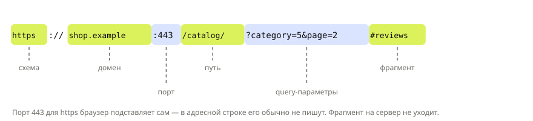

## Теория
**URL** — адрес ресурса в интернете. По нему браузер понимает, к какому серверу подключиться, как с ним говорить и что попросить. Каждая часть URL отвечает на свой вопрос: **схема** — по какому протоколу (`https`), **домен** — к какому серверу, **порт** — к какой программе на нём, **путь** — какую страницу, **query-параметры** — с какими уточнениями (фильтр, номер страницы), **фрагмент** — к какому месту страницы прокрутить.

Для backend-разработчика URL — главный вход в приложение. Django по **пути** выбирает, какой код выполнить. **Query-параметры** приходят в этот код словарём `request.GET`. Фрагмент до сервера не доходит вообще: его использует только браузер. В URL допустим ограниченный набор символов, поэтому пробелы, кириллица и служебные знаки внутри значений **кодируются**: `%` и две шестнадцатеричные цифры на каждый байт.

## Наглядно
**Рисунок 1.** Части URL каталога: отфильтровать по категории 5, показать вторую страницу и прокрутить к отзывам.



**Таблица 1.** Части URL и что с ними делает сервер.

| Часть | Пример | Кто использует | В Django |
|---|---|---|---|
| схема | `https` | браузер: как подключаться | — |
| домен | `shop.example` | DNS и сервер | `request.get_host()` |
| порт | `:443` | ОС сервера: какой программе отдать | — |
| путь | `/catalog/` | приложение: какую страницу | `urls.py` → view |
| query | `?category=5&page=2` | приложение: уточнения | `request.GET["page"]` → `"2"` |
| фрагмент | `#reviews` | только браузер | не приходит |

## На практике
Задача: разобрать адрес каталога `https://shop.example/catalog/?category=5&page=2#reviews` и понять, что из него получит сервер.

### Шаг 1. Делим URL на части
Python умеет разбирать URL — посмотрим, что в нём:
```python
from urllib.parse import urlsplit

url = "https://shop.example/catalog/?category=5&page=2#reviews"
parts = urlsplit(url)
print(parts.scheme, parts.hostname, parts.port)
print(parts.path)
print(parts.query)
print(parts.fragment)
```
Результат:
```
https shop.example None
/catalog/
category=5&page=2
reviews
```
Порт не указан (`None`), значит, берётся порт по умолчанию для схемы: 443 для `https`, 80 для `http`.

### Шаг 2. Читаем query-параметры
Query — это пары `ключ=значение`, разделённые `&`. Все значения — **строки**, даже если похожи на числа:
```python
from urllib.parse import parse_qs

print(parse_qs("category=5&page=2"))
```
Результат:
```
{'category': ['5'], 'page': ['2']}
```
Значения пришли списками: один ключ может повторяться (`?tag=sale&tag=new`). В Django `request.GET["page"]` вернёт последнее значение строкой `"2"`, а `request.GET.getlist("tag")` — все.

### Шаг 3. Смотрим, что уйдёт на сервер
Браузер отправляет серверу путь и query, но **не фрагмент**:
```http
GET /catalog/?category=5&page=2 HTTP/1.1
Host: shop.example
```
Фрагмент `#reviews` браузер оставил себе: после загрузки страницы он прокрутит её к элементу с `id="reviews"`. Сервер не знает, к какому месту прокрутили страницу.

### Шаг 4. Кодируем поисковый запрос
Покупатель ищет «кофе & чай». Пробел, `&` и кириллицу нельзя вставлять в URL как есть: `&` разделил бы запрос на два параметра. Кодируем значение:
```python
from urllib.parse import urlencode

print(urlencode({"q": "кофе & чай", "page": 1}))
```
Результат:
```
q=%D0%BA%D0%BE%D1%84%D0%B5+%26+%D1%87%D0%B0%D0%B9&page=1
```
Каждая русская буква — два байта в UTF-8, отсюда по два `%XX` на букву. Пробел стал `+`, `&` внутри значения — `%26`. Браузер и Django декодируют это обратно сами: в `request.GET["q"]` будет `"кофе & чай"`.

## Частые ошибки
- **Ожидать число из query.** `request.GET["page"]` — строка `"2"`, а не `2`. Перед вычислениями её нужно превратить в число и обработать мусор вроде `?page=abc`.
- **Собирать URL склейкой строк.** `"/search/?q=" + query` ломается на первом `&` или пробеле в запросе. Параметры кодируют функцией (`urlencode`), в Django-шаблоне — фильтром `urlencode`.
- **Передавать данные во фрагменте.** `#page=2` до сервера не дойдёт. Всё, что нужно серверу, — в пути или query.
- **Путать путь с файлом.** `/catalog/` не обязан быть папкой на диске: в Django путь — просто строка, по которой выбирается код.
- **Секреты в URL.** URL сохраняется в истории браузера, логах сервера и заголовке `Referer`. Пароли и токены в query не передают.

## Итог
**Части URL**
- `схема://домен:порт/путь?query#фрагмент`, например `https://shop.example:443/catalog/?page=2#reviews`.
- Порт по умолчанию: 443 для `https`, 80 для `http` — в адресе его не пишут.

**Что видит сервер**
- Путь выбирает код (в Django — через `urls.py`).
- Query — пары `ключ=значение` через `&`. Значения всегда строки, ключ может повторяться.
- Фрагмент (`#…`) остаётся в браузере и на сервер не уходит.

**Кодирование**
- Пробел, кириллица и служебные символы внутри значений кодируются: `%D0%BA…`, `&` → `%26`, пробел → `+` или `%20`.
- Кодируем функцией (`urlencode`), а не склейкой строк.

## Вопросы на собеседовании
<details><summary>Из каких частей состоит URL?</summary>

Схема (`https`), домен (хост), необязательный порт, путь, необязательные query-параметры после `?` и фрагмент после `#`. Схема и домен говорят, куда и как подключиться. Путь и query — что попросить. Фрагмент — куда прокрутить в браузере.
</details>

<details><summary>Почему фрагмент URL не попадает на сервер?</summary>

Фрагмент адресует место внутри уже полученного документа — это забота браузера. Браузер вырезает его из запроса. Поэтому сервер не может узнать фрагмент, и в нём нельзя передавать данные для сервера.
</details>

<details><summary>Зачем кодировать параметры URL?</summary>

В URL у символов `?`, `&`, `=`, `#`, `/` особый смысл, а пробел и не-ASCII символы недопустимы. Без кодирования значение с `&` разрежется на два параметра, а `#` обрежет запрос. Кодирование заменяет такие символы на `%XX` — байты в шестнадцатеричном виде.
</details>

<details><summary>Чем путь отличается от query-параметров и что куда класть?</summary>

Путь называет ресурс: `/products/17/`, `/catalog/`. Query уточняет, как его показать: фильтр, сортировка, страница. Удобное правило: если без значения страница теряет смысл — это путь. Если это необязательная настройка отображения — это query.
</details>
