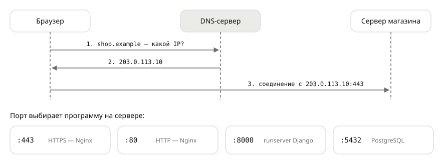

## Теория
Компьютеры в сети находят друг друга не по именам, а по **IP-адресам**: `203.0.113.10` (IPv4) или `2001:db8::10` (IPv6). Людям такие числа запоминать неудобно, поэтому есть **DNS** — распределённый «телефонный справочник» интернета. Браузер спрашивает у DNS-сервера: «какой IP у `shop.example`?» — и получает адрес. Ответ кэшируется на время **TTL**: несколько минут или часов браузер и система не спрашивают заново.

Один сервер с одним IP запускает много программ: веб-сервер, базу данных, SSH. Чтобы запрос попал к нужной, у каждой своя дверь — **порт**, число от 1 до 65535. Полный адрес программы — IP и порт: `203.0.113.10:443`. Особый адрес `127.0.0.1` (имя `localhost`) — это «этот же компьютер». Запрос на него никуда не уходит: так разработчик открывает сайт, который запустил у себя.

## Наглядно
**Рисунок 1.** Браузер узнаёт IP домена у DNS, затем подключается к серверу на порт 443. Внизу — какие программы обычно слушают порты на сервере магазина.



**Таблица 1.** Адреса, которые встретятся в курсе.

| Адрес | Что значит | Где встретится |
|---|---|---|
| `127.0.0.1`, `localhost` | этот компьютер, снаружи недоступен | `runserver` на своём ноутбуке |
| `0.0.0.0` | «слушать на всех адресах этой машины» | `runserver 0.0.0.0:8000`, сервер в Docker |
| `192.168.x.x`, `10.x.x.x` | адреса внутри локальной сети | Wi-Fi дома и в офисе |
| публичный IP | виден из интернета | сервер магазина |
| `:80`, `:443` | стандартные порты HTTP и HTTPS | Nginx на сервере |
| `:8000` | порт `runserver` по умолчанию | разработка |
| `:5432` | порт PostgreSQL | подключение Django к базе |

## На практике
Задача: понять, почему при разработке сайт открывается на `http://127.0.0.1:8000/`, а у покупателей — на `https://shop.example/` без всяких цифр.

### Шаг 1. Спрашиваем адрес у системы
Имя `localhost` система знает без внешнего DNS — оно записано в файле `/etc/hosts`:
```python
import socket

print(socket.gethostbyname("localhost"))
```
Результат:
```
127.0.0.1
```
Для `shop.example` ответ пришёл бы от DNS-сервера провайдера. В DNS для домена хранится **A-запись** — «имя → IPv4-адрес».

### Шаг 2. Запускаем сервер разработки
Команда `runserver` запускает Django и занимает порт:
```bash
python manage.py runserver
```
Результат:
```
Starting development server at http://127.0.0.1:8000/
```
Сервер слушает адрес `127.0.0.1` и порт `8000`. Порт не стандартный, поэтому в адресной строке его нужно писать явно. А `127.0.0.1` значит, что открыть сайт можно только с этого же компьютера.

### Шаг 3. Открываем сайт с телефона
Телефон в той же Wi-Fi-сети не откроет `127.0.0.1:8000`: для телефона это его собственный адрес. Нужно, чтобы Django слушал все адреса машины:
```bash
python manage.py runserver 0.0.0.0:8000
```
Теперь телефон откроет `http://192.168.1.5:8000/` (адрес ноутбука в сети). Django при этом проверит заголовок `Host` по настройке `ALLOWED_HOSTS` — про это в курсе Django.

### Шаг 4. Смотрим на боевой сервер
У магазина в интернете DNS-запись `shop.example → 203.0.113.10`. На сервере работает Nginx: он слушает порты 80 и 443 и передаёт запросы Django. Браузер для `https` сам подставляет порт 443, поэтому покупатель видит адрес без цифр. Django там слушает внутренний порт, недоступный снаружи. Как это собирается — в курсе «Nginx и деплой».

## Частые ошибки
- **`127.0.0.1` в Docker или на сервере.** Программа, которая слушает `127.0.0.1`, доступна только изнутри своей машины или контейнера. Для доступа снаружи нужен `0.0.0.0` (и открытый порт в firewall).
- **Порт уже занят.** Второй `runserver` на том же порту падает с `Error: That port is already in use.` Один порт на одном адресе слушает одна программа.
- **«Поменял DNS — почему не работает?».** Старый ответ ещё живёт в кэшах до конца TTL. Изменения DNS расходятся постепенно, от минут до суток.
- **Порт в адресе без нужды.** `https://shop.example:443/` и `https://shop.example/` — один и тот же адрес. Писать стандартный порт не нужно, а нестандартный — обязательно.

## Итог
**IP и DNS**
- Компьютеры находят друг друга по IP: `203.0.113.10`.
- DNS превращает имя в IP (A-запись). Ответ кэшируется на время TTL.
- `localhost` = `127.0.0.1` — этот же компьютер; снаружи недоступен.

**Порты**
- Порт выбирает программу на сервере: 80 — HTTP, 443 — HTTPS, 5432 — PostgreSQL, 8000 — `runserver`.
- Стандартный порт браузер подставляет сам; нестандартный пишется в адресе: `:8000`.
- Один порт на одном адресе занимает одна программа.

**Разработка**
- `runserver` слушает `127.0.0.1:8000` — сайт виден только с этого компьютера.
- `runserver 0.0.0.0:8000` — сайт виден с других устройств сети.

## Вопросы на собеседовании
<details><summary>Что такое DNS и зачем он нужен?</summary>

DNS — система, которая переводит доменные имена в IP-адреса. Браузер спрашивает адрес у DNS-резолвера (обычно у провайдера или публичного вроде 1.1.1.1). Тот находит ответ у серверов, отвечающих за домен. Ответы кэшируются на время TTL, поэтому изменения DNS расходятся не сразу.
</details>

<details><summary>Чем `127.0.0.1` отличается от `0.0.0.0`?</summary>

`127.0.0.1` — loopback: соединения на него не выходят за пределы машины. Сервер, слушающий этот адрес, доступен только локально. `0.0.0.0` в настройке сервера значит «слушать все адреса машины»: сервер принимает соединения с любого её сетевого интерфейса, в том числе снаружи.
</details>

<details><summary>Что такое порт и зачем он нужен?</summary>

Порт — номер, по которому система решает, какой программе на машине отдать соединение. IP находит компьютер, порт — программу на нём. Стандартные порты: 80 — HTTP, 443 — HTTPS, 22 — SSH, 5432 — PostgreSQL.
</details>

<details><summary>Почему после смены IP сервера часть пользователей попадает на старый адрес?</summary>

DNS-ответы кэшируются у резолверов провайдеров, в системе и в браузере на время TTL записи. Пока кэш не истёк, клиенты получают старый IP. Перед переездом TTL заранее уменьшают, чтобы смена разошлась быстрее.
</details>
