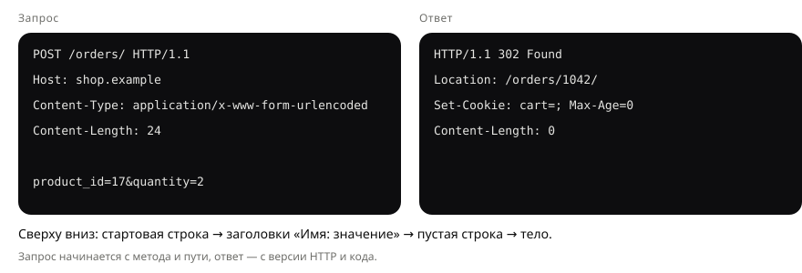

## Теория
HTTP — **текстовый** протокол. Запрос и ответ — обычный текст из строк, который можно прочитать глазами. Оба устроены одинаково. Сначала **стартовая строка**: у запроса — метод, путь и версия (`POST /orders/ HTTP/1.1`), у ответа — версия, код и пояснение (`HTTP/1.1 302 Found`). Дальше **заголовки** — по одному на строку, в виде `Имя: значение`. Потом **пустая строка** — знак «заголовки кончились». И последним идёт **тело**, если оно есть.

Заголовки — метаданные: кому запрос (`Host`), что в теле (`Content-Type`), сколько в нём байт (`Content-Length`), куда идти дальше (`Location`). Тело — сами данные: HTML страницы в ответе, поля формы или JSON в запросе. Django разбирает этот текст за вас: заголовки попадают в `request.headers`, поля формы — в `request.POST`. Но понимать, что пришло «по проводу», нужно, чтобы искать ошибки.

## Наглядно
**Рисунок 1.** Запрос на создание заказа и ответ сервера. Пустая строка отделяет заголовки от тела; у ответа-редиректа тела нет.



**Таблица 1.** Заголовки, которые встретятся в первую очередь.

| Заголовок | Где | Что значит |
|---|---|---|
| `Host` | запрос | домен сайта; обязателен: на одном IP живут много сайтов |
| `Content-Type` | оба | формат тела: `text/html`, `application/json`, `application/x-www-form-urlencoded` |
| `Content-Length` | оба | длина тела в байтах |
| `Location` | ответ 3xx | куда перейти дальше |
| `Cookie` / `Set-Cookie` | запрос / ответ | данные, которые браузер хранит и присылает обратно |
| `User-Agent` | запрос | какой программой отправлен запрос |
| `Accept` | запрос | какие форматы ответа клиент понимает |

## На практике
Задача: прочитать «сырой» запрос на оформление заказа и понять, что из него достанет сервер.

### Шаг 1. Смотрим на запрос как на текст
Покупатель нажал «Оформить» на карточке товара. Браузер отправил такой текст:
```http
POST /orders/ HTTP/1.1
Host: shop.example
Content-Type: application/x-www-form-urlencoded
Content-Length: 24

product_id=17&quantity=2
```
Метод `POST` — отправляем данные. Путь `/orders/` — куда. Тело — поля формы в том же формате, что query-параметры. Об этом говорит `Content-Type`.

### Шаг 2. Разбираем текст на части
Строки HTTP разделяются парой символов `\r\n`, а заголовки от тела — пустой строкой, то есть `\r\n\r\n`. Разберём запрос так, как это делает сервер:
```python
raw = (
    "POST /orders/ HTTP/1.1\r\n"
    "Host: shop.example\r\n"
    "Content-Type: application/x-www-form-urlencoded\r\n"
    "Content-Length: 24\r\n"
    "\r\n"
    "product_id=17&quantity=2"
)
head, body = raw.split("\r\n\r\n", 1)
start_line, *header_lines = head.split("\r\n")
headers = dict(line.split(": ", 1) for line in header_lines)
print(start_line.split())
print(headers["Content-Type"])
print(len(body.encode()), body)
```
Результат:
```
['POST', '/orders/', 'HTTP/1.1']
application/x-www-form-urlencoded
24 product_id=17&quantity=2
```
Длина тела в байтах совпала с `Content-Length`. По этому числу сервер понимает, где кончается тело.

### Шаг 3. Читаем ответ
Заказ создан. Сервер отвечает не страницей, а указанием «иди сюда»:
```http
HTTP/1.1 302 Found
Location: /orders/1042/
Content-Length: 0
```
Тела нет, а заголовок `Location` говорит браузеру, какую страницу открыть следующей. Браузер сам сделает новый запрос `GET /orders/1042/`. Почему так делают после POST — в теме «Методы и коды ответа».

### Шаг 4. Смотрим, как то же отправить JSON
Мобильное приложение магазина шлёт заказ не формой, а JSON. Меняется тело и `Content-Type`:
```http
POST /api/orders/ HTTP/1.1
Host: shop.example
Content-Type: application/json
Content-Length: 33

{"product_id": 17, "quantity": 2}
```
Сервер смотрит на `Content-Type` и понимает, как читать тело. В Django поля формы из первого запроса окажутся в `request.POST`. JSON туда не попадёт: его читают из `request.body`. API подробно разберём в курсе «Веб и API».

## Частые ошибки
- **Нет пустой строки.** Без неё сервер считает тело продолжением заголовков. Когда пишете HTTP вручную (в тестах, в `curl`), пустая строка между заголовками и телом обязательна.
- **`Content-Type` не совпадает с телом.** Отправили JSON с `application/x-www-form-urlencoded` — сервер не разберёт тело как JSON, и `request.POST` окажется пустым или странным.
- **Длина в символах вместо байт.** `Content-Length` считается в байтах: «кофе» — 4 символа, но 8 байт в UTF-8.
- **Редирект без `Location`.** Ответ 302 без `Location` — браузеру некуда идти. Django ставит заголовок сам, если отвечать через `redirect()`.
- **Регистр имён заголовков.** `Content-Type` и `content-type` — один заголовок: имена нечувствительны к регистру. Значения — чувствительны.

## Итог
**Устройство сообщения**
- Стартовая строка → заголовки `Имя: значение` → пустая строка → тело.
- Стартовая строка запроса: `МЕТОД путь HTTP/1.1`; ответа: `HTTP/1.1 код пояснение`.
- Строки разделяются `\r\n`, заголовки от тела — `\r\n\r\n`.

**Заголовки**
- `Host` — какой сайт; обязателен в каждом запросе.
- `Content-Type` — формат тела, `Content-Length` — его размер в байтах.
- `Location` — куда перейти после ответа 3xx.

**Тело**
- В ответе — HTML страницы, JSON или ничего (у редиректа).
- В запросе — данные формы (`a=1&b=2`) или JSON; у GET тела обычно нет.

## Вопросы на собеседовании
<details><summary>Из чего состоит HTTP-запрос?</summary>

Из стартовой строки (метод, путь с query, версия протокола), заголовков в формате `Имя: значение`, пустой строки и необязательного тела. В HTTP/1.1 обязателен заголовок `Host`. Он нужен, потому что на одном IP-адресе может работать много сайтов.
</details>

<details><summary>Зачем нужен заголовок `Content-Type`?</summary>

Он говорит получателю, в каком формате тело и как его разбирать: HTML, JSON, поля формы, файл. Без него или с неверным значением сервер не поймёт данные. Например, Django заполняет `request.POST` только для форм (`application/x-www-form-urlencoded` и `multipart/form-data`).
</details>

<details><summary>Как сервер понимает, где кончается тело запроса?</summary>

По заголовку `Content-Length` — число байт тела после пустой строки. Если длина заранее неизвестна, тело передают частями (`Transfer-Encoding: chunked`), и каждая часть начинается со своей длины.
</details>

<details><summary>Чем HTTP/1.1 отличается от HTTP/2 для backend-разработчика?</summary>

Смысл сообщений тот же: методы, коды, заголовки, тело. HTTP/2 передаёт их в бинарном виде и умеет вести много запросов в одном соединении параллельно. Обычно этим занимается веб-сервер (Nginx), а Django видит те же запросы, что и с HTTP/1.1.
</details>
