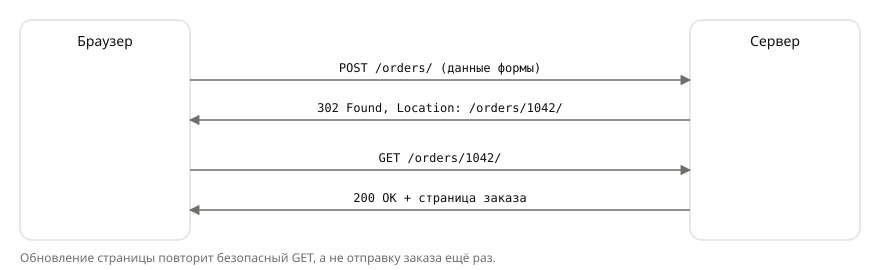

## Теория
**Метод** в начале запроса говорит серверу, что клиент хочет сделать. Для сайта главных два. **GET** — «покажи»: открыть каталог, карточку, найти товар. Он ничего не меняет, поэтому его можно повторять, кэшировать и сохранять в закладки, а параметры передаются в URL. **POST** — «прими данные и сделай»: оформить заказ, оставить отзыв, войти. Он меняет данные на сервере, а данные идут в теле запроса. Остальные методы — `PUT`, `PATCH`, `DELETE`, `HEAD`, `OPTIONS` — встретятся в курсе «Веб и API».

**Код ответа** — трёхзначное число в стартовой строке ответа: как всё прошло. Первая цифра задаёт класс. 2xx — успех. 3xx — иди по другому адресу. 4xx — ошибка клиента: запросил то, чего нет или нельзя. 5xx — ошибка сервера: упал наш код. По коду браузер решает, что делать: показать страницу, перейти по `Location`, показать ошибку. По кодам же вы будете искать проблемы в логах.

## Наглядно
**Таблица 1.** Классы кодов и коды, которые нужно знать наизусть.

| Код | Название | Когда магазин его возвращает |
|---|---|---|
| 200 | OK | страница каталога, карточка товара |
| 201 | Created | API создал заказ (для форм обычно редирект) |
| 301 | Moved Permanently | старый адрес `/shop/` навсегда переехал на `/catalog/` |
| 302 | Found | временный переход: после оформления заказа, на страницу входа |
| 304 | Not Modified | браузер уже хранит свежую копию файла — тело не нужно |
| 400 | Bad Request | запрос нельзя разобрать: битые данные формы, `?page=abc` |
| 401 | Unauthorized | нужно войти (чаще в API) |
| 403 | Forbidden | вошёл, но нельзя: покупатель открыл админку |
| 404 | Not Found | товара `/products/999/` нет |
| 405 | Method Not Allowed | GET туда, где ждут только POST |
| 500 | Internal Server Error | исключение в коде view |
| 502 / 504 | Bad Gateway / Gateway Timeout | Nginx не достучался до Django или не дождался ответа |

**Таблица 2.** GET и POST.

| | GET | POST |
|---|---|---|
| Смысл | получить | отправить и изменить |
| Данные | в URL (query) | в теле |
| Повтор (F5) | безопасен | создаст второй заказ |
| Закладки, история, кэш | да | нет |
| Пример | поиск, фильтр каталога | заказ, отзыв, вход |

## На практике
Задача: решить, каким методом отправлять форму отзыва, что отвечать после её сохранения и какой код вернуть, если товара нет.

### Шаг 1. Выбираем метод для поиска
Поиск по каталогу ничего не меняет. Его результат удобно отправить другу ссылкой, значит — GET с параметрами в URL:
```http
GET /search/?q=%D1%87%D0%B0%D0%B9%D0%BD%D0%B8%D0%BA HTTP/1.1
Host: shop.example
```

### Шаг 2. Выбираем метод для отзыва
Отзыв создаёт запись в базе, а текст может быть длинным. Значит — POST, данные в теле:
```http
POST /products/17/reviews/ HTTP/1.1
Host: shop.example
Content-Type: application/x-www-form-urlencoded

rating=5&text=%D0%9E%D1%82%D0%BB%D0%B8%D1%87%D0%BD%D0%BE
```
Если бы отзыв уходил через GET, он появлялся бы снова при каждом открытии ссылки из истории. А поисковые роботы, переходящие по ссылкам, оставляли бы отзывы сами.

### Шаг 3. Отвечаем редиректом после POST
Если в ответ на POST сразу вернуть страницу «Спасибо», браузер запомнит именно POST. Обновление страницы (F5) отправит отзыв второй раз — браузер даже спросит «Отправить форму повторно?». Поэтому после успешного POST отвечают **редиректом** (рисунок 1):
```http
HTTP/1.1 302 Found
Location: /products/17/#reviews
```
Браузер сам сделает GET на карточку товара. Обновление страницы теперь повторит безопасный GET. Этот приём называется **POST → redirect → GET** (PRG), в Django его пишут через `redirect()`.

**Рисунок 1.** После успешного POST сервер отвечает 302, браузер сам запрашивает новую страницу через GET.



### Шаг 4. Выбираем код для «товара нет»
Покупатель открыл `/products/999/`, а товара с таким номером нет. Это ошибка в запросе, а не в нашем коде — значит, 4xx, точнее **404**:
```http
HTTP/1.1 404 Not Found
Content-Type: text/html; charset=utf-8
```
Ответ 200 со страницей «товар не найден» обманул бы поисковики и мониторинг: для них страница существует. А 500 означало бы, что сломался сервер, хотя он отработал правильно.

## Частые ошибки
- **GET, который меняет данные.** Ссылка `/cart/clear/` очищает корзину по GET — её откроет предзагрузка браузера или робот. Изменения — только POST (или другие методы API).
- **Страница вместо редиректа после POST.** F5 повторяет отправку: двойной заказ, двойной отзыв. После успешного POST — редирект.
- **200 на ошибку.** «Не найдено» с кодом 200 — для программ это успех. Код должен соответствовать смыслу.
- **500 на плохой ввод.** `?page=abc` уронил view `ValueError` — пользователь видит «ошибку сервера». Неверный ввод — это 400 или 404, его нужно обработать в коде.
- **301 вместо 302.** Браузер запоминает 301 надолго. Временный переход, отданный как 301, будет срабатывать у пользователей даже после того, как вы его уберёте.

## Итог
**Методы**
- GET — получить: без изменений, параметры в URL, можно повторять и сохранять.
- POST — отправить и изменить: данные в теле, повтор опасен.
- После успешного POST — редирект на GET (PRG), чтобы F5 не повторил отправку.

**Коды**
- 2xx — успех (200), 3xx — иди по `Location` (301 — навсегда, 302 — временно).
- 4xx — ошибка клиента: 400 — плохой запрос, 403 — нельзя, 404 — нет такого, 405 — не тот метод.
- 5xx — ошибка сервера: 500 — исключение в коде, 502/504 — проблемы между Nginx и Django.

**Правило выбора кода**
- Код отвечает на вопрос «чья ошибка»: запросили несуществующее — 404, упал наш код — 500.

## Вопросы на собеседовании
<details><summary>Чем GET отличается от POST?</summary>

GET запрашивает данные и не должен ничего менять: параметры идут в URL, запрос можно кэшировать, повторять и сохранять в закладки. POST отправляет данные на обработку и меняет состояние сервера: данные идут в теле, повтор может создать дубль. В GET тоже можно передать «секрет», но он останется в истории и логах — поэтому пароли и формы с изменениями отправляют через POST.
</details>

<details><summary>Что такое идемпотентность? Какие методы идемпотентны?</summary>

Запрос идемпотентен, если повтор даёт тот же результат на сервере, что и один вызов. GET, HEAD, PUT и DELETE идемпотентны: удалить заказ дважды — он всё равно удалён. POST — нет: два POST создадут два заказа. GET вдобавок «безопасен» — он вообще ничего не меняет.
</details>

<details><summary>Чем 401 отличается от 403?</summary>

401 Unauthorized — сервер не знает, кто вы: нужно войти или передать токен. 403 Forbidden — сервер знает, кто вы, но этому пользователю действие запрещено. Иногда вместо 403 отвечают 404, чтобы не раскрывать, что ресурс существует: например, на чужой заказ.
</details>

<details><summary>Что такое паттерн PRG и зачем он нужен?</summary>

Post/Redirect/Get: после успешной обработки POST сервер отвечает редиректом (302 или 303), и браузер загружает результат через GET. Так обновление страницы и кнопка «назад» не отправляют форму повторно. В Django это `return redirect(...)` после сохранения формы.
</details>

<details><summary>Чем 502 отличается от 504?</summary>

Оба возвращает прокси (Nginx), а не само приложение. 502 Bad Gateway — Nginx не получил корректного ответа: Django не запущен или упал во время ответа. 504 Gateway Timeout — Django не ответил вовремя: запрос слишком долгий или зависший.
</details>
