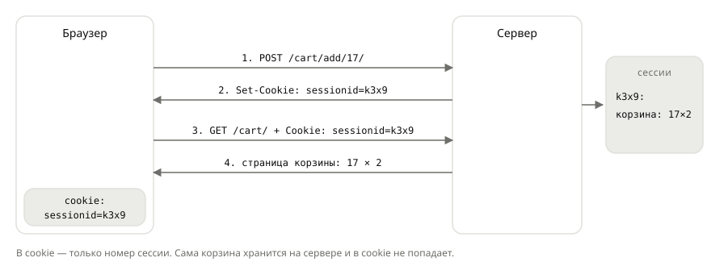

## Теория
HTTP **не хранит состояние**. Каждый запрос сервер видит как первый: он не помнит, что этот же браузер минуту назад положил чайник в корзину. Чтобы «узнавать» покупателя, придумали **cookies**. Сервер в ответе присылает заголовок `Set-Cookie: имя=значение`. Браузер сохраняет эту пару для домена и дальше сам добавляет её в каждый запрос к этому сайту — заголовком `Cookie`.

Хранить в cookie сами данные — корзину, скидку, роль — опасно. Cookie лежит у покупателя, и он может переписать её как угодно. Поэтому используют **сессию**: данные хранятся на сервере (в базе или кэше), а в cookie лежит только случайный номер сессии — `sessionid=k3x9…`. Номер ничего не говорит сам по себе, а подобрать чужой практически невозможно. Так в Django работают вход в аккаунт и корзина гостя.

## Наглядно
**Рисунок 1.** Сервер выдаёт номер сессии, браузер возвращает его с каждым запросом, а корзина хранится на сервере под этим номером.



**Таблица 1.** Атрибуты `Set-Cookie`, которые важны backend-разработчику.

| Атрибут | Пример | Что делает |
|---|---|---|
| `Max-Age` / `Expires` | `Max-Age=1209600` | сколько хранить (здесь 2 недели); без них — до закрытия браузера |
| `Path` | `Path=/` | для каких путей сайта отправлять |
| `HttpOnly` | `HttpOnly` | JavaScript на странице не прочитает cookie — защита от кражи сессии |
| `Secure` | `Secure` | отправлять только по HTTPS |
| `SameSite` | `SameSite=Lax` | не отправлять с запросами, которые начал чужой сайт (защита от CSRF, тема в разделе «Формы») |

## На практике
Задача: понять, как магазин «помнит» корзину гостя, который не входил в аккаунт.

### Шаг 1. Гость кладёт товар в корзину
Первый POST от этого браузера — никаких cookies у него ещё нет:
```http
POST /cart/add/17/ HTTP/1.1
Host: shop.example
```
Django создаёт новую сессию и сохраняет в неё корзину: товар 17, две штуки.

### Шаг 2. Сервер выдаёт cookie
В ответ уходит номер сессии:
```http
HTTP/1.1 302 Found
Location: /cart/
Set-Cookie: sessionid=k3x9pq; expires=Tue, 01 Dec 2026 10:00:00 GMT; HttpOnly; Path=/; SameSite=Lax
```
Браузер сохранил `sessionid=k3x9pq` для `shop.example`. Атрибуты после `;` — правила хранения, обратно на сервер они не уходят.

### Шаг 3. Браузер возвращает cookie
Каждый следующий запрос к магазину несёт номер сессии:
```http
GET /cart/ HTTP/1.1
Host: shop.example
Cookie: sessionid=k3x9pq
```
Django находит сессию `k3x9pq` в своём хранилище и достаёт оттуда корзину. Покупателю кажется, что сайт его помнит. На деле сервер каждый раз заново находит его данные по номеру.

### Шаг 4. Разбираем заголовок Cookie
В заголовке может быть несколько cookies через `; ` — сервер раскладывает их по именам. Посмотрим, как это делает стандартная библиотека Python:
```python
from http.cookies import SimpleCookie

cookie = SimpleCookie()
cookie.load("sessionid=k3x9pq; theme=dark")
print({name: morsel.value for name, morsel in cookie.items()})
```
Результат:
```
{'sessionid': 'k3x9pq', 'theme': 'dark'}
```
В Django это готовый словарь `request.COOKIES`. Сессией же пользуются через `request.session` как обычным словарём: `request.session["cart"] = {...}`.

## Частые ошибки
- **Данные в cookie вместо сессии.** `discount=10` или `is_admin=1` в cookie покупатель исправит на `discount=90`. В cookie — только номер сессии, а данные и права — на сервере.
- **Cookie без `HttpOnly`.** Если на страницу попадёт чужой скрипт (XSS, тема в разделе «HTML»), он прочитает cookie сессии и войдёт от имени покупателя. Django ставит `HttpOnly` на `sessionid` сам.
- **Ждать, что cookie прочитается в том же ответе.** `Set-Cookie` сохраняется браузером. Вернётся она только со следующим запросом.
- **Большие cookies.** Они уходят с каждым запросом, даже за картинками. Браузер хранит не больше ~4 КБ на cookie — большим данным место в сессии на сервере.

## Итог
**Cookies**
- HTTP не помнит прошлые запросы: каждый запрос — как первый.
- Сервер ставит cookie заголовком `Set-Cookie`, браузер возвращает её заголовком `Cookie` в каждом запросе к сайту.
- Атрибуты: `Max-Age` — срок, `HttpOnly` — не для JS, `Secure` — только HTTPS, `SameSite` — не с чужих сайтов.

**Сессии**
- В cookie — только случайный номер сессии, данные хранятся на сервере.
- Django: `request.COOKIES` — все cookies, `request.session` — данные сессии как словарь.

**Безопасность**
- Всё, что лежит в cookie, покупатель может прочитать и изменить.
- Украденный номер сессии = вход в аккаунт. Поэтому `HttpOnly`, `Secure` и HTTPS.

## Вопросы на собеседовании
<details><summary>Что значит «HTTP — протокол без состояния»?</summary>

Сервер не связывает запросы между собой: каждый обрабатывается независимо, без памяти о предыдущих. Состояние (вход, корзину) добавляют поверх: клиент с каждым запросом присылает идентификатор — cookie сессии или токен. По нему сервер находит сохранённые данные.
</details>

<details><summary>Чем cookie отличается от сессии?</summary>

Cookie — маленькая пара «имя=значение», которую хранит браузер и присылает с запросами. Сессия — данные на сервере, привязанные к пользователю. Обычно cookie хранит только ключ сессии, а всё важное лежит на сервере, где пользователь не может это подделать.
</details>

<details><summary>Зачем флаги `HttpOnly`, `Secure` и `SameSite`?</summary>

`HttpOnly` запрещает JavaScript читать cookie — украсть сессию через XSS не выйдет. `Secure` отправляет cookie только по HTTPS: её не перехватят в открытой сети. `SameSite` не даёт браузеру прикладывать cookie к запросам, начатым с чужого сайта, — это защита от CSRF.
</details>

<details><summary>Где Django хранит сессии?</summary>

По умолчанию — в таблице базы данных `django_session`: ключ, сериализованные данные, срок действия. Можно хранить в кэше (Redis), в файлах или в подписанной cookie. Последний вариант не скрывает данные от пользователя — подпись только защищает их от подделки.
</details>
