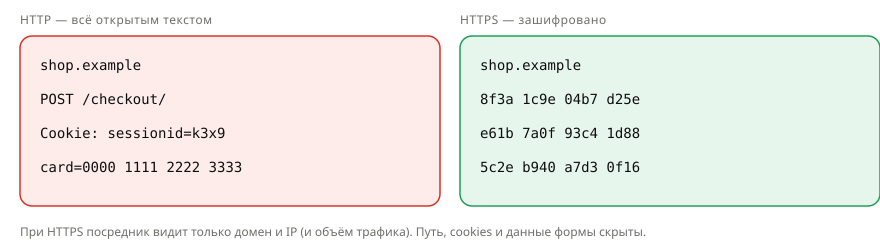

## Теория
Запрос от покупателя до сервера идёт через десятки чужих устройств: Wi-Fi в кафе, роутеры провайдеров, узлы между городами. По обычному **HTTP** всё идёт открытым текстом. Любое из этих устройств может прочитать пароль, номер карты и cookie сессии, а может и подменить ответ: вставить рекламу или изменить реквизиты оплаты. **HTTPS** — тот же HTTP, но внутри зашифрованного канала **TLS**. Методы, заголовки и коды те же, меняется только «труба».

HTTPS решает три задачи. **Шифрование** — посредник видит только мусор. **Целостность** — подменённые данные не пройдут проверку. **Подлинность** — сервер показывает **сертификат**, подписанный центром сертификации, и браузер проверяет, что сертификат выдан именно на `shop.example`. Замок в адресной строке значит «соединение защищено и это действительно `shop.example`». Он не значит «сайт честный»: сертификат бесплатно получит и мошенник на свой домен.

## Наглядно
**Рисунок 1.** Один и тот же запрос оформления заказа глазами посредника в сети.



**Таблица 1.** Что защищает HTTPS, а что нет.

| Видит ли посредник | HTTP | HTTPS |
|---|---|---|
| IP сервера и домен | да | да |
| путь и query (`/orders/?id=1042`) | да | нет |
| заголовки, cookies | да | нет |
| тело: пароль, данные карты | да | нет |
| может ли подменить ответ | да | нет — браузер заметит |

## На практике
Задача: понять, почему форма оплаты без HTTPS недопустима, и что нужно магазину, чтобы работать по HTTPS.

### Шаг 1. Смотрим, что уходит по HTTP
Покупатель в кафе оплачивает заказ. По HTTP в сеть кафе уходит:
```http
POST /checkout/ HTTP/1.1
Host: shop.example
Cookie: sessionid=k3x9pq

card=0000111122223333&cvc=123
```
Хозяин точки доступа видит номер карты, а с `sessionid` может войти в аккаунт покупателя. Поэтому браузеры помечают HTTP-страницы с формами как «Не защищено».

### Шаг 2. Получаем сертификат
Серверу нужен сертификат на домен. Бесплатно и автоматически его выдаёт **Let's Encrypt**: программа `certbot` доказывает, что вы управляете `shop.example`, и получает сертификат на 90 дней с автопродлением. Сертификат и ключ подключаются в Nginx — это курс «Nginx и деплой».

### Шаг 3. Переводим всех на HTTPS
Покупатель может набрать адрес без `https://`. Сервер на порту 80 отвечает только одним — редиректом:
```http
HTTP/1.1 301 Moved Permanently
Location: https://shop.example/
```
Дальше включают **HSTS** — заголовок `Strict-Transport-Security`. Получив его, браузер даже не пытается открыть сайт по HTTP.

### Шаг 4. Защищаем cookies и ресурсы
Cookie сессии получает атрибут `Secure`, чтобы браузер никогда не отправил её по HTTP. Все ресурсы страницы — стили, картинки, скрипты — тоже грузятся по `https://`. HTTPS-страница со скриптом по `http://` называется **mixed content**, и такой скрипт браузер заблокирует.

## Частые ошибки
- **«HTTPS нужен только на странице оплаты».** Cookie сессии уходит с каждым запросом. Если хоть одна страница открыта по HTTP, сессию можно перехватить — HTTPS нужен на всём сайте.
- **«Замок — значит, сайт безопасный».** Замок подтверждает только защищённое соединение с этим доменом. Фишинговый `shop-example-pay.ru` тоже получит сертификат.
- **Mixed content.** `<script src="http://…">` на HTTPS-странице браузер блокирует, картинки помечает. Ссылки на ресурсы — с `https://` или относительные.
- **Просроченный сертификат.** Браузер покажет полноэкранное предупреждение, и покупатели уйдут. Автопродление сертификата — обязательная часть деплоя.

## Итог
**Зачем HTTPS**
- HTTP идёт открытым текстом: посредник читает пароли, карты, cookies и может подменить ответ.
- HTTPS = HTTP внутри TLS: шифрование, целостность и проверка подлинности сервера.
- Посредник при HTTPS видит только IP и домен.

**Сертификат**
- Подтверждает, что сервер — действительно `shop.example`; выдаётся центром сертификации (Let's Encrypt — бесплатно, на 90 дней).
- Замок — защищённое соединение с этим доменом, а не гарантия честности сайта.

**Как включить на сайте**
- Порт 443 с сертификатом. Порт 80 — только `301` на `https://`, плюс HSTS.
- Cookie сессии — `Secure`, все ресурсы — по HTTPS.

## Вопросы на собеседовании
<details><summary>Чем HTTPS отличается от HTTP?</summary>

HTTPS — это HTTP поверх TLS. Сообщения те же, но передаются по зашифрованному каналу. Сервер при подключении предъявляет сертификат. Браузер проверяет, что сертификат подписан доверенным центром, выдан на этот домен и не истёк. Стандартный порт — 443 вместо 80.
</details>

<details><summary>Что защищает HTTPS и что — нет?</summary>

Защищает содержимое (путь, заголовки, cookies, тело) от чтения и подмены в сети и подтверждает подлинность домена. Не скрывает IP и домен, к которому вы подключаетесь. Не защищает от уязвимостей самого сайта (SQL-инъекции, XSS) и от фишинговых доменов с собственными сертификатами.
</details>

<details><summary>Что такое сертификат и кто его выдаёт?</summary>

Сертификат — открытый ключ сервера плюс данные о домене, подписанные центром сертификации (CA). Браузеры заранее доверяют списку CA. Если сертификат подписан одним из них и выдан на открытый домен, соединение считается подлинным. Let's Encrypt выдаёт сертификаты бесплатно, проверяя, что вы управляете доменом.
</details>

<details><summary>Что такое HSTS?</summary>

Заголовок `Strict-Transport-Security`. Он говорит браузеру: «этот домен — только по HTTPS в течение указанного времени». Браузер сам переписывает `http://` на `https://` ещё до запроса, поэтому первый незащищённый запрос не уходит в сеть и его нельзя перехватить.
</details>
